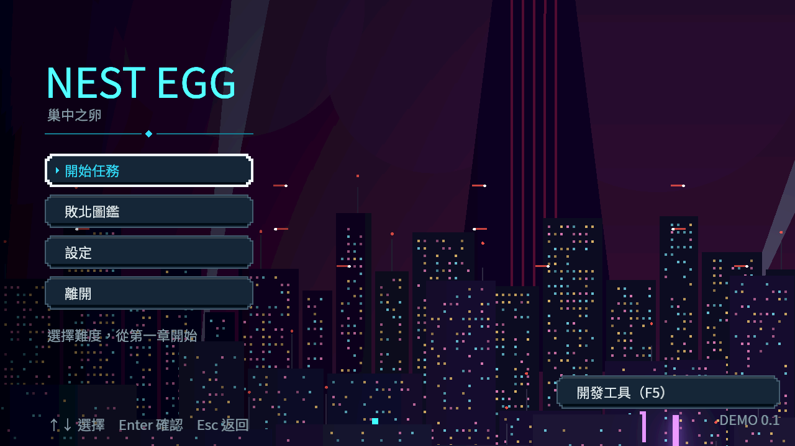
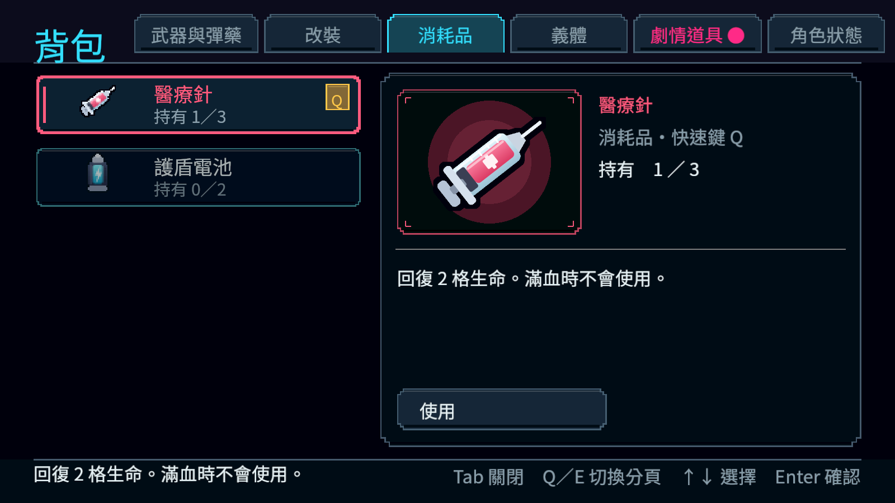
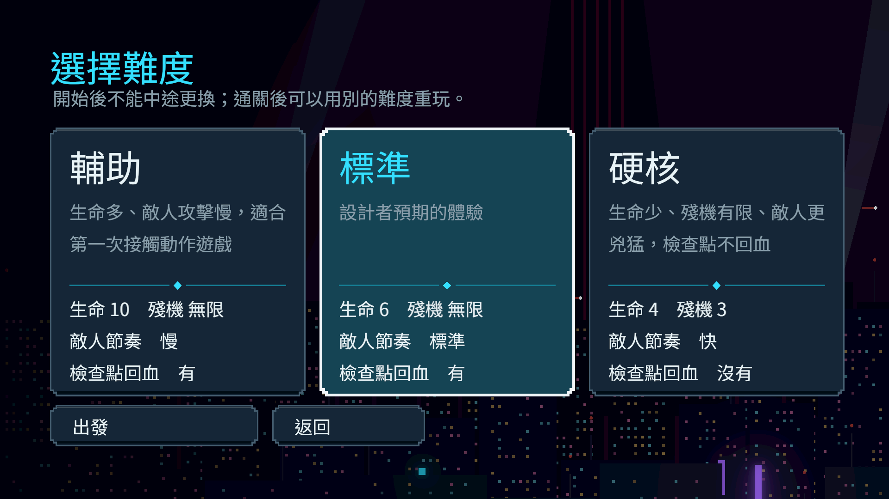
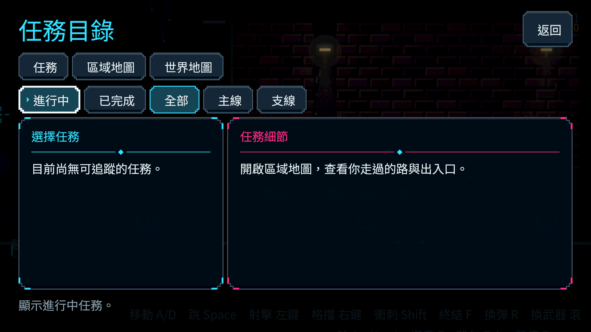
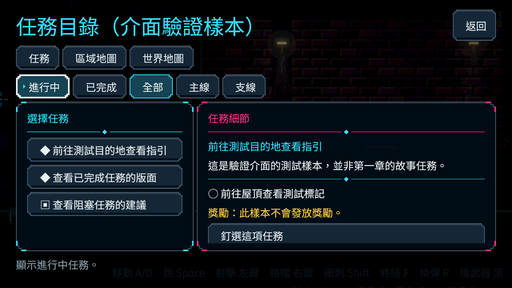
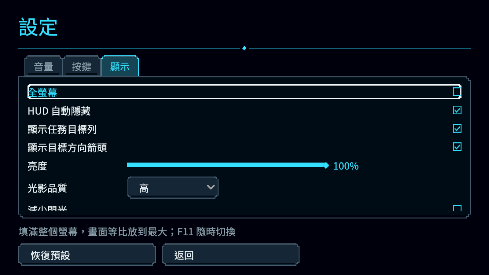

# [NE-227] 建立高清像素介面視覺

> 狀態：完成

## 內文

### 需求
重設共用高清像素視覺，使用清楚面板、圖示與細節取代目前過於簡陋的細線表現，同時保持遊戲風格與閱讀優先序。

### 來源
2026-10-10，使用者要求逐章完成與累積發行、高清像素UI、全流程手把、豐富合理敘事與動畫、場景減雜，並追加武器差異、子彈、方向護盾、可選連段升級與打擊感總驗收；一般設計選擇由實作者決定，持續推進。

詳見[整體設計](../../design/20-campaign-experience/DESIGN.md)與[研究依據](../../design/20-campaign-experience/RESEARCH.md)。

### 驗收條件
- [x] 主選單、背包、任務三種代表畫面有完整實際面板、像素圖示與層級，未用概念圖代替遊戲畫面。
- [x] 正常、聚焦、按下與停用狀態可辨，文字與焦點不依賴微弱光暈或單一顏色。
- [x] 像素圖形密度一致，720p、1080p及非整數縮放文字可讀、圖示不失真或錯位。
- [x] 亮暗背景、文字放大与減少動態均可讀，裝飾不蓋內容。
- [x] 沿用現有功能与導覽，新增風格可一致套用全部頁面。

### 測試流程
1. 檢視三種實際代表畫面、各控制狀態與鍵鼠／手把焦點。
2. 切換解析度、亮暗背景、文字大小和動效選項，保存對照截圖。

---

# 跟其他票的關係

- Blocks：NE-228
- Blocked by：無
- Related：NE-35、NE-215、NE-223

---

# Commit-1

## 內文

介面原本以細線、透明底與掃描紋為主，背景細節會干擾背包及設定閱讀，放大文字時難度卡片底部也會裁切。

現在主選單、背包、任務與設定沿用同一組實心深藍面板、階梯像素轉角及低亮內緣；焦點有獨立白框，停用按鈕有虛線及暗色文字。背包取消滿屏雨點與網格，保留物件圖及操作提示。新增100%／120%介面文字與減少介面動態設定，切頁時焦點和底部說明跟隨可見內容，難度卡片完整顯示資訊。

已通讀差異並檢視原生720p、900p與1080p畫面，覆蓋明暗、放大文字與減少動態。正式任務目錄與樣本畫面分別保存；樣本只證明介面呈現，不計為正式任務。共用風格可套用現有頁面，全頁動線與HUD接續由NE-228驗收。

### 測試結果

| 項目 | 結果 |
|---|---|
| 受影響範圍 | 70群、51,415 checks，0新失敗、0已知失敗，566秒 |
| 同步最新main後交集 | 5群、5,218 checks，0新失敗、0已知失敗，21秒 |
| 介面狀態、像素形狀與輔助設定 | 包含焦點、微小面板、文字更新、損毀設定與減少動態回歸 |
| 原生Forward+ | Arc B580，18張實際畫面；三份版面報告均0溢出，捲動內容可由焦點帶入 |
| 執行輸出 | 無SCRIPT ERROR；既有預期容錯與退出資源診斷按原規則判定，未修改過濾或已知失敗清單 |

### 截圖

---
