# [NE-228] 重整全遊戲介面體驗

> 狀態：進行中

## 內文

### 需求
以共用高清像素視覺重新設計所有主要畫面的資訊層級、操作、提示與適量動畫，保持一致且完整的使用體驗。

### 來源
2026-10-10，使用者要求逐章完成與累積發行、高清像素UI、全流程手把、豐富合理敘事與動畫、場景減雜，並追加武器差異、子彈、方向護盾、可選連段升級與打擊感總驗收；一般設計選擇由實作者決定，持續推進。

詳見[整體設計](../../design/20-campaign-experience/DESIGN.md)與[研究依據](../../design/20-campaign-experience/RESEARCH.md)。

本階段操作提示的閱讀與版面規則見[遊戲操作提示](../../design/20-campaign-experience/HUD_GUIDANCE.md)。

2026-10-10，使用者檢視實際六項操作提示截圖，要求更融入遊戲並重整對話框風格；情境教學、人物交談與通訊的驗收補入本票。對話方向見[對話介面](../../design/20-campaign-experience/DIALOGUE_GUIDANCE.md)。

### 驗收條件
- [ ] 主選單、暫停、設定、背包、商店／改裝、任務／地圖、HUD、對話、死亡與結算全部完成迁移。
- [x] 確認、返回、分頁與取消一致，關閉子頁恢復原焦點，不出現操作死角或穿透模態頁面。
- [ ] 功能引導与聚焦／Hover說明一句講重點，關鍵條件、價格與效果能直接看懂。
- [ ] 動畫與特效提供狀態回饋但不延遲輸入、不蓋戰鬥威脅或字幕；減少動態仍清楚。
- [ ] 720p、1080p、不同寬高比與文字放大不截字或重疊，無占位頁面或臨時簡陋圖示。
- [ ] 鍵鼠、手把及切換裝置能完成全部頁面流程，任務與物品顯示正式內容。
- [x] 遊戲內提示依實際情境顯示當下必要動作，離開、過場與選單時收起；完整操作仍可查閱，不在每次入區重播整份按鍵表。
- [x] 序章練習提示配合實際命中、格擋、移動與互動，不因按下按鍵就宣稱完成教學。
- [ ] 人物對話、無線電與物件閱讀有一致像素材質及清楚身份；文字、角色與威脅可讀，告示不被當成人物交談。

- [x] 通訊、人物交談與暫停選單出現時，背景介面的 Hover／聚焦說明不蓋住讲者、正文、標題或操作；已顯示和等待出現的說明都正确收起，返回後可再次使用。

### 測試流程
1. 按主要流程逐頁操作新遊戲、設定、背包、購買、任務、死亡與結算。
2. 檢查返回與焦點、短說明、不同解析度和減動態，保存代表畫面。
3. 進入與退出實際教學／互動範圍，切換装置及改鍵；核對提示與真正可操作的動作一致。
4. 檢視人物交談、無線電、物件閱讀及電影黑邊過渡，確認長句、放大文字、推進與取消完整可用。

---

# Commit-1

## 內文

原本遊戲下方堆疊完整操作文字，文字放大時容易超過閱讀區。現在基本操作使用兩行實心像素面板，寬度隨內容調整，與武器欄分開；完整按鍵表可從暫停頁查閱。改鍵與切換裝置會同步提示，演出期間不消耗閱讀時間，減少動態時直接收起。

### 測試結果

| 項目 | 結果 |
|---|---|
| 受影響範圍 | 12 組、2,428 檢查；0 新失敗、0 已知失敗，402 秒 |
| 原生 Forward+ 畫面與版面 | 1280×720、1920×1080、2560×1080，各26檢查通過，共78項 |
| 文字放大 | 100%／120% 文字不截字、面板不壓住武器欄 |
| 裝置與改鍵 | 合成手把提示、鍵鼠接管、跳躍改鍵、完整操作表保留通過 |
| 演出與減少動態 | 鎖定時隱藏並保留閱讀時間；解鎖恢復、淡出及直接收起通過 |
| 執行紀錄 | 0 SCRIPT ERROR、0 出口資源警告；局部測試保留故障注入與既有原生物理診斷 |

畫面取自受控第一章街道，只有取景副本停用演出觸發；手把項目為合成輸入驗證。原始[局部結果](attachments/NE-228-hud/changed-console.log)、[測試紀錄](attachments/NE-228-hud/changed-shard-0.log)、[720p量測](attachments/NE-228-hud/NE-228-hud-1280.json)、[1080p量測](attachments/NE-228-hud/NE-228-hud-1920.json)及[超寬量測](attachments/NE-228-hud/NE-228-hud-2560.json)保留供核對。

### 截圖

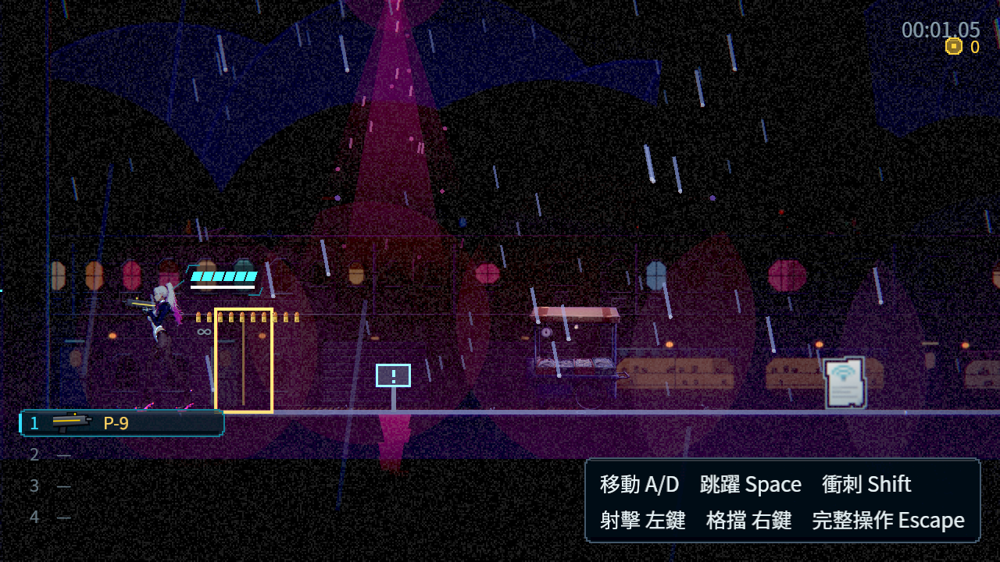
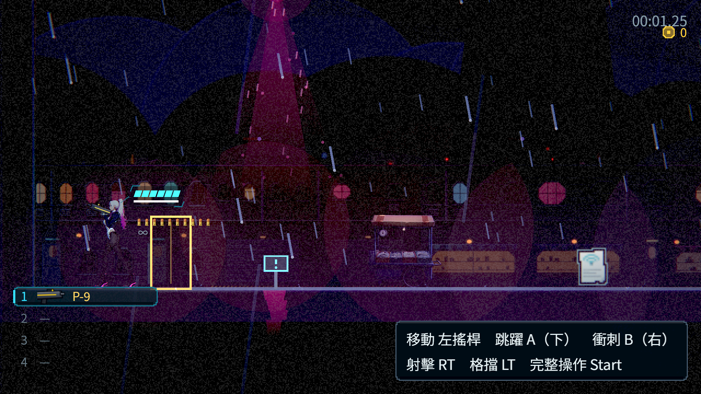

---

# Commit-2

## 內文

常駐六项操作說明容易像外加工具面板，也會與人物、字幕及其他提示競爭。現在新遊戲只短暫顯示查閱操作的入口，完整操作保留於暫停頁；同區提示收起時保留閱讀時間，改鍵與裝置切換會更新文字。

人物交談使用像素切角、頭像與姓名標籤；通訊使用窄卡，文件以物件名稱與紙灰色框辨識。閱讀期間收起競爭的世界短句與操作邀請，暫停會保留同一句通訊、氣泡及章節卡的閱讀時間。站立、蹲姿與左右朝向的實際角色及血條不被提示框或文字蓋住。

### 測試結果

| 項目 | 結果 |
|---|---|
| 受影響範圍 | 原始選取流程 60 組、54,481 檢查；0 新失敗、0 已知失敗，908 秒，exit 0 |
| 最新主線近戰回歸 | 原有套件 36 檢查、0 失敗，17 秒，exit 0 |
| 原生 Forward+ | 1280×720、1920×1080、2100×900；共24張完整尺寸畫面，文字100%／120% |
| 提示與輸入 | 26 檢查通過；改鍵、合成手把圖示、減動態、完整操作查閱與閱讀時間保留 |
| 目視複核 | 三尺寸正文、頭像、人物及血條與提示框分離；引線穿越狀態列的觀察保留於目視記錄 |
| 執行紀錄 | 0 SCRIPT ERROR；原始紀錄包含故障注入、物理診斷，以及離場6個Area2D RID／7個CanvasItem RID／25個ObjectDB／13個資源診斷 |

畫面使用真實角色、原有台詞與實際蹲站輸入，取景時使用隔離資料副本；驗收範圍是介面呈現、操作回歸與閱讀時間。完整操作表保留於暫停頁，章節與教學的正式進度由玩法決定。原始[局部結果](attachments/NE-228-contextual/changed-console.log)、[執行紀錄](attachments/NE-228-contextual/changed-shard-0.log)、[目視記錄](attachments/NE-228-contextual/visual-review.md)、[最新主線近戰](attachments/NE-228-contextual/latest-melee-console.log)及[證據清單](attachments/NE-228-contextual/manifest.json)可供核對。

### 截圖

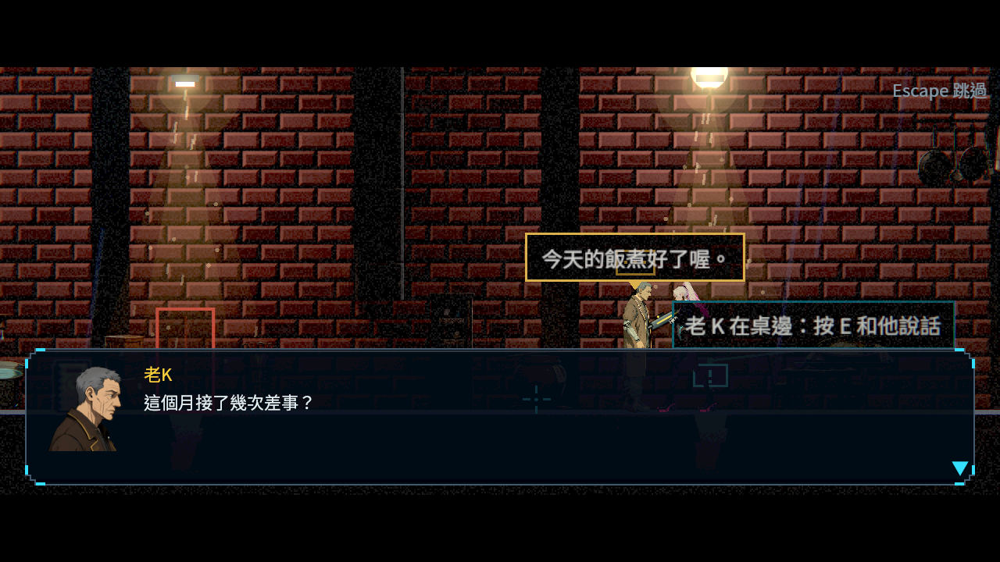
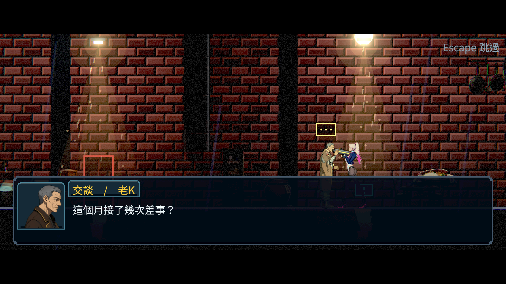
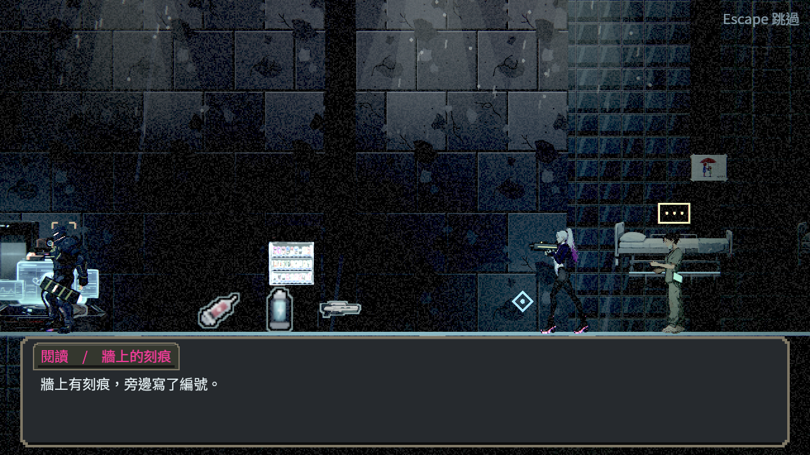
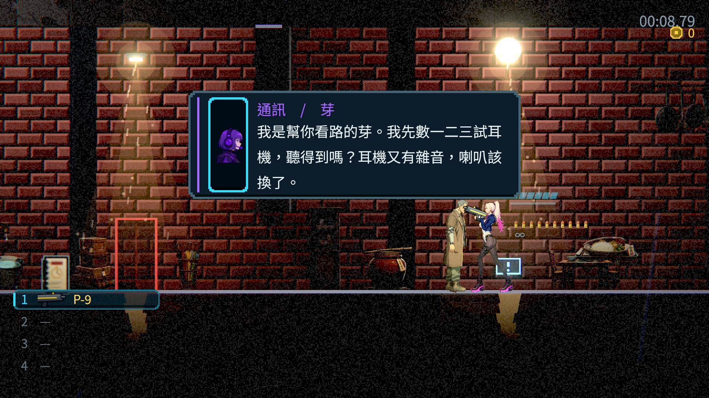

---

# Commit-3

## 內文

操作提示的連線原本可能穿過角色狀態、彈藥與章名。現在連線避開這些閱讀區域，仍指回原本的互動物件；提示框維持在畫面內，彈藥、章名隱藏或離場後立即釋放空間。

三種解析度的二十四張畫面逐張複核通過，左右站立與蹲姿都保留物件位置的辨識，人物交谈、通訊與物件閱讀的姓名、正文與頭像完整。

### 測試結果

| 項目 | 結果 |
|---|---|
| 受影響範圍 | 原始選取流程46組、8,982檢查；0新失敗、0已知失敗，832秒，exit 0 |
| 介面與提示回歸 | 原有三套件200檢查、0失敗，exit 0 |
| 雲端受影響範圍 | 原始選取流程46組、9,002檢查；0新失敗、0已知失敗，463秒，exit 0 |
| 主線死亡動作回歸 | 候選來源完整保留；原有死亡動作套件4,382檢查、0新失敗、0已知失敗，11秒，exit 0 |
| 最新主線護盾與連段回歸 | 原有近戰武器、近戰與操作手感三套件729檢查、0新失敗、0已知失敗，138秒，exit 0 |
| 原生 Forward+ | 1280×720、1920×1080、2100×900；文字100%／120%，24張圖逐張複核通過 |
| 紀錄保存 | 測試與截圖原始結果、目視限制及檔案雜湊可核對；沒有修改測試選取與錯誤篩選規則 |

[受影響結果](attachments/NE-228-clearance/changed-console.log)、[完整執行紀錄](attachments/NE-228-clearance/changed-shard-0.log)、[死亡動作回歸](attachments/NE-228-clearance/latest-rig-console.log)、[最新主線護盾與连段回歸](attachments/NE-228-clearance/latest-combat-console.log)、[目視複核](attachments/NE-228-clearance/visual-review.md)及[證據清單](attachments/NE-228-clearance/manifest.json)。

雲端的[原始結果](attachments/NE-228-clearance/cloud/run.log)、[完整紀錄1](attachments/NE-228-clearance/cloud/run/shard_0.log)、[完整紀錄2](attachments/NE-228-clearance/cloud/run/shard_1.log)及[本機複核](attachments/NE-228-clearance/cloud/root-review.json)保留供核對；兩邊總檢查數差20，原因尚未定位，均為0失敗。

### 截圖

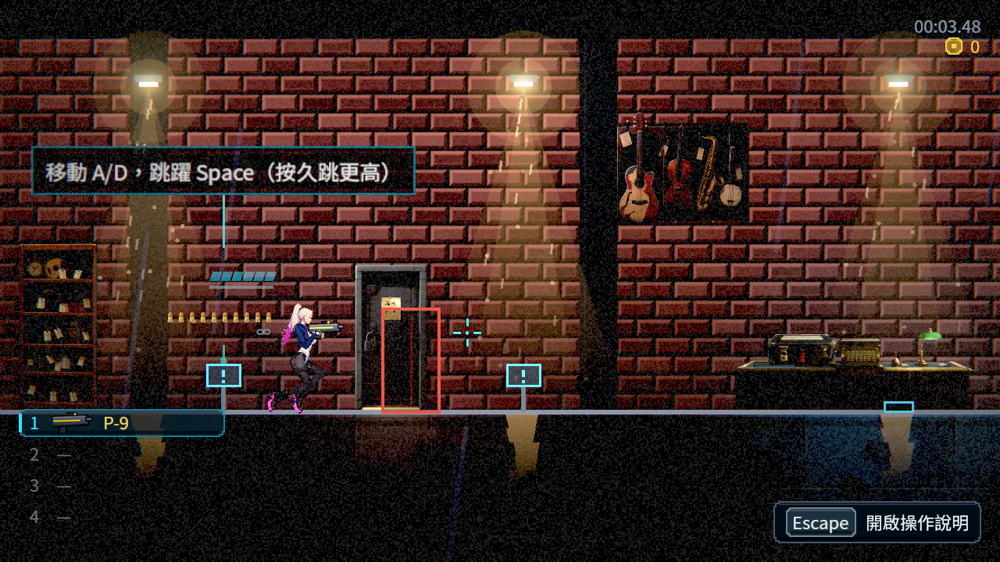
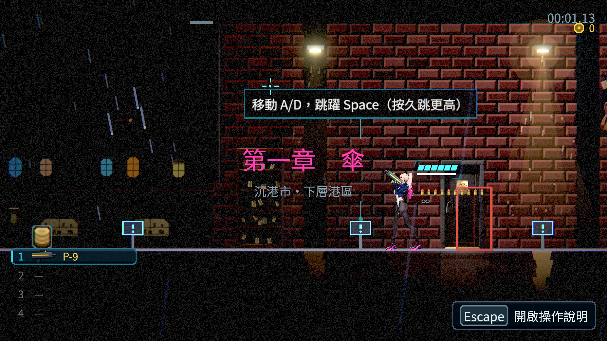
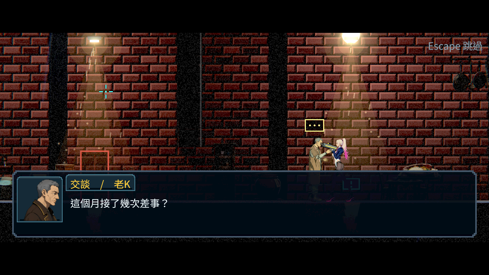

交談預覽使用原有台詞與隔離取景，驗證介面閱讀；角色持槍姿勢與完整交談舞台另依故事與角色票驗收。

---

# 跟其他票的關係

- Blocks：NE-233
- Blocked by：NE-227
- Related：NE-36、NE-43、NE-223、NE-229、NE-230

---

# 2026-10-11 交接紀錄

## 內文

在真戰鬥通訊與暫停圖中確認背景任務說明遮擋。HUD 窄候選僅有來源／語法審查，未採用、未經 Godot 與原生驗證；本票維持進行中。

使用者要求本 Session 收尾後停止開發。偏好、研究依據、避免重犯事項與精確接手資訊見 [使用者指南](../user_guide.md)及[本次交接](../SESSION_HANDOFF_2026-10-11.md)。此段保存現況，不是新完成紀錄。

---

# Commit-4

## 內文

滑鼠停在 HUD 上（例如信用點）時，說明框會留在畫面上，接著打開暫停頁或來了通訊，舊說明就壓在「目前進度」標題或通訊上；還沒冒出來的說明也可能在交談期間晚一步出現。

現在暫停頁、人物交談或通訊一出現，背景 HUD 的說明立刻收起，等待中的說明一併取消，期間停在 HUD 上也不會再冒出來；回到遊戲後重新停住滑鼠，說明照常出現。HUD 原本的說明文字、可見規則與暫停頁焦點都不受影響。上次留下的候選做法較大且未驗證，這次只採用其中「暫停邊緣當下處理」的原則，改成更小、可重用的守門元件。

驗收用真的滑鼠移動事件讓引擎實際顯示說明，再打開真的暫停頁、通訊與交談：拿掉守門時三種情況都重現遮擋（自動檢查 3 項失敗），加上後全部通過。Forward+ 畫面修前修後並排如下。實體滑鼠與手把在原生畫面的操作仍待本機原生驗收，對應驗收條件暫不勾選。

### 測試結果

| 項目 | 結果 |
|---|---|
| 受影響範圍（基準 f048d9d1） | 12 組、2,586 檢查；0 新失敗、0 已知失敗，175 秒 |
| 介面套件單跑 | 43 檢查、0 失敗；拿掉守門時 3 項失敗（暫停時已顯示、交談前排程中、通訊時已顯示），證明檢查有效 |
| 首輪平行測試 | 「通訊結束後守門解除」在負載下固定兩影格內未解除；改為有上限的等待後重跑通過 |
| 原生 Forward+ | Vulkan／llvmpipe 軟體渲染；1280×720 修前修後、1920×1080 修後 |
| 待本機原生驗收 | 實體滑鼠停留後開暫停頁／收到通訊、實體手把；雲端合成輸入不代替 |

分支 `claude/nest-egg-ui-quest-map-wgwwvw`，[提交紀錄](https://github.com/deadline314/Nest-Egg/commits/claude/nest-egg-ui-quest-map-wgwwvw)。

### 截圖

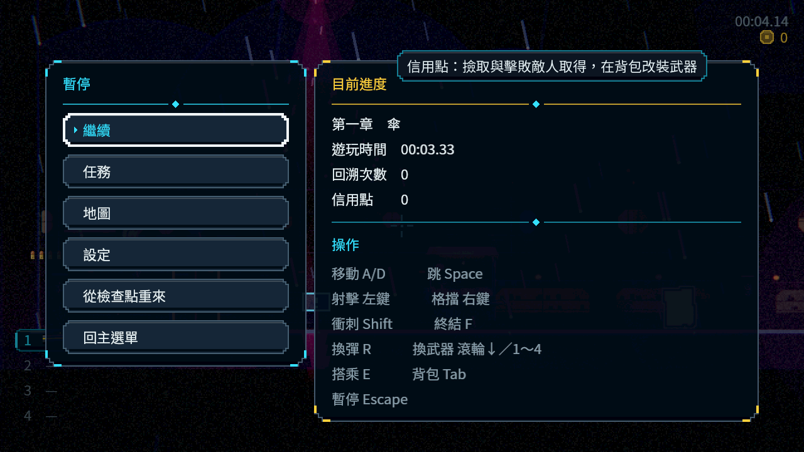
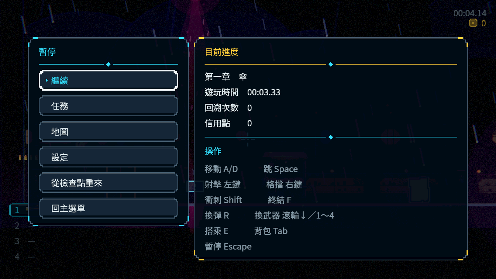
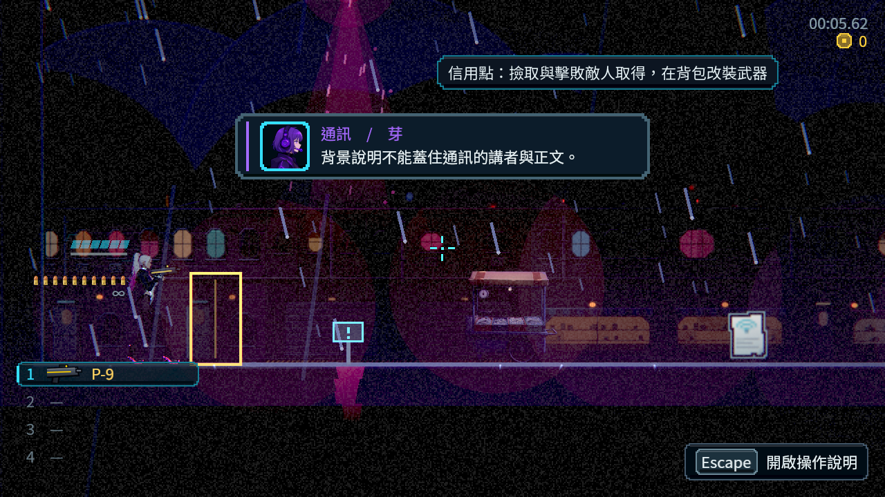
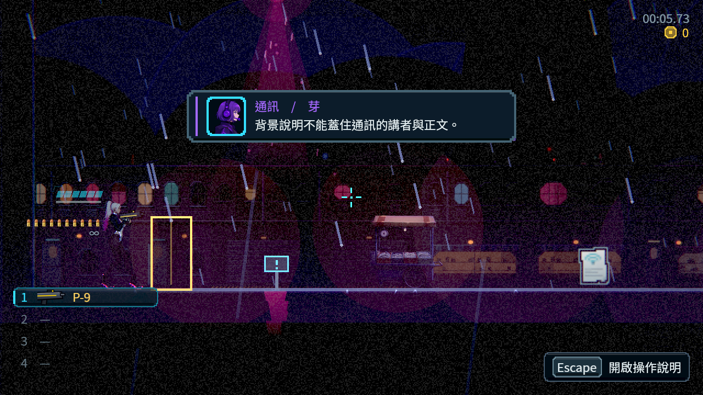
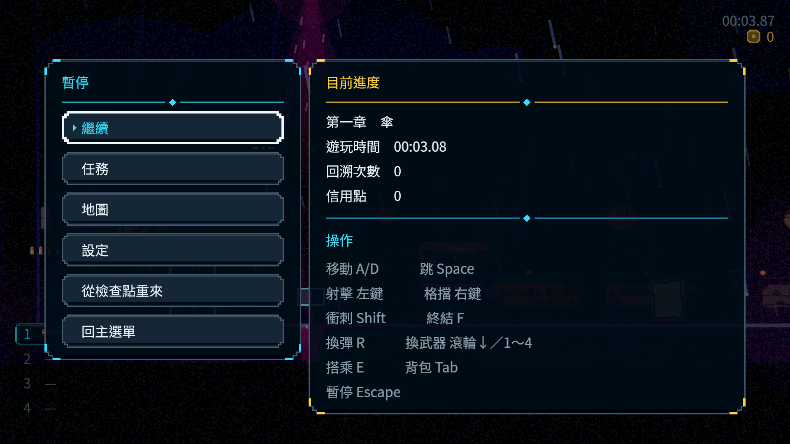

---

# Commit-5

## 內文

畫面右下角的「Escape 開啟操作說明」提示在打開暫停頁、任務或地圖後仍留在原地，透過暗底壓在地圖的圖例旁邊。原因是暫停期間 HUD 不再更新，提示沒有機會收起。

現在暫停頁或其子頁一打開，這張操作提示當下收起；關閉後依當時情境回來，暫停期間不扣它的閱讀時間。

### 測試結果

| 項目 | 結果 |
|---|---|
| 受影響範圍（基準 2a1fce49） | 12 組、2,609 檢查；0 新失敗、0 已知失敗，174 秒 |
| 介面套件 | 47 檢查、0 失敗；拿掉修正時「暫停頁打開時背景的操作提示收起」失敗 |
| 原生 Forward+ | 1280×720 港區街道區域地圖修前修後（Vulkan／llvmpipe 軟體渲染） |

分支 `claude/nest-egg-ui-quest-map-wgwwvw`，[提交紀錄](https://github.com/deadline314/Nest-Egg/commits/claude/nest-egg-ui-quest-map-wgwwvw)。

### 截圖

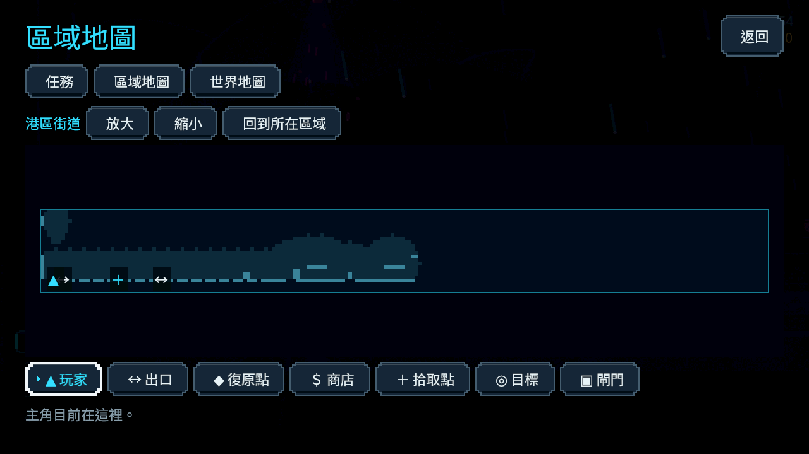

---

# Commit-6

## 內文

把文字放大到 120% 逐頁檢查主選單、難度、設定、圖鑑、暫停、死亡與結算，找到三個會截字或擠出畫面的地方：結算畫面整張超出畫面底部，「再玩一次／回主選單」按鈕完全看不到；暫停頁的「目前進度」面板底部超出畫面；敗北圖鑑的卡片名稱與「？？？」被切掉一半。另外難度卡片的說明會把「，」換到下一行開頭。

現在結算的評價改成兩欄，放大文字後整張結算與按鈕都在畫面內；暫停頁兩個面板往上移，完整操作表留在畫面內；卡片會隨內容長高，不再裁掉文字，難度與圖鑑共用這個修正。卡片、死亡畫面與圖鑑的換行改用中文斷行規則，標點不會出現在行首。結算畫面的按鈕說明改放在按鈕右側的淡色文字，不加框，避免被看成第三顆按鈕。

100% 與 120% 兩種文字大小都重拍確認；截圖工具新增文字放大與視窗尺寸參數，放大設定寫到獨立設定檔，不影響玩家設定。

### 測試結果

| 項目 | 結果 |
|---|---|
| 受影響範圍（基準 86a8097f） | 20 組、5,166 檢查；0 新失敗、0 已知失敗，176 秒 |
| 中文斷行 | 引擎內實測同一句在三種寬度下，舊斷行在一種寬度把「，」放到行首，新斷行三種都沒有 |
| 原生 Forward+ | 1280×720，文字 100%／120% 七個畫面全部重拍目視（Vulkan／llvmpipe 軟體渲染） |

分支 `claude/nest-egg-ui-quest-map-wgwwvw`，[提交紀錄](https://github.com/deadline314/Nest-Egg/commits/claude/nest-egg-ui-quest-map-wgwwvw)。

### 截圖

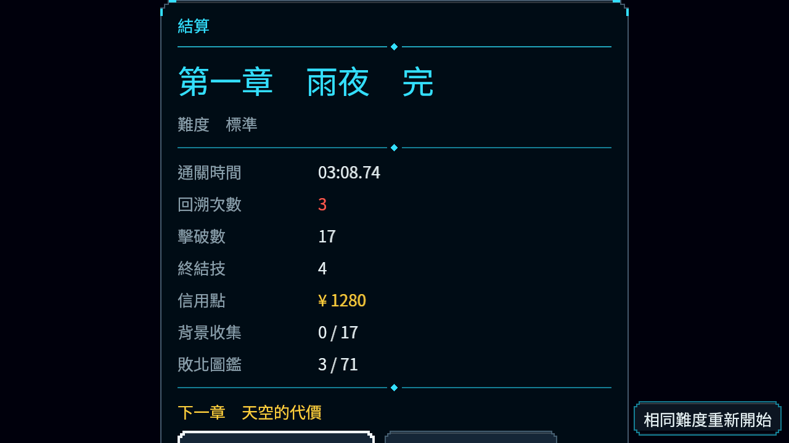
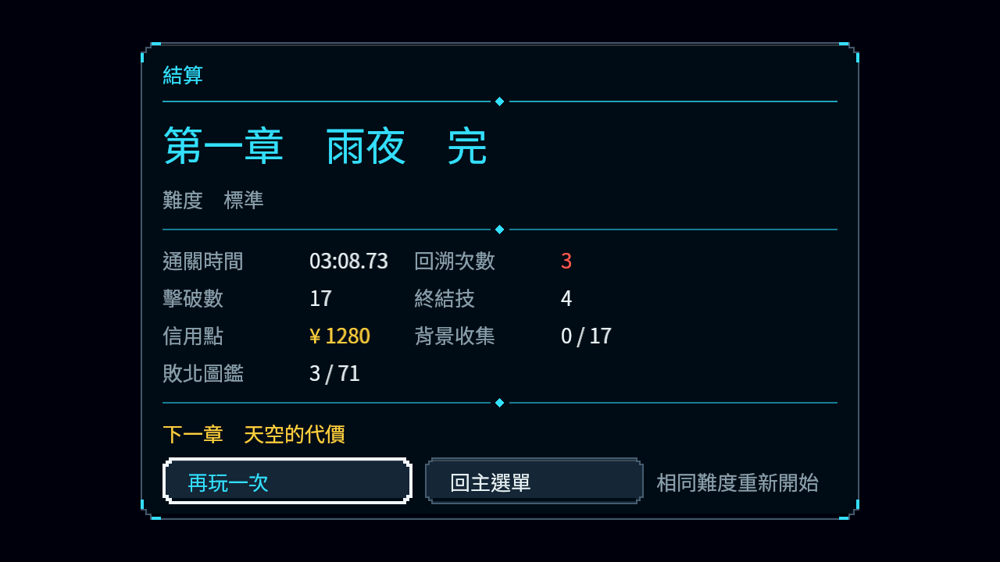
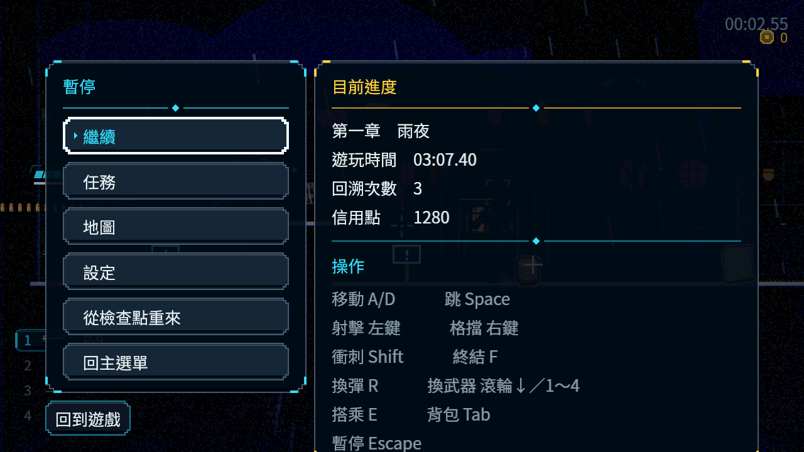
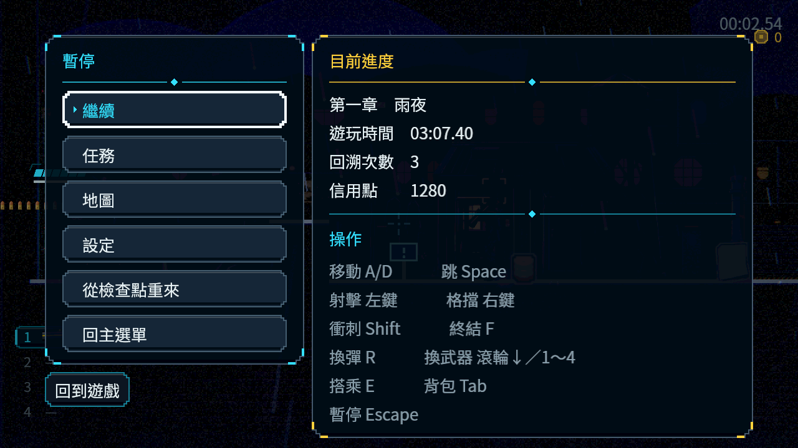
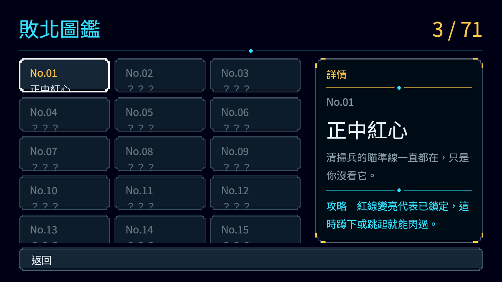
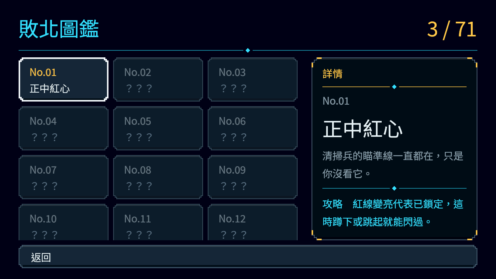
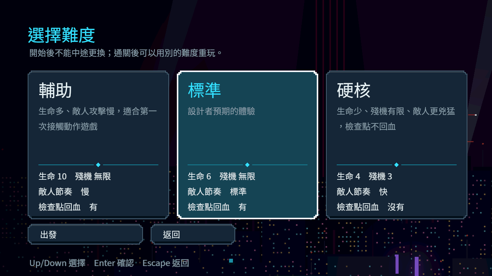
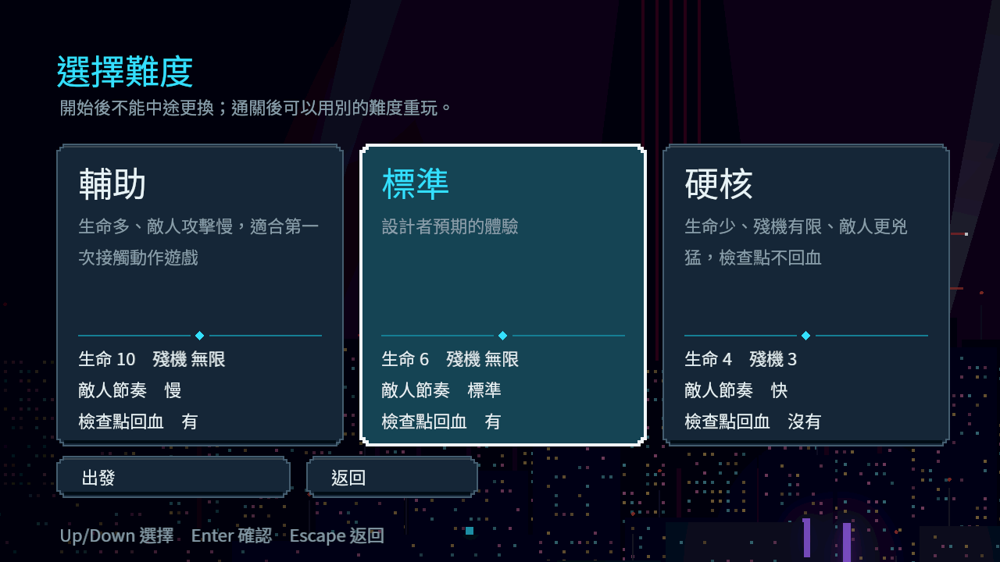

---

# Commit-7

## 內文

接著用 120% 文字檢查背包六個分頁。「角色狀態」最後一列擊破數壓到底部的操作說明列；武器清單上「手上」徽章變高後，半透明底蓋到右側的彈種圖示。

現在狀態列的列高跟著文字決定，七列都留在頁面內；徽章文字的基線依字型高度計算，字留在框內，有彈種圖示時徽章讓到圖示左邊。這只修截字與重疊，背包的整體版面由 NE-244 重排。

### 測試結果

| 項目 | 結果 |
|---|---|
| 受影響範圍（基準 0f683c28） | 9 組、3,081 檢查；0 新失敗、0 已知失敗，134 秒 |
| 原生 Forward+ | 1280×720，文字 100%／120% 背包武器、消耗品、劇情道具、角色狀態重拍目視（Vulkan／llvmpipe 軟體渲染） |

分支 `claude/nest-egg-ui-quest-map-wgwwvw`，[提交紀錄](https://github.com/deadline314/Nest-Egg/commits/claude/nest-egg-ui-quest-map-wgwwvw)。

### 截圖

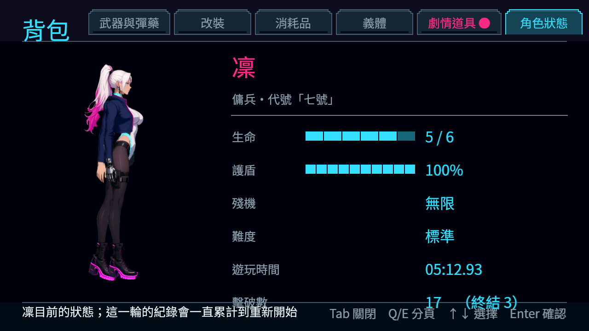
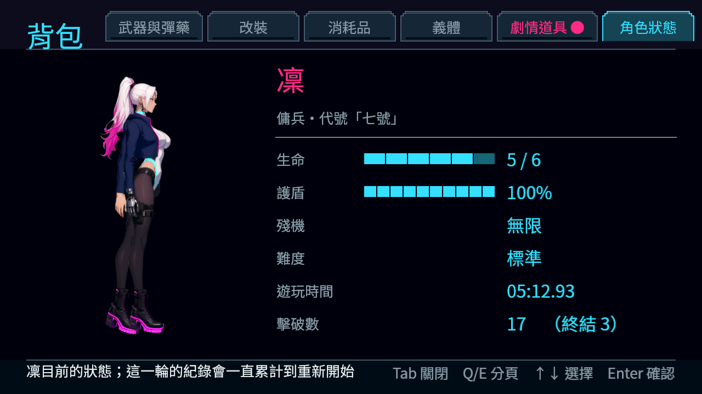
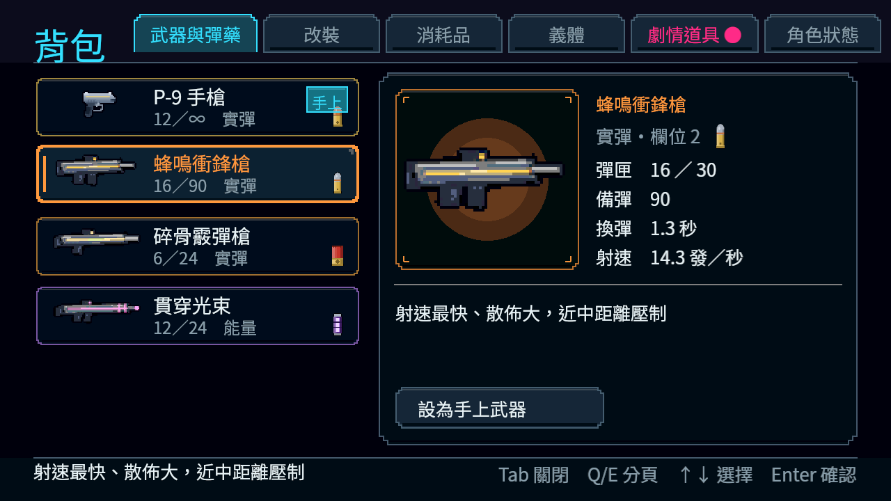
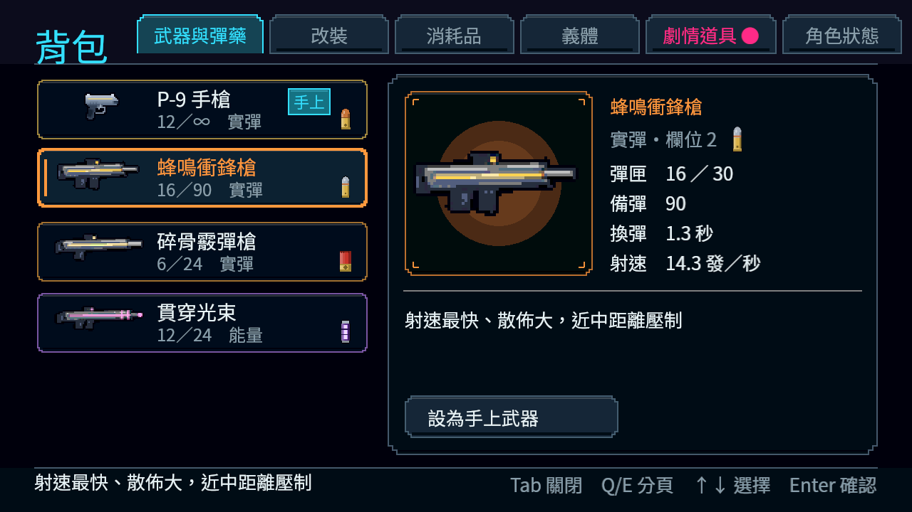

---

# Commit-8

## 內文

設定頁的切換鈕（全螢幕、HUD 自動隱藏等）沒有內距，鍵盤或手把聚焦時白色焦點框直接壓在文字第一個字上，看起來像框線切過字。

現在切換鈕留了內距，焦點框完整圍住整列；設定頁其他列（音量、亮度、光影品質、按鍵表）的標題同步內縮，整頁文字仍然對齊。新增一個放大文字巡檢工具，一次拍設定四個分頁與補給商店，並列出超出畫面或被裁切的文字；這次巡檢在設定與商店沒有其他截字（清單本來就可捲動的列不算）。

### 測試結果

| 項目 | 結果 |
|---|---|
| 受影響範圍（基準 3fd0246a） | 48 組、12,373 檢查；0 新失敗、0 已知失敗，196 秒 |
| 原生 Forward+ | 1280×720，文字 100%／120% 設定四分頁與補給商店（Vulkan／llvmpipe 軟體渲染） |

分支 `claude/nest-egg-ui-quest-map-wgwwvw`，[提交紀錄](https://github.com/deadline314/Nest-Egg/commits/claude/nest-egg-ui-quest-map-wgwwvw)。

### 截圖

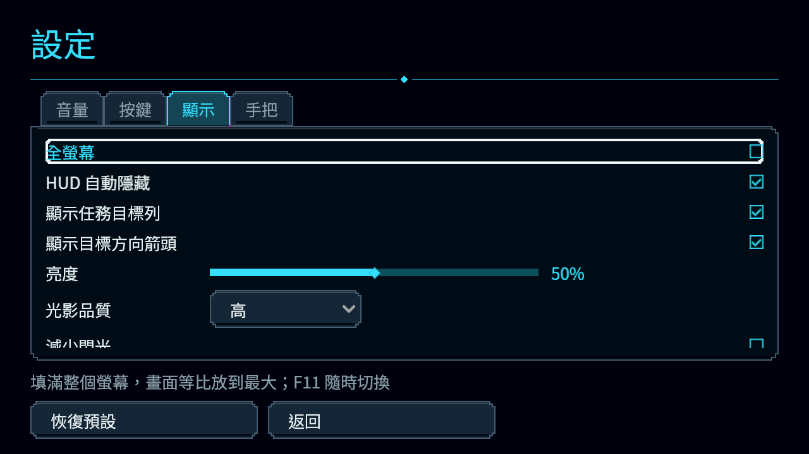
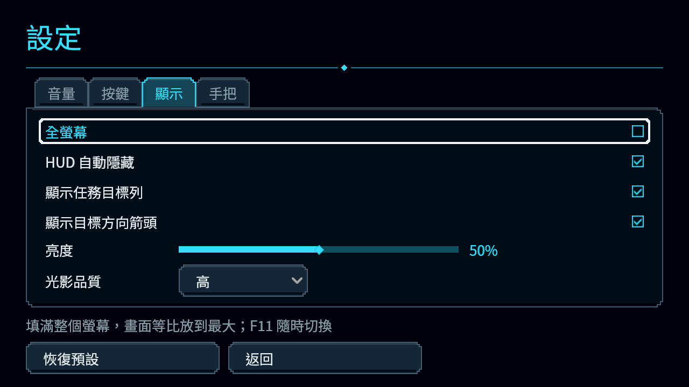
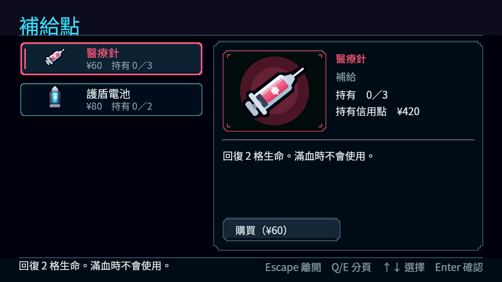

---

# Commit-9

## 內文

撿到道具時，「取得…」橫幅出現在畫面中上方、角色與敵人附近，一次只顯示一句；連續撿到幾樣東西時後一句直接蓋掉前一句，戰鬥中也會擋到視線。

參考 Leyla In Veil 實際畫面裡角落的拾取紀錄，改成在右上角信用點下方疊列：每撿到一樣多一行，最新的在最下面，幾秒後淡出；同一句在顯示中再出現會顯示次數，不洗版。每行只和文字一樣寬，用 Nest Egg 的像素切角框與金色字。通訊出現時拾取紀錄先讓位，剩下的時間保留，通訊結束再回來；暫停時跟著停住；減少動態時不淡入。檢查點、警告與其他提示維持畫面中央的橫幅。

各處撿東西的提示內容與觸發都沒變，只改了呈現位置。

### 測試結果

| 項目 | 結果 |
|---|---|
| 受影響範圍（基準 31136f13） | 12 組、2,656 檢查；0 新失敗、0 已知失敗，172 秒 |
| 介面套件 | 54 檢查、0 失敗；取得類進紀錄、同句計次、超過上限換掉最舊一行、位置與寬度、通訊讓位與保留時間、時間到全部淡出且閒置不再更新 |
| 原有斷言調整 | 「橫幅水平置中」原本用取得類文字測試，取得類已改進紀錄，改用檢查點文字測同一項置中 |
| 原生 Forward+ | 1280×720 第一章街道修前修後（Vulkan／llvmpipe 軟體渲染） |

分支 `claude/nest-egg-ui-quest-map-wgwwvw`，[提交紀錄](https://github.com/deadline314/Nest-Egg/commits/claude/nest-egg-ui-quest-map-wgwwvw)。

### 截圖

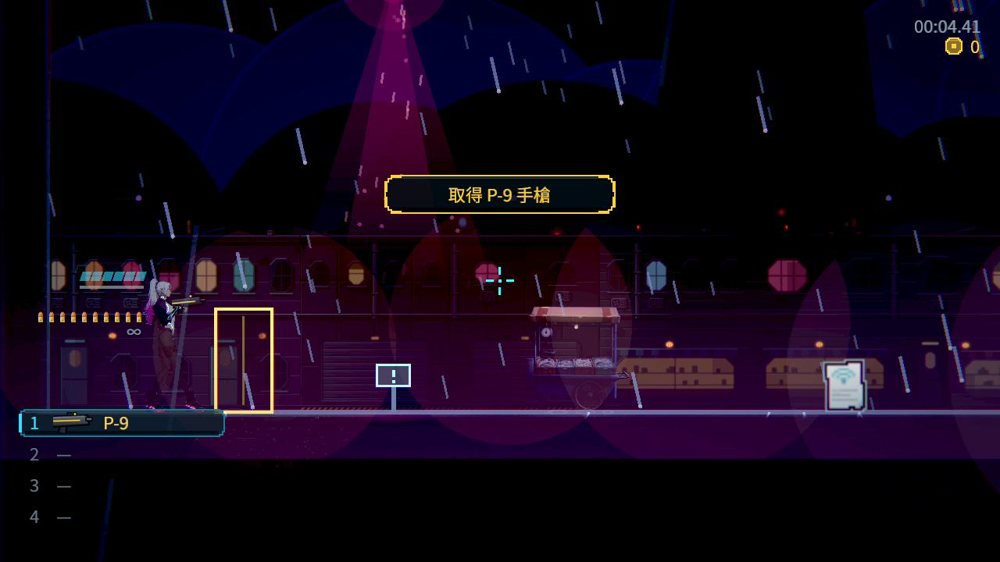
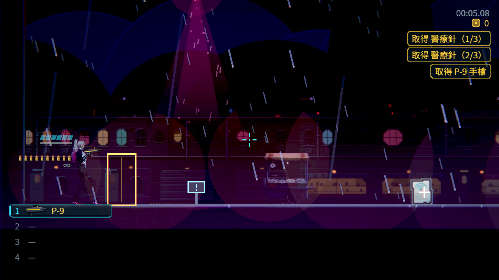

# 本機原生驗收（2026-10-11）

## 內文

雲端只有軟體渲染與合成輸入，以下項目在本機補驗：Godot 4.7.2、Forward+、Intel Arc B580，來源是分支 `claude/nest-egg-ui-quest-map-wgwwvw` 的 7dffe868，沒有改動任何程式。

滑鼠說明：把作業系統的真游標移到信用點、義體電量、武器欄第一格上，等說明出現，再分別開暫停頁、觸發通訊、觸發人物交談（含說明還在排程時就開始交談）。三個位置、1280×720 與 1920×1080 共 54 個時點全部符合：說明當下消失，沒有蓋住講者與正文；回到遊戲後再停住滑鼠會重新出現。暫停是真的開啟（世界停住）才記錄。

暫停頁、任務頁與地圖頁底下沒有透出「Escape 開啟操作說明」。撿到道具時，紀錄逐行疊在右上角信用點下方，同一句會計次（醫療針 1/3、2/3），不再佔畫面中央。

文字 120%：結算、暫停、圖鑑、設定、難度與主選單在兩種解析度都沒有截字或擠出畫面；補給商店的文字完整。

另外看到幾件事，沒有動手修，留給負責的 Session 判斷：
- 死亡畫面底下仍看得到「Escape 開啟操作說明」與關卡裡的提示框（截圖情境同時疊了章節標題卡，那一項是截圖時機造成的）。
- 補給商店的半透明底下，會透出關卡地板的亮邊（一條橫貫畫面的細線）與雨絲。
- 文字放大巡檢工具回報 19 筆「超出畫面」，逐筆對照畫面後都是設定頁可捲動清單裡還沒捲到的列，不是真的被擠出去；工具沒有把捲動區的裁切算進去。按鍵分頁在 120% 一次只看得到四列，第五列被切一半，沒有捲軸提示。
- 背包頁沒有對應的截圖情境，這次沒有驗到。

驗收條件維持原狀，這一段只記錄本機看到的結果。

### 測試結果

| 項目 | 結果 |
|---|---|
| 受影響測試（本機，基準 ae8f1e94） | 12835 項檢查；新失敗 0、已知失敗 0 |
| 滑鼠說明（真游標，3 個位置 × 9 個時點 × 2 種解析度） | 54／54 符合 |
| 120% 文字（兩種解析度各 9 個畫面，加設定四分頁與商店） | 沒有截字或擠出畫面 |
| 原生執行紀錄 | 自然結束；沒有腳本錯誤 |

### 截圖

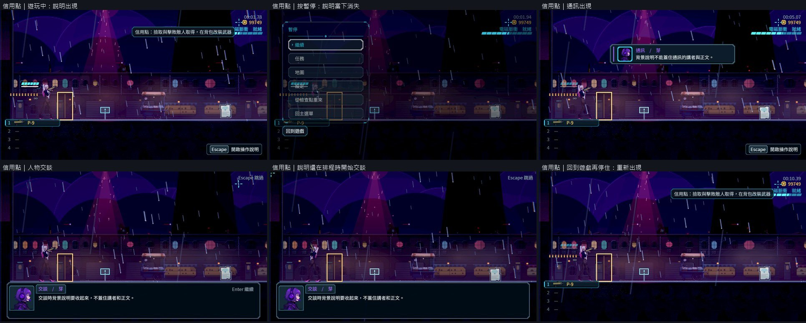

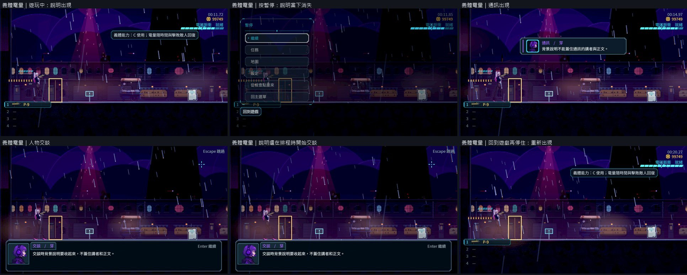

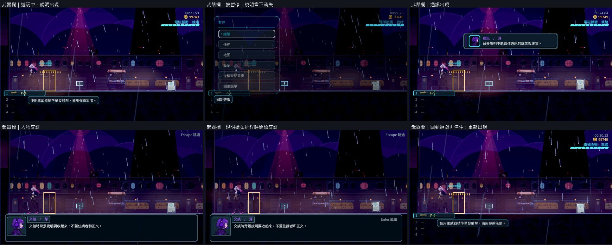

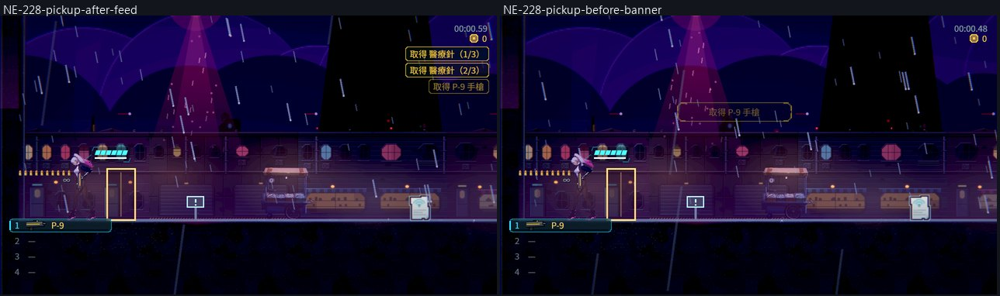

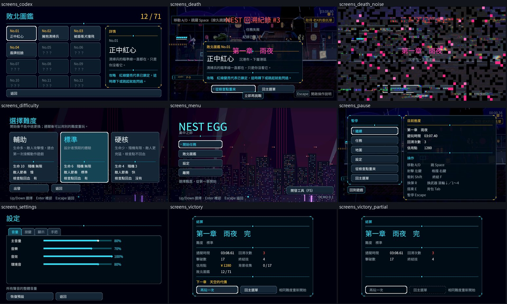

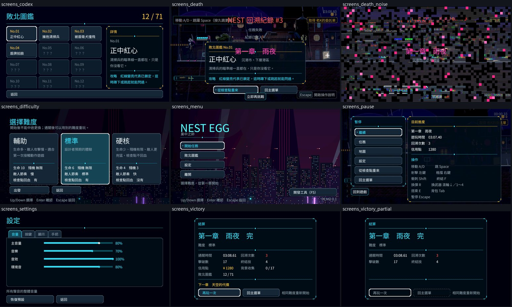

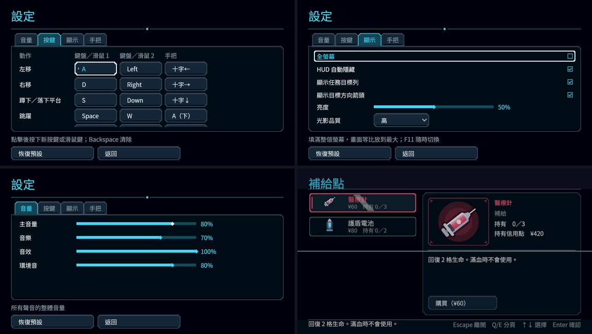

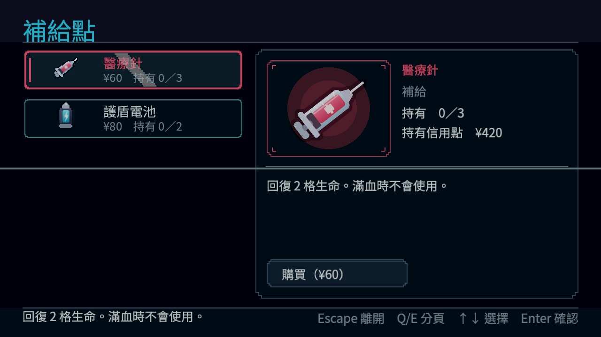

# Commit-10

## 內文

本機原生驗收留下四件事：死亡畫面底下還看得到「Escape 開啟操作說明」與關卡裡的教學提示框；補給商店的半透明底下透出一條橫貫畫面的亮線與雨絲；文字放大巡檢回報 19 筆「超出畫面」，其實都是設定頁可捲動清單裡還沒捲到的列，而且按鍵分頁在 120% 時第五列被切一半，看不出下面還有內容；背包頁沒有截圖情境，沒有驗到。

死亡畫面的操作說明，是截圖情境直接把死亡畫面疊上去、主角其實沒有倒下造成的；真正的死亡流程本來就會收起操作說明。截圖情境改成讓主角真的倒下、由關卡自己開死亡畫面。走真正流程後，發現教學看板的提示（「移動、跳躍」）仍會對倒地的主角顯示，所以改成主角倒下時不再顯示任何靠近提示，起身後恢復。商店的亮線與雨絲，在雲端等開啟動畫跑完才拍時沒有出現；原工具是固定等 30 個影格，GPU 很快時不到動畫長度，會拍到正在淡入、中央掃描線還在的畫面，判斷是拍攝時機造成，工具改成用實際時間等動畫跑完。巡檢工具把捲動區裡還沒捲到的列另外計數、不算問題，改為列出「還有內容卻沒有捲動提示」的捲動區；設定頁的顯示、按鍵、手把三個捲動分頁加上底緣淡出與 ▼ 提示。截圖情境補上背包六個分頁；背包底部說明列在文字放大時改用省略號收尾，不再從字的中間切開。

驗收在 Forward+（雲端軟體 Vulkan）1280×720、文字 120% 拍攝：真正死亡流程的死亡畫面沒有操作說明與教學提示框；按鍵分頁看得到 ▼ 與淡出；商店開啟後畫面乾淨；背包六個分頁都拍到；巡檢 0 問題（捲動區內尚未捲到的列 21 筆，另計）。商店亮線需要在本機原生用新工具重拍一次確認。死亡畫面的按鈕說明在 120% 時壓到「回主選單」，屬於 NE-229 的聚焦說明，在那張票處理。驗收條件仍有多項（實機手把、全頁面正式內容等）未達成，本票維持進行中。

### 測試結果

| 項目 | 結果 |
|---|---|
| 受影響範圍（基準 75bb558c） | 52 組、19,058 檢查；0 新失敗、0 已知失敗，168 秒 |
| 新增檢查 | 主角倒下後教學提示不顯示、起身後恢復 |
| 文字放大巡檢（設定四分頁＋補給商店，120%） | 0 問題；捲動區內尚未捲到的列 21 筆另計 |
| 截圖情境（主選單到結算、背包六分頁，120%） | 15 張，沒有腳本錯誤 |

分支 `feature/ui-quest`，[提交紀錄](https://github.com/deadline314/Nest-Egg/commits/feature/ui-quest)。

### 截圖

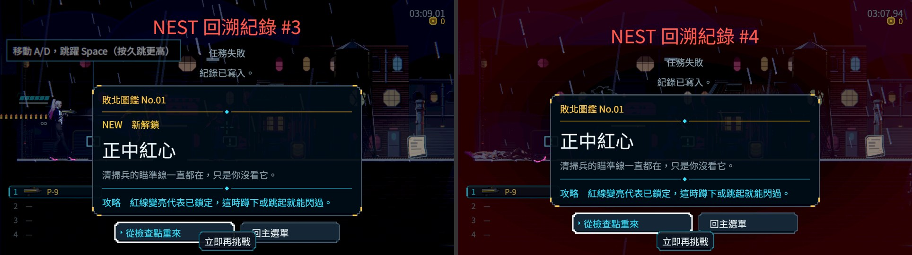

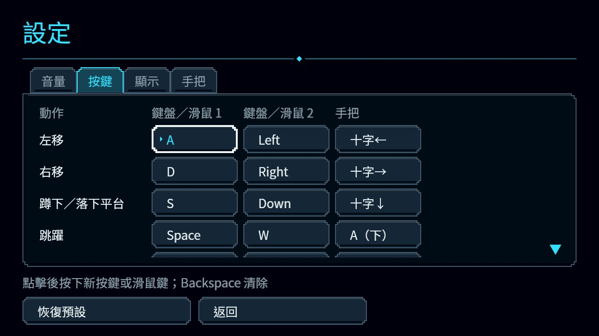

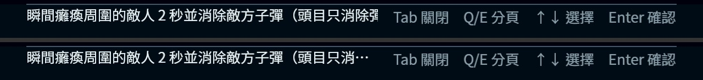

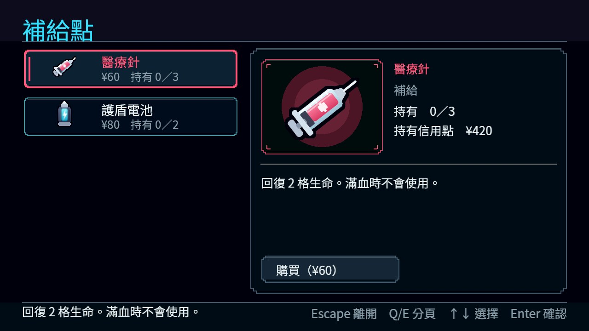

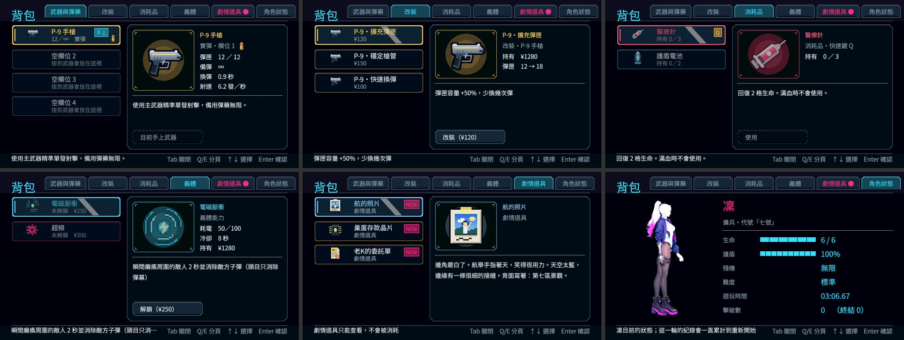

# Commit-11

## 內文

剩下的驗收條件裡，「確認、返回、分頁與取消一致、關閉子頁恢復焦點、不穿透模態頁」與「入區不重播整份按鍵表」原本沒有一套檢查從頭到尾走過；「不同寬高比」只拍過 16:9；聚焦說明的條件已在本機原生驗收 54/54 符合，但勾選一直沒有更新。

這次沒有改遊戲程式，只補上一致性檢查，並放進介面畫面套件。檢查內容如下：主選單的「設定」「敗北圖鑑」與暫停頁的「任務」「地圖」「設定」，都用手把 A 打開、LB／RB 換頁、B 一層層返回，焦點回到打開它的那顆按鈕；暫停頁、背包、任務與地圖開著時，按跳躍與射擊，主角的位置與彈匣都不變，再用 B 一路回到遊戲；新遊戲第一次進關卡時保留開場操作提示，從出入口進到下一區時不再出現。合成的手把事件不代替實體手把（NE-229）。寬高比在 Forward+（雲端軟體 Vulkan）、文字 120% 下拍了 2560×1080（21:9）、1024×768（4:3）、1280×800（16:10）與 1920×1080。遊戲固定以 16:9 畫面等比放大，其他比例只在兩側或上下補黑邊，所以四種尺寸的畫面內容一致，主選單、設定、暫停、背包、死亡、結算、圖鑑與難度都沒有截字或重疊。

勾選：「確認、返回、分頁與取消一致」依這次的檢查；「遊戲內提示依情境顯示」依這次的入區檢查，加上既有的模態與倒地收起提示檢查，以及暫停頁可查完整操作；「通訊、交談與暫停時收起聚焦說明」依本機原生 54/54 與自動檢查。「不同寬高比與文字放大」的版面已經沒有問題，但同一條還要求「無占位頁面」：正式任務還沒合進 main，任務頁在 main 上沒有內容，所以先不勾。其他條件（全頁面正式內容、實機手把、減少動態等）也未完成，本票維持進行中。

### 測試結果

| 項目 | 結果 |
|---|---|
| 一致性檢查（主選單 2 頁、暫停頁 3 頁、3 種模態頁、入區提示） | 27 項全過 |
| 寬高比（21:9、4:3、16:10、16:9，文字 120%，各 15 張） | 沒有腳本錯誤；畫面內容一致，沒有截字或重疊 |
| 受影響範圍 | 20 組、5,677 檢查；0 新失敗、0 已知失敗，163 秒 |

分支 `feature/ui-quest`，[提交紀錄](https://github.com/deadline314/Nest-Egg/commits/feature/ui-quest)。

### 截圖

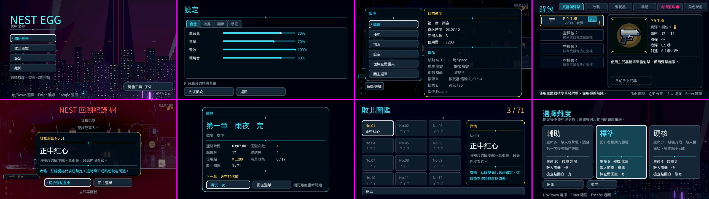

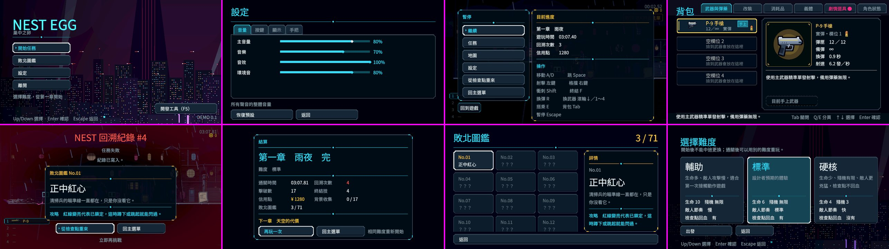

# Commit-12

## 內文

用真輸入走一遍序章（從主選單開新遊戲，用移動、跳躍、射擊、近戰、格擋、衝刺與互動鍵玩完）時，Forward+ 截圖看到訓練站的操作提示和 HUD 的任務目標列疊在同一個位置：「Space 跳上搬貨台，工具就放在上面。」和「◎ 取下搬貨台上的試貨工具」兩行字互相壓住，訓練器那一段也一樣。另外上次留下的「無占位頁面」一直等正式任務合進 main，現在已經合入。

改動：世界提示（訓練站、告示）是當下要做的動作，優先讀得到。提示框壓到目標列時，目標列在 0.15 秒內淡出讓位，提示框留在原處；提示收起後目標列再淡回來。曾先試過讓提示框避開目標列，結果訓練器那一段的提示被推出畫面上緣，反而看不到，所以改成目標列讓位。減少介面動態時直接切換，不做淡入淡出。

驗收：序章真輸入探針在 Forward+（雲端軟體 Vulkan）1280×720 重跑，提示完整、不再疊字，十六項練習檢查全過（射擊要子彈真的打中低靶、近戰要真的打中假人、格擋要真的擋下訓練器、衝刺要真的衝過線，走過去或用錯動作都不算），手把版同樣全過。自動檢查補上：把提示框擺在目標列正中央，目標列會淡出、提示框不被推走、提示收起後目標列回來；拿掉修正時這兩項會失敗。

勾選：「720p、1080p、不同寬高比與文字放大不截字或重疊，無占位頁面」：正式任務已在 main，任務頁、地圖與 HUD 在 1280×720、1920×1080、文字 100%／120% 都是正式內容且版面檢查 0 問題（NE-223 Commit-7），背包在四種尺寸與文字設定 0 問題（NE-244），寬高比在 Commit-11 已拍，這次又修掉提示與目標列的重疊。「序章練習提示配合實際命中、格擋、移動與互動」：依第一章地圖套件的逐項檢查與這次的真輸入探針。其他條件（全頁面遷移、說明全面複查、減少動態、實體手把與裝置切換、人物對話與通訊的身份呈現）仍未完成，通訊對話框在 NE-274 審查中、行為保留；本票維持進行中。

### 測試結果

| 項目 | 結果 |
|---|---|
| 序章真輸入探針（鍵鼠、手把） | 各 16 項，0 失敗 |
| 任務與地圖套件 | 242 檢查、0 失敗（新增目標列讓位 3 項；拿掉修正時 2 項失敗） |
| 受影響範圍（基準 f79e491f，NE-228 與 NE-229 這次的改動一起跑） | 58 組、60,568 檢查；0 新失敗、0 已知失敗，589 秒 |

分支 `claude/ui-2i98t8`，已併入 main：[e3aff532](https://github.com/deadline314/Nest-Egg/commit/e3aff532)。

### 截圖

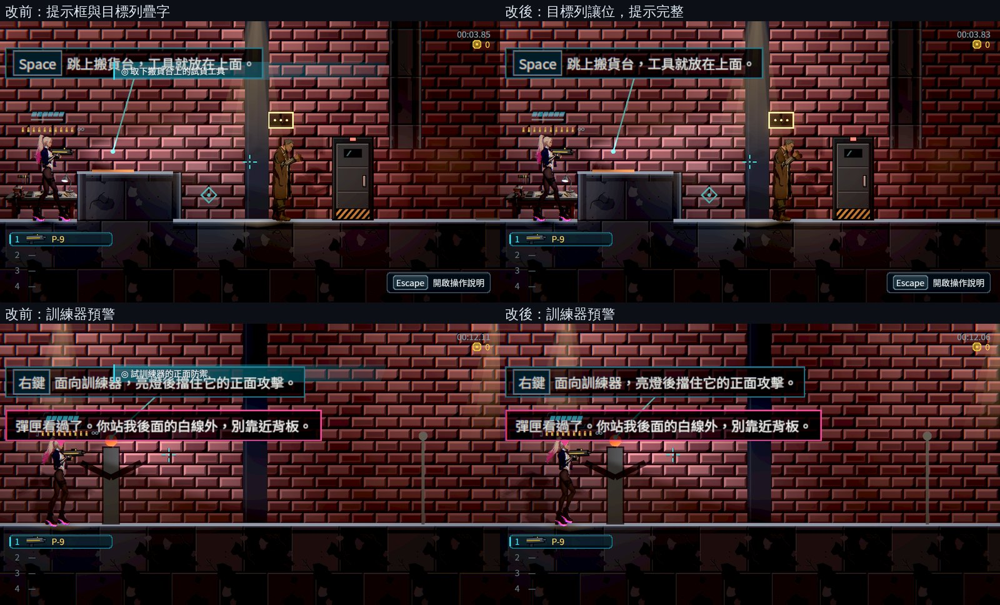

# Commit-13

## 內文

本組四張票（NE-223、NE-244、NE-228、NE-229）做完後的互相影響檢查：目標列讓位給世界提示淡出時，看不見的目標列仍會攔截滑鼠、停在那裡就跳出它的說明框。

改動：目標列讓位期間不攔滑鼠，淡回來後恢復。另外核對過：背包的立繪與信用點不影響暫停、交談與通訊時收起背景說明；世界地圖的新排法不影響任務稽核與截圖工具；設定頁新增的按住與連按說明在主選單與暫停頁開設定都一樣。使用者指南補上地圖上下層、HUD 讓位與背包版面三句。

驗收：任務與地圖套件新增「讓位時不攔滑鼠」一項並通過。受影響範圍第一輪在平行負載下有 3 項載具與掉坑的計時檢查失敗，單獨重跑本分支與乾淨的 origin/main 都是 2,274 項 0 失敗，整組重跑 0 新失敗，判定與本改動無關。

### 測試結果

| 項目 | 結果 |
|---|---|
| 受影響範圍（基準 origin/main bbbe0708） | 20 組、6,750 檢查；0 新失敗、0 已知失敗，263 秒（第一輪 3 項計時失敗，見上） |
| 主流程組單獨重跑 | 本分支 2,274／0 失敗；乾淨 origin/main 2,274／0 失敗 |

分支 `claude/ui-2i98t8`，已併入 main：[57eef82d](https://github.com/deadline314/Nest-Egg/commit/57eef82d)。

# Commit-14

## 內文

完整CI出現一項閱讀結束後頁首恢復失敗，舊紀錄無法分辨演出、操作鎖、附近演出預告或遮幅哪個狀態未恢復。本次只在失敗時保留等待前後的實際狀態，原判定與等待時間完全保留；沒有修改遊戲畫面或規則。

### 測試結果

| 項目 | 結果 |
|---|---|
| 最終受影響範圍 | 406項、0新／已知失敗，45秒 |
| 原CI前置順序重跑 | 571／0 |
| 保留頁首隱藏的診斷控制 | 13／1，原判定仍拒絕並留下前後狀態 |
| 原斷言、等待與執行器核對 | 相同 |

[原遠端失敗、重現嘗試與完整證據](attachments/NE-228-header-diagnostic/README.md)。原遠端失敗未定位；本次不更動驗收勾選，亦未以成功重跑宣稱修復。

# Commit-15

## 內文

暫停頁的進度與操作說明背後還能讀到HUD目標，圖鑑標題與卡片之間也有相同文字干擾。現在兩頁沿用既有資訊頁的模糊與壓暗背景，前景保持銳利，回到遊戲後恢復原畫面。原操作、焦點、點擊阻擋、減少動態與重要通訊的暫停規則保留。

### 測試結果

| 項目 | 結果 |
|---|---|
| 原受影響範圍，固定54b05d17 | 18組、6,911項，0新／已知失敗，215秒 |
| 明暗、720p／1080p、標準／放大文字原生驗證 | 84／0；另主選單進圖鑑5／0，五程序0引擎ERROR |
| 真正確認、方向、返回及滑鼠事件 | 子頁與焦點恢復、空白點擊不開槍／解凍、減少動態通過 |
| 同條件畫面 | 暫停、圖鑑修前修後，另保留背景目標隱藏的拍攝控制及中途版 |

[原圖、原始日誌、來源與界線](attachments/NE-228-modal-background/README.md)；[五款圖片研究](../../design/20-campaign-experience/PAUSE_READABILITY.md)。未以這次兩頁的可讀性修正代勾全遊戲介面遷移或實體裝置條件。

### 截圖

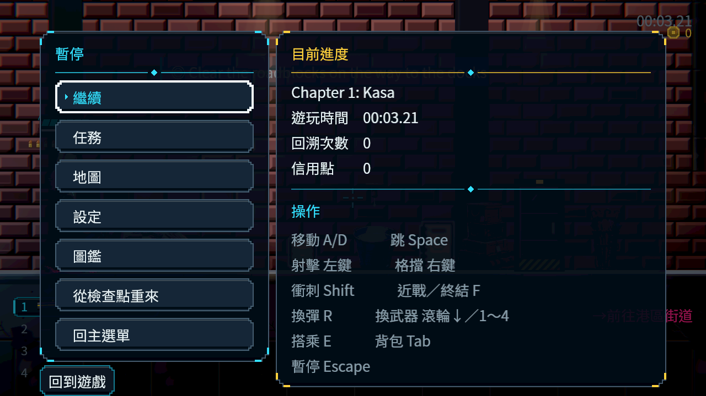
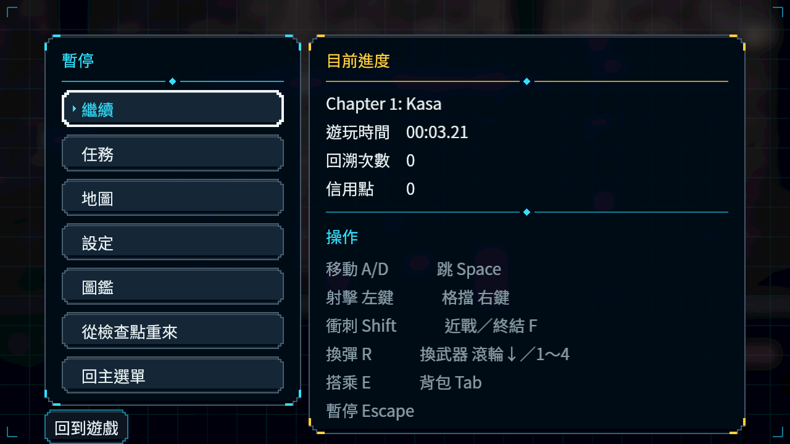

# Commit-16

## 內文

電話亭備份後立即交談，備份通知會透進選項與後果說明之間，形成兩層文字。現在選項底板完整遮住背景資訊，焦點、方向、確認與返回規則保留，通知仍照原時間消失。

### 測試結果

| 項目 | 結果 |
|---|---|
| 固定1a4fae5f的原受影響範圍 | 59組、63,098項，0新／已知失敗，491秒 |
| 720p／1080p、100%／120%文字 | 四組共100／0；五次修前／修後程序0引擎ERROR |
| 同一選項的真通知對照 | 修前2539個取樣像素不同；修後四組皆0，20張原圖逐張看過 |
| 原操作與生命週期 | 公開方向、確認返回、不接受支線、鎖釋放與通知自然結束通過 |

[五款研究、原圖、完整日誌與界線](attachments/NE-228-choice-background/README.md)。同一畫面暫藏真通知只用於診斷，正式通知規則沒有改動；整票原驗收勾選保持。

### 截圖

# Commit-17

## 內文

間歇停頓時，閱讀已結束、預告與鎖已清掉，遮幅還差一小段動畫，頁首因此晚恢復。現在遮幅與來源判定在同一更新階段推進，原動畫長度、曲線、減動態與恢復門檻保持。

### 測試結果

| 項目 | 結果 |
|---|---|
| 原CI失敗診斷 | 演出／鎖／預告皆清；遮幅仍0.262853／0.28秒，原始artifact保留 |
| 原helper同負載修前／修後 | 260／3 → 260／0；原0.48秒等待與斷言保持 |
| 固定b2d253c8原受影響範圍 | NPC、介面兩組1494項、0新／已知失敗，52秒 |
| 真Main標準／1080p放大字／減動態 | 60／0，三程序exit0、0引擎ERROR；12張最終圖逐張看過 |

[完整證據與歷史失敗](attachments/NE-228-framing-clock/README.md)。獨立舊關卡原生包裝退出錯誤在修前程式也重現，仍保留未定位；沒有以正式Main成功代稱舊入口已修好。全票原驗收條件不變。

### 截圖

同一正式流程的交談與退開階段，並非原CI失敗畫面的前後對照。

# Commit-18

## 內文

前次只調物理階段仍在完整CI失敗；本次按真正經過時間推進遮幅，完整開合保留0.28秒，短行程返回按剩餘距離縮時，原等待與斷言保持。

原helper高更新率／間歇負載各260／0，原兩組1496項、0新／已知失敗、51秒；真CI前置571／0。兩項慢動作公開scope檢查對舊正式程式均如預期失敗。正式Main三組60／0、三程序exit0、0引擎ERROR，12張圖逐張看過。

[失敗歷史、原檔、研究與驗證界線](attachments/NE-228-framing-realtime/README.md)。新完整CI待推送核對，全票原驗收勾選保持。舊關卡原生退出250仍未定位。

# Commit-19

## 內文

水坑尚未觸發時，踩踏提示會跑進約1005單位外的戰鬥區。現在只在原44單位內邀請，踩下或還原已漲滿的坑後收起；機關、故事、淡出與其他互動範圍保持。

原測試含新增近遠／完成檢查，舊程式28／3、修後28／0，14秒。同一正式Main探針修前15／2、修後15／0，兩程序0引擎ERROR；六張最終圖逐張看過。

[研究、原檔、早期通訊遮擋的探針失敗與SHA](attachments/NE-228-flood-prompt/README.md)。整票原驗收勾選保持，其他過長提示接續改善。

# Commit-20

## 內文

世界氣泡與長路牌原本橫跨畫面、透出背景字，還可能被避讓推到畫外或黑邊。現在完整句子依畫面寬度換行，按鍵帽保持完整；人物、氣泡與其他提示互相讓位，任務列也沿既有規則讓開。沒空間時暫時收起文字，互動資格保留，空間恢復便重新顯示。

正式老K對話與電話亭長提示在同條件原生對照重現7個問題，修改後720p、1080p、放大文字和平滑字型全部通過；四輪24張原圖逐張檢視，公開暫停／返回與時計保持正常。英文／日文另列排版樣本，不冒稱全章驗收。

最終原受影響60組：checks: 63204, new failures: 0, known failures (tests/known_failures.txt): 0  (wall time 488 s)。原斷言逐字保留；中途1個baseline失敗修正後重新全跑，負控制與歷史失敗完整保存。

[研究九圖、所有原生對照、失敗與最終原始測試](attachments/NE-228-world-text/README.md)。本批完成世界文字範圍，整票原驗收保持。

| 修前 | 修後 |
|---|---|
|  |  |
|  |  |

研究圖為不同作品的正式畫面，只引用有限欄寬與指向，不推論對方內部程式。

# Commit-21

## 內文

路牌已避開人物的最後位置，出現與移動途中卻仍可能遮人。現在新提示先在安全處淡入，移動途中也避開人物、其他文字與HUD；減少動態直接定位。短通知出現時保留閱讀空間，通知結束後路牌回來。任務目標閃亮不再讓已收起的目標列突然透出，方向標籤也會讓出世界閱讀位置。

另外修正切換介面字型時的引擎錯誤；同條件公開切換從8錯誤變為0。原生前後對照在720p重現3項、1080p重現4項，修後四組放大文字／字型／減動態皆通過。最終120項、288格、六輪30張圖逐張檢視，0引擎ERROR。原受影響整輪：checks: 64722, new failures: 0, known failures (tests/known_failures.txt): 0  (wall time 505 s)。

[實圖參考、連續畫面、全部中途失敗與原始測試](attachments/NE-228-prompt-motion/README.md)。新圖另見右上拾取紀錄壓到氣泡及方向標籤遮人物，因此版面條件改回未勾，整票維持進行中；不以雲端合成輸入代替實體流程。

| 同條件修前 | 修後 |
|---|---|
|  |  |
|  |  |

# Commit-22

## 內文

通訊剛顯示時，背景說明原本要等後續畫面更新才收起；剛關閉時也可能晚恢復。現在依面板真正可見性同步收起／恢復。延遲而尚未顯示的通訊不阻擋背景，關閉其中一個來源不會解除另一個可見來源，最後來源離開場景也立即恢復。

先讀User-guide並重看Hollow Knight與Hades原參照圖，活動資訊層級與同步時序的證據分開。原失敗沒有當刻快照，不補造唯一根因；新增同次呼叫負控制，用真正引擎Tooltip核對。[設計與參照](../../design/20-campaign-experience/RADIO_HOVER_VISIBILITY.md)、[全部成功／失敗、原生快照與八張逐張檢視原圖](attachments/NE-228-hover-events/README.md)。

### 測試結果

| 項目 | 結果 |
|---|---|
| 原戰鬥HUD＋9項 | 修前76／6；修後76／0，原斷言／輸入／等待保持 |
| 原生同步狀態與真Tooltip | 修前13／5；修後13／0；兩程序0引擎ERROR、0退出洩漏診斷 |
| 首輪原76組回歸 | 90,856項／1項未改動的彈帶超標（29.6像素，原小於24）；原暖檔、通訊守門與其餘75組通過 |
| 該彈帶套件隔離比較 | 未修改main與本次來源各33／0；未重現首次超標，門檻與程式保持 |
| 原選擇器、基準7a29f753 | checks: 90853, new failures: 0, known failures (tests/known_failures.txt): 0  (wall time 1398 s) |

後續渲染時舊輪詢也會收起說明，原生圖用來看清實際界面，失敗與修復時點以同次呼叫快照判斷；沒有稱圖片拍到重疊。軟體Vulkan、顯示fixture與人工／實體條件分開，本票保持進行中。

### 本作原生畫面

# Commit-23

## 內文

右上的計時、信用點與取得紀錄原本會被人物氣泡壓住，目的地方向字也可能蓋住人物。現在氣泡會避開真正顯示中的HUD與取得紀錄；方向字保留原目的地與文字，沿同一邊緣讓位，並保留世界閱讀優先。空白或消失的紀錄立即釋放空間，原取得通知時間、操作與保存規則保持。

開始前重讀User-guide，另看HUNTDOWN、The Final Station、Blasphemous、Eastward、Dead Cells五團隊十張官方圖片，逐張保存與核對；靜態圖只作構圖觀察，不當玩家民調或輸入機制證明。[設計與取捨](../../design/20-campaign-experience/HUD_READING_SPACE.md)、[前後負控制、全部中途失敗與35張原圖](attachments/NE-228-hud-reading/README.md)。

### 測試結果

| 項目 | 結果 |
|---|---|
| 原任務地圖套件＋8項 | 修前354／4；修後354／0，既有斷言逐位元相同 |
| 相同原生平滑組負控制 | 修前34／2；修後34／0 |
| 四組最終原生設定 | 136／0；288格取樣，像素／平滑、720／1080、減少動態與120%文字 |
| 首次7a整合 | 原生34／0；完整回歸7358／1暖檔順序失敗，原檔保留並轉BG-50處理 |
| 再接上BG-50修正後原生複驗 | 34／0，72格；0引擎ERROR、0退出洩漏診斷 |
| 原選擇器基準5bcc9f68 | 20組、7,349項，0新／已知失敗，216秒 |
| 最新7009af86整合後原選擇器 | checks: 7372, new failures: 0, known failures (tests/known_failures.txt): 0  (wall time 438 s) |

七次原生程序共35張圖已逐張檢視；合成輸入、安排好的路線前提與軟體Vulkan明確標示。此項修正維持本票進行中與原未勾條件。

### 本作前後圖

| 修前：氣泡蓋住右上資訊 | 修後：各自保留閱讀空間 |
|---|---|
|  |  |

五個團隊的研究原圖（他作，非本作驗收）

# Commit-24

## 內文

通訊卡原本會蓋住主角頭部，大字卡也可能漏掉仍可使用的上方空間，首次避讓仍遮到敵人。現在讓正文避開真正主角、敵人外觀與HUD，任務列即時收起讓位、結束後恢復；滑入路徑放不下時只淡入，保留原閱讀、確認與暫停規則，不縮小文字。另精簡三份日文文件，保留所有金額、編號、時段與限制，使原詳情元件高度契約通過。

### 測試結果

| 項目 | 結果 |
|---|---|
| 歷史同格正式街道修前／修後 | 18／1失敗→18／0 |
| 最終同配置負控制 | 20項／3失敗；只還原通訊與任務列以隔離版面修正 |
| 擴充狹窄入口回歸 | 90／2失敗→90／0；原有斷言／輸入／等待保留 |
| 擁擠視野邊距回歸 | 94／1失敗→94／0；字級、卡寬與安全區不變 |
| 任務列即時讓位 | 359／1失敗→359／0；原文字與顯示計時保持 |
| 日文詳情高度 | 本機同環境main基準299／1、本票修前299／1→精簡三段說明後299／0；原斷言、字級、尺寸與其他語系保留 |
| 原受影響選擇器回歸 | checks: 92173, new failures: 0, known failures (tests/known_failures.txt): 0  (wall time 483 s) |
| 四組最終原生配置 | 82／0；三語正文、120%字、減少動態與真1080p／寬螢幕，八圖逐張檢視 |

[全部原檔、參照圖、工具失敗及驗證界線](attachments/NE-228-radio-actors/README.md)。

# Commit-25

## 內文

市場M17摘要、P17報表與看房卡原本只有短說明，無法在背包讀到完整證據。現在有全文的關鍵物品可開閱讀頁，返回保留原選取與世界暫停；長文可捲到最後一行，返回保持可見。圖示留在清單，把詳情空間給完整文字，英文普通照片也不再把面板擠過頁界。

新增閱讀動作、返回與提示有中日英，使用原本文及數字；閱讀不消耗物品、不付款或改劇情旗標。先讀User-guide，對照Hollow Knight與Ghost Song實圖；[完整設計、負控制、中途拒收、圖片與驗證界線](attachments/NE-228-full-text/README.md)。

### 測試結果

| 項目 | 結果 |
|---|---|
| 原單組入口對照＋4項 | 303／3失敗→303／0 |
| 最終原受影響十組 | 6049項／0新／已知失敗，210秒 |
| 額外原手把流程 | 130項／0新／已知失敗 |
| 正式介面原生四模式 | 264／0；三語、大字、像素字型、減動態與真正寬視窗 |
| 真GUI滑鼠與滾輪補驗 | 66／0；合成輸入與實體裝置分開 |

五輪正例原生均0引擎ERROR與退出洩漏診斷，44張正例圖片逐張看過，其中四張是明示像素區域診斷；原斷言、輸入、等待與篩選規則保持。全套UI翻譯、人物與人工整章不由本次局部結果代勾。

### 本作前後圖

| 原本只有摘要 | 現在可閱讀全文並返回原選取 |
|---|---|
|  |  |

