# [NE-228] 重整全遊戲介面體驗

> 狀態：進行中

## 內文

### 需求
以共用高清像素視覺重新設計所有主要畫面的資訊層級、操作、提示與適量動畫，保持一致且完整的使用體驗。

### 來源
2026-10-10，使用者要求逐章完成與累積發行、高清像素UI、全流程手把、豐富合理敘事與動畫、場景減雜，並追加武器差異、子彈、方向護盾、可選連段升級與打擊感總驗收；一般設計選擇由實作者決定，持續推進。

詳見[整體設計](../../design/20-campaign-experience/DESIGN.md)與[研究依據](../../design/20-campaign-experience/RESEARCH.md)。

本階段操作提示的閱讀與版面規則見[遊戲操作提示](../../design/20-campaign-experience/HUD_GUIDANCE.md)。

2026-10-10，使用者檢視實際六項操作提示截圖，要求更融入遊戲並重整對話框風格；情境教學、人物交談與通訊的驗收補入本票。對話方向見[對話介面](../../design/20-campaign-experience/DIALOGUE_GUIDANCE.md)。

### 驗收條件
- [ ] 主選單、暫停、設定、背包、商店／改裝、任務／地圖、HUD、對話、死亡與結算全部完成迁移。
- [x] 確認、返回、分頁與取消一致，關閉子頁恢復原焦點，不出現操作死角或穿透模態頁面。
- [ ] 功能引導与聚焦／Hover說明一句講重點，關鍵條件、價格與效果能直接看懂。
- [ ] 動畫與特效提供狀態回饋但不延遲輸入、不蓋戰鬥威脅或字幕；減少動態仍清楚。
- [ ] 720p、1080p、不同寬高比與文字放大不截字或重疊，無占位頁面或臨時簡陋圖示。
- [ ] 鍵鼠、手把及切換裝置能完成全部頁面流程，任務與物品顯示正式內容。
- [x] 遊戲內提示依實際情境顯示當下必要動作，離開、過場與選單時收起；完整操作仍可查閱，不在每次入區重播整份按鍵表。
- [x] 序章練習提示配合實際命中、格擋、移動與互動，不因按下按鍵就宣稱完成教學。
- [ ] 人物對話、無線電與物件閱讀有一致像素材質及清楚身份；文字、角色與威脅可讀，告示不被當成人物交談。

- [x] 通訊、人物交談與暫停選單出現時，背景介面的 Hover／聚焦說明不蓋住讲者、正文、標題或操作；已顯示和等待出現的說明都正确收起，返回後可再次使用。

### 測試流程
1. 按主要流程逐頁操作新遊戲、設定、背包、購買、任務、死亡與結算。
2. 檢查返回與焦點、短說明、不同解析度和減動態，保存代表畫面。
3. 進入與退出實際教學／互動範圍，切換装置及改鍵；核對提示與真正可操作的動作一致。
4. 檢視人物交談、無線電、物件閱讀及電影黑邊過渡，確認長句、放大文字、推進與取消完整可用。

---

# Commit-1

## 內文

原本遊戲下方堆疊完整操作文字，文字放大時容易超過閱讀區。現在基本操作使用兩行實心像素面板，寬度隨內容調整，與武器欄分開；完整按鍵表可從暫停頁查閱。改鍵與切換裝置會同步提示，演出期間不消耗閱讀時間，減少動態時直接收起。

### 測試結果

| 項目 | 結果 |
|---|---|
| 受影響範圍 | 12 組、2,428 檢查；0 新失敗、0 已知失敗，402 秒 |
| 原生 Forward+ 畫面與版面 | 1280×720、1920×1080、2560×1080，各26檢查通過，共78項 |
| 文字放大 | 100%／120% 文字不截字、面板不壓住武器欄 |
| 裝置與改鍵 | 合成手把提示、鍵鼠接管、跳躍改鍵、完整操作表保留通過 |
| 演出與減少動態 | 鎖定時隱藏並保留閱讀時間；解鎖恢復、淡出及直接收起通過 |
| 執行紀錄 | 0 SCRIPT ERROR、0 出口資源警告；局部測試保留故障注入與既有原生物理診斷 |

畫面取自受控第一章街道，只有取景副本停用演出觸發；手把項目為合成輸入驗證。原始[局部結果](attachments/NE-228-hud/changed-console.log)、[測試紀錄](attachments/NE-228-hud/changed-shard-0.log)、[720p量測](attachments/NE-228-hud/NE-228-hud-1280.json)、[1080p量測](attachments/NE-228-hud/NE-228-hud-1920.json)及[超寬量測](attachments/NE-228-hud/NE-228-hud-2560.json)保留供核對。

### 截圖

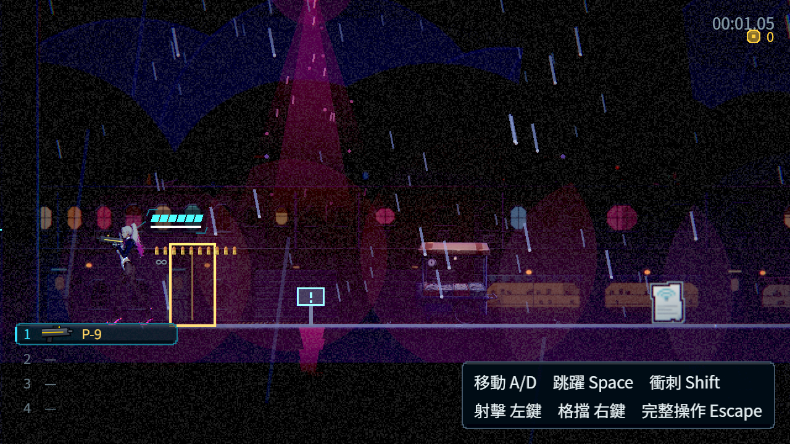
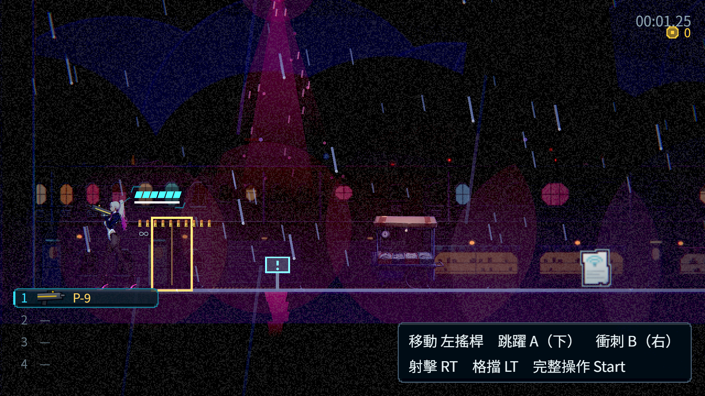

---

# Commit-2

## 內文

常駐六项操作說明容易像外加工具面板，也會與人物、字幕及其他提示競爭。現在新遊戲只短暫顯示查閱操作的入口，完整操作保留於暫停頁；同區提示收起時保留閱讀時間，改鍵與裝置切換會更新文字。

人物交談使用像素切角、頭像與姓名標籤；通訊使用窄卡，文件以物件名稱與紙灰色框辨識。閱讀期間收起競爭的世界短句與操作邀請，暫停會保留同一句通訊、氣泡及章節卡的閱讀時間。站立、蹲姿與左右朝向的實際角色及血條不被提示框或文字蓋住。

### 測試結果

| 項目 | 結果 |
|---|---|
| 受影響範圍 | 原始選取流程 60 組、54,481 檢查；0 新失敗、0 已知失敗，908 秒，exit 0 |
| 最新主線近戰回歸 | 原有套件 36 檢查、0 失敗，17 秒，exit 0 |
| 原生 Forward+ | 1280×720、1920×1080、2100×900；共24張完整尺寸畫面，文字100%／120% |
| 提示與輸入 | 26 檢查通過；改鍵、合成手把圖示、減動態、完整操作查閱與閱讀時間保留 |
| 目視複核 | 三尺寸正文、頭像、人物及血條與提示框分離；引線穿越狀態列的觀察保留於目視記錄 |
| 執行紀錄 | 0 SCRIPT ERROR；原始紀錄包含故障注入、物理診斷，以及離場6個Area2D RID／7個CanvasItem RID／25個ObjectDB／13個資源診斷 |

畫面使用真實角色、原有台詞與實際蹲站輸入，取景時使用隔離資料副本；驗收範圍是介面呈現、操作回歸與閱讀時間。完整操作表保留於暫停頁，章節與教學的正式進度由玩法決定。原始[局部結果](attachments/NE-228-contextual/changed-console.log)、[執行紀錄](attachments/NE-228-contextual/changed-shard-0.log)、[目視記錄](attachments/NE-228-contextual/visual-review.md)、[最新主線近戰](attachments/NE-228-contextual/latest-melee-console.log)及[證據清單](attachments/NE-228-contextual/manifest.json)可供核對。

### 截圖

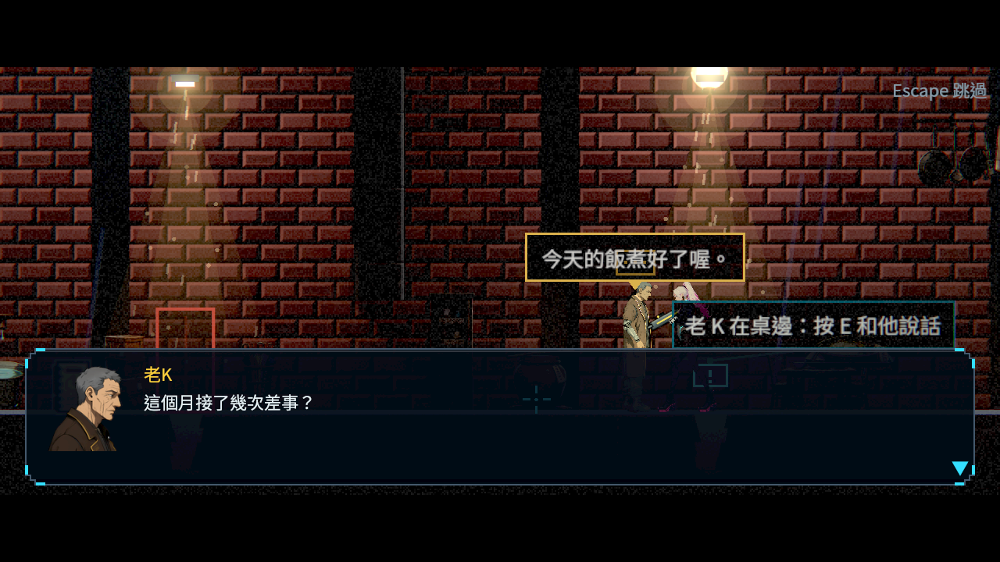
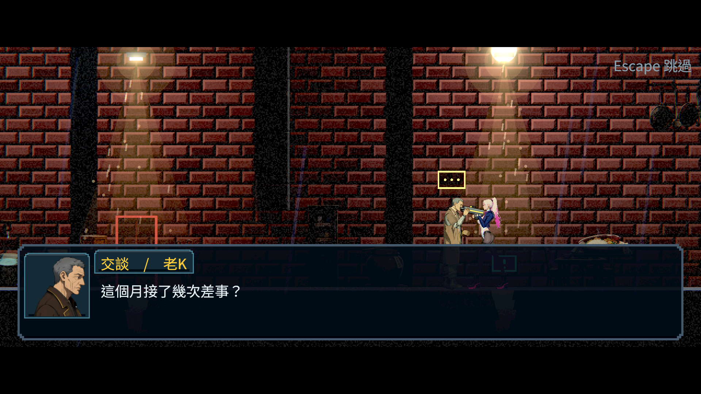
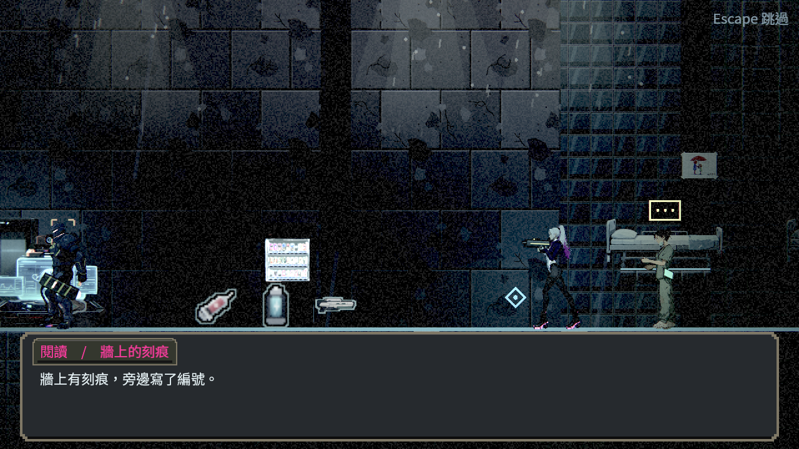
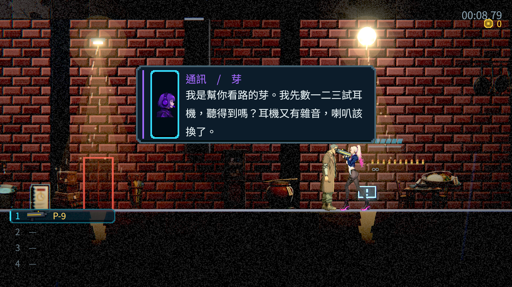

---

# Commit-3

## 內文

操作提示的連線原本可能穿過角色狀態、彈藥與章名。現在連線避開這些閱讀區域，仍指回原本的互動物件；提示框維持在畫面內，彈藥、章名隱藏或離場後立即釋放空間。

三種解析度的二十四張畫面逐張複核通過，左右站立與蹲姿都保留物件位置的辨識，人物交谈、通訊與物件閱讀的姓名、正文與頭像完整。

### 測試結果

| 項目 | 結果 |
|---|---|
| 受影響範圍 | 原始選取流程46組、8,982檢查；0新失敗、0已知失敗，832秒，exit 0 |
| 介面與提示回歸 | 原有三套件200檢查、0失敗，exit 0 |
| 雲端受影響範圍 | 原始選取流程46組、9,002檢查；0新失敗、0已知失敗，463秒，exit 0 |
| 主線死亡動作回歸 | 候選來源完整保留；原有死亡動作套件4,382檢查、0新失敗、0已知失敗，11秒，exit 0 |
| 最新主線護盾與連段回歸 | 原有近戰武器、近戰與操作手感三套件729檢查、0新失敗、0已知失敗，138秒，exit 0 |
| 原生 Forward+ | 1280×720、1920×1080、2100×900；文字100%／120%，24張圖逐張複核通過 |
| 紀錄保存 | 測試與截圖原始結果、目視限制及檔案雜湊可核對；沒有修改測試選取與錯誤篩選規則 |

[受影響結果](attachments/NE-228-clearance/changed-console.log)、[完整執行紀錄](attachments/NE-228-clearance/changed-shard-0.log)、[死亡動作回歸](attachments/NE-228-clearance/latest-rig-console.log)、[最新主線護盾與连段回歸](attachments/NE-228-clearance/latest-combat-console.log)、[目視複核](attachments/NE-228-clearance/visual-review.md)及[證據清單](attachments/NE-228-clearance/manifest.json)。

雲端的[原始結果](attachments/NE-228-clearance/cloud/run.log)、[完整紀錄1](attachments/NE-228-clearance/cloud/run/shard_0.log)、[完整紀錄2](attachments/NE-228-clearance/cloud/run/shard_1.log)及[本機複核](attachments/NE-228-clearance/cloud/root-review.json)保留供核對；兩邊總檢查數差20，原因尚未定位，均為0失敗。

### 截圖

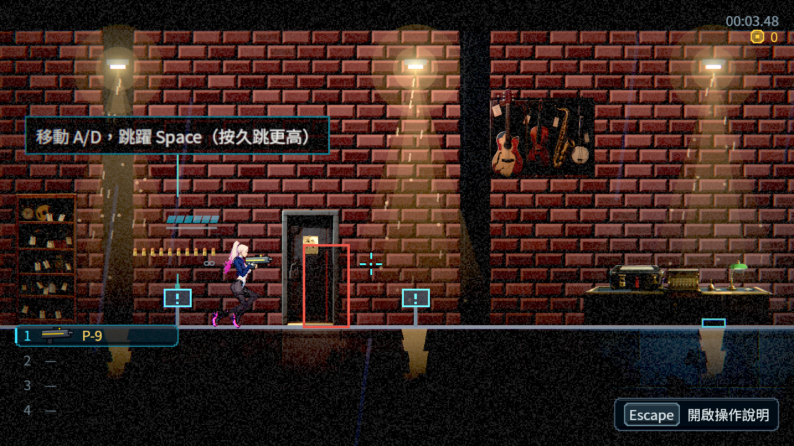
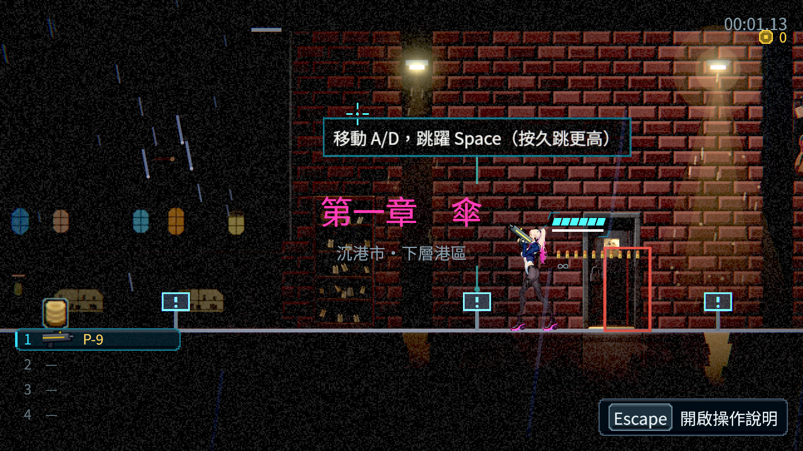
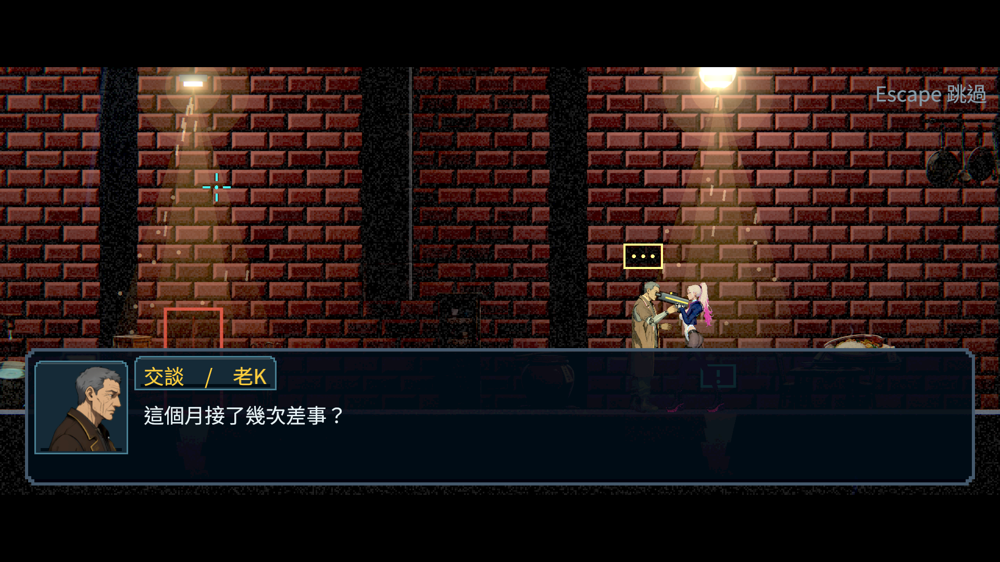

交談預覽使用原有台詞與隔離取景，驗證介面閱讀；角色持槍姿勢與完整交談舞台另依故事與角色票驗收。

---

# 跟其他票的關係

- Blocks：NE-233
- Blocked by：NE-227、NE-291
- Related：NE-36、NE-43、NE-223、NE-229、NE-230

---

# 2026-10-11 交接紀錄

## 內文

在真戰鬥通訊與暫停圖中確認背景任務說明遮擋。HUD 窄候選僅有來源／語法審查，未採用、未經 Godot 與原生驗證；本票維持進行中。

使用者要求本 Session 收尾後停止開發。偏好、研究依據、避免重犯事項與精確接手資訊見 [使用者指南](../user_guide.md)及[本次交接](../SESSION_HANDOFF_2026-10-11.md)。此段保存現況，不是新完成紀錄。

---

# Commit-4

## 內文

滑鼠停在 HUD 上（例如信用點）時，說明框會留在畫面上，接著打開暫停頁或來了通訊，舊說明就壓在「目前進度」標題或通訊上；還沒冒出來的說明也可能在交談期間晚一步出現。

現在暫停頁、人物交談或通訊一出現，背景 HUD 的說明立刻收起，等待中的說明一併取消，期間停在 HUD 上也不會再冒出來；回到遊戲後重新停住滑鼠，說明照常出現。HUD 原本的說明文字、可見規則與暫停頁焦點都不受影響。上次留下的候選做法較大且未驗證，這次只採用其中「暫停邊緣當下處理」的原則，改成更小、可重用的守門元件。

驗收用真的滑鼠移動事件讓引擎實際顯示說明，再打開真的暫停頁、通訊與交談：拿掉守門時三種情況都重現遮擋（自動檢查 3 項失敗），加上後全部通過。Forward+ 畫面修前修後並排如下。實體滑鼠與手把在原生畫面的操作仍待本機原生驗收，對應驗收條件暫不勾選。

### 測試結果

| 項目 | 結果 |
|---|---|
| 受影響範圍（基準 f048d9d1） | 12 組、2,586 檢查；0 新失敗、0 已知失敗，175 秒 |
| 介面套件單跑 | 43 檢查、0 失敗；拿掉守門時 3 項失敗（暫停時已顯示、交談前排程中、通訊時已顯示），證明檢查有效 |
| 首輪平行測試 | 「通訊結束後守門解除」在負載下固定兩影格內未解除；改為有上限的等待後重跑通過 |
| 原生 Forward+ | Vulkan／llvmpipe 軟體渲染；1280×720 修前修後、1920×1080 修後 |
| 待本機原生驗收 | 實體滑鼠停留後開暫停頁／收到通訊、實體手把；雲端合成輸入不代替 |

分支 `claude/nest-egg-ui-quest-map-wgwwvw`，[提交紀錄](https://github.com/deadline314/Nest-Egg/commits/claude/nest-egg-ui-quest-map-wgwwvw)。

### 截圖

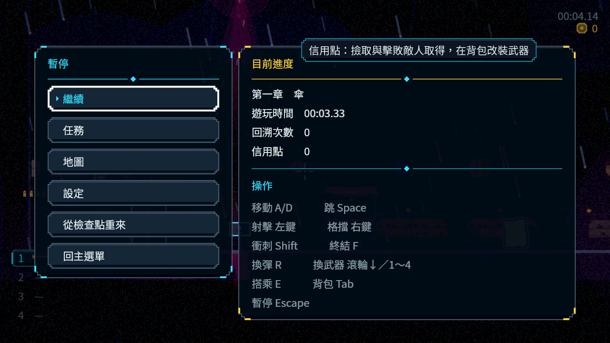
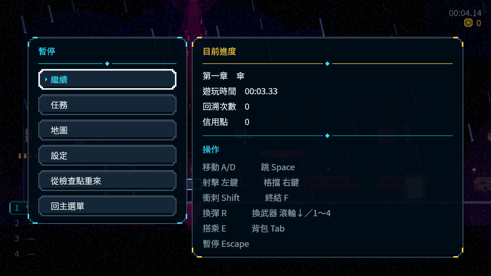
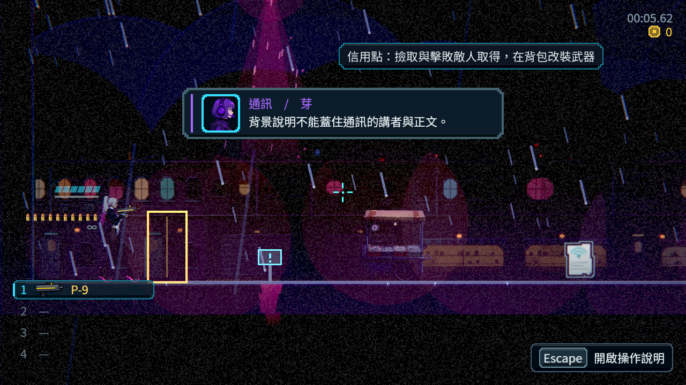
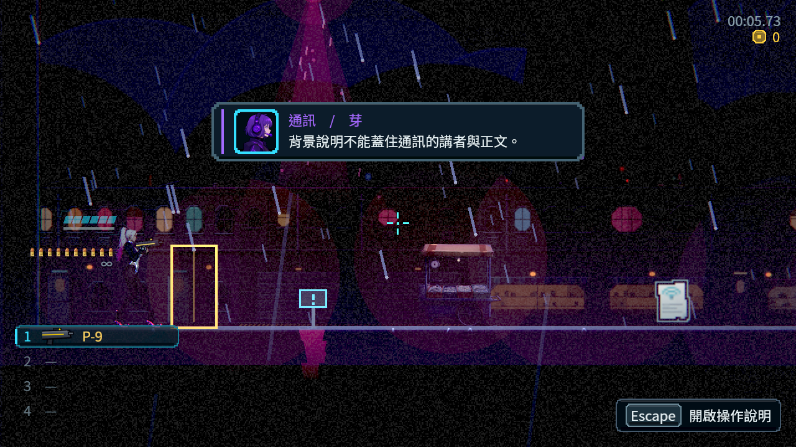
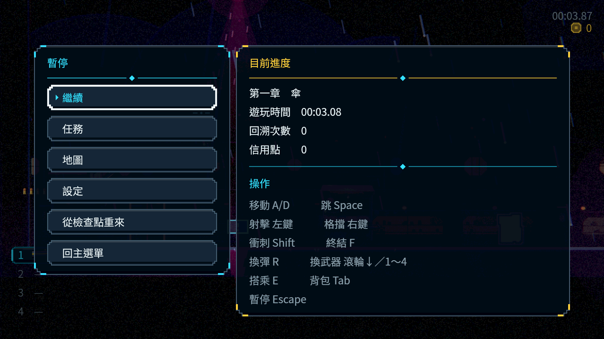

---

# Commit-5

## 內文

畫面右下角的「Escape 開啟操作說明」提示在打開暫停頁、任務或地圖後仍留在原地，透過暗底壓在地圖的圖例旁邊。原因是暫停期間 HUD 不再更新，提示沒有機會收起。

現在暫停頁或其子頁一打開，這張操作提示當下收起；關閉後依當時情境回來，暫停期間不扣它的閱讀時間。

### 測試結果

| 項目 | 結果 |
|---|---|
| 受影響範圍（基準 2a1fce49） | 12 組、2,609 檢查；0 新失敗、0 已知失敗，174 秒 |
| 介面套件 | 47 檢查、0 失敗；拿掉修正時「暫停頁打開時背景的操作提示收起」失敗 |
| 原生 Forward+ | 1280×720 港區街道區域地圖修前修後（Vulkan／llvmpipe 軟體渲染） |

分支 `claude/nest-egg-ui-quest-map-wgwwvw`，[提交紀錄](https://github.com/deadline314/Nest-Egg/commits/claude/nest-egg-ui-quest-map-wgwwvw)。

### 截圖

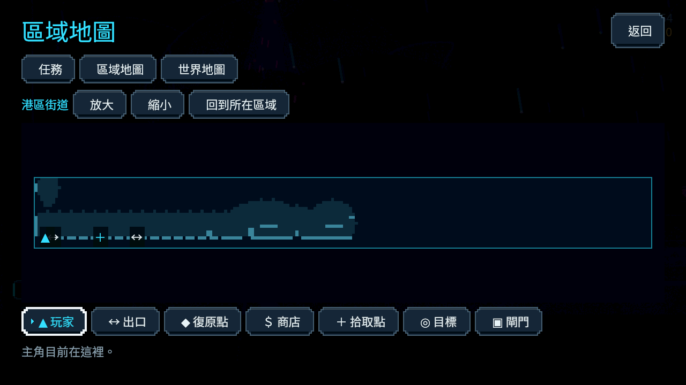

---

# Commit-6

## 內文

把文字放大到 120% 逐頁檢查主選單、難度、設定、圖鑑、暫停、死亡與結算，找到三個會截字或擠出畫面的地方：結算畫面整張超出畫面底部，「再玩一次／回主選單」按鈕完全看不到；暫停頁的「目前進度」面板底部超出畫面；敗北圖鑑的卡片名稱與「？？？」被切掉一半。另外難度卡片的說明會把「，」換到下一行開頭。

現在結算的評價改成兩欄，放大文字後整張結算與按鈕都在畫面內；暫停頁兩個面板往上移，完整操作表留在畫面內；卡片會隨內容長高，不再裁掉文字，難度與圖鑑共用這個修正。卡片、死亡畫面與圖鑑的換行改用中文斷行規則，標點不會出現在行首。結算畫面的按鈕說明改放在按鈕右側的淡色文字，不加框，避免被看成第三顆按鈕。

100% 與 120% 兩種文字大小都重拍確認；截圖工具新增文字放大與視窗尺寸參數，放大設定寫到獨立設定檔，不影響玩家設定。

### 測試結果

| 項目 | 結果 |
|---|---|
| 受影響範圍（基準 86a8097f） | 20 組、5,166 檢查；0 新失敗、0 已知失敗，176 秒 |
| 中文斷行 | 引擎內實測同一句在三種寬度下，舊斷行在一種寬度把「，」放到行首，新斷行三種都沒有 |
| 原生 Forward+ | 1280×720，文字 100%／120% 七個畫面全部重拍目視（Vulkan／llvmpipe 軟體渲染） |

分支 `claude/nest-egg-ui-quest-map-wgwwvw`，[提交紀錄](https://github.com/deadline314/Nest-Egg/commits/claude/nest-egg-ui-quest-map-wgwwvw)。

### 截圖

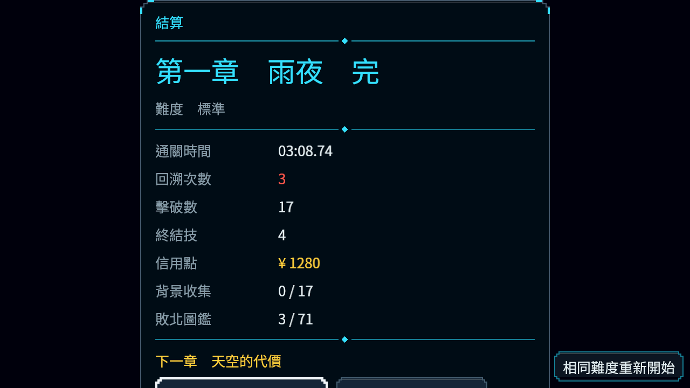
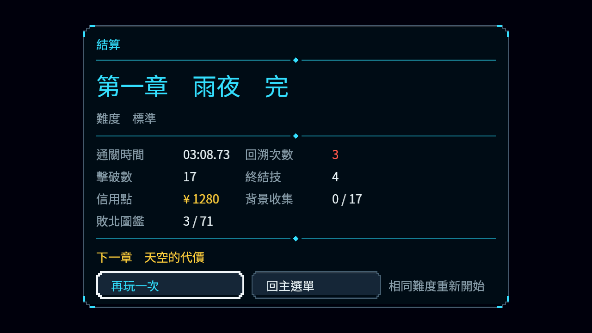
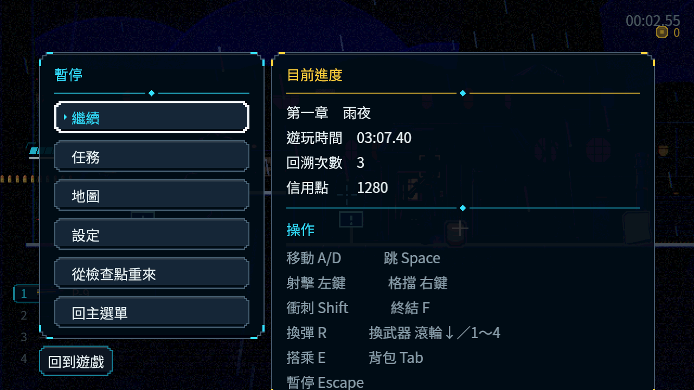
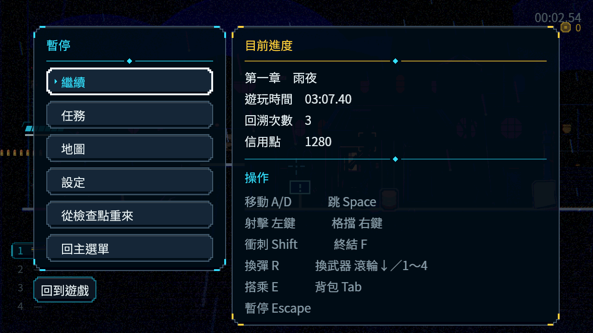
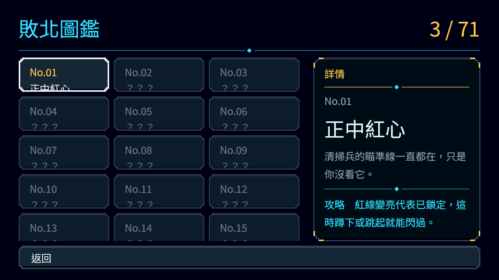
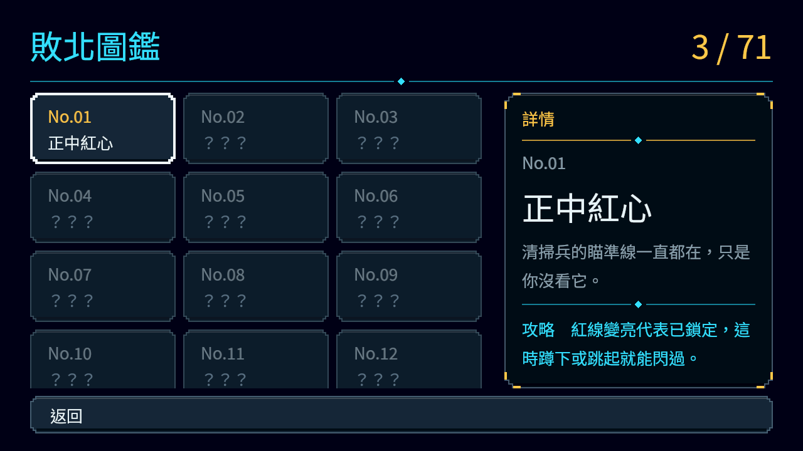
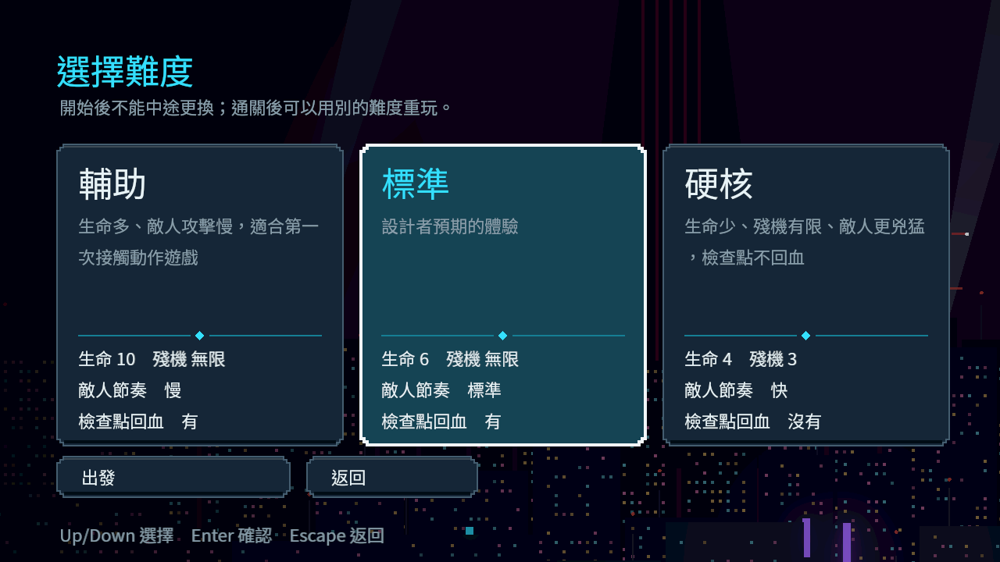
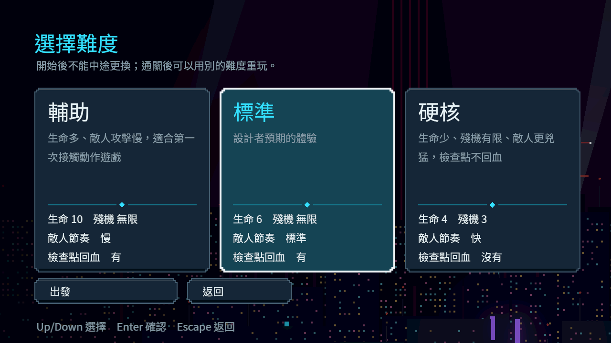

---

# Commit-7

## 內文

接著用 120% 文字檢查背包六個分頁。「角色狀態」最後一列擊破數壓到底部的操作說明列；武器清單上「手上」徽章變高後，半透明底蓋到右側的彈種圖示。

現在狀態列的列高跟著文字決定，七列都留在頁面內；徽章文字的基線依字型高度計算，字留在框內，有彈種圖示時徽章讓到圖示左邊。這只修截字與重疊，背包的整體版面由 NE-244 重排。

### 測試結果

| 項目 | 結果 |
|---|---|
| 受影響範圍（基準 0f683c28） | 9 組、3,081 檢查；0 新失敗、0 已知失敗，134 秒 |
| 原生 Forward+ | 1280×720，文字 100%／120% 背包武器、消耗品、劇情道具、角色狀態重拍目視（Vulkan／llvmpipe 軟體渲染） |

分支 `claude/nest-egg-ui-quest-map-wgwwvw`，[提交紀錄](https://github.com/deadline314/Nest-Egg/commits/claude/nest-egg-ui-quest-map-wgwwvw)。

### 截圖

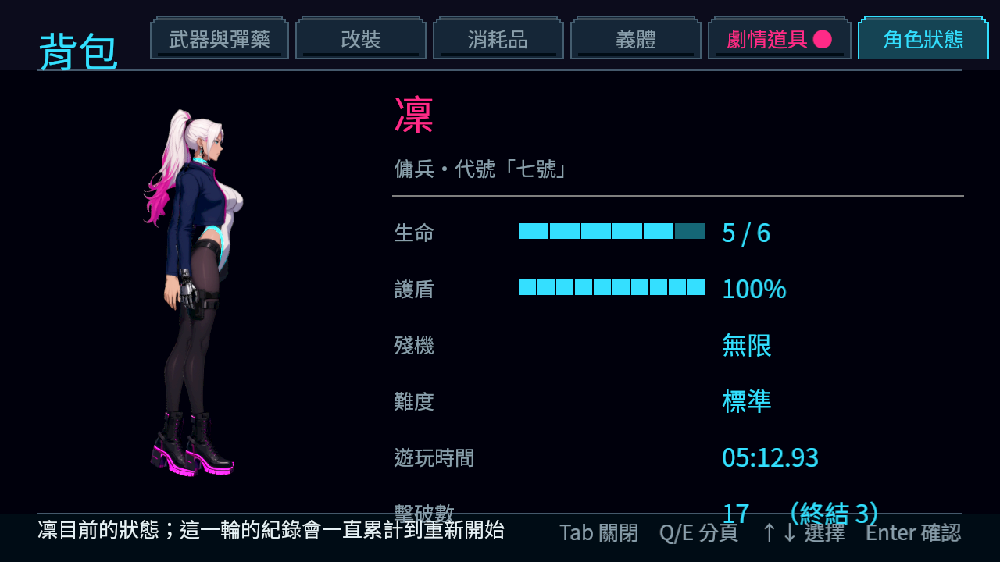
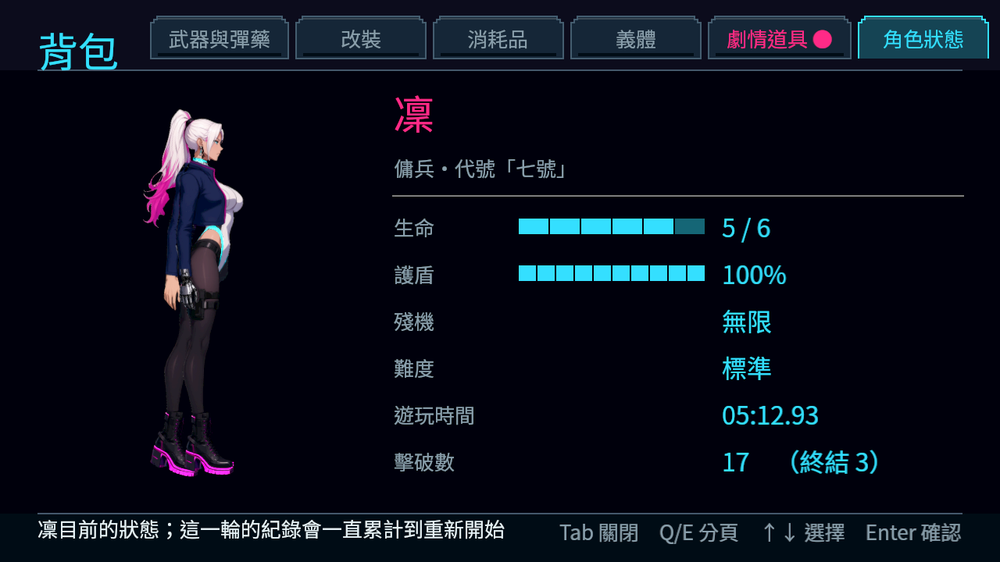
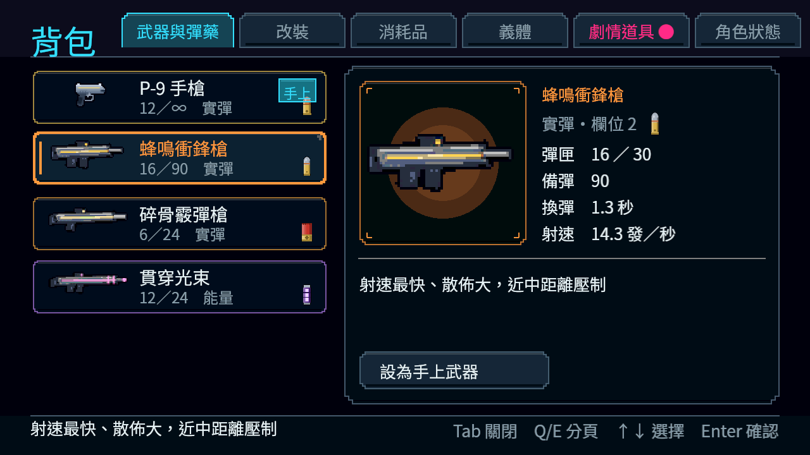
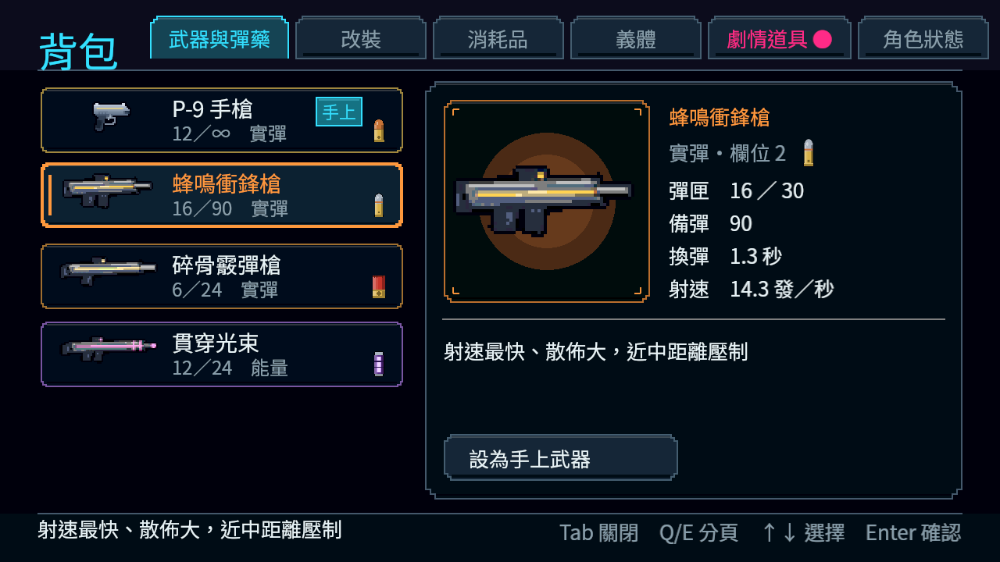

---

# Commit-8

## 內文

設定頁的切換鈕（全螢幕、HUD 自動隱藏等）沒有內距，鍵盤或手把聚焦時白色焦點框直接壓在文字第一個字上，看起來像框線切過字。

現在切換鈕留了內距，焦點框完整圍住整列；設定頁其他列（音量、亮度、光影品質、按鍵表）的標題同步內縮，整頁文字仍然對齊。新增一個放大文字巡檢工具，一次拍設定四個分頁與補給商店，並列出超出畫面或被裁切的文字；這次巡檢在設定與商店沒有其他截字（清單本來就可捲動的列不算）。

### 測試結果

| 項目 | 結果 |
|---|---|
| 受影響範圍（基準 3fd0246a） | 48 組、12,373 檢查；0 新失敗、0 已知失敗，196 秒 |
| 原生 Forward+ | 1280×720，文字 100%／120% 設定四分頁與補給商店（Vulkan／llvmpipe 軟體渲染） |

分支 `claude/nest-egg-ui-quest-map-wgwwvw`，[提交紀錄](https://github.com/deadline314/Nest-Egg/commits/claude/nest-egg-ui-quest-map-wgwwvw)。

### 截圖

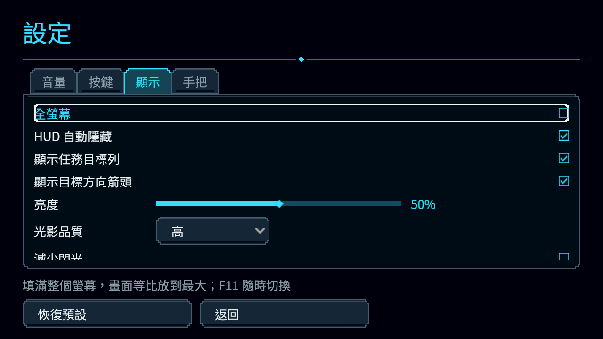
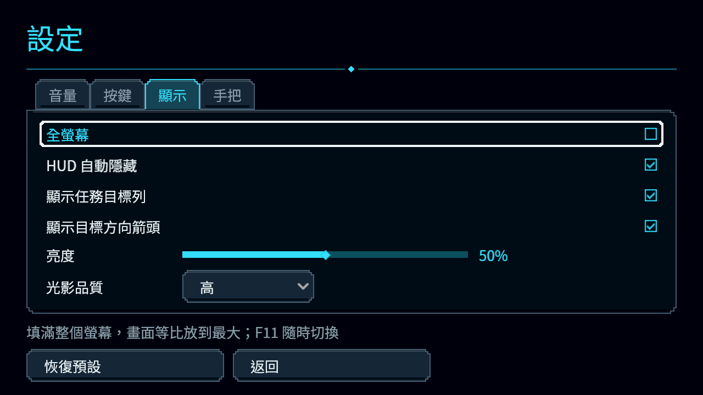
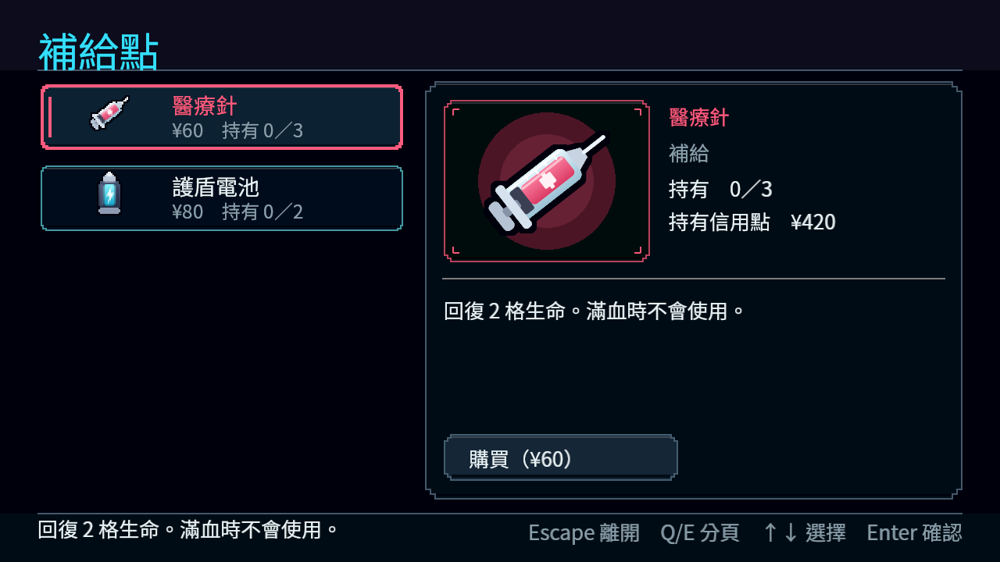

---

# Commit-9

## 內文

撿到道具時，「取得…」橫幅出現在畫面中上方、角色與敵人附近，一次只顯示一句；連續撿到幾樣東西時後一句直接蓋掉前一句，戰鬥中也會擋到視線。

參考 Leyla In Veil 實際畫面裡角落的拾取紀錄，改成在右上角信用點下方疊列：每撿到一樣多一行，最新的在最下面，幾秒後淡出；同一句在顯示中再出現會顯示次數，不洗版。每行只和文字一樣寬，用 Nest Egg 的像素切角框與金色字。通訊出現時拾取紀錄先讓位，剩下的時間保留，通訊結束再回來；暫停時跟著停住；減少動態時不淡入。檢查點、警告與其他提示維持畫面中央的橫幅。

各處撿東西的提示內容與觸發都沒變，只改了呈現位置。

### 測試結果

| 項目 | 結果 |
|---|---|
| 受影響範圍（基準 31136f13） | 12 組、2,656 檢查；0 新失敗、0 已知失敗，172 秒 |
| 介面套件 | 54 檢查、0 失敗；取得類進紀錄、同句計次、超過上限換掉最舊一行、位置與寬度、通訊讓位與保留時間、時間到全部淡出且閒置不再更新 |
| 原有斷言調整 | 「橫幅水平置中」原本用取得類文字測試，取得類已改進紀錄，改用檢查點文字測同一項置中 |
| 原生 Forward+ | 1280×720 第一章街道修前修後（Vulkan／llvmpipe 軟體渲染） |

分支 `claude/nest-egg-ui-quest-map-wgwwvw`，[提交紀錄](https://github.com/deadline314/Nest-Egg/commits/claude/nest-egg-ui-quest-map-wgwwvw)。

### 截圖

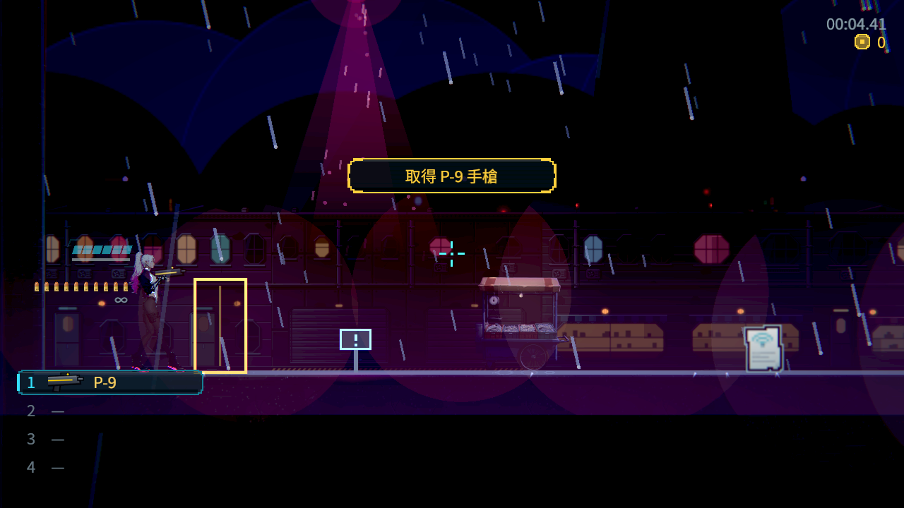
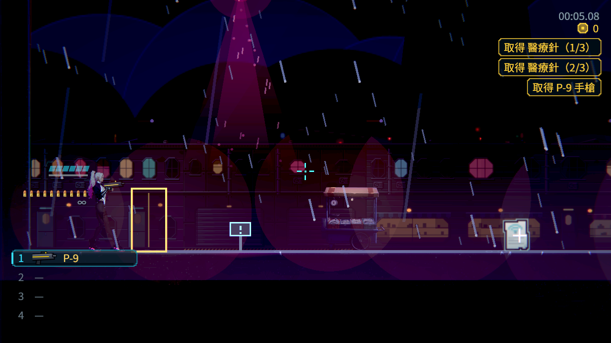

# 本機原生驗收（2026-10-11）

## 內文

雲端只有軟體渲染與合成輸入，以下項目在本機補驗：Godot 4.7.2、Forward+、Intel Arc B580，來源是分支 `claude/nest-egg-ui-quest-map-wgwwvw` 的 7dffe868，沒有改動任何程式。

滑鼠說明：把作業系統的真游標移到信用點、義體電量、武器欄第一格上，等說明出現，再分別開暫停頁、觸發通訊、觸發人物交談（含說明還在排程時就開始交談）。三個位置、1280×720 與 1920×1080 共 54 個時點全部符合：說明當下消失，沒有蓋住講者與正文；回到遊戲後再停住滑鼠會重新出現。暫停是真的開啟（世界停住）才記錄。

暫停頁、任務頁與地圖頁底下沒有透出「Escape 開啟操作說明」。撿到道具時，紀錄逐行疊在右上角信用點下方，同一句會計次（醫療針 1/3、2/3），不再佔畫面中央。

文字 120%：結算、暫停、圖鑑、設定、難度與主選單在兩種解析度都沒有截字或擠出畫面；補給商店的文字完整。

另外看到幾件事，沒有動手修，留給負責的 Session 判斷：
- 死亡畫面底下仍看得到「Escape 開啟操作說明」與關卡裡的提示框（截圖情境同時疊了章節標題卡，那一項是截圖時機造成的）。
- 補給商店的半透明底下，會透出關卡地板的亮邊（一條橫貫畫面的細線）與雨絲。
- 文字放大巡檢工具回報 19 筆「超出畫面」，逐筆對照畫面後都是設定頁可捲動清單裡還沒捲到的列，不是真的被擠出去；工具沒有把捲動區的裁切算進去。按鍵分頁在 120% 一次只看得到四列，第五列被切一半，沒有捲軸提示。
- 背包頁沒有對應的截圖情境，這次沒有驗到。

驗收條件維持原狀，這一段只記錄本機看到的結果。

### 測試結果

| 項目 | 結果 |
|---|---|
| 受影響測試（本機，基準 ae8f1e94） | 12835 項檢查；新失敗 0、已知失敗 0 |
| 滑鼠說明（真游標，3 個位置 × 9 個時點 × 2 種解析度） | 54／54 符合 |
| 120% 文字（兩種解析度各 9 個畫面，加設定四分頁與商店） | 沒有截字或擠出畫面 |
| 原生執行紀錄 | 自然結束；沒有腳本錯誤 |

### 截圖

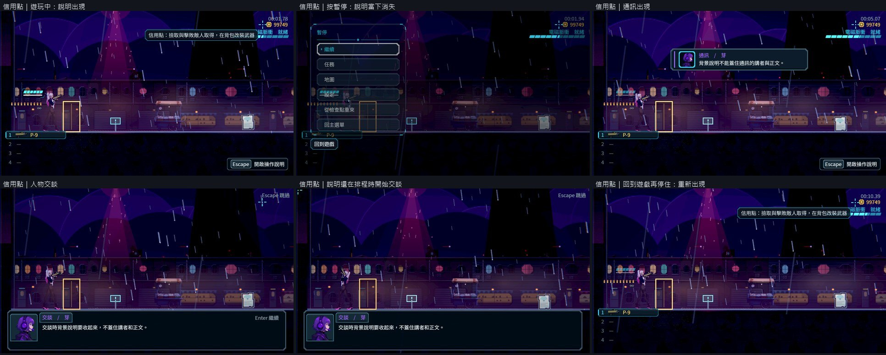

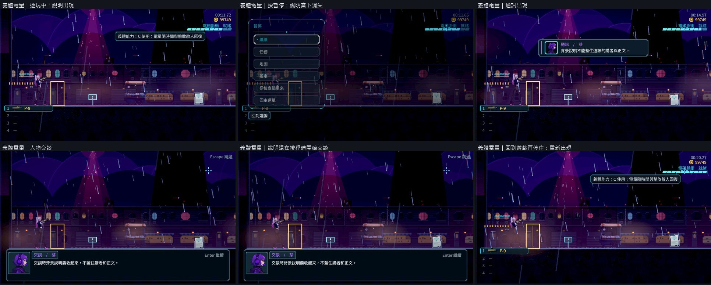

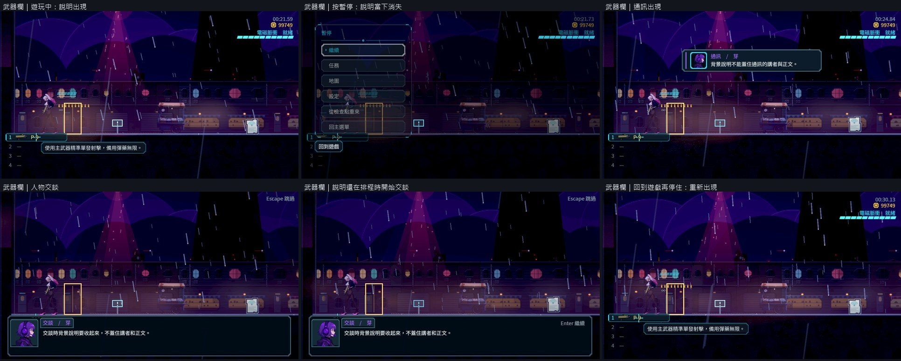

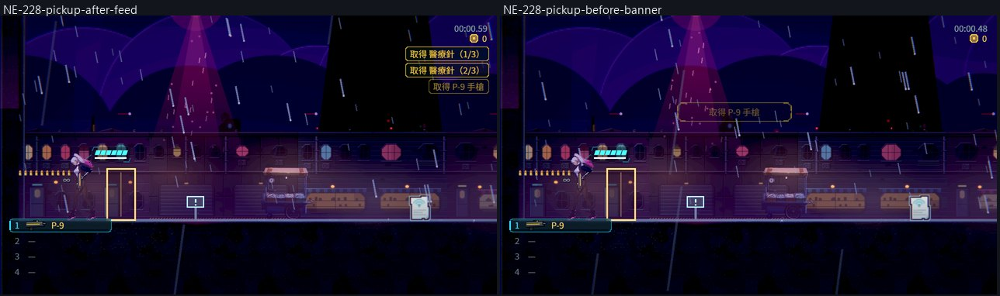

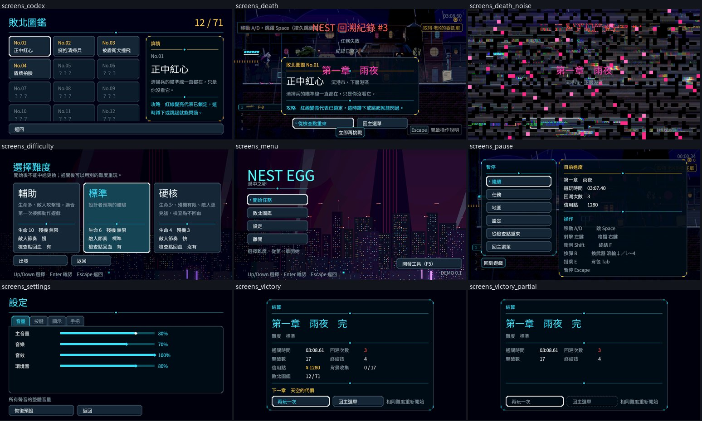

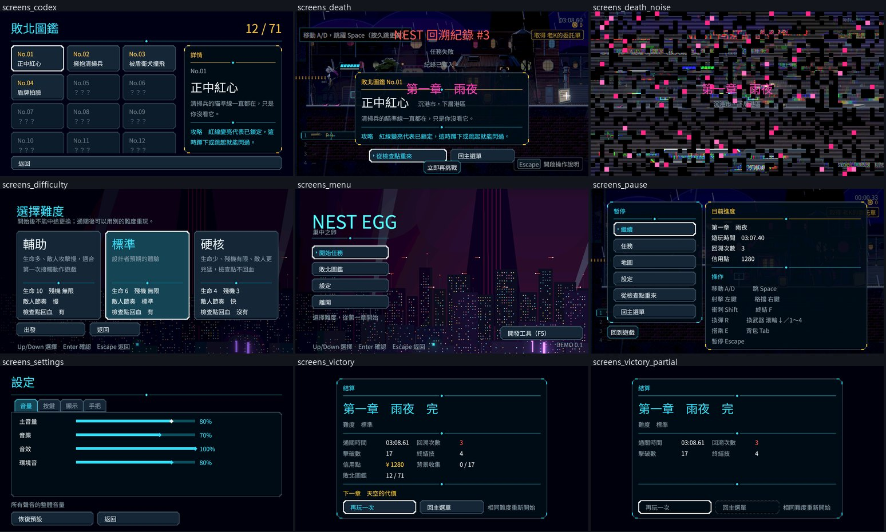

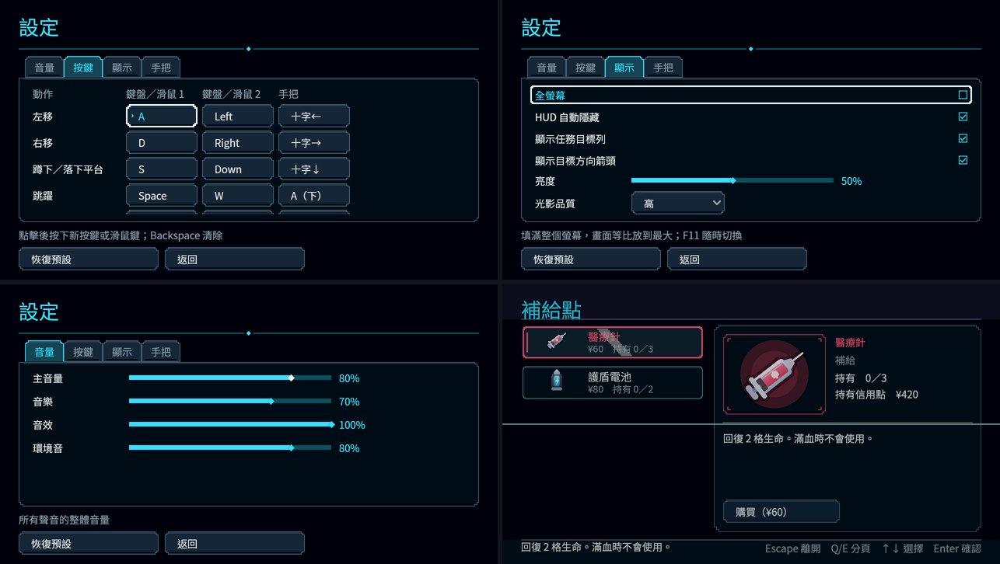

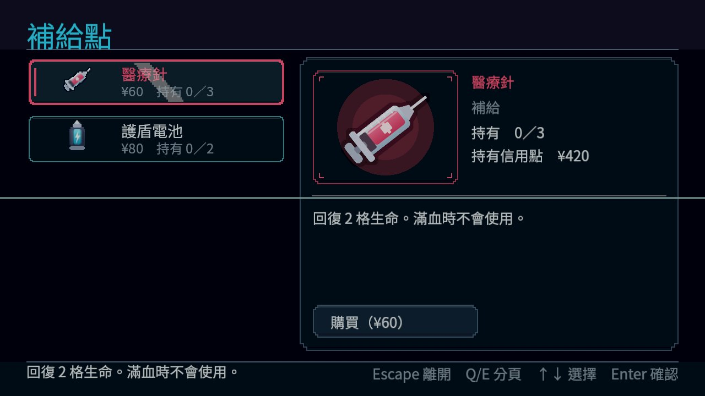

# Commit-10

## 內文

本機原生驗收留下四件事：死亡畫面底下還看得到「Escape 開啟操作說明」與關卡裡的教學提示框；補給商店的半透明底下透出一條橫貫畫面的亮線與雨絲；文字放大巡檢回報 19 筆「超出畫面」，其實都是設定頁可捲動清單裡還沒捲到的列，而且按鍵分頁在 120% 時第五列被切一半，看不出下面還有內容；背包頁沒有截圖情境，沒有驗到。

死亡畫面的操作說明，是截圖情境直接把死亡畫面疊上去、主角其實沒有倒下造成的；真正的死亡流程本來就會收起操作說明。截圖情境改成讓主角真的倒下、由關卡自己開死亡畫面。走真正流程後，發現教學看板的提示（「移動、跳躍」）仍會對倒地的主角顯示，所以改成主角倒下時不再顯示任何靠近提示，起身後恢復。商店的亮線與雨絲，在雲端等開啟動畫跑完才拍時沒有出現；原工具是固定等 30 個影格，GPU 很快時不到動畫長度，會拍到正在淡入、中央掃描線還在的畫面，判斷是拍攝時機造成，工具改成用實際時間等動畫跑完。巡檢工具把捲動區裡還沒捲到的列另外計數、不算問題，改為列出「還有內容卻沒有捲動提示」的捲動區；設定頁的顯示、按鍵、手把三個捲動分頁加上底緣淡出與 ▼ 提示。截圖情境補上背包六個分頁；背包底部說明列在文字放大時改用省略號收尾，不再從字的中間切開。

驗收在 Forward+（雲端軟體 Vulkan）1280×720、文字 120% 拍攝：真正死亡流程的死亡畫面沒有操作說明與教學提示框；按鍵分頁看得到 ▼ 與淡出；商店開啟後畫面乾淨；背包六個分頁都拍到；巡檢 0 問題（捲動區內尚未捲到的列 21 筆，另計）。商店亮線需要在本機原生用新工具重拍一次確認。死亡畫面的按鈕說明在 120% 時壓到「回主選單」，屬於 NE-229 的聚焦說明，在那張票處理。驗收條件仍有多項（實機手把、全頁面正式內容等）未達成，本票維持進行中。

### 測試結果

| 項目 | 結果 |
|---|---|
| 受影響範圍（基準 75bb558c） | 52 組、19,058 檢查；0 新失敗、0 已知失敗，168 秒 |
| 新增檢查 | 主角倒下後教學提示不顯示、起身後恢復 |
| 文字放大巡檢（設定四分頁＋補給商店，120%） | 0 問題；捲動區內尚未捲到的列 21 筆另計 |
| 截圖情境（主選單到結算、背包六分頁，120%） | 15 張，沒有腳本錯誤 |

分支 `feature/ui-quest`，[提交紀錄](https://github.com/deadline314/Nest-Egg/commits/feature/ui-quest)。

### 截圖

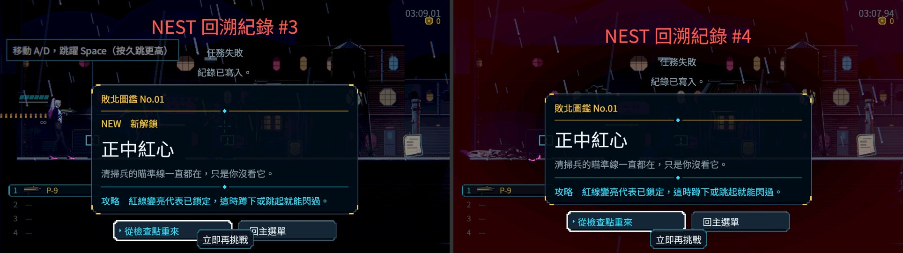

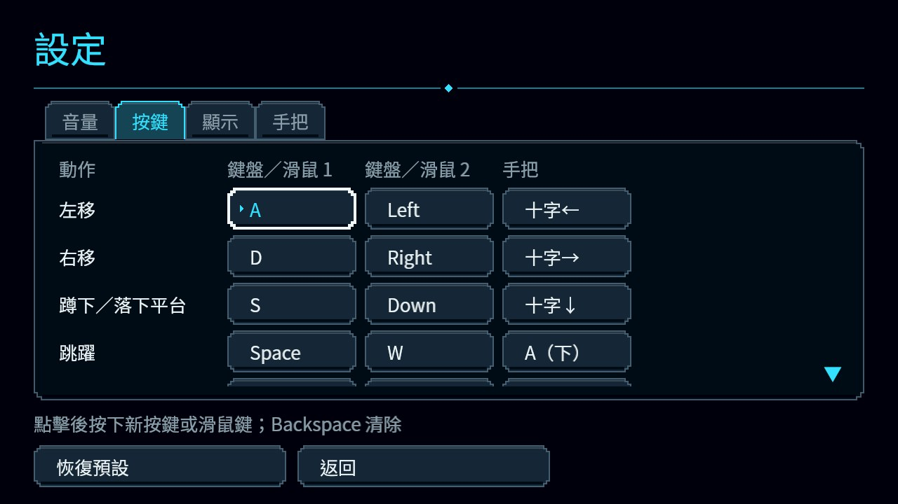

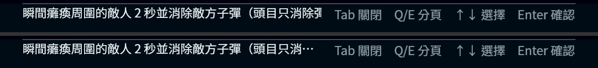

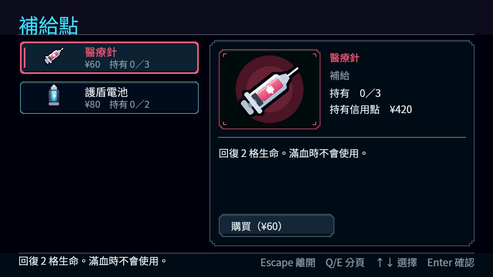

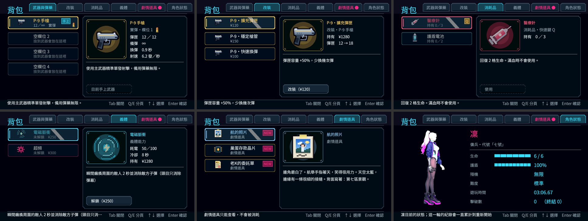

# Commit-11

## 內文

剩下的驗收條件裡，「確認、返回、分頁與取消一致、關閉子頁恢復焦點、不穿透模態頁」與「入區不重播整份按鍵表」原本沒有一套檢查從頭到尾走過；「不同寬高比」只拍過 16:9；聚焦說明的條件已在本機原生驗收 54/54 符合，但勾選一直沒有更新。

這次沒有改遊戲程式，只補上一致性檢查，並放進介面畫面套件。檢查內容如下：主選單的「設定」「敗北圖鑑」與暫停頁的「任務」「地圖」「設定」，都用手把 A 打開、LB／RB 換頁、B 一層層返回，焦點回到打開它的那顆按鈕；暫停頁、背包、任務與地圖開著時，按跳躍與射擊，主角的位置與彈匣都不變，再用 B 一路回到遊戲；新遊戲第一次進關卡時保留開場操作提示，從出入口進到下一區時不再出現。合成的手把事件不代替實體手把（NE-229）。寬高比在 Forward+（雲端軟體 Vulkan）、文字 120% 下拍了 2560×1080（21:9）、1024×768（4:3）、1280×800（16:10）與 1920×1080。遊戲固定以 16:9 畫面等比放大，其他比例只在兩側或上下補黑邊，所以四種尺寸的畫面內容一致，主選單、設定、暫停、背包、死亡、結算、圖鑑與難度都沒有截字或重疊。

勾選：「確認、返回、分頁與取消一致」依這次的檢查；「遊戲內提示依情境顯示」依這次的入區檢查，加上既有的模態與倒地收起提示檢查，以及暫停頁可查完整操作；「通訊、交談與暫停時收起聚焦說明」依本機原生 54/54 與自動檢查。「不同寬高比與文字放大」的版面已經沒有問題，但同一條還要求「無占位頁面」：正式任務還沒合進 main，任務頁在 main 上沒有內容，所以先不勾。其他條件（全頁面正式內容、實機手把、減少動態等）也未完成，本票維持進行中。

### 測試結果

| 項目 | 結果 |
|---|---|
| 一致性檢查（主選單 2 頁、暫停頁 3 頁、3 種模態頁、入區提示） | 27 項全過 |
| 寬高比（21:9、4:3、16:10、16:9，文字 120%，各 15 張） | 沒有腳本錯誤；畫面內容一致，沒有截字或重疊 |
| 受影響範圍 | 20 組、5,677 檢查；0 新失敗、0 已知失敗，163 秒 |

分支 `feature/ui-quest`，[提交紀錄](https://github.com/deadline314/Nest-Egg/commits/feature/ui-quest)。

### 截圖

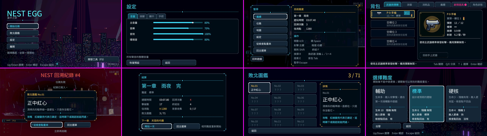

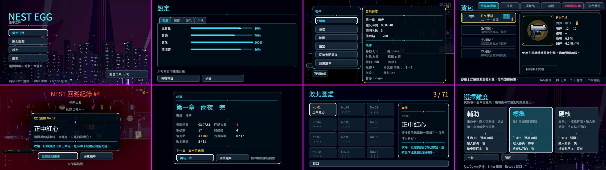

# Commit-12

## 內文

用真輸入走一遍序章（從主選單開新遊戲，用移動、跳躍、射擊、近戰、格擋、衝刺與互動鍵玩完）時，Forward+ 截圖看到訓練站的操作提示和 HUD 的任務目標列疊在同一個位置：「Space 跳上搬貨台，工具就放在上面。」和「◎ 取下搬貨台上的試貨工具」兩行字互相壓住，訓練器那一段也一樣。另外上次留下的「無占位頁面」一直等正式任務合進 main，現在已經合入。

改動：世界提示（訓練站、告示）是當下要做的動作，優先讀得到。提示框壓到目標列時，目標列在 0.15 秒內淡出讓位，提示框留在原處；提示收起後目標列再淡回來。曾先試過讓提示框避開目標列，結果訓練器那一段的提示被推出畫面上緣，反而看不到，所以改成目標列讓位。減少介面動態時直接切換，不做淡入淡出。

驗收：序章真輸入探針在 Forward+（雲端軟體 Vulkan）1280×720 重跑，提示完整、不再疊字，十六項練習檢查全過（射擊要子彈真的打中低靶、近戰要真的打中假人、格擋要真的擋下訓練器、衝刺要真的衝過線，走過去或用錯動作都不算），手把版同樣全過。自動檢查補上：把提示框擺在目標列正中央，目標列會淡出、提示框不被推走、提示收起後目標列回來；拿掉修正時這兩項會失敗。

勾選：「720p、1080p、不同寬高比與文字放大不截字或重疊，無占位頁面」：正式任務已在 main，任務頁、地圖與 HUD 在 1280×720、1920×1080、文字 100%／120% 都是正式內容且版面檢查 0 問題（NE-223 Commit-7），背包在四種尺寸與文字設定 0 問題（NE-244），寬高比在 Commit-11 已拍，這次又修掉提示與目標列的重疊。「序章練習提示配合實際命中、格擋、移動與互動」：依第一章地圖套件的逐項檢查與這次的真輸入探針。其他條件（全頁面遷移、說明全面複查、減少動態、實體手把與裝置切換、人物對話與通訊的身份呈現）仍未完成，通訊對話框在 NE-274 審查中、行為保留；本票維持進行中。

### 測試結果

| 項目 | 結果 |
|---|---|
| 序章真輸入探針（鍵鼠、手把） | 各 16 項，0 失敗 |
| 任務與地圖套件 | 242 檢查、0 失敗（新增目標列讓位 3 項；拿掉修正時 2 項失敗） |
| 受影響範圍（基準 f79e491f，NE-228 與 NE-229 這次的改動一起跑） | 58 組、60,568 檢查；0 新失敗、0 已知失敗，589 秒 |

分支 `claude/ui-2i98t8`，已併入 main：[e3aff532](https://github.com/deadline314/Nest-Egg/commit/e3aff532)。

### 截圖

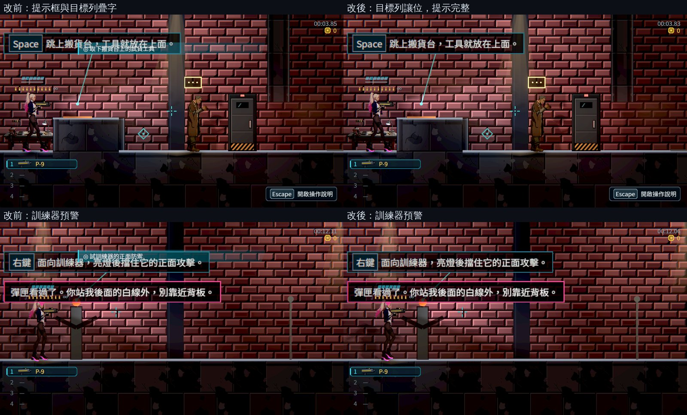

# Commit-13

## 內文

本組四張票（NE-223、NE-244、NE-228、NE-229）做完後的互相影響檢查：目標列讓位給世界提示淡出時，看不見的目標列仍會攔截滑鼠、停在那裡就跳出它的說明框。

改動：目標列讓位期間不攔滑鼠，淡回來後恢復。另外核對過：背包的立繪與信用點不影響暫停、交談與通訊時收起背景說明；世界地圖的新排法不影響任務稽核與截圖工具；設定頁新增的按住與連按說明在主選單與暫停頁開設定都一樣。使用者指南補上地圖上下層、HUD 讓位與背包版面三句。

驗收：任務與地圖套件新增「讓位時不攔滑鼠」一項並通過。受影響範圍第一輪在平行負載下有 3 項載具與掉坑的計時檢查失敗，單獨重跑本分支與乾淨的 origin/main 都是 2,274 項 0 失敗，整組重跑 0 新失敗，判定與本改動無關。

### 測試結果

| 項目 | 結果 |
|---|---|
| 受影響範圍（基準 origin/main bbbe0708） | 20 組、6,750 檢查；0 新失敗、0 已知失敗，263 秒（第一輪 3 項計時失敗，見上） |
| 主流程組單獨重跑 | 本分支 2,274／0 失敗；乾淨 origin/main 2,274／0 失敗 |

分支 `claude/ui-2i98t8`，已併入 main：[57eef82d](https://github.com/deadline314/Nest-Egg/commit/57eef82d)。

# Commit-14

## 內文

完整CI出現一項閱讀結束後頁首恢復失敗，舊紀錄無法分辨演出、操作鎖、附近演出預告或遮幅哪個狀態未恢復。本次只在失敗時保留等待前後的實際狀態，原判定與等待時間完全保留；沒有修改遊戲畫面或規則。

### 測試結果

| 項目 | 結果 |
|---|---|
| 最終受影響範圍 | 406項、0新／已知失敗，45秒 |
| 原CI前置順序重跑 | 571／0 |
| 保留頁首隱藏的診斷控制 | 13／1，原判定仍拒絕並留下前後狀態 |
| 原斷言、等待與執行器核對 | 相同 |

[原遠端失敗、重現嘗試與完整證據](attachments/NE-228-header-diagnostic/README.md)。原遠端失敗未定位；本次不更動驗收勾選，亦未以成功重跑宣稱修復。

# Commit-15

## 內文

暫停頁的進度與操作說明背後還能讀到HUD目標，圖鑑標題與卡片之間也有相同文字干擾。現在兩頁沿用既有資訊頁的模糊與壓暗背景，前景保持銳利，回到遊戲後恢復原畫面。原操作、焦點、點擊阻擋、減少動態與重要通訊的暫停規則保留。

### 測試結果

| 項目 | 結果 |
|---|---|
| 原受影響範圍，固定54b05d17 | 18組、6,911項，0新／已知失敗，215秒 |
| 明暗、720p／1080p、標準／放大文字原生驗證 | 84／0；另主選單進圖鑑5／0，五程序0引擎ERROR |
| 真正確認、方向、返回及滑鼠事件 | 子頁與焦點恢復、空白點擊不開槍／解凍、減少動態通過 |
| 同條件畫面 | 暫停、圖鑑修前修後，另保留背景目標隱藏的拍攝控制及中途版 |

[原圖、原始日誌、來源與界線](attachments/NE-228-modal-background/README.md)；[五款圖片研究](../../design/20-campaign-experience/PAUSE_READABILITY.md)。未以這次兩頁的可讀性修正代勾全遊戲介面遷移或實體裝置條件。

### 截圖

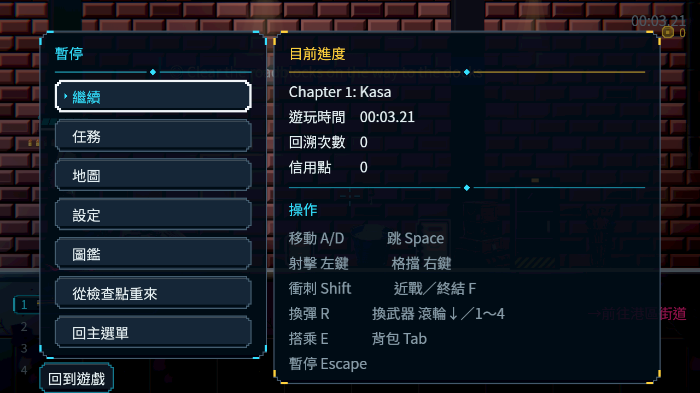
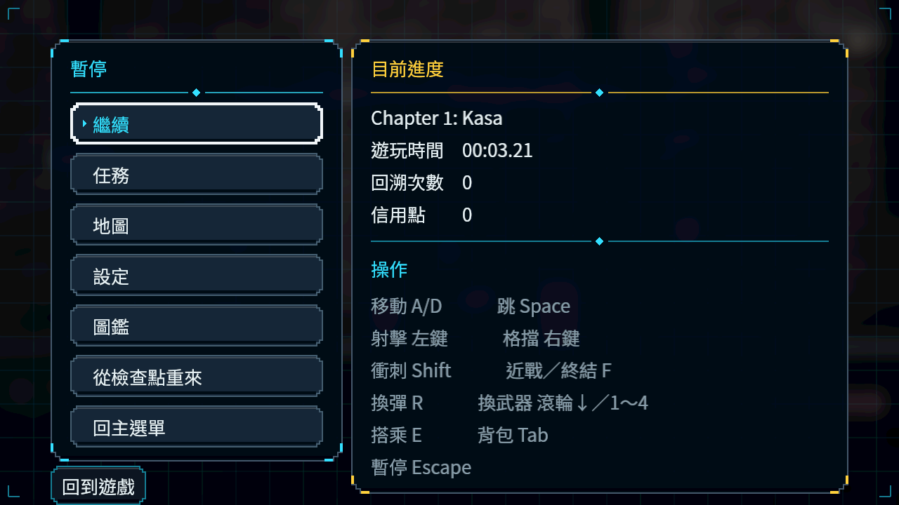

# Commit-16

## 內文

電話亭備份後立即交談，備份通知會透進選項與後果說明之間，形成兩層文字。現在選項底板完整遮住背景資訊，焦點、方向、確認與返回規則保留，通知仍照原時間消失。

### 測試結果

| 項目 | 結果 |
|---|---|
| 固定1a4fae5f的原受影響範圍 | 59組、63,098項，0新／已知失敗，491秒 |
| 720p／1080p、100%／120%文字 | 四組共100／0；五次修前／修後程序0引擎ERROR |
| 同一選項的真通知對照 | 修前2539個取樣像素不同；修後四組皆0，20張原圖逐張看過 |
| 原操作與生命週期 | 公開方向、確認返回、不接受支線、鎖釋放與通知自然結束通過 |

[五款研究、原圖、完整日誌與界線](attachments/NE-228-choice-background/README.md)。同一畫面暫藏真通知只用於診斷，正式通知規則沒有改動；整票原驗收勾選保持。

### 截圖

# Commit-17

## 內文

間歇停頓時，閱讀已結束、預告與鎖已清掉，遮幅還差一小段動畫，頁首因此晚恢復。現在遮幅與來源判定在同一更新階段推進，原動畫長度、曲線、減動態與恢復門檻保持。

### 測試結果

| 項目 | 結果 |
|---|---|
| 原CI失敗診斷 | 演出／鎖／預告皆清；遮幅仍0.262853／0.28秒，原始artifact保留 |
| 原helper同負載修前／修後 | 260／3 → 260／0；原0.48秒等待與斷言保持 |
| 固定b2d253c8原受影響範圍 | NPC、介面兩組1494項、0新／已知失敗，52秒 |
| 真Main標準／1080p放大字／減動態 | 60／0，三程序exit0、0引擎ERROR；12張最終圖逐張看過 |

[完整證據與歷史失敗](attachments/NE-228-framing-clock/README.md)。獨立舊關卡原生包裝退出錯誤在修前程式也重現，仍保留未定位；沒有以正式Main成功代稱舊入口已修好。全票原驗收條件不變。

### 截圖

同一正式流程的交談與退開階段，並非原CI失敗畫面的前後對照。

# Commit-18

## 內文

前次只調物理階段仍在完整CI失敗；本次按真正經過時間推進遮幅，完整開合保留0.28秒，短行程返回按剩餘距離縮時，原等待與斷言保持。

原helper高更新率／間歇負載各260／0，原兩組1496項、0新／已知失敗、51秒；真CI前置571／0。兩項慢動作公開scope檢查對舊正式程式均如預期失敗。正式Main三組60／0、三程序exit0、0引擎ERROR，12張圖逐張看過。

[失敗歷史、原檔、研究與驗證界線](attachments/NE-228-framing-realtime/README.md)。新完整CI待推送核對，全票原驗收勾選保持。舊關卡原生退出250仍未定位。

# Commit-19

## 內文

水坑尚未觸發時，踩踏提示會跑進約1005單位外的戰鬥區。現在只在原44單位內邀請，踩下或還原已漲滿的坑後收起；機關、故事、淡出與其他互動範圍保持。

原測試含新增近遠／完成檢查，舊程式28／3、修後28／0，14秒。同一正式Main探針修前15／2、修後15／0，兩程序0引擎ERROR；六張最終圖逐張看過。

[研究、原檔、早期通訊遮擋的探針失敗與SHA](attachments/NE-228-flood-prompt/README.md)。整票原驗收勾選保持，其他過長提示接續改善。

# Commit-20

## 內文

世界氣泡與長路牌原本橫跨畫面、透出背景字，還可能被避讓推到畫外或黑邊。現在完整句子依畫面寬度換行，按鍵帽保持完整；人物、氣泡與其他提示互相讓位，任務列也沿既有規則讓開。沒空間時暫時收起文字，互動資格保留，空間恢復便重新顯示。

正式老K對話與電話亭長提示在同條件原生對照重現7個問題，修改後720p、1080p、放大文字和平滑字型全部通過；四輪24張原圖逐張檢視，公開暫停／返回與時計保持正常。英文／日文另列排版樣本，不冒稱全章驗收。

最終原受影響60組：checks: 63204, new failures: 0, known failures (tests/known_failures.txt): 0  (wall time 488 s)。原斷言逐字保留；中途1個baseline失敗修正後重新全跑，負控制與歷史失敗完整保存。

[研究九圖、所有原生對照、失敗與最終原始測試](attachments/NE-228-world-text/README.md)。本批完成世界文字範圍，整票原驗收保持。

| 修前 | 修後 |
|---|---|
|  |  |
|  |  |

研究圖為不同作品的正式畫面，只引用有限欄寬與指向，不推論對方內部程式。

# Commit-21

## 內文

路牌已避開人物的最後位置，出現與移動途中卻仍可能遮人。現在新提示先在安全處淡入，移動途中也避開人物、其他文字與HUD；減少動態直接定位。短通知出現時保留閱讀空間，通知結束後路牌回來。任務目標閃亮不再讓已收起的目標列突然透出，方向標籤也會讓出世界閱讀位置。

另外修正切換介面字型時的引擎錯誤；同條件公開切換從8錯誤變為0。原生前後對照在720p重現3項、1080p重現4項，修後四組放大文字／字型／減動態皆通過。最終120項、288格、六輪30張圖逐張檢視，0引擎ERROR。原受影響整輪：checks: 64722, new failures: 0, known failures (tests/known_failures.txt): 0  (wall time 505 s)。

[實圖參考、連續畫面、全部中途失敗與原始測試](attachments/NE-228-prompt-motion/README.md)。新圖另見右上拾取紀錄壓到氣泡及方向標籤遮人物，因此版面條件改回未勾，整票維持進行中；不以雲端合成輸入代替實體流程。

| 同條件修前 | 修後 |
|---|---|
|  |  |
|  |  |

# Commit-22

## 內文

通訊剛顯示時，背景說明原本要等後續畫面更新才收起；剛關閉時也可能晚恢復。現在依面板真正可見性同步收起／恢復。延遲而尚未顯示的通訊不阻擋背景，關閉其中一個來源不會解除另一個可見來源，最後來源離開場景也立即恢復。

先讀User-guide並重看Hollow Knight與Hades原參照圖，活動資訊層級與同步時序的證據分開。原失敗沒有當刻快照，不補造唯一根因；新增同次呼叫負控制，用真正引擎Tooltip核對。[設計與參照](../../design/20-campaign-experience/RADIO_HOVER_VISIBILITY.md)、[全部成功／失敗、原生快照與八張逐張檢視原圖](attachments/NE-228-hover-events/README.md)。

### 測試結果

| 項目 | 結果 |
|---|---|
| 原戰鬥HUD＋9項 | 修前76／6；修後76／0，原斷言／輸入／等待保持 |
| 原生同步狀態與真Tooltip | 修前13／5；修後13／0；兩程序0引擎ERROR、0退出洩漏診斷 |
| 首輪原76組回歸 | 90,856項／1項未改動的彈帶超標（29.6像素，原小於24）；原暖檔、通訊守門與其餘75組通過 |
| 該彈帶套件隔離比較 | 未修改main與本次來源各33／0；未重現首次超標，門檻與程式保持 |
| 原選擇器、基準7a29f753 | checks: 90853, new failures: 0, known failures (tests/known_failures.txt): 0  (wall time 1398 s) |

後續渲染時舊輪詢也會收起說明，原生圖用來看清實際界面，失敗與修復時點以同次呼叫快照判斷；沒有稱圖片拍到重疊。軟體Vulkan、顯示fixture與人工／實體條件分開，本票保持進行中。

### 本作原生畫面

# Commit-23

## 內文

右上的計時、信用點與取得紀錄原本會被人物氣泡壓住，目的地方向字也可能蓋住人物。現在氣泡會避開真正顯示中的HUD與取得紀錄；方向字保留原目的地與文字，沿同一邊緣讓位，並保留世界閱讀優先。空白或消失的紀錄立即釋放空間，原取得通知時間、操作與保存規則保持。

開始前重讀User-guide，另看HUNTDOWN、The Final Station、Blasphemous、Eastward、Dead Cells五團隊十張官方圖片，逐張保存與核對；靜態圖只作構圖觀察，不當玩家民調或輸入機制證明。[設計與取捨](../../design/20-campaign-experience/HUD_READING_SPACE.md)、[前後負控制、全部中途失敗與35張原圖](attachments/NE-228-hud-reading/README.md)。

### 測試結果

| 項目 | 結果 |
|---|---|
| 原任務地圖套件＋8項 | 修前354／4；修後354／0，既有斷言逐位元相同 |
| 相同原生平滑組負控制 | 修前34／2；修後34／0 |
| 四組最終原生設定 | 136／0；288格取樣，像素／平滑、720／1080、減少動態與120%文字 |
| 首次7a整合 | 原生34／0；完整回歸7358／1暖檔順序失敗，原檔保留並轉BG-50處理 |
| 再接上BG-50修正後原生複驗 | 34／0，72格；0引擎ERROR、0退出洩漏診斷 |
| 原選擇器基準5bcc9f68 | 20組、7,349項，0新／已知失敗，216秒 |
| 最新7009af86整合後原選擇器 | checks: 7372, new failures: 0, known failures (tests/known_failures.txt): 0  (wall time 438 s) |

七次原生程序共35張圖已逐張檢視；合成輸入、安排好的路線前提與軟體Vulkan明確標示。此項修正維持本票進行中與原未勾條件。

### 本作前後圖

| 修前：氣泡蓋住右上資訊 | 修後：各自保留閱讀空間 |
|---|---|
|  |  |

五個團隊的研究原圖（他作，非本作驗收）

# Commit-24

## 內文

通訊卡原本會蓋住主角頭部，大字卡也可能漏掉仍可使用的上方空間，首次避讓仍遮到敵人。現在讓正文避開真正主角、敵人外觀與HUD，任務列即時收起讓位、結束後恢復；滑入路徑放不下時只淡入，保留原閱讀、確認與暫停規則，不縮小文字。另精簡三份日文文件，保留所有金額、編號、時段與限制，使原詳情元件高度契約通過。

### 測試結果

| 項目 | 結果 |
|---|---|
| 歷史同格正式街道修前／修後 | 18／1失敗→18／0 |
| 最終同配置負控制 | 20項／3失敗；只還原通訊與任務列以隔離版面修正 |
| 擴充狹窄入口回歸 | 90／2失敗→90／0；原有斷言／輸入／等待保留 |
| 擁擠視野邊距回歸 | 94／1失敗→94／0；字級、卡寬與安全區不變 |
| 任務列即時讓位 | 359／1失敗→359／0；原文字與顯示計時保持 |
| 日文詳情高度 | 本機同環境main基準299／1、本票修前299／1→精簡三段說明後299／0；原斷言、字級、尺寸與其他語系保留 |
| 原受影響選擇器回歸 | checks: 92173, new failures: 0, known failures (tests/known_failures.txt): 0  (wall time 483 s) |
| 四組最終原生配置 | 82／0；三語正文、120%字、減少動態與真1080p／寬螢幕，八圖逐張檢視 |

[全部原檔、參照圖、工具失敗及驗證界線](attachments/NE-228-radio-actors/README.md)。

# Commit-25

## 內文

市場M17摘要、P17報表與看房卡原本只有短說明，無法在背包讀到完整證據。現在有全文的關鍵物品可開閱讀頁，返回保留原選取與世界暫停；長文可捲到最後一行，返回保持可見。圖示留在清單，把詳情空間給完整文字，英文普通照片也不再把面板擠過頁界。

新增閱讀動作、返回與提示有中日英，使用原本文及數字；閱讀不消耗物品、不付款或改劇情旗標。先讀User-guide，對照Hollow Knight與Ghost Song實圖；[完整設計、負控制、中途拒收、圖片與驗證界線](attachments/NE-228-full-text/README.md)。

### 測試結果

| 項目 | 結果 |
|---|---|
| 原單組入口對照＋4項 | 303／3失敗→303／0 |
| 最終原受影響十組 | 6049項／0新／已知失敗，210秒 |
| 額外原手把流程 | 130項／0新／已知失敗 |
| 正式介面原生四模式 | 264／0；三語、大字、像素字型、減動態與真正寬視窗 |
| 真GUI滑鼠與滾輪補驗 | 66／0；合成輸入與實體裝置分開 |

五輪正例原生均0引擎ERROR與退出洩漏診斷，44張正例圖片逐張看過，其中四張是明示像素區域診斷；原斷言、輸入、等待與篩選規則保持。全套UI翻譯、人物與人工整章不由本次局部結果代勾。

### 本作前後圖

| 原本只有摘要 | 現在可閱讀全文並返回原選取 |
|---|---|
|  |  |

# Commit-26

## 內文

人物已離場時，原入場招呼仍跟著舊位置顯示。現在來源宣告離場，同一次對話的顯示與未讀句一起取消，不把未完成的話記成已讀或發出旗標；原招呼也不會在稍後進區改從通訊重播。

其他說話者、同名新請求與取消通知中新排入的句子保留。電影、暫停與選單只隱藏仍在場的話，原閱讀時間與淡出保持；一般位置錨點的既有最後位置閱讀不變。

### 測試結果

| 項目 | 結果 |
|---|---|
| 同一原Main流程負控制 | 52項／1失敗 → 52項／0失敗 |
| 原受影響選擇器 | 67組、67,725項、0新／0已知失敗、653秒 |
| 來源、排隊、暫停、舊回呼與讀取時間 | 原兩組92／0；公開正式來源54／0 |
| 最終軟體Forward+真Main | 兩程序106／0，無引擎ERROR／腳本錯誤／洩漏 |
| 原阿梨、耳機、週日與交盤 | 12程序306／0、17程序615／0、8程序133／0、2程序107／0 |

[原來源狀態、主檔、全部輸出、原圖及相近作品參考](attachments/NE-228-bubble-source/README.md)。

來源離場f8286413之遠端完整CI已完成：97,999項、0新／0已知失敗、567秒；真混音與交盤／週日／耳機／阿梨／來源專項皆成功。[實際job及固定引擎來源收據](../ST/attachments/ST-9-reception-results/previous-ne228-ci.json)。

## 2026-10-26 攤位原畫面交叉核對

ST-9攤位實際付款、吃完與簽欠條後，原人物仍在場，但地圖短暫保留「這碗麵還熱，你要留下嗎？」；原條件已不成立。[未加工原圖](../ST/images/ST-9-supper-stale-greeting.png)及[二十張原圖、階段與明示前提](../ST/attachments/ST-9-supper-results/visual-review.json)保留。這是狀態已改變但來源未離場的原招呼，與前批來源離場不同；冷讀沒有舊泡與取消圖自然淡出均不算修復證明。

# Commit-27

## 內文

麵攤已付款且原人物仍在場時，「這碗麵還熱，你要留下嗎？」已不符合當下條件，卻仍顯示。現在正式狀態改變會撤下對應原請求及未讀句，立即釋放它的提示版面，不把取消算成讀完。其他有效對話、同名新請求與原閱讀時間保留，回呼內更新狀態也不會讓已撤下內容重新出現。

原無頭及軟體 Forward+ 同一探針皆 52／1 → 52／0；原受影響範圍 67 組 67,810／0、651 秒，原人物離場、阿梨、耳機、週日、交盤、接待與麵攤保存／冷讀全過。最終兩個原生程序 104／0；三張同影格原圖已逐張檢視，無 ERROR、腳本錯誤或退出洩漏。保留原字級、停留、淡出、台詞與價格；整票其他未完成條件不代勾。

[同影格狀態、原主檔、全部輸出、正式原圖及同類作品參考](attachments/NE-228-bubble-state/README.md)。

# Commit-28（成功保存後撤回過期失敗提示）

## 內文

真正重試成功、原存檔與訓練結果都已成立後，舊「存檔未成功」仍留在畫面。現在成功保存會立即撤下相符的原失敗提示，不等自然淡出、不額外加成功橫幅；較新的其他提示保留，原動畫及占位不會復活。保存與重試規則保持。

### 測試結果

| 項目 | 結果 |
|---|---|
| 同一公開真IO探針 | 19項／1失敗→19項／0失敗 |
| 最後原受影響範圍 | 69組、66,730項、0新／0已知失敗、606秒 |
| 最後保存／冷讀矩陣 | 7程序104項全過，來源雜湊一致 |
| 介面元件 | 91項全過，含不誤刪新提示及停止舊動畫 |
| 軟體Forward+ | 20項全過；前後原圖已看，退出貼圖檢查通過 |

[全部原主檔、失敗與最後來源及原圖](attachments/NE-228-save-notice/README.md)。本次只驗保存提示的生命週期，整票其他條件維持。

# Commit-29（新遊戲說明對齊序章）

## 內文

「開始任務」實際先進序章，原焦點與Hover說明卻寫從第一章開始。現在兩者共用「選擇難度，從序章開始」，按鈕、難度選擇與真正進場流程保持。

### 測試結果

| 項目 | 結果 |
|---|---|
| 正式受影響範圍 | 原入口選出16組、6,298檢查，0新／0已知失敗、exit0，來源前後不變 |
| 本機原生前後 | RX9070XT／Forward+／HDR2D，聚焦說明與tooltip一致，文字完整可讀 |
| 真正選單退出 | 兩程序真exit0、0引擎錯誤或退出洩漏訊息；原強制退出工具失敗另存 |
| 功能範圍 | 僅更正一句起點說明，沒有調整難度、存檔、版面或遊戲路由 |

[原始日誌、兩版來源與畫面](attachments/NE-228-start-guidance-2026-11-12/README.md)。整票其餘條件按原範圍驗收，程式觀察不代稱實體手把／人工完整流程。

### 截圖

# Commit-30（品質說明、捲軸厚度與減動態）

## 內文

切換品質或恢復預設後，Hover／焦點說明會保留舊內容；部分可捲動頁面沒有看得見的捲軸；減少介面動態時死亡卡仍壓扁展開、播放雜訊。現在說明跟隨當下選項，捲軸有實際厚度，減動態直接完整顯示死亡卡。正常與減少閃光的原顯示規則保留。

### 測試結果

| 項目 | 結果 |
| --- | --- |
| 品質／死亡原生對照 | 各4失敗→0、3失敗→0；RX9070XT、Forward+、退出無診斷 |
| 捲軸實際厚度 | 垂直與水平兩條2失敗→0；水平為元件fixture |
| 精確五源原入口 | 31組13,017項、0新／0已知、exit0；3943來源前後固定 |
| 原始輸出 | 156條原過濾器接受的ERROR保留，0腳本錯誤；原失敗不改寫 |

[原始來源、日誌、獨立讀取與分段範圍](attachments/NE-228-ui-hints-scroll-motion-2026-11-12/README.md)。本次子交付沒有代勾母票的完整頁面與硬體條件。

### 截圖

# Commit-31（圖鑑焦點與完整攻略）

## 內文

圖鑑聚焦最後一張卡時可能沒有捲到完整卡片，長攻略又會把頁尾與返回推到畫面外。現在焦點卡片保持完整可見，長攻略在詳情區捲動閱讀，鍵盤翻頁提示與最後一行都可讀；文字放大後仍能返回。

手動滾輪不會再跳回先前焦點；真正改變版面時仍會讓當下焦點完整顯示。切換卡片會回到詳情起點，離開卡牆後不搶回焦點。原攻略全文、字級與閱讀面板寬度保持。

### 測試結果

| 項目 | 結果 |
|---|---|
| 精確兩源原受影響入口 | 19 組、9,212 項，0 新／0 已知失敗、退出 0 |
| 最終原生兩輪 | 720p／正常字與1080p／120%字全通，16張原圖，無引擎或退出洩漏診斷 |
| 實際滾輪與字級重排 | 滾輪 0→23→23 不回彈；放大後末卡、長文末行、圖例及返回完整 |
| 獨立讀取器 | 47個epoch原件保留；回彈、藏末卡、截攻略三個反例均被拒絕 |

[原始來源、故障紀錄及最終原圖](attachments/NE-228-ui-hints-scroll-motion-2026-11-12/codex-v5-final/README.md)。兩輪均為本機 RX9070XT／Forward+，合成輸入與人工裝置驗收分開；母票其他未完成條件維持。

### 截圖

# Commit-32（保留完整章末預告與收錄說明）

## 內文

正式累積版本的章末預告比舊巡檢樣本長。英文第二章在120%文字下，預告與保存說明擠成超過畫面寬度的單行，後半段無法閱讀；日文部分章末也會超出畫面。

現在長預告依結算欄寬換行，保留原全文、數字與字級，保存說明及兩顆操作都完整留在畫面。兩欄評價、確認略過、聚焦說明與減少動態規則保持。

### 測試結果

| 項目 | 結果 |
|---|---|
| 相同介面套件修前／修後 | 509項／9失敗 → 509項／0失敗，0腳本錯誤 |
| 正式三章 × 三語 × 100%／120%文字 | 18種版面保留完整預告與保存說明，兩顆操作可見且可用 |
| 本機原生修前 | 英文120%單行超出畫面，正常退出碼1拒絕；無引擎錯誤 |
| 本機原生修後 | 720p／1080p、三語代表配置共六程序均退出0，無引擎錯誤或退出洩漏診斷；七張前後圖逐張檢視 |
| 獨立讀取核對 | 原英文全文一致、行數完整、實際圖片尺寸與來源差異均符合 |

[完整原始輸出、圖像雜湊與畫面樣本界線](attachments/NE-228-release-victory-2026-11-17/README.md)；[章末版面設計](../../design/20-campaign-experience/VICTORY_RELEASE_LAYOUT.md)。原驗收勾選維持，未將版面樣本當作真人通關或全介面遷移。

### 截圖

| 修前英文120% | 修後英文120% |
|---|---|
|  |  |

最終受影響範圍：隔離候選17組、7,251項，0新／已知失敗、458秒、退出0；保留原容錯負向測試日誌，沒有非預期腳本錯誤。

# Commit-33（當舖標題與完整詳情閱讀）

## 內文

文字放大到120%時，當舖標題被分頁蓋住，典當與贖回的長詳情還會把確認動作推進頁尾。現在標題與分頁依真正文字寬度留間距；長詳情可捲動閱讀，確認動作固定留在頁尾上方。保留全文、原字級、價格與交易規則，溢出時顯示簡短的閱讀按鍵提示，閱讀不會執行交易或改變選取項目。

正式頁面以五種平滑字型配置驗證210個狀態，另補1080p／120%像素字型42個狀態；六組都保留實際捲到末行的畫面。從Main開始的公開合成輸入流程，在720p與1080p各38項通過，涵蓋選單、序章、背包、暫停、任務與地圖、設定與取消。

### 測試結果

| 項目 | 結果 |
|---|---|
| 同一最終回歸、冷啟動原版 | 513項、3失敗，真正退出1，無腳本錯誤 |
| 候選介面與完整閱讀回歸 | 825項、0失敗，含全文、價錢、捲動與同層閱讀頁的輸入隔離 |
| 原受影響範圍 | 12組、6,527項，0新／0已知失敗，退出0；來源前後相同 |
| 原生版面 | RX9070XT、Forward+，252個狀態與六張閱讀末行原圖；原版八個版面失敗另存 |
| 數值欄補查 | 平滑與像素字型的典當／贖回四案例，原字格與放大原圖確認正常折行，未因此另改產品 |

原始容錯測試及退出診斷保留；原工具把未交談省略號、未載入地圖當成功的歷史紀錄另列，沒有算入最終252個狀態。[原始結果、逐份來源與獨立讀取器](attachments/NE-228-counter-layout-2026-11-17/README.md)。本次交付不代勾母票的自然全流程與實體裝置條件。

### 截圖

---

# Commit-34（過場換行與跳過提示）

## 內文

市集演說的英文單字原本會被拆到下一行，日文標點有時落在行首。過場字幕現在依播放語言換行，逐字顯示沿用整句排好的行。雜訊字幕的兩個色層與主字幕共用文字寬度；中央旁白也依語言換行。

過場與一般對話的跳過提示會顯示繁中、日文或英文，按鍵文字仍隨目前裝置切換。原來的推進與跳過操作照常使用。

### 測試結果

| 項目 | 結果 |
|---|---|
| 正式受影響範圍測試 | 65 組、64,216 項通過，0 新失敗、0 已知失敗 |
| 實際市集公告播放 | RX 9070 XT、Forward+，720p 三語各 17 項通過 |
| 文字放大 | 1080p、120% 字級，日文與英文各 18 項通過，文字與跳過提示在可視區內 |
| 過場專項 | 2,384 項通過，涵蓋字幕圖層與語言、控制器輸入事件及跳過後鎖定解除 |

[原生畫面、回放工具與測試紀錄](attachments/NE-228-cinematic-language-2026-11-19/evidence.zip)

### 截圖

---

# Commit-35（操作入口與殘機說明依劇本語言顯示）

## 內文

遊戲右下角的操作說明入口、左上角的殘機數與滑鼠提示，會依目前劇本語言顯示繁中、日文或英文。停在殘機數上時會說明殘機用完後從哪裡重來。操作入口保留實際按鍵，暫停時會收起背景提示，繼續後可再次查看。

### 測試結果

| 項目 | 結果 |
|---|---|
| 原引擎重現 | 日文與英文顯示中文，殘機說明有字但滑鼠停上去沒有顯示。新增檢查重現 3 項失敗。 |
| 戰鬥 HUD 套件 | 101 項全過。 |
| 受影響範圍（22 組） | 10,701 項，0 新失敗、0 已知失敗、0 腳本錯誤，230 秒。 |
| RX 9070 XT Forward+ | 三語各 7 項通過。繁中 1280×720，日英 1920×1080 並使用 120% 文字。合成滑鼠移動事件觸發原生 Hover，裝置切換顯示對應的 Escape 或 Start。 |

[原生畫面、輸入檢查與測試輸出](attachments/NE-228-hud-help-2026-11-19/evidence.zip)

### 截圖

# Commit-36（跨版存檔提示與續玩說明）

## 內文

使用日文或英文時，主選單的版本接續條件原本仍是中文。現在可接續的來源、應開啟的新版、收錄範圍及續玩按鈕說明會依劇本語言顯示。

### 測試結果

| 項目 | 結果 |
|---|---|
| 繁中、日文、英文原生選單 | 6 組全過，120% 文字提示完整 |
| 跨版提示與存檔 | 可接續才出現續玩，來源存檔校驗保持 |
| 發行工具及受影響遊戲回歸 | 發行工具 88 項通過、2 項跳過，遊戲 21 套、9,652 項全過 |

[實機截圖、原始紀錄與存檔校驗](attachments/NE-228-save-notice-2026-11-19/README.md)

### 截圖

# Commit-37（補給點換頁提示與空貨架）

## 內文

補給點有多個分頁時才顯示換頁鍵，鍵鼠與手把切換後立即更新。缺少商品、典當及改裝設定時仍顯示貨架，說明沒有商品，玩家可正常離開並繼續遊戲。原資料檢查仍記錄缺漏。

### 測試結果

| 項目 | 結果 |
|---|---|
| 受影響的測試 | 27 套、11,975 項、0 新失敗、0 已知失敗 |
| 120% 文字原生對照 | 4 項重現失敗修正，原本的頁面索引腳本錯誤消失 |
| 鍵盤與合成手把 | 單頁隱藏分頁提示，三頁保留換頁，取消後恢復遊戲 |
| 空貨架 | 說明可見，確認不影響信用點，返回後解除暫停 |

[原生截圖、輸入及完整回歸](attachments/NE-228-shop-navigation-2026-11-19/README.md)

### 截圖

# Commit-38（角色狀態的減少介面動態）

## 內文

開啟減少介面動態時，背包角色狀態立即顯示實際數值，立繪只在首次顯示或解析度改變時繪製。關閉設定可恢復立繪待機與原本的數字動畫。

### 測試結果

| 項目 | 結果 |
|---|---|
| 受影響的測試 | 11 套、6,474 項、0 新失敗、0 已知失敗 |
| 120% 文字原生對照 | 4 項失敗修正，9 項全過 |
| 動畫與版面 | 初始數值正確，36 格立繪畫面及姿勢一致，縮放能重繪 |
| 返回與恢復 | 正常動態可重新播放，重開角色狀態仍可讀 |

[完整驗證、程式與原圖](attachments/NE-228-status-reduced-motion-2026-11-19/README.md)

### 截圖

---

# Commit-39（改裝數值與秒數單位）

## 內文

緩衝襯墊的詳情用「破盾硬直」。數值和「秒」一起換行。購買前比較 0.60 秒與 0.42 秒，購買後直接顯示 0.42 秒。實機以 100%、120% 文字各跑購買前後，確認秒數單位不再單獨掉到下一行。

### 測試結果

| 項目 | 結果 |
|---|---|
| RX 9070 XT、Forward+ | 1280×720，購買前和購買後各測兩種字級，共 4 種組合。修正前 2 種可重現，修正後 4 種通過 |
| 受影響測試 | 11 組、6,488 項，0 新／已知失敗、0 腳本錯誤，278 秒 |

[原圖、測試與真實購買前後存檔](attachments/NE-228-upgrade-duration-2026-11-19/evidence.zip)

### 截圖

---

# Commit-40（序章對話氣泡讓開準星）

## 內文

進入訓練區時，準星會穿過老 K 的「彈匣看過了」一句。氣泡現在沿用原有的版面排法橫向移開，讓出準星與命中標記的空間。移開準星後，氣泡回到原位。空間不足時保留原本能顯示的氣泡。

### 驗收

從 Main 新遊戲以真實操作走完序章，RX 9070 XT Forward+ 的修前修後各跑兩次。960×540 分別使用預設字級及 120% 文字配減少動態，兩種設定都保留完整 22 字，準星在同一瞄準點，取樣相差最多一個物理影格，氣泡和格擋提示都完整可讀。第二套使用合成手把事件。四輪共 76 項通過。局部三組 217 項與受影響回歸 69 組 89,465 項全過，594 秒。其他頁面與實體手把的整票驗收仍在進行。

[同格座標、序章重播與回歸紀錄](attachments/NE-228-aim-bubble-2026-11-20/evidence.zip)

---

# Commit-41（任務箭頭顯示目前追蹤的目標）

## 內文

在第二章當舖，追蹤屋頂再改追蹤同區的收音機。原本單一箭頭留下「從這裡前往屋頂茶座」和舊說明的寬度。箭頭每格隱藏再出現，也會讓滑鼠停留計時一直重來。現在同區提示用目前步驟的一行標題，箭頭的可指範圍貼齊文字。找到位置後才更新可見狀態；遇到閱讀內容需避讓時依原規則收起。

### 測試結果

- 用同一份當舖存檔與正式任務，在 RX 9070 XT Forward+ 改追蹤屋頂、收音機、再回屋頂。收音機箭頭的邏輯範圍從 77 縮到 11 像素，右界由約 693.5 收回 627.5。切回屋頂恢復相應出口說明與寬度。
- 在 1280 × 720 原生視窗把游標移到實際箭頭，停留後顯示「修好工作檯的收音機。」。英、日文使用對應劇本標題。保留三語實際畫面、游標控制項與範圍紀錄。
- 新增同區提示、右側邊界與連續更新可見性回歸。受影響的 Godot 測試 22 組、10,829 項全過、0 腳本錯誤。

[原生圖、提示內容和回歸資料](attachments/NE-228-quest-arrow-hover-2026-11-20/evidence.zip)

---

# Commit-42（義體就緒提示遵守減少介面動態）

## 內文

開啟「減少介面動態」後，義體充滿時的文字原本仍會循環閃動。現在用原顯示設定通知即時停止或恢復脈動。靜態模式保留明亮的就緒文字和電量，使用能力仍即時反映剩餘電量與冷卻。

### 測試結果

- RX 9070 XT Forward+、1280 × 720，用同一份第一章存檔和正式電磁脈衝。從暫停的顯示設定開關兩次，再按原能力鍵。修前與修後各擷取 144 筆。開啟減少介面動態後，義體就緒動畫的時鐘在 36 格取樣中從走動 0.583 秒降至 0；關閉設定會恢復脈動。原生就緒字樣的 1,484 個相同像素中，綠色通道的變動幅度中位數從 36／255 降至 0。能力消耗及充能、冷卻進度仍更新。
- 戰鬥 HUD 專測 110 項通過，修前同測試重現兩項脈動錯誤。受影響的 Godot 回歸 22 組、10,834 項全過，0 腳本錯誤。

[原生畫面、時間軸與回歸](attachments/NE-228-cyber-motion-2026-11-20/evidence.zip)

---

# Commit-43（消耗品和義體提示跟著目前的操作）

## 內文

消耗品提示依持有的東西顯示。有快速道具時顯示實際快捷鍵，只有護盾電池時指向背包，空背包時不留下可觸發 Hover 的空白範圍。義體提示會顯示使用鍵和回電方式。兩處說明都使用目前的劇本語言、同步改鍵，義體充能時不重算操作文字。

### 測試結果

- RX 9070 XT Forward+、1280 × 720、120% 字級，使用同一存檔驗證中、英、日文。在英文模式的原版上，以滑鼠停在清空後仍有 1 設計像素寬的消耗品欄，可跳出中文的醫療針說明。三語修後在同處都不再出現空白 Hover。
- 用實際 InputBindings 把快速道具從 Q 改到 N，義體從 C 改到 B。兩處原生提示即時反映新鍵。清空後只放回護盾電池，顯示 Tab 可進背包使用；補回物品時 Hover 正常恢復。
- 戰鬥 HUD 專測 122 項全過。受影響的 Godot 測試 22 組、10,846 項全過，0 腳本錯誤。

[四組原生圖、實際操作與回歸](attachments/NE-228-hud-action-hints-2026-11-20/evidence.zip)

---

# Commit-44（武器欄提示跟著目前的切換鍵）

## 內文

武器空欄位的提示會依劇本語言顯示，查詢目前設定的上一把和下一把武器按鍵。已裝備的武器仍顯示自己的說明。

### 測試結果

- RX 9070 XT Forward+ 讀到第一章港街，120% 字體實測。上一把與下一把改成 V／N 後，原版仍寫滾輪；修後中文、日文與英文都顯示 V／N。三語各四個原生 Hover，P-9 原說明保持一致。
- 戰鬥介面套件 123 項，原版重現一項改鍵錯誤，修後全過。受影響的 Godot 測試 24 組、11,992 項全過，0 新失敗、0 非預期腳本錯誤。

[三語原圖、設定對照與回歸](attachments/NE-228-weapon-hints-2026-11-20/evidence.zip)

---

# Commit-45（第一章地圖看板依劇本語言顯示）

## 內文

第一章的電話亭、平台和戰鬥教學看板會跟著劇本語言顯示。22 則原本的中文內容有日文與英文對照，換鍵會一起換看板裡的按鍵帽。資料損毀時會記錄位置並依序使用英文或原文。

### 測試結果

- 核對正式地圖 24 筆出現位置、44 筆譯文及全部按鍵代號。RX 9070 XT Forward+ 在正式港街存檔，120% 字體檢查中、日、英三語的備份提示、格擋及改綁 B。最後的文字與按鍵帽比對在單一提示有足夠畫面空間時擷取，保留環境提示較密集的走查原檔。
- 譯文錯型的四項容錯通過。世界提示套件 48 項全過。受影響的 Godot 測試 54 組、59,362 項全過，0 新失敗、0 非預期腳本錯誤。

[三語原圖、譯文對照與回歸](attachments/NE-228-map-hint-language-2026-11-20/evidence.zip)

---

# Commit-46（提示的滑鼠按鍵名稱跟著語言）

## 內文

日文與英文提示現在也使用對應語言的滑鼠鍵名，同一套名稱適用於武器欄、格擋教學與設定。改綁後繼續顯示玩家選的按鍵。

### 測試結果

- RX 9070 XT Forward+，港街存檔及 120% 文字。三語武器欄的滾輪提示及三語看板的滑鼠右鍵有原生前後對照。改鍵後 V、N、B 都仍顯示在各自位置。
- 輸入套件 149 項全過，包含中、日、英及未知滑鼠鍵的名稱。受影響的 Godot 測試 53 組、57,050 項全過，0 新失敗、0 非預期腳本錯誤。

[兩個介面的原生前後、鍵名與回歸](attachments/NE-228-mouse-labels-2026-11-20/evidence.zip)

---

# Commit-47（頭目血條的減少動態與閃光）

## 內文

減少介面動態時，頭目登場立即顯示完整血條，擊敗演出結束時立即收起。開啟減少介面動態或減少閃光時，血條保留名稱、百分比與階段刻度，停止白色殘影、階段閃光及低血量脈動。只開減少閃光時仍沿用原來的淡入淡出。途中變更設定會即時收起對應效果，重新打開動態也不補播已經過的階段。

### 測試結果

- 第一章倉庫原生對照，RX 9070 XT、Forward+、1280×720。從看門狗實際登場、血量 60 → 28 → 9 → 0 到原倒地演出結束，五種設定路徑共 24 組。修前修後血量、階段與頭目名稱一致。以傷害元件直接安排檢查點，實際關閉訊號來自原本的擊敗演出。
- 戰鬥介面聚焦測試 143 項，修前重現 14 項失敗，修後全過。受影響回歸 23 組、10,960 項，0 新失敗、0 已知失敗、0 腳本錯誤。

[原始擷取、設定切換與受影響回歸](attachments/NE-228-boss-motion-2026-11-20/evidence.zip)。

---

# Commit-48（信用點讀數遵循減少動態與閃光）

## 內文

開啟減少介面動態後，拾取或花費信用點會立即顯示實際餘額，數字不跳動也不閃。只開減少閃光時，拾取保留原計數，拾取和花費都不用閃光。設定在計數或閃光途中變更會即時生效。

### 測試結果

- 第一章港街在 RX 9070 XT Forward+ 的五種設定路徑共 22 組對照。用碰撞拾取原地圖（184, 51）的 10 點信用點，經原錢包扣 5 點。餘額不足時拒絕扣款。修前修後實際餘額與拾取結果相同。
- 戰鬥介面聚焦測試 154 項，修前 8 項失敗，修後全過。受影響回歸 22 組、10,881 項，0 新失敗、0 已知失敗、0 腳本錯誤。

[原生前後畫面、讀數與回歸紀錄](attachments/NE-228-credit-motion-2026-11-20/evidence.zip)。

---

# Commit-49（角色血量與護盾遵循減少動態與閃光）

## 內文

開啟減少介面動態時，角色旁的護盾直接顯示實際餘量，受傷後的浮標停止晃動。開啟減少介面動態或減少閃光時，血格停止變色閃爍與噴散，低血量維持固定警示色，破防字樣維持可讀。只開減少閃光時，保留護盾讀數的平滑過渡與短促的受傷晃動。遊戲中切換會立即停止對應效果，關閉後從下一次事件恢復。

### 測試結果

- 第一章港街以 RX 9070 XT、Forward+、1280×720 擷取前後各 39 幀，涵蓋兩項設定各自開啟、同時開啟、原預設和遊戲中切換。用實際受傷及補血元件、原護盾破防流程和已安排的護盾及招架事件驗證。預設的 7 個檢查點讀數一致，所有設定的實際血量、護盾與存活狀態一致。
- 受影響回歸 24 組、12,061 項，0 新失敗、0 已知失敗、0 腳本錯誤，耗時 343 秒。退出時有既有的清理警告（9 個物件、5 個資源）。

[原生前後畫面、事件讀數與受影響回歸](attachments/NE-228-player-vitals-effects-2026-11-21/evidence.zip)。

---

# Commit-50（彈帶遵循減少動態與閃光）

## 內文

角色身旁的彈帶在低彈量維持紅色警示，空匣維持換彈按鍵提示。開啟減少介面動態或減少閃光時，兩種警示維持固定亮度。減少介面動態還會停止彈殼拋出、補位滑動、換槍翻轉和補彈跳動。實際換彈進度與原有聲音提示照常。途中開啟設定會清掉正在播放的對應效果。

### 測試結果

- 第一章港街以 RX 9070 XT、Forward+、1280×720，擷取修正前後各 68 幀。經原彈匣扣彈、換彈、取消自動換彈與切換能量武器，驗證原預設、兩項設定各自開啟、同時開啟及遊戲中切換。實際彈量、備彈、換彈進度及下一次射擊散佈用的亂數前後一致。
- 直接從原生截圖量測手槍與能量武器的低彈量色和空匣提示。三種減少效果設定的 12 組兩幀對照，警示維持亮度，色差分數至多 1；預設與恢復後的警示保留原讀數。
- 受影響回歸 24 組、12,071 項，0 新失敗、0 已知失敗、0 腳本錯誤，耗時 361 秒。退出時有既有的清理警告（9 個物件、5 個資源）。

[原生前後畫面、亮度與彈量紀錄、受影響回歸](attachments/NE-228-ammo-effects-2026-11-21/evidence.zip)。

---

# Commit-51（準星與換彈提示遵循減少動態與閃光）

## 內文

開啟減少介面動態時，空槍時準星穩定留在瞄準點，擊倒時也省去額外放大。瞄準點和實際散佈仍會照常反映。減少閃光會降低命中、弱點、擊倒及換彈完成瞬間的亮度，原有命中形狀仍在。兩個設定都會停止換彈文字與備彈耗盡提示的脈動。顯示頁的滑鼠與焦點說明補上空槍準星效果。

### 測試結果

- 第一章港街以 RX 9070 XT、Forward+、1280×720 擷取修前與修後各 55 個狀態。實際空槍觸發備彈耗盡與切回手槍，正常裝填至 12 發。用已安排的命中、弱點、被擋與擊倒事件確認 HUD 表現。實際瞄準、散佈、彈藥、備彈與換彈進度前後一致。
- 原生畫面的命中、弱點、擊倒和換彈完成區域在減閃光下比原版暗。較暗階段的換彈文字恢復可讀。設定頁用焦點顯示更新後的一句說明，量測底部文字寬度未超出可用範圍。
- 受影響回歸 25 組、13,034 項，0 新失敗、0 已知失敗、0 腳本錯誤，耗時 314 秒。

[原生前後畫面、像素與輸入狀態、受影響回歸](attachments/NE-228-aim-feedback-2026-11-21/evidence.zip)。

---

# Commit-52（暫停時的閃光立即遵循設定）

## 內文

從暫停選單開啟「減少閃光」，已停在關卡畫面上的全螢幕效果立即降低亮度、色差與暗角。調回一般模式時，該次效果保持較低強度直到消退，下一次才依當前設定播放。

### 驗收

- RX 9070 XT Forward+、HDR 2D。倉庫用正式看門狗投射物扣兩格血，在效果尚未結束時按暫停，透過顯示頁的原按鈕切換兩次。一般、減少閃光兩種起始設定，修前修後共 28 張原生畫面。
- 開啟時原版仍維持 0.202 的疊色強度，修後當場降到 0.050。切回一般時沒有變亮，暫停期間的效果計時、受傷來源、血量和閃光次數一致。離開暫停後效果消退，下一次格擋提示使用當時設定。
- 受影響回歸 4 組 10,589 項全過，162 秒。

[顯示頁、恢復遊戲的原生影格、逐步數值與回歸紀錄](attachments/NE-228-active-flash-2026-11-21/evidence.zip)

---

# Commit-53（裝備補滿時立即收起換彈提示）

## 內文

補滿或切換武器取消換彈時，準星旁的換彈弧、提示和保留空間現在跟裝備事件一起更新。換彈中的進度仍跟著原本的計時。暫停時收到裝備更新，也會立即反映實際狀態。

### 驗收

- 用相同的正式港街存檔進入遊戲，從 2 發開始換彈，在暫停期間走電話亭所用的原補滿方法。前後皆為 12 發且已取消實際換彈。修前準星仍顯示約 14.8% 的進度並保留提示位置，修後當格進度歸零、提示及留白消失。
- 兩組無頭與兩組 RX 9070 XT Forward+。正在換彈時與恢復遊戲後的狀態前後相同。原生測試用合成檢查，不移動桌面上的滑鼠。
- 受影響 Godot 回歸 22 組、10,925 項，0 新失敗、0 已知失敗、0 腳本錯誤，354 秒。

[原生截圖、準星留白及回歸紀錄](attachments/NE-228-reload-state-2026-11-21/evidence.zip)

---

# Commit-54（選到無法操作的項目時顯示原因）

## 內文

補給、背包及改裝選到不能操作的項目時，底部直接顯示原按鈕的短說明，例如還差多少信用點或已達攜帶上限。可以操作的項目仍顯示用途，價格留在動作按鈕。

### 測試結果

- RX 9070 XT Forward+，1280×720、120% 文字。實際當舖介面比對信用點不足、醫療針拿滿、切換到可買的護盾電池。三種說明都放得下，原按鈕與 Hover 同步。
- 新回歸在舊程式重現兩種缺少提示的狀態。修後受影響回歸 11 套、6,501 項全過，283 秒。

[原生介面、提示內容與測試紀錄](attachments/NE-228-disabled-action-hints-2026-11-21/evidence.zip)

---

# Commit-55（當舖櫃台與帳冊箱各自接受一次互動）

## 內文

站在老 K 櫃台與帳冊箱都可碰到的地方，兩邊原本同時顯示互動鍵，按鍵卻先打開帳冊箱。現在較近的物件顯示提示並接收按鍵。走到帳冊箱旁，即可正常查看原劇情。

### 驗收

- RX 9070 XT Forward+，用正式當舖區域，在相同世界座標按 E。原版先讀帳冊箱，修正版一次 E 開櫃台，離開後移到箱旁再按 E，讀到原帳冊箱內容。
- 兩個提示在原版畫面同時出現，修正後只留實際會接收按鍵的櫃台提示。前後為自然鏡頭，證據記錄相同世界座標。
- 原生修正版 9 項通過。受影響回歸 4 組、2,015 項全過，84 秒，0 腳本錯誤。

[原生畫面、互動事件與回歸紀錄](attachments/NE-228-shop-interaction-2026-11-22/evidence.zip)

---

# Commit-56（放大暫停文字時保留最後一列）

## 內文

開著聚焦說明時，序章暫停選單最下方的「回主選單」會被說明蓋住。現在有空間時把說明留在下方，位置不足時移到上方空白區。序章多一個略過按鈕，調整後放大文字仍可看見完整選單。

### 驗收

- RX 9070 XT Forward+，在同一序章比較「地圖」與「繼續」兩個焦點。120% 文字時，說明與按鈕面板重疊的高度由 28 個設計像素降到 0。左側面板底緣由 365 回到 358，完整留在 360 像素的版面內。
- 720p 標準與放大、1080p 放大、請求 1024 × 768 時實際視窗為 1024 × 576，放大模式與其他解析度皆為 8 項全過。當舖一般暫停選單的說明仍在下方，前後位置與尺寸相同。
- 受影響回歸 24 組、11,207 項全過，300 秒，0 腳本錯誤。

[前後原生畫面、各解析度的位置與回歸](attachments/NE-228-pause-hint-layout-2026-11-22/evidence.zip)

---

# Commit-57（載具搭乘提示與互動範圍一致）

## 內文

壁壘機甲原本會在距離 38 個世界單位時顯示「搭乘」，實際範圍是 36。手持木箱靠近時，按一次互動也會同時放下木箱並搭上。載具現已加入共用互動選擇，提示沿用搭乘範圍和冷卻。手持物時先顯示「放下」，下一次按鍵可搭乘選中的載具。「搭乘」保留實際按鍵與載具名，放大文字時可與短暫教學提示一起顯示。

### 驗收

- 原雨夜關使用原位的壁壘機甲，另安排原木箱在附近。修前 15 項有 3 項失敗。修後 720p 鍵盤及 1080p、120% 文字的合成手把各 15 項全過，涵蓋進出原範圍、放下、搭乘和下車。
- 1080p 放大文字的搭乘提示由 138×40 縮至 127×23 個世界單位，可在原提示配置內顯示。原生畫面和配置數據在附件。
- 搭乘的 7 項聚焦檢查全過，其中包含高於共用提示高度、仍在設定範圍內的搭乘。受影響回歸 70 組、97,469 項全過，1049 秒，0 腳本錯誤。

[原生提示、輸入順序與測試紀錄](attachments/NE-228-vehicle-hints-2026-11-22/evidence.zip)

---

# Commit-58（對話與通訊的繼續提示語言）

## 內文

日文及英文的序章對話已用對應台詞，但原本繼續提示仍寫中文。人物對話與需要確認的通訊共用同一份三語繼續提示。切換鍵盤或手把時沿用既有按鍵名稱，原本可略過的通訊維持略過提示。

### 驗收

- RX 9070 XT Forward+，120% 字級，1280×720 與 1920×820 視窗各驗一次，超寬視窗另驗擴張內容區。修前 54 項中八項語言不符，修後三種配置各 54 項全過。另送出鍵盤及右搖桿事件，72 項全過。正式序章的日文及英文聯絡也各讀完四句並成功保存。
- 受影響的 Godot 測試 25 組、12,406 項全過，0 腳本錯誤。合成手把事件驗了裝置切換，實體手把仍待驗收。

[兩種版面、正式序章聯絡及回歸](attachments/NE-228-continue-language-2026-11-22/evidence.zip)

---

# Commit-59（消耗品名稱、效果和使用提示）

## 內文

日文和英文的消耗品原本還顯示中文名稱、效果和使用提示。現在醫療針與護盾電池的名稱由道具資料提供，HUD 和道具清單採用同一名稱。消耗品頁顯示當前按鍵與攜帶量，滿血時說明原因並保留道具。

### 驗收

- 真正的第一章關卡，從背包按鍵進入消耗品頁。原版 36 項有 11 項語言失敗。RX 9070 XT、Forward+ 修後在 1280×720 與 1600×900、120% 字級各 40 項全過，含分頁、120% 字級及英文效果的完整顯示。
- 三語用正常確認鍵測滿血保留道具，受傷後回復並只消耗一個，空庫存按鈕維持停用。受影響回歸 63 組、64,651 項全過，0 腳本錯誤。

[三語道具、原生按鍵和回歸結果](attachments/NE-228-consumable-language-2026-11-23/evidence.zip)

---

# Commit-60（背包與補給櫃台導覽語言）

## 內文

背包標題、分頁、Hover、信用點與底部按鍵說明會隨繁中、日文、英文切換。分頁依實際字寬調整，保留放大字級下的最後一欄。補給櫃台保留場景指定的名稱，更新共用分頁與選擇提示。

### 驗收

- 正式第一章街道以三種語言打開背包。原 51 項有 18 項失敗。導覽翻譯完成後另外抓到英文最右欄超出畫面，改依各分頁字寬分配位置。
- RX 9070 XT Forward+ 在 720p、1080p，120% 字級各通過 52、51 項。用互動鍵打開原當舖補給櫃台，三語標題、分頁、兩種裝置提示和 Hover 餘額 29 項全過。
- 新版保留改裝、義體、採買與典當 Hover 的餘額。受影響回歸 12 組、7,704 項全過，323 秒，0 腳本錯誤。

[原生介面、櫃台和回歸量測](attachments/NE-228-inventory-guide-languages-2026-11-23/evidence.zip)

---

# Commit-61（角色狀態與難度名稱的語言）

## 內文

角色狀態原本只有分頁名稱跟著語言切換。現在凜的身分、六列數值、Hover、破防、無限殘機與擊破統計都套用目前語言。難度名稱從原難度資源讀取，沿用可選譯文的退回規則。

### 驗收

- 在第一章街道打開同一背包並重開狀態頁，核對繁中、日文與英文。原 49 項有 17 項失敗。修後 720p、1080p 各為 49、48 項全過，RX 9070 XT Forward+，120% 字級仍容納全部資料列。
- 原生命、護盾、殘機、遊玩時間和擊破值沿用遊戲狀態。重新開啟背包後，數字和說明會套用新語言。受影響回歸 57 組、63,184 項全過，719 秒，0 腳本錯誤。

[原生三語介面與回歸](attachments/NE-228-status-languages-2026-11-23/evidence.zip)

---

# Commit-62（義體解鎖與換裝的三語提示）

## 內文

義體頁的能力名稱、效果、耗電、冷卻、價格、信用點差額以及操作結果都套用所選語言。第一項能力的提示會說明付款後立即裝備，後續能力付款後可自行換裝。

### 驗收

- 在第一章街道打開正式背包，使用合成確認與選擇事件走完餘額不足、首次解鎖、第二項解鎖及手動裝備。修前有 22 項日英文字失敗；修後 RX 9070 XT Forward+ 在 720p 與 1080p、120% 字級合計 109 項全過。
- 電磁脈衝的說明保留對頭目的效果限制。測試核對第一次購買的扣款與自動裝備，以及第二次購買後原裝備保留。
- 受影響回歸共 49 組、56,429 項全過，818 秒。

[三語操作及回歸紀錄](attachments/NE-228-cyberware-2026-11-23/evidence.zip)

---

# Commit-63（劇情語言設定與收集品閱讀）

## 內文

顯示設定可選繁體中文、日本語或 English，於下次啟動套用台詞、任務與已支援的介面。背包內已取得的文件和錄音可開啟全文或逐字稿，關閉後回到同一件物品。分類、章節收集數與閱讀提示使用所選語言。

### 驗收

- 從正式主選單進入顯示設定並選擇日文。六個獨立程序共 48 項全過，包含重啟讀取、命令列優先、恢復預設與損毀值回退。每個程序核對正式章節文字。原生畫面另以合成鍵盤從展開選單、下移一格到確認選擇，7 項全過。
- 第一章背包使用當票存根與航的語音留言，中、日、英文各開啟與返回。修前 45 項有 28 項失敗；修後 RX 9070 XT Forward+、720p、120% 字級共 46 項全過。核對完整譯文、暫停、焦點、返回與物品持有狀態。
- 受影響回歸 74 組、73,979 項全過，930 秒。

[冷啟動、三語閱讀和回歸紀錄](attachments/NE-228-story-reading-2026-11-23/evidence.zip)

---

# Commit-64（武器詳細數字與說明的語言）

## 內文

武器頁的 13 把武器名稱與說明從各自的資料讀取，空欄位、彈藥、近戰連段、裝備與提示也使用同一語言。HUD 的武器說明與背包共用原文。舊武器資料沒提供譯文時顯示既有文字。

### 驗收

- 第一章街道逐一拿起正式 13 把武器，對照中、日、英的卡片、詳情、數值、手上與空欄位標籤，以及 HUD Hover。原版 196 項有 130 項日英失敗。修後 RX 9070 XT Forward+、720p、120% 字級共 197 項全過。
- 過場遮幅回歸改用與動畫一致的實時間；開啟及關閉在正常與固定 120 FPS 各兩項全過。
- 受影響回歸 60 組、65,219 項全過，1051 秒。

[三語武器與回歸紀錄](attachments/NE-228-weapon-inventory-2026-11-23/evidence.zip)

---

# Commit-65（補給與典當的交易提示）

## 內文

當舖與補給櫃的名稱及互動提示、購買、典當、贖回的價格與結果使用同一劇情語言。餘額不足時顯示差額，背包已滿時顯示上限。錢包剩餘空間小於當價時，按鈕顯示本次實收，詳情仍可查看原當價、利率和贖回費。

### 驗收

- 第一章正式當舖，使用現行按鍵實際買入、典當、贖回。中、日、英共 88 項全過，包含信用點不足、背包或錢包已滿、剩 ¥1 空間、取消、實際收到的金額與當票。原版 87 項中 32 項失敗。
- 原生 RX 9070 XT Forward+，720p、120% 字級。受影響回歸 50 組、57,071 項全過，1085 秒。

[正式櫃台操作與回歸紀錄](attachments/NE-228-counter-transactions-2026-11-23/evidence.zip)

---

# Commit-66（改裝說明與 HUD 短名稱）

## 內文

八種武器改裝與六種臂盾零件的名稱、效果、數值、安裝提示及差額依劇情語言顯示。HUD 與改裝清單共用武器資料中的短名稱。舊武器沒有譯文時顯示原名稱。臂盾清單優先顯示可辨識的零件名，類別在詳情。卡片提示直接顯示主要前後數值。秒數與單位一起換行。

### 驗收

- 正式當舖逐項查看三種語言的 14 種改裝、說明及實際差額，並按鍵購買反應晶片。舊版 211 項中 65 項未翻譯，修後 RX 9070 XT Forward+、720p、120% 字級的 272 項全過。五把近戰的 HUD 短名稱與六種待購入臂盾零件名都落在各自欄位寬度內。
- 受影響回歸 62 組、65,387 項全過，1868 秒。

[三語改裝、實際交易與回歸](attachments/NE-228-mods-language-2026-11-23/evidence.zip)

---

# Commit-67（玩家文字盤點讀取改裝共用文案）

改裝文案移到共用檔後，全套回歸的文字盤點仍期待原頁面內有直接文案。改為核對共用檔，並確認改裝頁實際使用的空清單提示有列入盤點。

- 遠端原版 88 組、102,747 項，有一項來源檢查失敗。修正後受影響的 StoryLintSuite 共 210 項全過，21 秒。
- 沿用上一筆改裝畫面的附件。這次變更驗證案例與設計說明。

[本機失敗對照與受影響回歸](attachments/NE-228-workbench-copy-audit-2026-11-23/evidence.zip)

---

# Commit-68（依劇情語言顯示保存失敗）

原地保存及換區寫入失敗會依目前劇情語言顯示，換區失敗提示能再試。原地重試成功時，只收起剛才的保存警告。

### 驗收

- 正式當舖使用原存檔寫入與原 HUD，從隔離測試路徑阻止暫存檔寫入。中、日、英皆保留原存檔的位元組，允許重寫後保存新錢包資料。修前 30 項中 4 項出現錯誤語言，修後 RX 9070 XT Forward+ 的 31 項全過。
- 受影響回歸 9 組、4,840 項全過，218 秒。

[存檔位元組、重試與回歸](attachments/NE-228-save-failure-notices-2026-11-23/evidence.zip)

---

# Commit-69（同影格關閉通訊時仍能還原畫幅）

通訊層移出場景樹後，若同影格收到畫幅更新，直接略過那個通訊層的排版。仍在場景裡的通訊照常跟上畫幅。

### 驗收

- 兩個真正的 DialogueLayer 同時顯示，移除其中一個後立即還原畫幅。原版發生一次缺 viewport 的腳本錯誤。修後原生 4 項全過，留下的通訊仍顯示。
- 受影響回歸 25 組、12,509 項全過，494 秒。

[同影格通訊離場、原生與受影響回歸](attachments/NE-228-detached-radio-layout-2026-11-23/evidence.zip)

---

# Commit-70（任務目錄的操作與聚焦說明支援三語）

繁中、日文和英文都可讀到目錄分頁、篩選、任務狀態、釘選及查看地點的操作。切換語言後，保留選中的任務與原按鈕焦點。從目錄開啟目的地、再返回時，焦點回到同一個地圖按鈕。任務原文、地點資料及探索規則沿用正式來源。

### 驗收

- 實際由當舖的任務快捷鍵進入，切換三語、追蹤、取消、打開目的地後返回。對照原版 30 項有 8 項未顯示相應語言，修後 RX 9070 XT Forward+、720p、120% 字級的 31 項全過。英文用合成手把確認和返回。
- 受影響回歸 15 組、8,923 項全過，326 秒。玩家文字掃描通過。

[原位操作紀錄與受影響回歸](attachments/NE-228-quest-journal-language-2026-11-23/evidence.zip)

---

# Commit-71（區域與世界地圖的操作與提示支援三語）

區域與世界地圖的操作、探索統計、圖例及通用標記提示使用繁中、日文與英文。切換時，保留正在看的區域、縮放和原焦點。世界地圖用手把確認能進入原區域，返回會回到同一個世界標記。區域名稱與專屬通行條件仍取自關卡資料。

### 驗收

- 從當舖用地圖快捷鍵進入，實際縮放、切換三語和按手把確認／返回。原版 27 項中 10 項有語言或縮放落差，現版 RX 9070 XT Forward+、720p、120% 字級的 29 項全過。
- 受影響回歸 25 組、11,741 項全過，321 秒。玩家文字掃描通過。

[原生操作紀錄與受影響回歸](attachments/NE-228-map-language-2026-11-23/evidence.zip)

---

# Commit-72（暫停選單與序章略過確認支援三語）

暫停動作、章節進度及實際按鍵說明跟著繁中、日文與英文更新。切換語言後保留現有焦點。鍵盤與手把共用同一個聚焦說明；按鍵更新後顯示實際綁定。略過序章的目的地和保留進度從原關卡資料讀取。確認初始焦點是繼續練習。

### 驗收

- 在真實序章以 Escape 暫停，切換三語、短按 Enter 開略過確認，並以合成手把 B 返回。原版 24 項有 12 項語言或提示差異。現版 RX 9070 XT Forward+ 的 26 項全過，720p、120% 字級無面板重疊。取消與切換語言不會寫入略過旗標。
- 序章產生器核對略過動作和說明的四個來源欄位。受影響回歸 72 組、92,035 項全過，701 秒。

[原生操作、作者檢查與回歸](attachments/NE-228-pause-language-2026-11-23/evidence.zip)

