# [NE-229] 補齊全流程手把操作

> 狀態：進行中

## 內文

### 需求
讓玩家不用滑鼠即可從新遊戲或續玩完成戰鬥、敘事、任務、商店與章末；按鍵提示與設定真正對應目前裝置。

### 來源
2026-10-10，使用者要求逐章完成與累積發行、高清像素UI、全流程手把、豐富合理敘事與動畫、場景減雜，並追加武器差異、子彈、方向護盾、可選連段升級與打擊感總驗收；一般設計選擇由實作者決定，持續推進。

詳見[整體設計](../../design/20-campaign-experience/DESIGN.md)與[研究依據](../../design/20-campaign-experience/RESEARCH.md)。

本批操作與接線決策見[手把操作設計](../../design/20-campaign-experience/CONTROLLER_INPUT.md)。

### 驗收條件
- [ ] 可用手把完成開始／繼續、設定、移動瞄準、射擊、方向防禦、近戰、對話、購物、任務地圖、死亡重試與結算。
- [ ] 提示依近期裝置與改鍵同步，鍵鼠與手把切換不殘留錯誤提示。
- [ ] 確認／返回／分頁一致、焦點可見與恢復正確，說明不依賴滑鼠Hover。
- [ ] 瞄準死區、反轉與震動可調，按住／連按規則及連段緩衝可理解。
- [ ] 斷線時正確暫停或提供安全提示，重接後恢復且無卡住輸入。
- [ ] 射擊、盾及近戰回饋可用手把辨識；減震動與減動態不改變判定。
- [ ] 真實手把人工全流程與自動輸入檢查分開記錄，不以雲端合成事件代替實機。

自動輸入與實體手把驗收分開保留，完整條件達成才勾選。

### 測試流程
1. 只用實體手把走全部主要操作及一章完整流程。
2. 改鍵、切換裝置、拔插、調整死區與震動，核對提示與輸入結果。

---

# Commit-1

## 內文

原本手把操作時仍顯示鍵鼠提示，滑鼠切換後也可能被保持的右搖桿搶回瞄準；重插後的裝置索引與必要動作改鍵亦有缺口。

本批補上近期裝置提示、按鍵互換與必要操作保護、可保存的死區／垂直反轉／震動強度、射擊與格擋等回饋。左搖桿在選單按住後以固定節奏逐項移動，斷線釋放按住輸入並暫停實際遊戲，重新接上後需要明確確認才繼續，確認不會同時跳躍或射擊。

2026-10-10 使用 Godot 4.7.2、基準 `33519c09e9630ab2189b9988384abd51ac76e280` 加本批輸入與介面接線，以合成裝置完成 93 項檢查。隔離存檔目錄中的實際畫面流程另完成 36 項檢查，走過主選單、難度、第一章當舖、背包分頁、暫停、正式任務目錄、兩種地圖、設定及返回遊戲。此紀錄是自動邏輯與畫面驗證，實體裝置雖被偵測到，送入的操作仍是合成事件。

### 測試結果

| 項目 | 結果 |
|---|---|
| 最終受影響範圍完整批次 | 基準 `c147c8dbaea385b032e367e7dfe8310d7dd718f4` 加本批凍結程式；原選擇器選全部 79 組，53,837 項檢查／0 新失敗／0 已知失敗，588 秒、退出碼 0 |
| 共用服務與合成輸入 | 97 項通過、0 失敗；含裝置切換、改鍵、死區、反轉、類比導航、斷線與確認恢復 |
| 實際介面事件流程 | 36 項通過、0 失敗；含可見分頁焦點、三項手把設定調整與恢復、長 B 取消／短 B 綁定、鍵盤欄 B 取消及返回遊戲 |
| 真實畫面 | Forward+／Intel Arc B580，1280×720／100% 與 1600×900／120%；正式任務目錄為空，沒有插入故事樣本 |
| 執行 log | 無非預期腳本錯誤；既有缺值容錯樣本依測試規則判斷；實際流程退出有 265 個物件的資源警告，保留原始紀錄 |

首次完整測試發現聲音試驗台的模擬輸入沒有指定裝置，造成 29 項聲音漏觸發；已修正真正的試驗台與既有截圖／試聽工具，並補上初始化時安全的瞄準退回值。修復後試驗台 134 項及瞄準／彈匣／近戰／音效工具鏈 410 項全部通過，其中共用服務與實際介面輸入檢查增為 97 項；原失敗與新正常日誌均保留，沒有加入已知失敗例外。

完整測試記錄：[主記錄](attachments/NE-229-final-console.log)、[程序 0 完整日誌](attachments/NE-229-final-shard-0.log)（38,311 項／0 失敗）、[程序 1 完整日誌](attachments/NE-229-final-shard-1.log)（15,526 項／0 失敗）。

### 截圖

以下畫面均由合成手把事件操作；裝置清單偵測到實體手把，不代表實體按鍵或震動驗收。

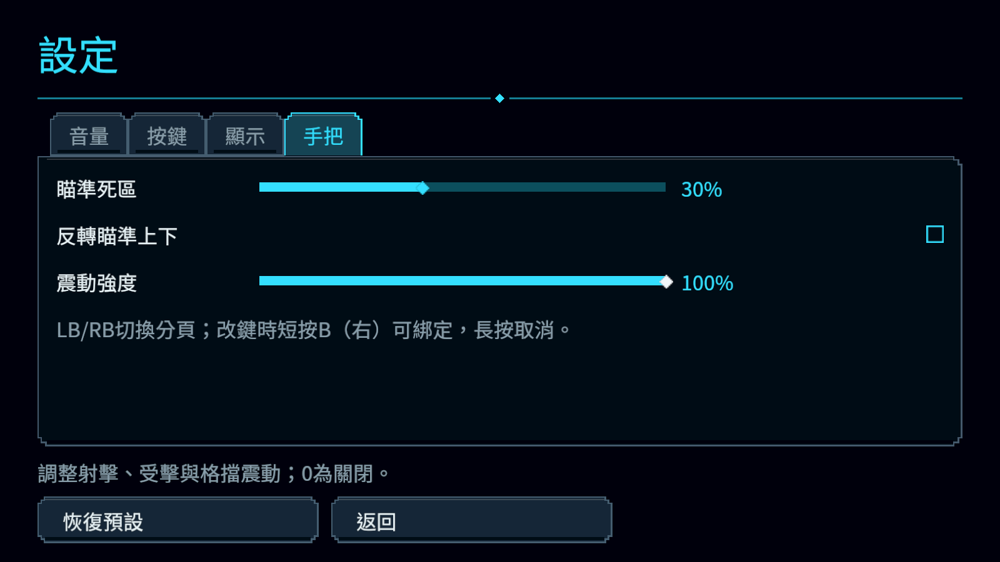

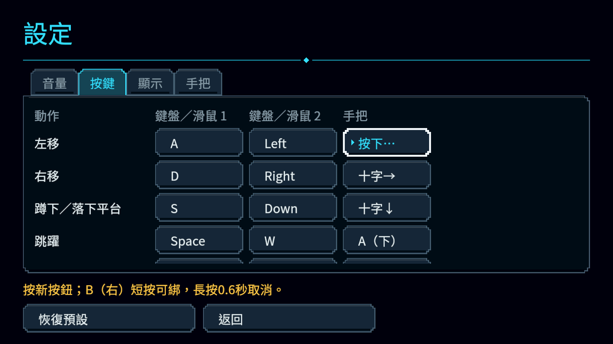

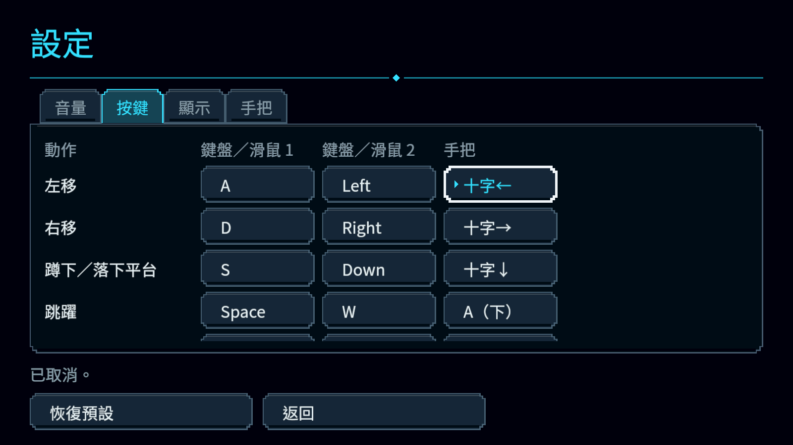

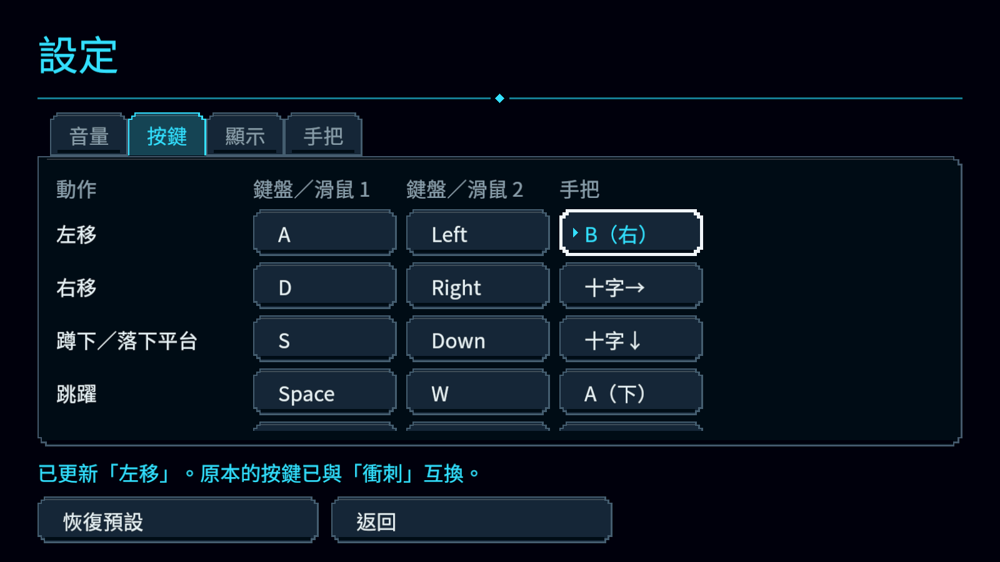

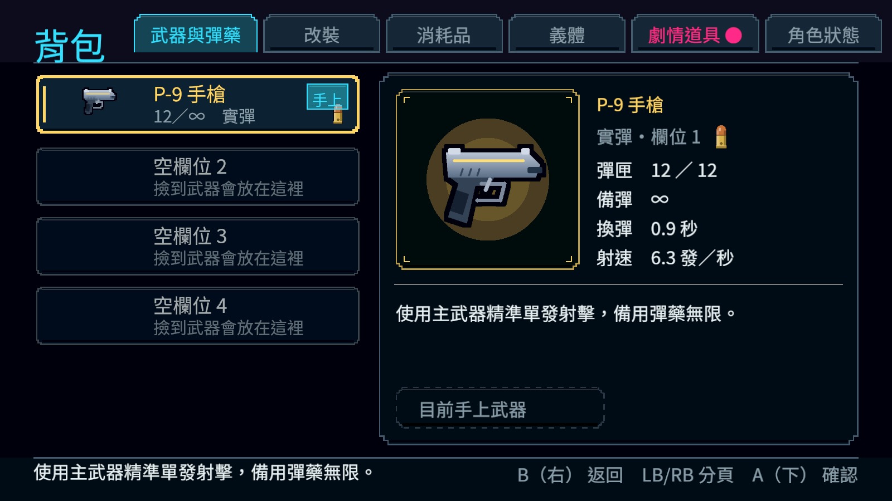

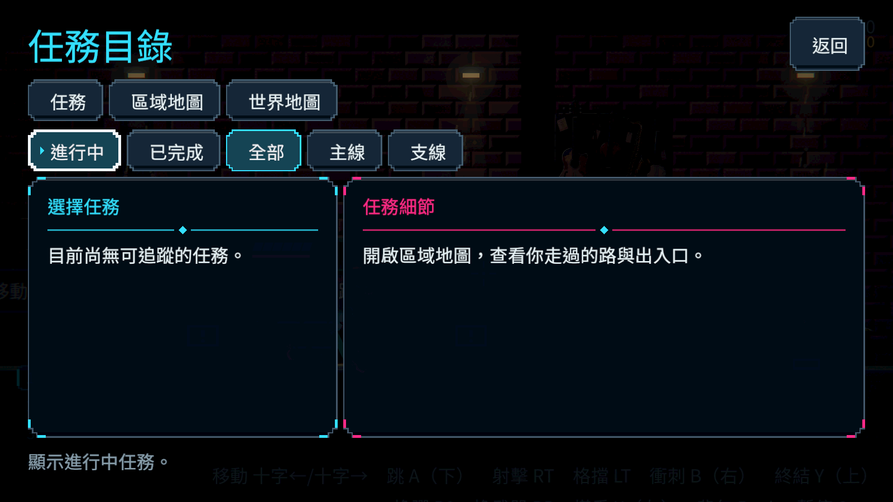

---

# Commit-2

## 內文

暫停頁、死亡畫面與結算畫面的按鈕說明只會在滑鼠停留時出現，只用手把或鍵盤的玩家看不到「從檢查點重來會保留武器」這類關鍵條件；死亡、結算、人物交談也沒有任何手把流程的自動檢查。

現在這三個畫面在鍵盤或手把移動焦點時，會在不擋按鈕的位置顯示同一句說明：暫停頁貼在選單下方，結算放在右下角，死亡畫面放在底部中央；一動滑鼠就收起，交給滑鼠原生說明。主選單本來就在按鈕下方顯示說明，維持原樣不重複。說明列用同一個共用元件，之後其他畫面一行就能接上。

自動檢查只用合成的手把按鍵走完：暫停頁上下移動與說明跟隨、死亡畫面 A 重來、結算 A 略過逐項顯示後方向鍵換按鈕並 A 回主選單、人物交談 A 先顯示整句再換句與 B 跳過。實體手把仍待本機原生驗收，對應驗收條件不勾選。

### 測試結果

| 項目 | 結果 |
|---|---|
| 介面畫面套件 | 175 檢查、0 失敗（含新增的手把流程與聚焦說明） |
| 受影響範圍（基準 68f679b0） | 37 組、8,796 檢查；0 新失敗、0 已知失敗，199 秒。首輪有一項音效閃避的計時檢查在平行負載下失敗，與本次改動無關，單跑兩次皆通過，整組重跑通過 |
| 原生 Forward+ | 1280×720 暫停、死亡、結算（Vulkan／llvmpipe 軟體渲染），說明列不壓按鈕與面板 |
| 已確認無缺口 | 交談推進／跳過、商店購買、死亡、結算、確認覆蓋、圖鑑、互動都有手把按鍵對應（靜態核對） |
| 待本機原生驗收 | 實體手把全流程、拔插、震動；商店與圖鑑的手把實際操作 |

分支 `claude/nest-egg-ui-quest-map-wgwwvw`，[提交紀錄](https://github.com/deadline314/Nest-Egg/commits/claude/nest-egg-ui-quest-map-wgwwvw)。

### 截圖

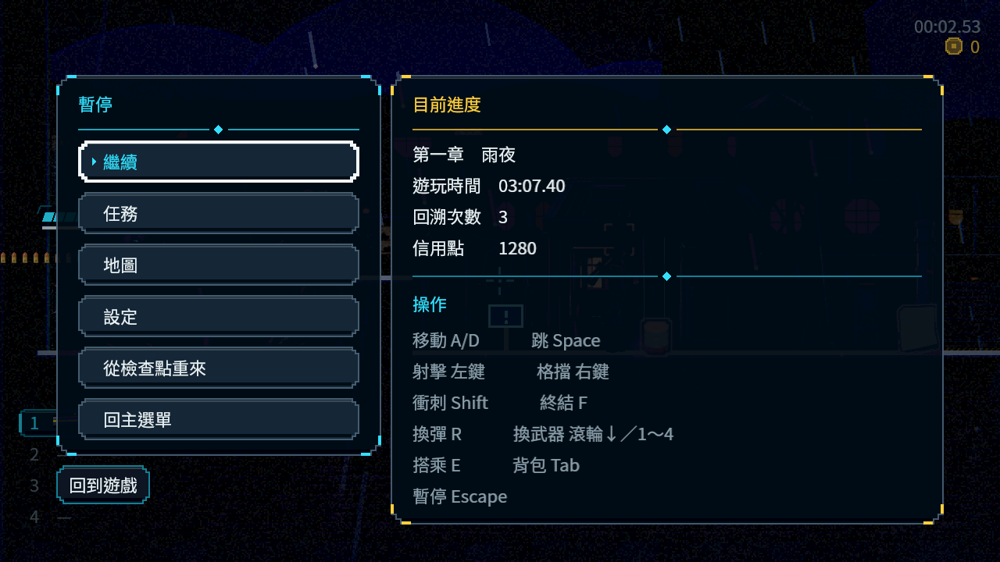
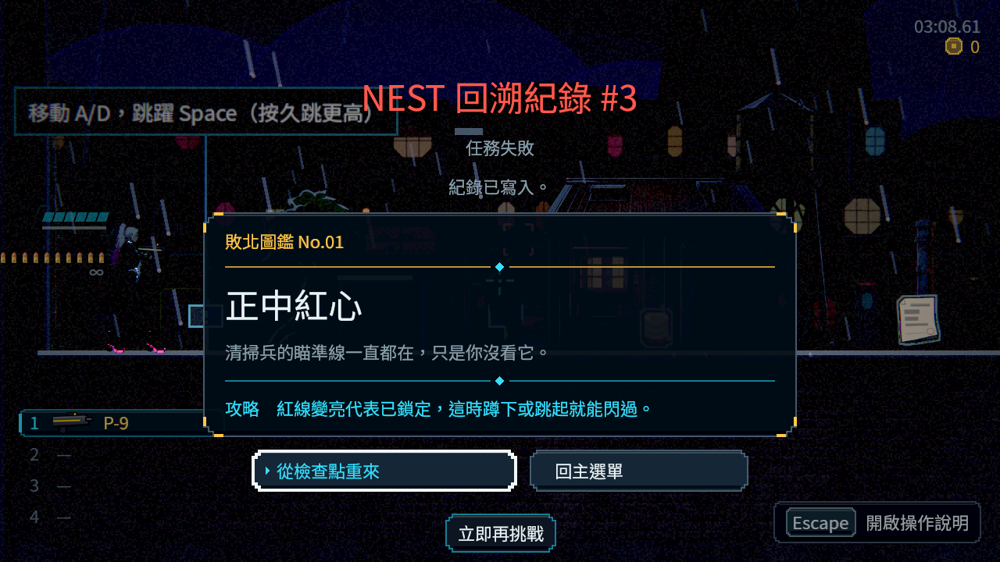
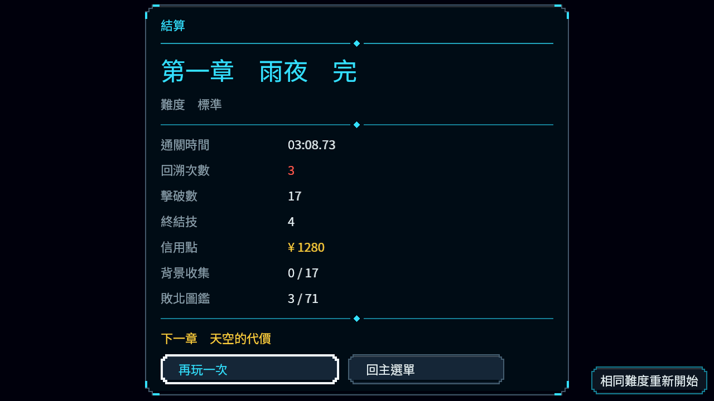

---

# Commit-3

## 內文

交叉檢查上一批改動時發現：從暫停頁打開設定、任務或地圖時，這些頁面是疊在暫停頁裡面的，暫停頁新增的聚焦說明列會跟著它們的焦點移動，和設定頁、任務頁自己底部的說明重複顯示。

現在本來就有自己說明列的畫面（設定、任務與地圖）會標明這一點，暫停頁的說明列在它們打開時不顯示，回到暫停頁後照常顯示。

### 測試結果

| 項目 | 結果 |
|---|---|
| 受影響範圍（基準 b60a6183） | 22 組、5,505 檢查；0 新失敗、0 已知失敗，177 秒 |
| 新增檢查 | 「從暫停頁開設定時不重複顯示說明」；拿掉修正時失敗，加上後通過 |
| 介面與任務地圖套件 | 389 檢查、0 失敗 |

分支 `claude/nest-egg-ui-quest-map-wgwwvw`，[提交紀錄](https://github.com/deadline314/Nest-Egg/commits/claude/nest-egg-ui-quest-map-wgwwvw)。

---

# 跟其他票的關係

- Blocks：NE-233
- Blocked by：無
- Related：NE-2、NE-145、NE-223、ST-16、ST-22

---

# 本機原生驗收（2026-10-11）

## 內文

這張票要的是實體手把的人工全流程。本機驗收的 Session 沒有辦法操作實體手把，所以實體手把的項目一項都沒有做，留給使用者親手操作；下面只記錄不需要手把就能看的畫面。

真 GPU（Godot 4.7.2、Forward+、Intel Arc B580）下，暫停、死亡、結算三個畫面聚焦按鈕時，說明各自出現在選單下方、按鈕下方與按鈕右側，沒有擋住按鈕。從暫停頁開設定或任務頁時會不會重複顯示說明，這次沒有實際操作到，併在下面的清單裡。

實體手把待辦，照順序操作並逐項記錄：
1. 只用手把：主選單 → 新遊戲 → 戰鬥 → 人物交談（A 先顯示整句、再按換句，B 跳過）→ 商店購買 → 暫停、任務、地圖 → 設定 → 死亡後重來 → 結算。
2. 暫停、死亡、結算移動焦點時，按鈕說明出現在不擋按鈕的位置；從暫停頁開設定或任務頁時不重複顯示。
3. 拔掉再插回手把、改鍵、調整震動強度，按鍵提示會跟著切換。

### 截圖

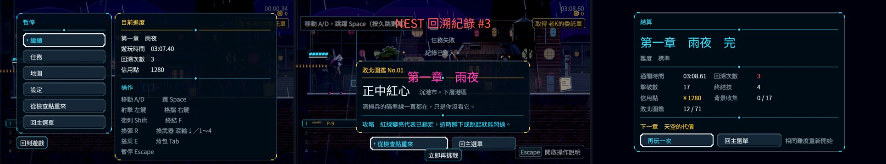

# Commit-4

## 內文

文字放大到 120% 時，死亡畫面的按鈕說明（「立即再挑戰」）固定貼在畫面底部，而敗北圖鑑卡片變高、按鈕被推到底部，說明就蓋住了「回主選單」的一半。另外上次留下兩項沒有自動檢查：從暫停頁開任務頁時會不會重複顯示說明，以及補給商店與圖鑑的手把操作（之前只有靜態核對按鍵對應）。

死亡畫面的說明改放在按鈕正下方自己的一列，這一列的高度先保留：說明出現或收起時版面不跳動，卡片再高也不會蓋到按鈕；死亡序列播完、按鈕出現時這一列才一起出現。自動檢查補上：真實敗北圖鑑卡在 100% 與 120% 文字下，說明都不和任何按鈕重疊（拿掉修正時這項會失敗）；從暫停頁開任務頁時，暫停頁的說明列不顯示，手把 B 回到暫停頁並恢復「任務」的焦點；補給商店用手把 A 買下選中的商品（扣款、背包數量增加），B 關閉；圖鑑用方向鍵移動焦點，B 關閉。

驗收用合成的手把事件與 Forward+（雲端軟體 Vulkan）1280×720、120% 的死亡畫面截圖。實體手把的人工全流程、拔插、震動仍未做，對應驗收條件不勾選，本票維持進行中；下面的本機清單加上商店與圖鑑兩項。

### 測試結果

| 項目 | 結果 |
|---|---|
| 介面畫面套件 | 186 檢查、0 失敗（新增 10 項：死亡畫面說明不蓋按鈕 ×2、暫停頁開任務頁 ×2、補給商店 ×3、圖鑑 ×3） |
| 修正前對照 | 換回舊的死亡畫面，「120% 說明不蓋到按鈕」失敗 1 項；換回新版通過 |
| 受影響範圍（基準 e8c1e2e9） | 7 組、2,243 檢查；0 新失敗、0 已知失敗，103 秒 |

分支 `feature/ui-quest`，[提交紀錄](https://github.com/deadline314/Nest-Egg/commits/feature/ui-quest)。

### 本機實體手把待辦（補充）

4. 補給商店：只用手把選商品、A 購買、B 離開，信用點與持有數量正確。
5. 圖鑑：方向鍵移動、B 返回主選單或暫停頁，焦點回到原本的按鈕。

### 截圖

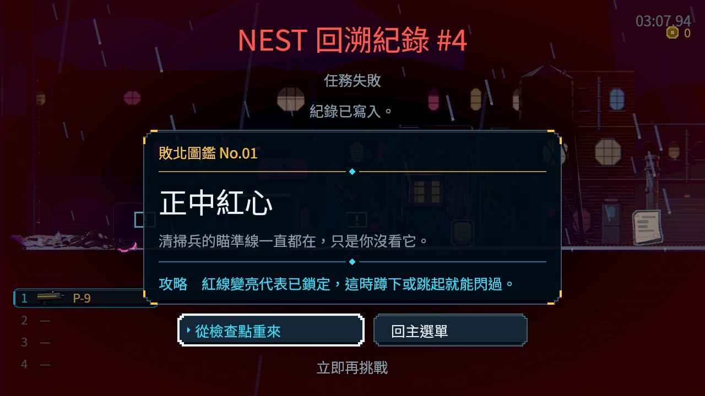

# Commit-5

## 內文

「按住／連按規則及連段緩衝可理解」一直沒有地方說清楚：暫停頁只列按鍵，玩家不知道按住跳躍會跳更高、按住射擊會連射、按住格擋才持續舉盾，也不知道出招中先按近戰會接下一段、衝刺快冷卻完時先按會排隊。

改動：設定的「按鍵」與「手把」分頁底部加一段「按住與連按」，三句講完，每句一件事；句子裡的按鍵名稱跟著目前裝置與改鍵（用手把時顯示 A、RT、LT、Y、B，改鍵後立刻換成新按鍵）。兩個分頁都可以捲動，放大文字也不會擠爆畫面；暫停頁的版面不動。另外記錄：NE-244 交付背包新版面時已一起補上手把的自動檢查（Back 開背包、RB／LB 換頁、方向鍵選物、A 執行、B 回到遊戲，以及把背包鍵改成 O 後底部提示立刻變成 O），屬於本票的自動輸入紀錄。

驗收：Forward+（雲端軟體 Vulkan）1280×720、文字 120% 拍「手把」分頁捲到底的畫面，鍵鼠與手把各一張，三句完整、按鍵名稱正確；文字放大巡檢 0 問題。自動檢查補上：兩個分頁都有三條規則、用手把時顯示手把按鍵、跳躍改成 K 後規則跟著換成 K。這些都是合成的手把事件，實體手把的人工全流程、拔插與震動仍待本機原生驗收，對應條件不勾選，本票維持進行中。

### 測試結果

| 項目 | 結果 |
|---|---|
| 介面畫面套件 | 237 檢查、0 失敗（本次新增按住與連按規則 3 項；背包手把 9 項已隨 NE-244 加入） |
| 文字放大巡檢（設定四分頁＋補給商店，120%） | 0 問題 |
| 受影響範圍（基準 f79e491f，NE-228 與 NE-229 這次的改動一起跑） | 58 組、60,568 檢查；0 新失敗、0 已知失敗，589 秒 |

分支 `claude/ui-2i98t8`，已併入 main：[bbbe0708](https://github.com/deadline314/Nest-Egg/commit/bbbe0708)。

### 本機實體手把待辦（補充）

6. 背包：只用手把開背包、換頁、選物、改裝或使用、返回；設定「手把」分頁捲到底，「按住與連按」三句的按鍵和實際手把一致。

### 截圖

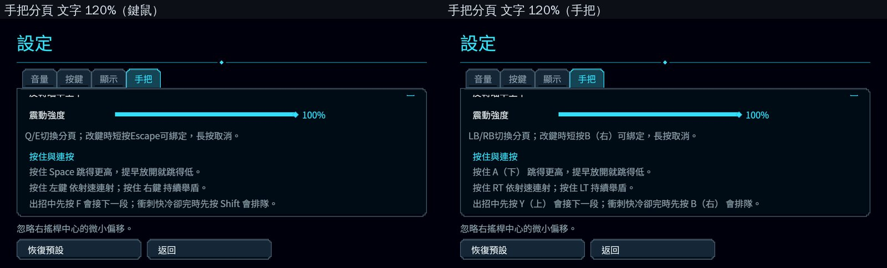

# 本機原生驗收（2026-10-12，Arc B580）

## 內文

在這台機器（Intel Arc B580、Godot 4.7.2、原生 Forward+，不是無頭）用 main 的 `feb9645d` 重跑本票的拍攝與量測工具。這一段只記錄跑出來的畫面與數字，沒有改本票的程式；有問題的地方寫在「發現」，交給本票負責的組。

| 項目 | 結果 |
|---|---|
| 手把全流程（合成的手把按鍵：主選單、難度、交談、商店、暫停、設定、死亡、結算），文字 100% | 36 項檢查、0 失敗 |
| 同上，文字 120% | 36 項檢查、0 失敗 |
| 文字 120% 的版面巡檢（設定四個分頁與商店） | 0 個問題 |

還沒驗、這裡也驗不了：實體手把的全流程、拔插、震動強度、改鍵（這次的手把是工具合成的裝置）。前一次原生驗收列的實體手把待辦清單仍然有效。驗收條件維持原狀，不代勾。

另外記錄：這台機器的 Windows 上，無頭自動測試單獨跑「輸入手感」那一組（或只和戰鬥介面那一組一起跑）時，「手把流程：新遊戲入口一開始就有聚焦」與「選完難度進入可玩的關卡」兩項檢查會失敗，乾淨的 main 也一樣，連跑六次都重現；和其他測試排在同一個程序、排在後面跑時則通過（受影響測試的平行執行就是這樣過的）。看起來和執行順序或啟動後經過的時間有關，請負責的組看一下。

### 截圖

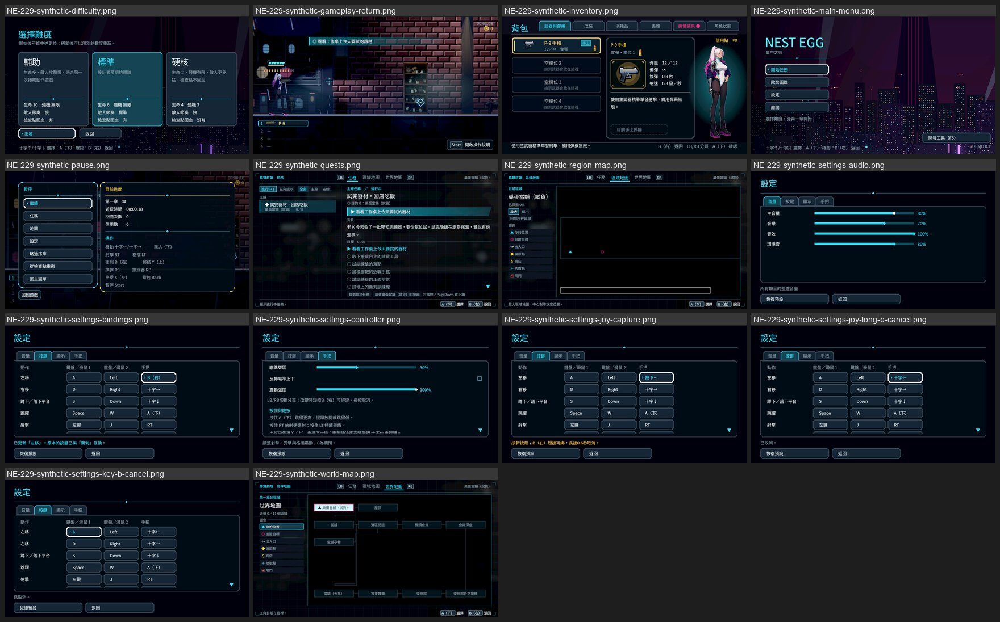

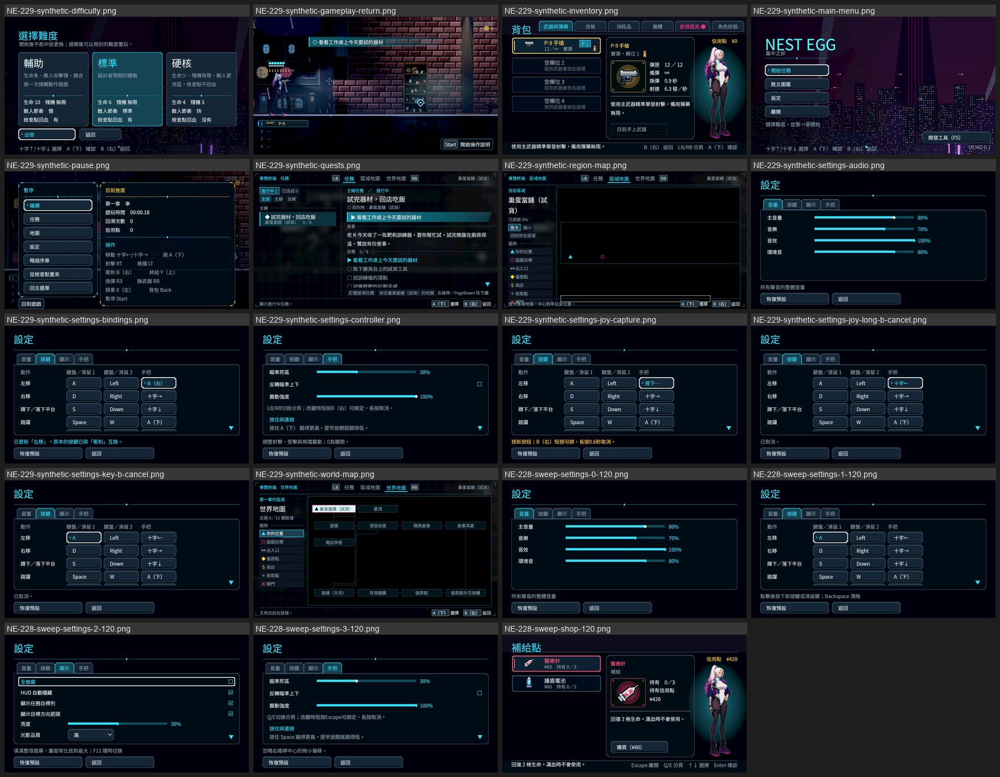

# Commit-6

## 內文

遊玩中手把斷線原本會暫停，但通知約兩秒後就消失，畫面只剩停住的關卡；晚看到通知的玩家沒有持續可見的恢復入口。開始前重讀 User-guide，實際看過並保存 Hollow Knight、Celeste、Blasphemous、Hades、Cyberpunk 2077 五個團隊的介面圖片，再決定恢復面板的資訊層級。前三款提供相近橫向動作／探索／平台參照，後兩款補充動作遊戲與賽博介面；沒有把圖片觀察當成玩家民調或這些遊戲的拔插機制證明。[研究與取捨](../../design/20-campaign-experience/CONTROLLER_RECOVERY.md)、[原圖來源與校驗碼](attachments/NE-229-recovery-references/sources.json)。

現在斷線會立即顯示像素面板、可見焦點與游標，直到玩家準備好再確認。重新連線會更新狀態，但不自動恢復；鍵盤確認、手把確認／暫停或滑鼠點「繼續遊戲」都可恢復。同一次操作不會漏成跳躍或射擊，返回與搖桿不會誤恢復。重複斷線只保留一個面板，原玩家離開場景會一起清理；恢復只釋放這次斷線的暫停，不會放掉其他畫面持有的暫停。原本已在交談或選單中的斷線保留既有暫停與焦點。

驗證先在正式序章關卡重現通知消失，再以同樣入口比較修後；使用隔離程序與合成裝置 999，不是實體拔插或從新遊戲玩完整章。真正玩家位置與遊戲時鐘在暫停期間不變，四秒後面板仍可見，重接後仍暫停，恢復後游標回到原遊玩模式。新面板的繁中、日文、英文與 100%／120% 文字、720p／1080p 組合已逐張看過。放大日文時發現標題句尾孤立換行，改成短而完整的句子並重拍；過早移除面板時的延後焦點錯誤也已修正，重新跑過原檢查。只有新面板的多語言在本次驗證範圍內。

### 測試結果

| 項目 | 結果 |
|---|---|
| 原選擇器、固定基準 339cc5d1 | 63 組；首輪 62,743 檢查，1 項彈帶轉身平滑超標（43.5 像素，原門檻 24），其餘 62 組無失敗 |
| 彈帶整組複驗 | 本次來源與乾淨基準各 33 檢查、0 失敗；未重現首次超標，成因未確定；沒有修改彈帶程式、判準、選擇器、錯誤過濾或已知失敗清單 |
| 最終輸入套件獨立複驗 | 109 檢查、0 新失敗、0 非預期腳本錯誤；包含真正 Main 的 36 項合成手把介面流程、鍵盤與滑鼠恢復、焦點、重複斷線與暫停責任 |
| Forward+ 畫面與狀態 | 五組語言／文字／解析度組合及游標還原複驗，共 143 檢查、0 失敗，這六次最終原生程序無 ERROR；Vulkan／llvmpipe 軟體渲染、Dummy 音訊，非硬體 GPU 或試聽 |
| 完整紀錄 | [驗證收據與檔案校驗碼](attachments/NE-229-recovery-verification/receipt.json)、[原始成功與失敗 log](attachments/NE-229-recovery-verification/logs.zip)；包含初次探針處理模式、合成事件座標／鍵碼與較早關閉資源診斷，未把它們當成乾淨通過 |

實體手把人工全流程、真正拔插與震動仍屬待本機原生驗收；狀態維持進行中，原驗收條件不代勾。

[本票提交紀錄](https://github.com/deadline314/Nest-Egg/commits/main/pm/Nest-Egg/%5BNE-229%5D%E8%A3%9C%E9%BD%8A%E5%85%A8%E6%B5%81%E7%A8%8B%E6%89%8B%E6%8A%8A%E6%93%8D%E4%BD%9C.md)。

### 本作畫面

同為序章關卡、斷線四秒後，左側通知已消失，右側持續保留恢復入口。世界光照沒有為面板改動。

| 修前 1280×720／100% | 修後同條件 |
|---|---|
| 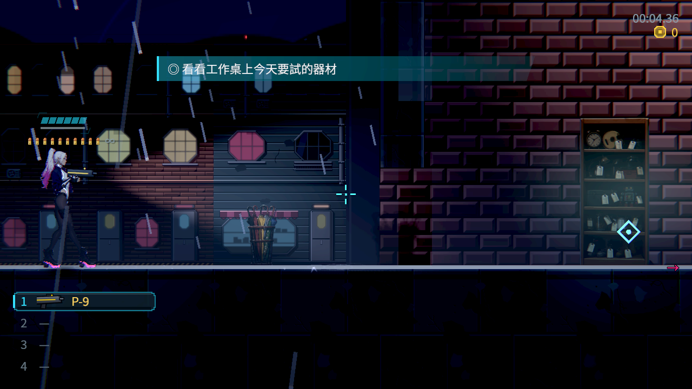 | 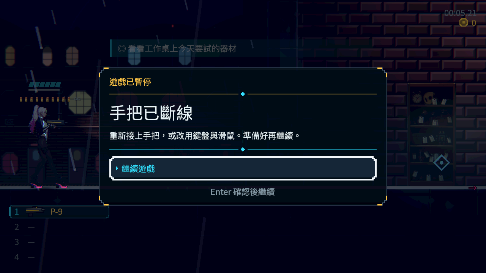 |

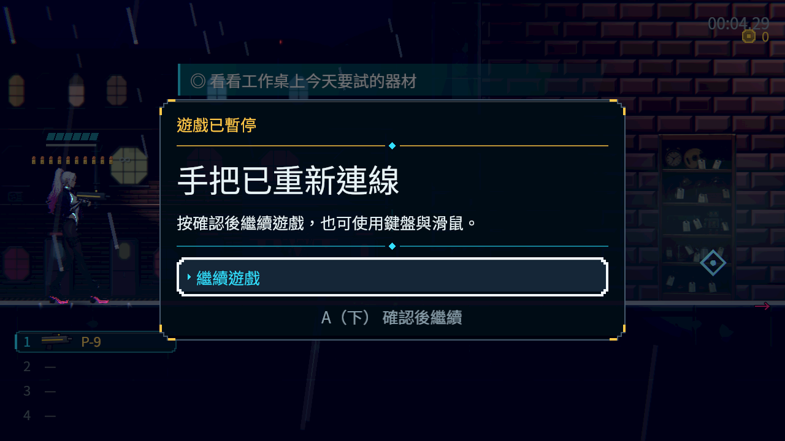
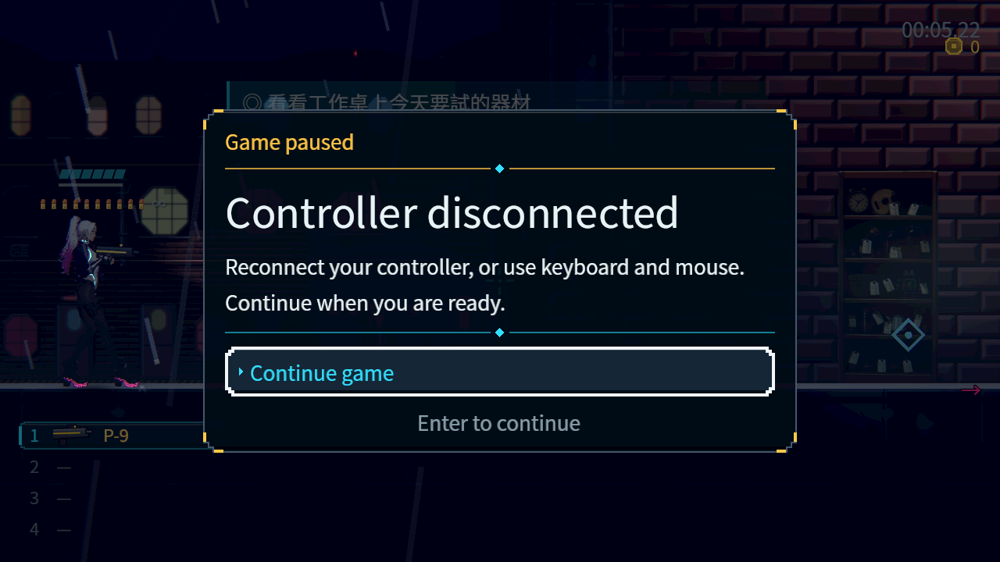
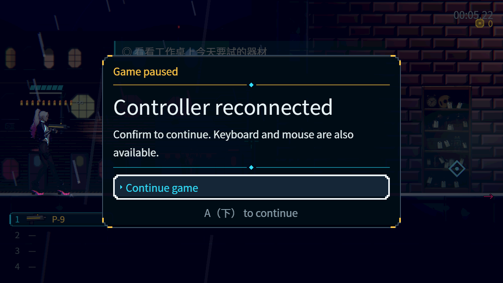
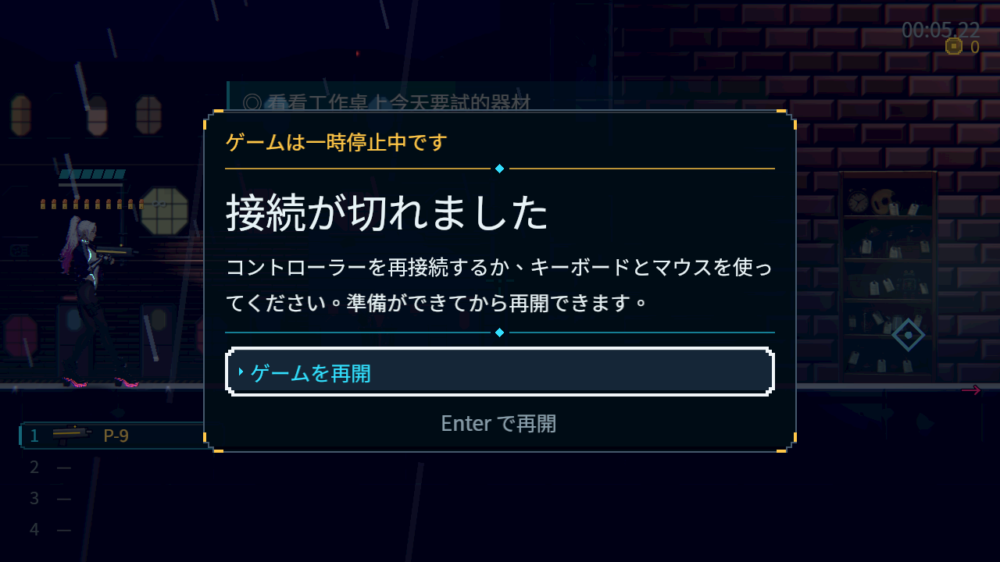

日文標題放大後的排版修正（1920×1080／120%）

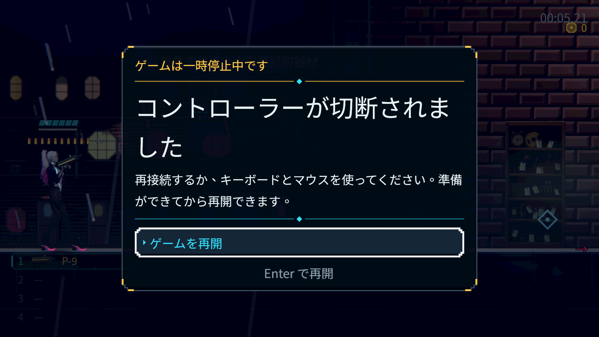
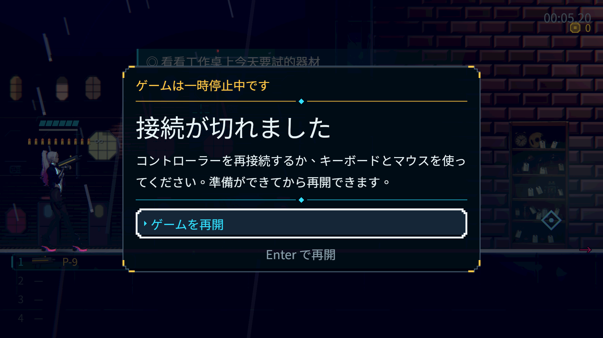
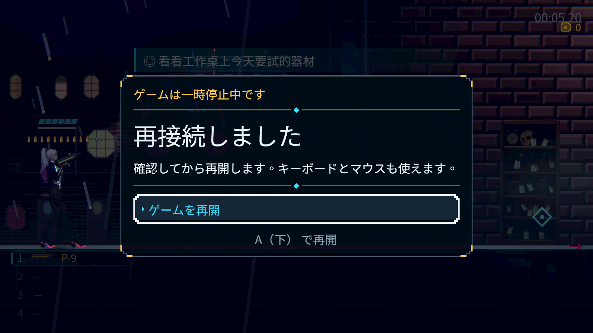

五款研究原圖（他作圖片，非本作驗收）

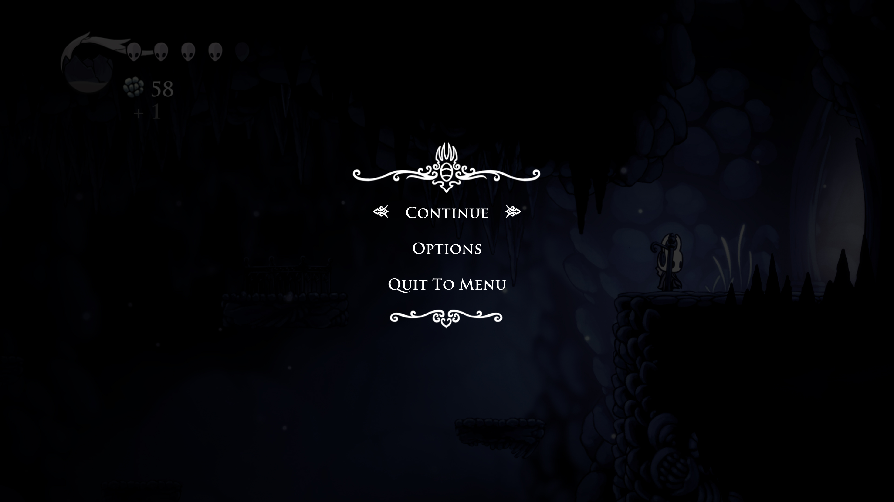
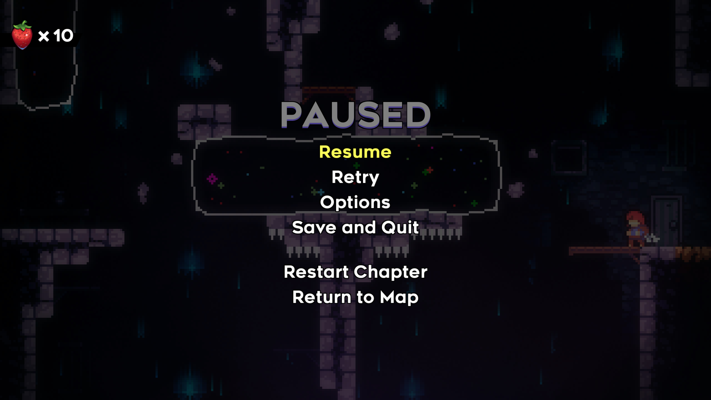
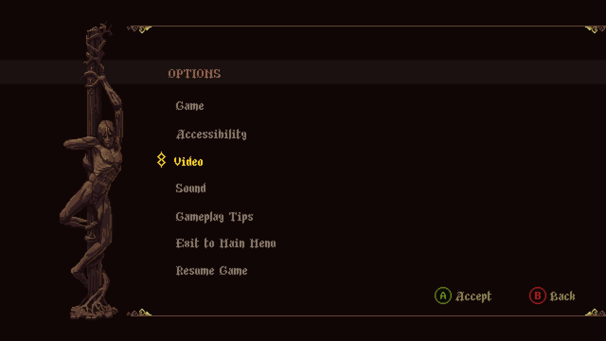
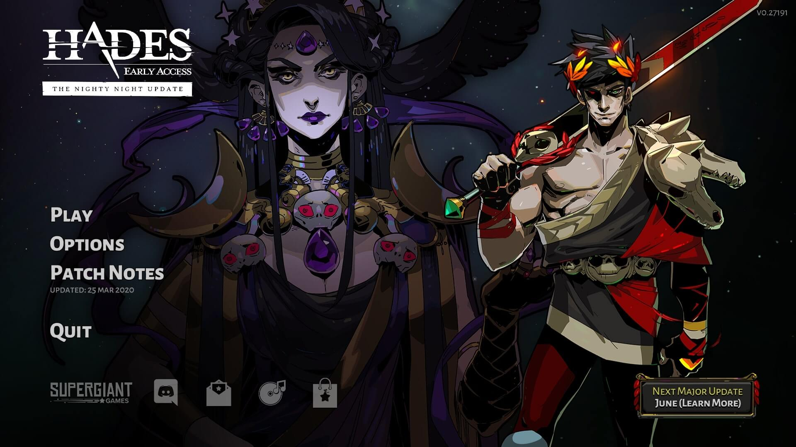
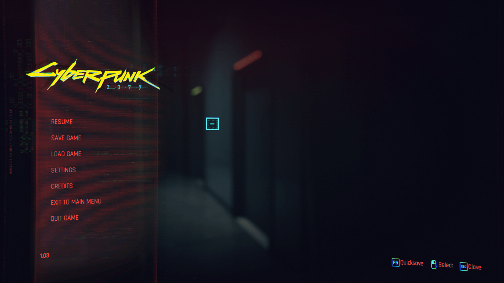

# Commit-7

## 內文

短暫受擊停格時按下附近載具的互動鍵，原本可能完全沒有反應；接著原想離開的操作反而成為搭乘。現在停格期間仍接收一次搭乘／離開，保留原距離、上下車保護及停格時間。按住不會反覆上下車，暫停時按下不會在返回後執行。

先讀User-guide，對照相近作品研究圖，再保留原遊戲流程做60ms停格前後對照。原CI同段三項失敗的當刻狀態不足以證明唯一根因，原檔與這次控制結果分開記錄；後續失敗會輸出當刻狀態。[設計與研究](../../design/20-campaign-experience/VEHICLE_HITSTOP_INPUT.md)、[全部成功／失敗、六張逐張檢視原圖與界線](attachments/NE-229-hitstop-input/README.md)。

### 測試結果

| 項目 | 結果 |
|---|---|
| 原遊戲流程，明示60ms局部停格 | 修前48項／9失敗；修後48項／0失敗 |
| 原輸入套件＋9項回歸 | 修前118項／2失敗；修後118項／0失敗 |
| Forward+原生前後對照 | 修前20項／1失敗；修後20項／0失敗；兩輪0引擎ERROR、0退出洩漏診斷 |
| 原選擇器、基準5bcc9f68 | checks: 96006, new failures: 0, known failures (tests/known_failures.txt): 0  (wall time 598 s)；609.05秒 |

合成輸入與軟體Vulkan分開標示，原實體手把條件及整票狀態保持。

### 本作前後圖

| 修前：同一操作未搭乘 | 修後：正式機甲血條出現 |
|---|---|
| 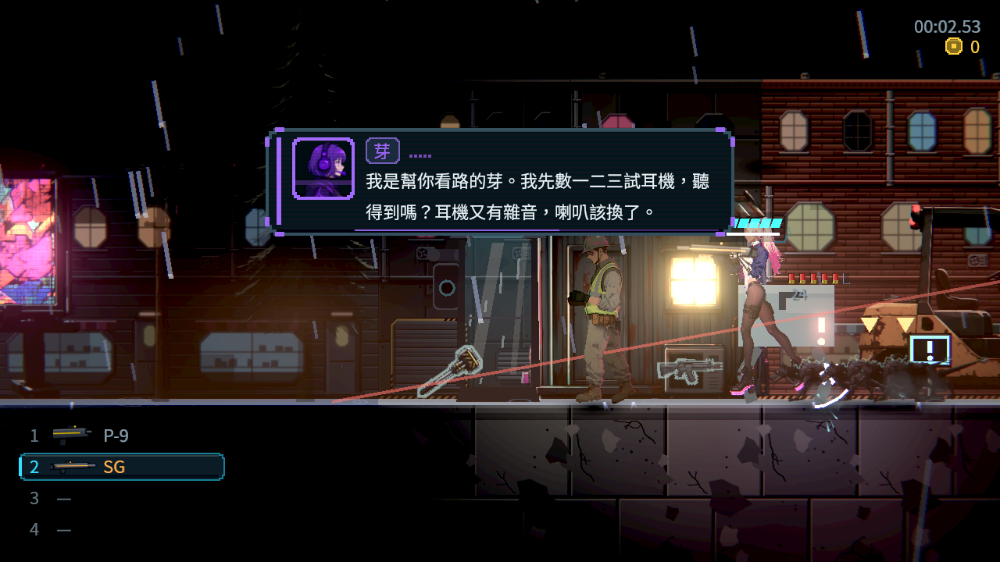 | 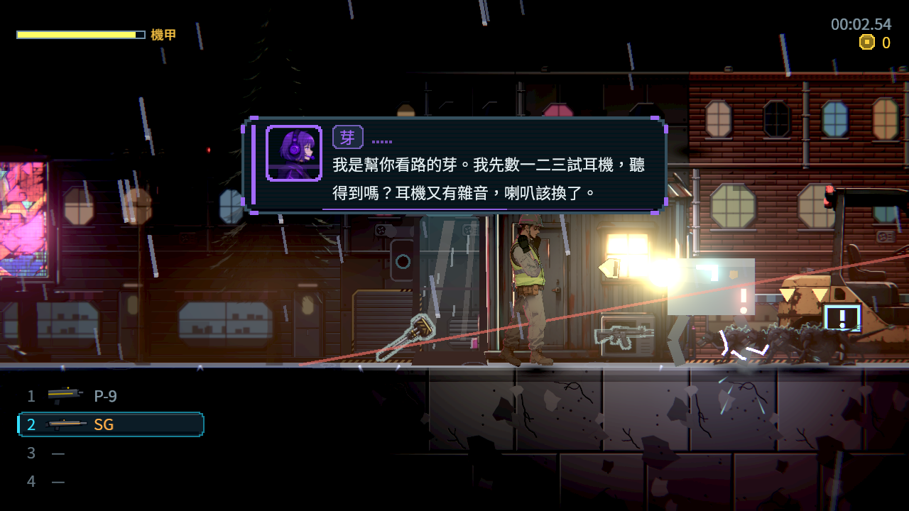 |

### 相近作品參照

# Commit-8

## 內文

按下附近載具互動的同一步才受到短暫停格，原本仍可能沒有搭乘，後一個離開操作就錯成搭乘。現在這個交錯順序也能接收一次上下車，維持原停格時間、距離、空車、上下車保護、長按與暫停規則。

接續f5469ea3完整CI的三項失敗，保存真正停格狀態；先前控制尚未涵蓋的同一步交錯，以同一原流程做前後對照。[成功、失敗、CI原檔、六圖與驗證界線](attachments/NE-229-hitstop-order/README.md)。原CI較早的操作順序沒有快照，不以控制替代唯一根因證明。

### 測試結果

| 項目 | 結果 |
|---|---|
| 原runner隔離輸入套件＋5項 | 修前123項／2新失敗；修後123項／0新／已知失敗 |
| 原main完整核心流程 | 2292項／0新／已知失敗，112秒 |
| Forward+同一原遊戲流程 | 修前20項／1失敗；修後20項／0失敗，兩輪0引擎ERROR／退出洩漏診斷 |

原斷言、輸入、等待與選擇器保持。合成輸入、明示短暫停格與軟體Vulkan分開記錄，整票條件維持真正證據要求。

### 前後圖

| 修前互動未搭乘 | 修後真正機甲血條出現 |
|---|---|
| 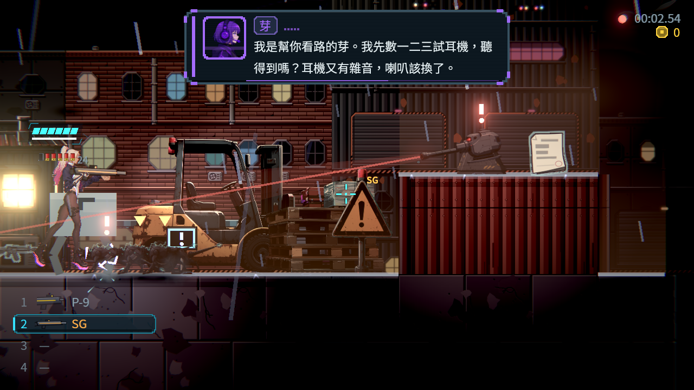 | 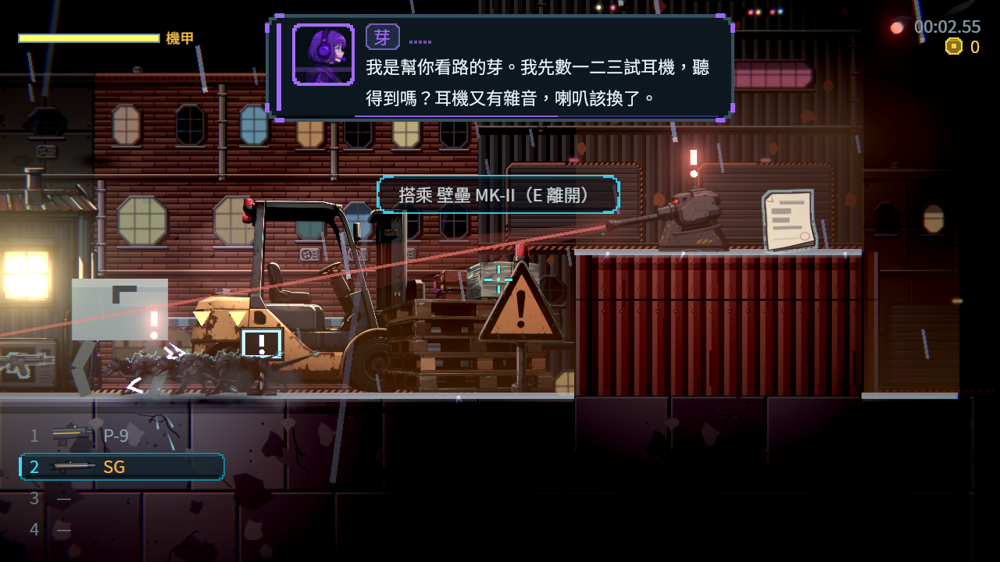 |

# Commit-9

## 內文

短按載具互動後才延後受到停格，原本仍可能沒有反應。現在原本有效的同一按鍵會接收一次，過期後不重播；正常上車後長按，也不會因稍後停格而意外下車。原停格時間、距離、上下車保護與暫停規則保持。

前一版完整CI實際96,404項全過；補查新增不同停格順序，不以綠燈代稱所有時序已涵蓋。[原CI、負控制、中途fixture失敗、六張圖及完整界線](attachments/NE-229-deferred-input/README.md)。

### 測試結果

| 項目 | 結果 |
|---|---|
| 原runner輸入套件＋7項 | 130／2新失敗→130／0新／已知失敗 |
| 原main完整核心流程 | 2292項／0新／已知失敗，106秒 |
| 原生同一原遊戲流程 | 20／1失敗→20／0；兩輪0引擎ERROR／退出洩漏 |

### 前後圖

| 修前未搭乘 | 修後機甲血條出現 |
|---|---|
| 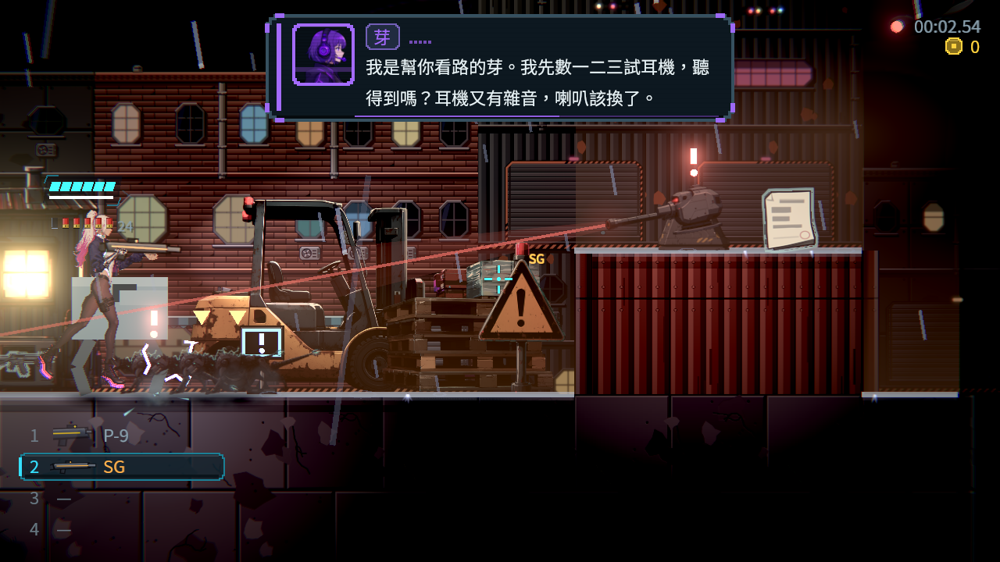 |  |

# Commit-10

## 內文

對話與動畫過場原本把同一次扣住扳機的壓力變化當成再次確認，可能直接換句或結束；手把事件先被對話接收後，畫面還可能保留鍵盤提示。

現在第一次扣下顯示當句，放開後再扣才推進；剛好停在門檻也不重複確認。提示即時跟著手把與滑鼠切換，移動滑鼠不會換句。鍵鼠確認、略過、選項與戰鬥射擊保持原規則。

### 測試結果

| 項目 | 結果 |
|---|---|
| 真正對話擁有者、十項相同公開輸入 | 原版10／6失敗，修後10／0 |
| 同條件原生顯示 | 10／6→10／0，0引擎ERROR／洩漏；四張最終圖逐張檢視 |
| 接上最新主線後原選擇器 | 62組64,113項，0新／已知失敗、505秒 |
| 原失敗保留 | 門檻初稿、錯誤探針與64,112／1彈帶失敗均保留，接上已交付的量測修正後複驗 |

[完整控制、研究、全部版本與原始紀錄](attachments/NE-229-dialogue-trigger/README.md)。畫面使用明示的兩句樣本與虛擬公開輸入，沒有代稱正式劇情、自然遊玩或實體手把驗收。

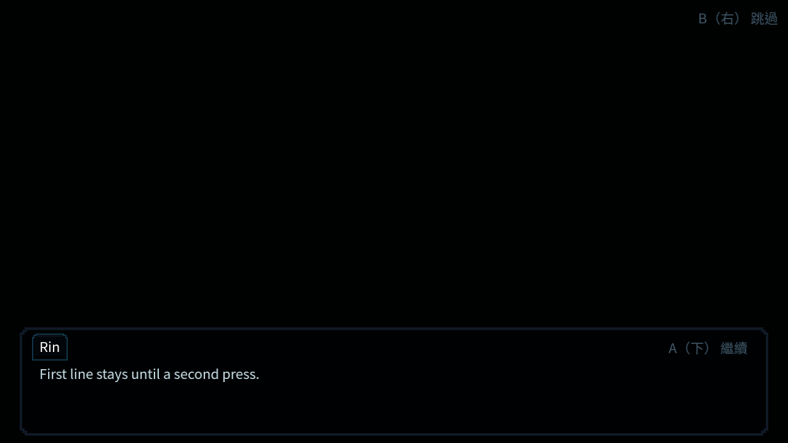

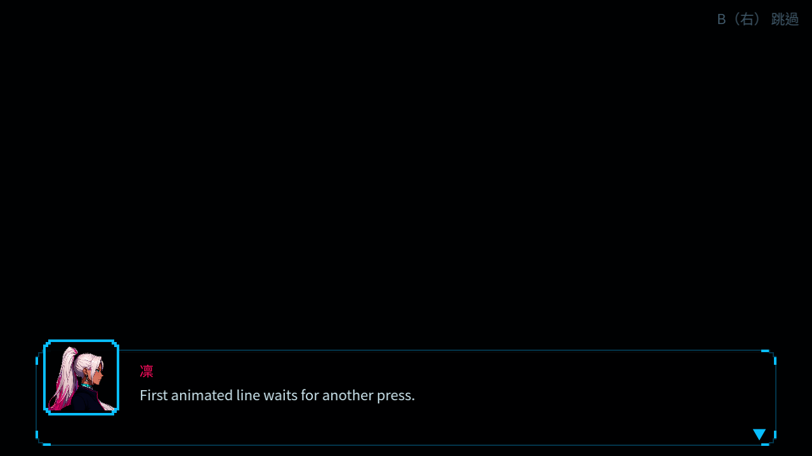

# Commit-11

## 內文

設定頁先接收分頁與改鍵事件時，提示會留在上一種裝置；只補觀察者還會讓刷新把「按下…」改回舊按鍵。現在先更新裝置並保留捕捉中狀態，B短按綁定／長按0.6秒取消與Esc取消也分別說明，不再出現「Escape短按可綁」。原綁定、計時與導航保持。

原UiScreensSuite448／11→448／0；僅補觀察者仍4失敗的反例保留。原受影響19組7,175／0新／已知失敗，231秒。相同原生100%與120%各28／11→28／0，四輪0引擎ERROR／洩漏；36張前後圖逐張檢視。這是實際設定元件與虛擬事件，實體手把、震動與自然全流程條件維持。

[完整原檔、同類遊戲圖與限制](attachments/NE-229-settings-owner/README.md)。

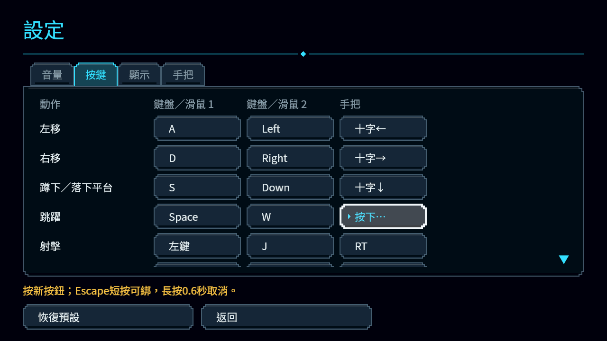
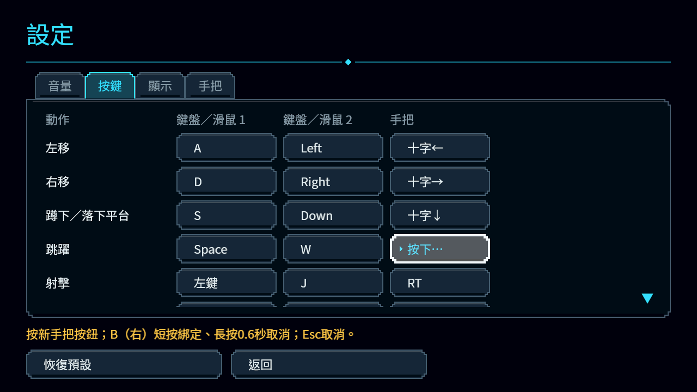

# Commit-12（保存復原後保持可操作焦點）

## 內文

保存失敗視窗原本焦點在取消時，切換成已保存、只能重新載入的狀態後會失去焦點，鍵盤與手把無法直接確認。現在焦點隨隱藏的取消移到唯一可用的重新載入；重複刷新不搶走其他視窗焦點。保存結果、重試及取消規則保持。

### 截圖

三語放大文字的回歸使用真正GUI鍵盤／合成手把確認；下圖為1280×720、1.2倍文字的正式視窗，軟體Vulkan Forward+，不代稱實體裝置或完整自然流程。

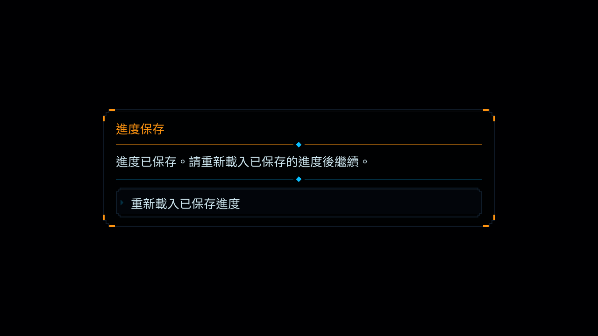
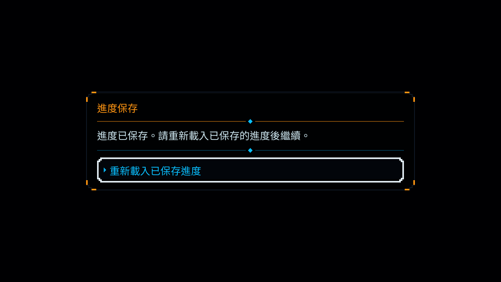

### 測試結果

| 項目 | 結果 |
|---|---|
| 同一三語焦點回歸 | 原介面454項／3新失敗，修後通過 |
| 原受影響範圍 | 7組3,758項、0新／0已知失敗、221秒 |
| GUI確認與焦點 | Enter／合成手把A可確認重新載入；重複刷新不搶外部焦點 |
| 原生軟體Forward+ | 修前無焦點、修後有焦點，兩張原圖已檢視；最終無非預期錯誤 |

[完整原始日誌、擷取來源與初次失敗](attachments/NE-229-save-focus/evidence.zip)／[來源與限制](attachments/NE-229-save-focus/receipt.json)。初次直接腳本擷取因無自動載入編譯失敗，改用正式場景入口；該失敗保留，不算通過。整票與實體手把條件維持進行中。

# Commit-13（手把路由探針不碰既有存檔）

## 內文

手把路由探針原本沿用一般存檔。若已有進度，正常選單會聚焦「繼續」，新遊戲也會要求確認覆寫，卻被探針誤報成新遊戲焦點與難度確認失敗。原版在隔離樣本中重現了同樣的兩項失敗。

現在每次探針都有自己的新存檔與設定，原本的進度與設定保留；原有新遊戲、覆寫確認、手把輸入及焦點規則維持。結束只清除該次產生的檔案。慢速軟體渲染下，探針先送達長按事件再計時，原按鍵、長按秒數及取消門檻維持。

### 測試結果

| 項目 | 結果 |
| --- | --- |
| 原版既有存檔負控制 | 6 項、2 失敗，原始日誌保留 |
| 既有存檔與原手把路由 | 40 項、0 失敗，原主檔逐 bytes 保留 |
| 受影響輸入手感套件 | 132 項、0 新／已知失敗、27 秒 |
| 原生軟體 Vulkan | 41 項、0 失敗，原主檔保留 |

[隔離樣本、來源雜湊與原始日誌](attachments/NE-229-probe-storage/README.md)。這是探針保存所有權修復，不把原有的繼續與覆寫確認當成產品故障；實體手把條件維持原驗收狀態。

### 截圖

| 原探針讀到既有存檔 | 修後使用自己的空槽 |
| --- | --- |
| 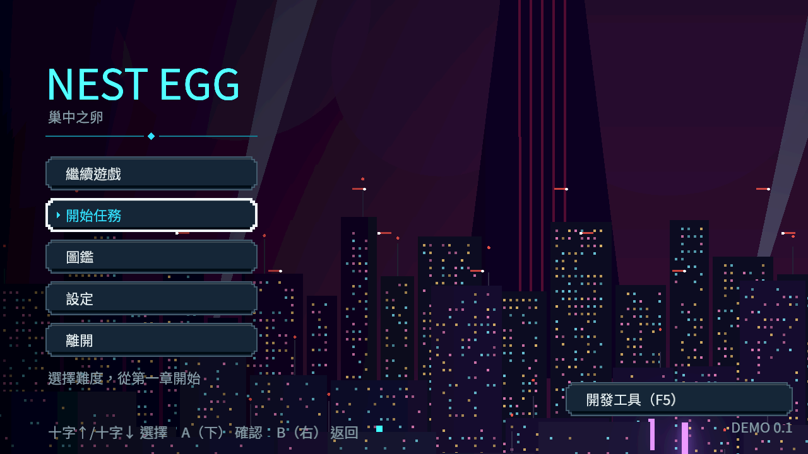 | 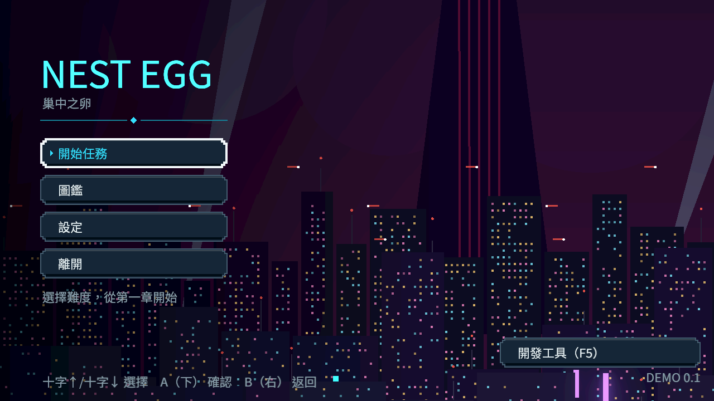 |
