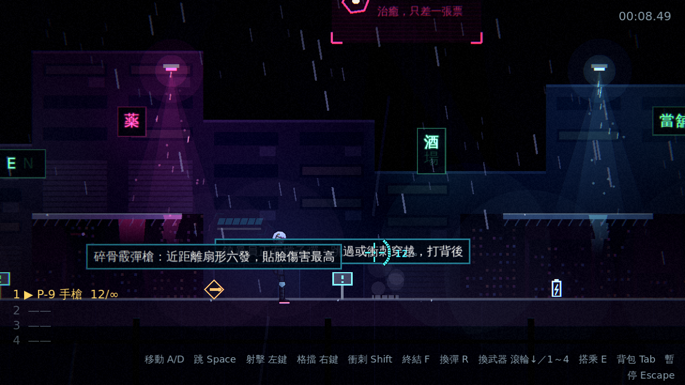
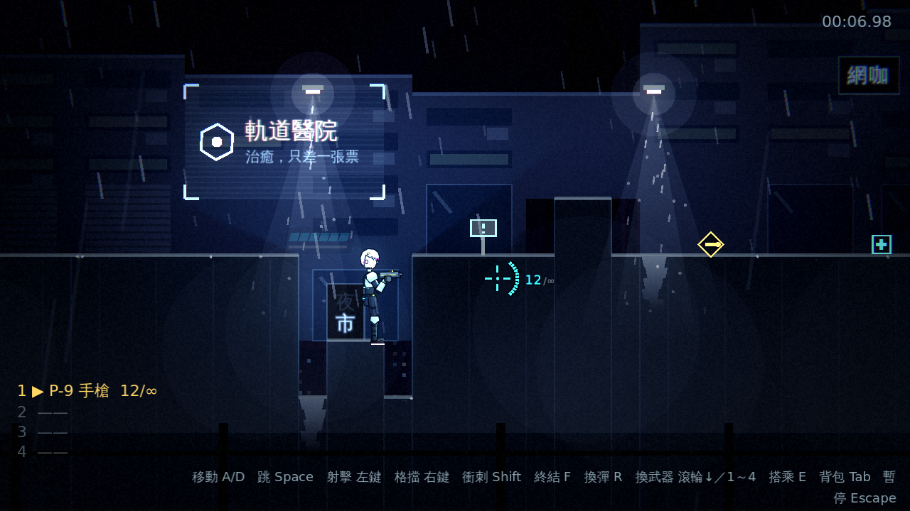
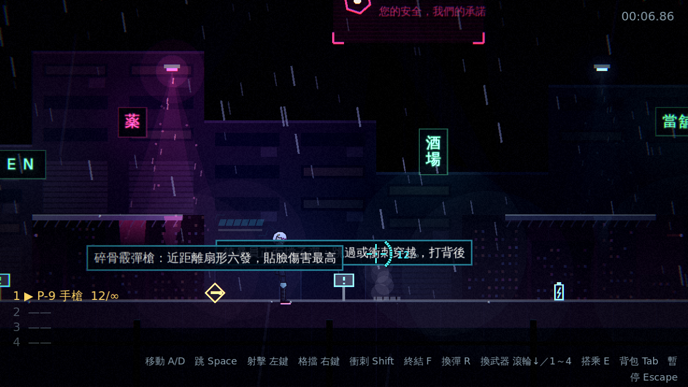
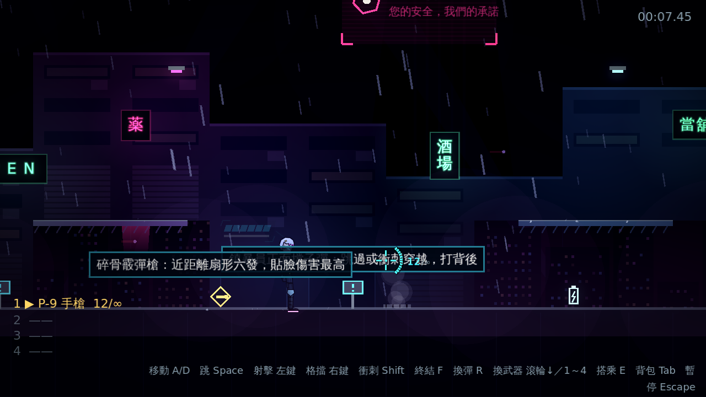

# [NE-22] 加入體積光與染色霧

> 狀態：完成

## 內文

### 需求
光只是一個圓形光池，缺少雨夜霓虹打在霧與雨上的體積感。加入光錐、被光源染色的霧、濕地反光，以及壓住畫面邊緣的前景剪影。設計見 `design/08-lighting/DESIGN.md` 的「架構」第 3、4 節。

### 來源
2026-10-02，使用者於開發對話中提出：「整個遊戲可以有完整的光影設計，請參考業界最佳實例」「整體的渲染跟場景應該要陰沉一點，遊戲希望整體沉重一點」；確認壓抑程度為重度壓抑、先做光影再做內容。

### 驗收條件
- [x] 場景燈、探照燈與砲台有光錐，雨在光錐裡更亮
- [x] 霧團靠近光源時被染成光源的顏色，光池之外的霧偏冷灰
- [x] 路燈與霓虹在濕地面有垂直拉長、輕微晃動的倒影
- [x] 前景有更暗的剪影層（管線、鋼樑、雨簾），壓住畫面邊緣且不遮住可玩區域與敵人
- [x] 低品質檔位下關閉這些效果，其餘畫面不受影響

### 測試流程
1. 在霓虹市集站在招牌下，確認光錐、染色霧與地面倒影
2. 確認前景剪影不會擋住敵人、子彈與平台
3. 切到低品質，確認體積效果關閉且遊戲正常
4. 執行完整測試套件，全部通過

---

# 跟其他票的關係

- Blocks：無
- Blocked by：NE-18、NE-19
- Related：NE-21

---

# Commit-1

## 內文

光只是一個圓形光池，缺少雨夜霓虹打在霧與雨上的體積感。
現在場景燈有光錐、光暈與錐內的雨絲和塵埃（雨在光錐裡更亮），燈下的地面有垂直拉長、輕微晃動的濕地倒影；哨戒砲台有紅色光錐，追蹤時淡、鎖定時亮並跟著瞄準方向，待機時熄滅；背景原本就有緩慢掃動的探照燈光束。霧團靠近光源時被染成光源的顏色，光池之外維持冷色。畫面邊緣多了前景剪影層（頂端的橫管與吊纜、街道之下的欄杆柱，以及快速飄過的雨簾），壓住邊角、增加縱深，不遮住可玩區域與敵人。光錐會跟著燈的閃爍、脈動與供電變化，燈被預算停用或熄滅時一起消失；光影品質調到低時關閉光錐、倒影、霧染色與前景層，其餘畫面照常。
驗收方式：冒煙測試驗證每盞可用的燈有綁定自己光源與地面高度的光錐、壞掉的燈沒有、光錐使用加法自發光材質、強度為 0 時隱藏、低品質隱藏光錐與前景層而高品質恢復、前景層在可玩區域之前、霧靠近光源染色而遠處維持原色、砲台光錐鎖定時最亮並跟著瞄準、待機熄滅；自動截圖對照高低品質。

### 測試結果

| 項目 | 結果 |
|---|---|
| 完整測試套件 | 通過 897 / 897 |
| 資料驗證 | 0 錯誤 |
| 執行 log | 無非預期 ERROR |

### 截圖

