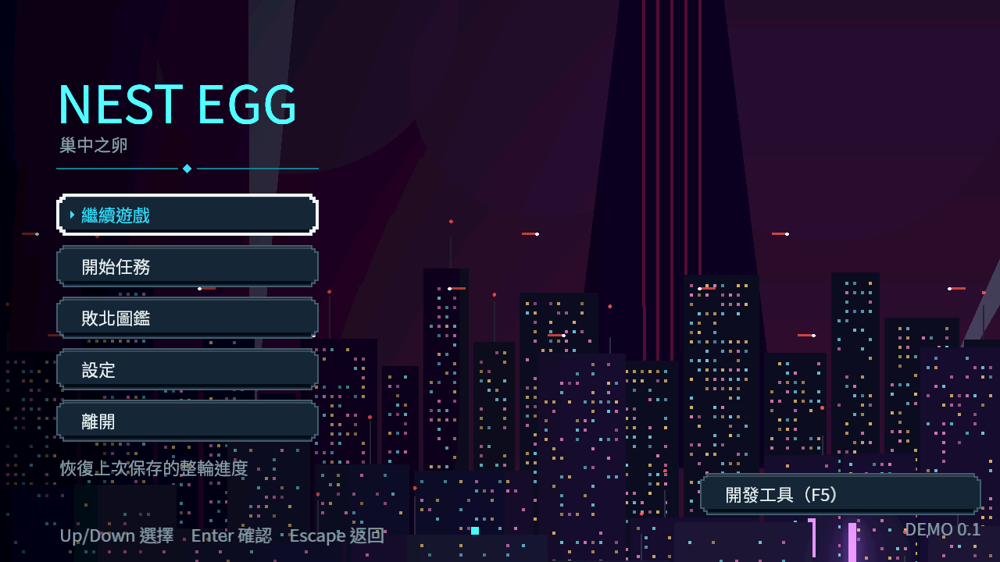
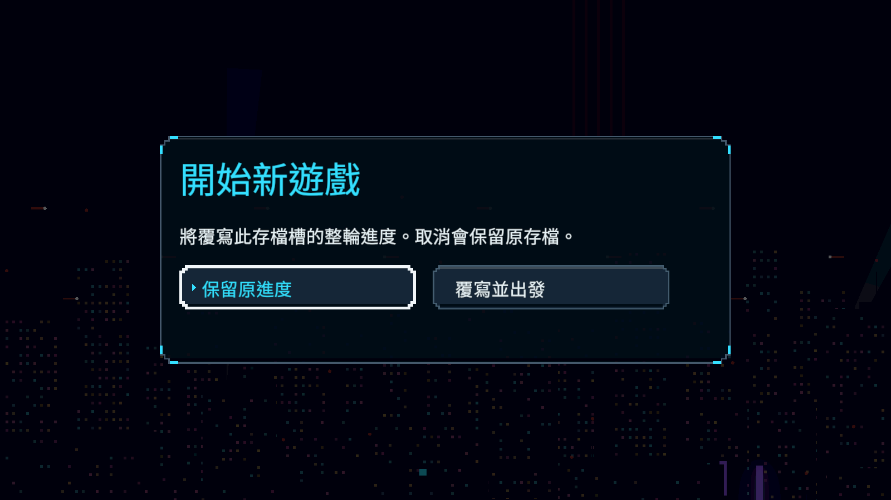
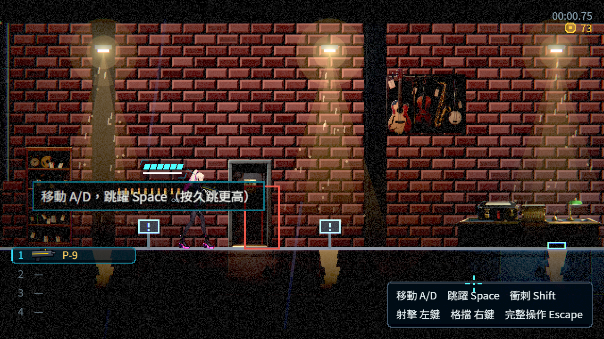
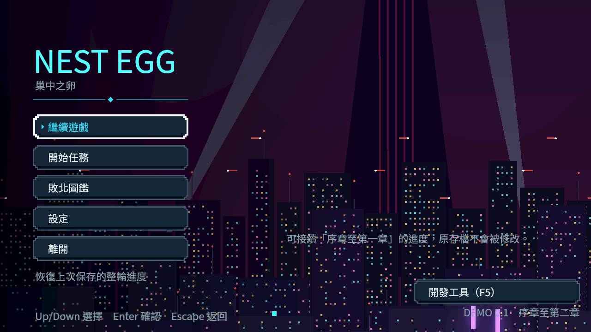
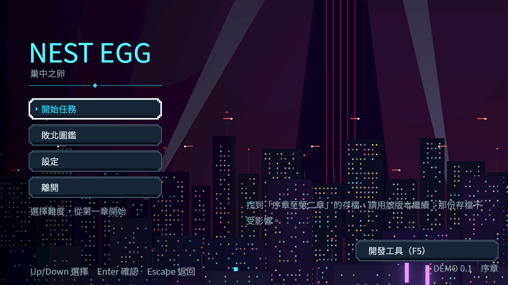
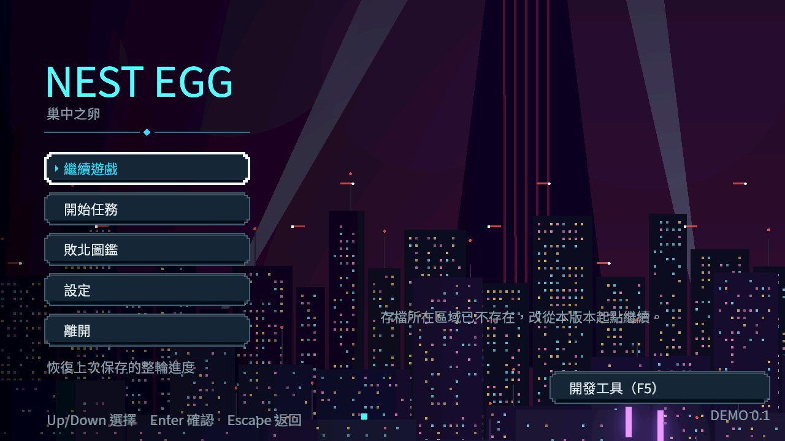
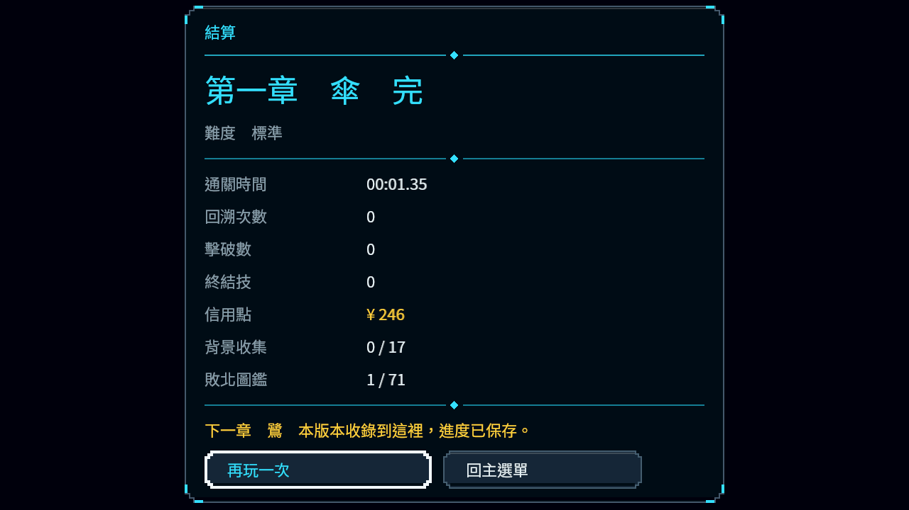

# [NE-230] 加入整輪存檔與續玩

> 狀態：進行中

## 內文

### 需求
補齊正式遊戲的整輪保存與主選單繼續遊戲，真正退出後恢復進度，支援逐章版本接續與安全重試。

### 來源
2026-10-10，使用者要求逐章完成與累積發行、高清像素UI、全流程手把、豐富合理敘事與動畫、場景減雜，並追加武器差異、子彈、方向護盾、可選連段升級與打擊感總驗收；一般設計選擇由實作者決定，持續推進。

詳見[整體設計](../../design/20-campaign-experience/DESIGN.md)、[研究依據](../../design/20-campaign-experience/RESEARCH.md)與[整輪續玩契約](../../design/20-campaign-experience/RUN_SAVE.md)。

### 驗收條件
- [x] 主選單可繼續遊戲；退出程序再開啟後恢復區域、檢查點、裝備、血量、貨幣、能力、當票與故事。
- [ ] 任務、探索、釘選、已開物件與世界狀態一致，序章不重播、章末不錯接。
- [x] 新遊戲、不同存檔與不同累積章節版本隔離清楚，舊檔可相容接續或給出具體說明。
- [x] 購買、任務獎勵、死亡扣款與招式解鎖不因關閉或重讀複製或遺失。
- [ ] 損毀與缺值保留可恢復內容並清楚提示，必要主線與物品不被永久卡住。

### 測試流程
1. 分別在序章、戰鬥後、購買、任務完成與章末退出程序，再重新啟動續玩。
2. 檢查新檔／舊檔、損毀、重複讀檔、跨版接續與手把繼續入口。

---

# Commit-1（驗收紀錄，進行中）

## 內文

原本退出後只有故事紀錄，無法恢復實際血量、購買、裝備及區域。現在主選單有有效整輪紀錄時提供繼續遊戲，新遊戲須明確確認覆寫；損毀讀取會保留原件並說明可採取的操作。

真實兩程序驗證中斷演出：選第一條路線後關閉，重開仍等待回答；重新選第二條路線時，第一條路線的暫定旗標及段內款項不殘留，之前已完成的交易保持。

### 測試結果

| 項目 | 結果 |
|---|---|
| 存檔資料／故障回歸 | 82 檢查／0 失敗，涵蓋未知備份、寫入失敗、新輪備份、改名中斷恢復與有界資料 |
| 非自動略過真選擇、兩次程序 | 11 檢查／0 失敗、Forward+ 無 ERROR |
| 1280／100%、1600／120% 主選單與覆寫面板 | 各 8 檢查／0 失敗，整合後出口乾淨 |
| 返回與焦點 | Esc、模擬手把 B、取消預設焦點與返回焦點通過 |
| 購買與成長、真血量／裝備／彈藥／故事／探索兩程序 | 18 檢查／0 失敗 |
| 持久目的地與非持久檢查點兩程序 | 13＋14 檢查／0 失敗 |
| 初次／再次死亡結算兩程序 | 6＋8 檢查／0 失敗 |
| 章末完成卡兩程序 | 4 檢查／0 失敗，不接舊第二章 |
| 同影格重複開始／續玩 | 最後重驗真主流程 11 檢查／0 失敗，含選單／過時及同區重試舊來源拒絕，唯一 Level／新輪交易 |
| 面向恢復及新輸入接管 | 4 檢查／0 失敗，合成輸入 |
| 修正後局部測試 | 章際、存檔、轉場、介面四組 393 檢查／0 失敗，無腳本錯誤；刻意缺素材 ERROR 另列 |
| 最後局部來源邊界 | 章際、存檔、轉場三組 322 檢查／0 失敗，原始輸出無腳本、引擎 ERROR 或退出資源警告 |
| 第一輪受影響範圍測試 | 54081 檢查、1 新失敗及 2 腳本錯誤；真關卡測試初始化修正後重新驗證，原始失敗保留 |
| 最終受影響範圍測試 | 最新主線 2c90、ALL 80 組、54073 檢查、0 新失敗、0 已知失敗、0 SCRIPT ERROR，592 秒、自然退出 0 |
| 引擎出口 | 整合後 192 項短測全過，無腳本／引擎 ERROR 或 ObjectDB 警告；早期失敗保留原始紀錄 |

第一輪章際測試原本未載入真關卡便直接通關，現保留原斷言並改用真正第一章與隔離存檔；正式流程也拒絕無效完成事件。修正後章末兩程序及路由再次全過；16 檔語法檢查通過。19 檔來源前後校驗相同，最終受影響測試已完成。原始退出資源診斷另外保留，未把此失敗列為已知失敗。

原始測試紀錄及量測位置列於[整輪續玩契約](../../design/20-campaign-experience/RUN_SAVE.md)。1280／100% 提示結尾 y314、1600／120% y329，均在頁尾 y334 之前。存檔與截圖使用隔離資料，不曾覆寫正式玩家存檔。

當舖初死缺電話亭是既有關卡缺口；本票未變更地圖，真電話亭區域通過不代表所有區域皆完整。末區路由及舊非持久示範只驗框架，不宣稱正式序章／新第二、三章已可玩或已完整通關。票維持進行中等待根代理驗收。

最新主線整合基準`2c90b9e2593fe47c00cd7aec1bff08f96e5da780`：匯入、124 項真視窗短測均過且退出乾淨，四張原始畫面已重新核對。來源凍結後按原選測工具完成最終 ALL；原始結果及校驗完整保留，票保持進行中。

最終 ALL 的斷言全過，不聲稱 raw 無 ERROR：原 filter 對應的 fixture／既有引擎 ERROR 為 43／39；另外 shard0 出口有 7 Area2D RID、8 resources、7 CanvasItem RID、17 ObjectDB，shard1 有 5 resources、1 CanvasItem RID、9 ObjectDB。選測 cp950 警告解碼診斷保留，完整 80 組皆完成，UTF-8 唯讀確認仍選 ALL。第一項整輪續玩已由真跨程序逐項覆蓋勾選；其他完整主線／序章／跨版條件保持待驗收。

遠端主線 CI 38001873893 因帳戶付款／額度限制未啟動（check-run 114061606400、steps 空），與本機測試結果分開記錄；沒有操作帳戶或重跑繞過。

完整原始證據：[索引](attachments/NE-230/README.md)、[最終摘要](attachments/NE-230/final-console.log)、[程序0](attachments/NE-230/final-shard-0.log)、[程序1](attachments/NE-230/final-shard-1.log)、[資料分類](attachments/NE-230/final-summary.json)、[來源校驗](attachments/NE-230/source-sha256.json)。

### 截圖

# 跟其他票的關係

- Blocks：NE-231、NE-232、NE-237
- Blocked by：無
- Related：ST-3、ST-16、NE-223、NE-216

---

# Commit-2（還原通知順序，進行中）

## 內文

原本續玩會先暫時清空金錢與故事，再逐項恢復；介面或保存通知可能在玩家、NPC 尚未恢復時看見混合進度。現在舊演出先在完整舊局中取消，續玩裝齊故事、金錢、導覽、實際玩家與 NPC 後才通知；取消演出也保留本輪真正經過的時間與死亡事實。

真實續玩情境的第一個金錢通知已讀到正確人物互動紀錄、故事與 73 信用點；通知中重複要求新遊戲／續玩不會換掉目前角色或難度。

### 測試結果

| 項目 | 結果 |
|---|---|
| 存檔局部回歸 | 374 檢查／0 失敗 |
| 原受影響選測 | 65 組、42226 檢查／0 新失敗、0 SCRIPT ERROR，自然退出 0 |
| 最新主線整合複驗 | 主流程、存檔、近戰三組 1954 檢查／0 新失敗 |
| 實際 Forward+ 續玩 | 初次與最新整合各 7／7，短測原始輸出無 ERROR 或退出資源診斷 |
| 來源與紀錄 | 9 檔來源前後校驗相同，原始輸出與分類保留 |

受影響與整合長測的原始輸出另有原 filter 對應的 fixture／既有引擎訊息及退出資源診斷，詳見[原始驗證與分類](attachments/NE-230-restore-order/README.md)；未修改篩選規則或已知失敗清單。這次驗證的是實際續玩恢復順序，沒有將直接定位章末當成完整章節通關。

### 截圖

---

# Commit-3（累積版本隔離、章末接續與部分恢復，進行中）

## 內文

原本所有版本共用同一個存檔、版本身分寫死，「序章至第一章」和「序章至第二章」放在同一台電腦會互相覆蓋，也無法判斷存檔能不能在這個版本接續；存檔所在區域一旦不存在，整份進度就讀不回來。

現在每個累積版本有自己的名稱與存檔目錄。新版本沒有自己的存檔時，主選單提示可接續舊版本的進度，接續後寫進自己的目錄，舊檔一個位元組都不改；舊版本看到新版本的存檔只說明該用哪一版，不讀不寫。版本的最後一章停在完成卡並說明「本版本收錄到這裡，進度已保存」；收錄下一章的版本讀到章末存檔時直接帶著裝備與成長進下一章入口，不重看結算；通往未收錄章節的出入口會拒絕並提示。存檔所在區域遺失時退回復原點或起點，錢包、成長、故事與各區域紀錄都保留，主選單與進場各一句說明；無效的導覽項目逐項略過。主選單的版本字樣標出收錄範圍；說明文字改為先換行再定框，長句不再超出畫面。

每一組都是兩個獨立程序：第一個程序走正式主流程後送出關閉視窗，第二個程序冷啟動續玩。序章開場不重播，探索格子、存檔點、已打開的箱子、撿到的錢與故事旗標一致；招式購買與委託報酬重開後不重複發放、不能再買、重複讀檔金額不變；死亡扣款、購買與改裝沿用 Commit-1 的兩程序紀錄並重跑通過。

### 測試結果

| 項目 | 結果 |
|---|---|
| 受影響範圍測試（17 組） | 3847 檢查、0 新失敗、0 已知失敗 |
| 主流程測試（額外加跑） | 1516 檢查、0 新失敗 |
| 存檔套件 | 424 檢查、0 失敗（新增版本身分、損毀設定、隔離、接續、拒絕與章末路由 30 項） |
| 新兩程序驗收 | 序章 6＋8、成長與獎勵 3＋5、區域遺失修復 0＋8、版本鏈 5＋8＋3＋7，全部通過 |
| 既有兩程序驗收重跑 | 購買／章末／死亡／轉場／世界／重試／選項 7 組 75 項全部通過 |
| Forward+（軟體 Vulkan） | 三種主選單說明都換行在框內與畫面內；完成卡整個面板在畫面內 |

跨章接續的第二章正式內容尚未交付，版本鏈用程式內明示的 fixture（第一章末區在記憶體中暫接舊示範區並標為第二章）驗證路由，不代表第二章可玩。兩項原有斷言依新行為調整而不刪除：外部關卡路徑仍不會被載入，改為驗證退回起點並附說明；新遊戲起點改為驗證實際起點資料是當舖且主流程讀它。

尚待：正式任務資料還沒進 main，釘選只驗證保持原值；「必要主線物品不被永久卡住」需要故事 Session 確認哪些旗標對應必要物品後才能做補發規則。實體手把與本機 GPU 未驗。

分支：`feature/save-release`，提交 [239ea37f](https://github.com/deadline314/Nest-Egg/commit/239ea37f55f3b7cfded1b1ae35734a20b846096d)

### 截圖

---

# Commit-4（與故事分支預先整合，進行中）

## 內文

正式任務資料在故事分支，還沒進 main，釘選一直只能驗「保持空值」。這次在本機把故事分支暫時合併到本組分支（不推送）預演：起點換成序章試貨區、存檔與版本程式不需要改；釘選一個真實支線任務後關閉，第二個程序續玩時釘選仍在，序章不重播、探索與存檔點一致。預演也找出合併時要處理的三處：新遊戲起點要改在章節資料而不是主流程常數（兩邊同時改會變成重複定義）、完成卡的收錄說明要依版本最後一章才顯示、驗收工具不能假設第一區有箱子或用直接進末區等自然收尾。驗收工具已改成讀資料起點、沒有箱子就略過該項、章末改送末區真正的完成訊號只驗路由；以上已告知故事與介面 Session。

### 測試結果

| 項目 | 結果 |
|---|---|
| 本組分支 | 序章 5＋8、版本鏈 6＋7＋3＋6 全部通過 |
| 本機預演（合併故事分支） | 序章 6＋8（含真實任務釘選跨程序保存）、成長 4＋9、死亡後關閉 4＋5、區域遺失 0＋7、版本鏈 6＋7＋3＋6 全部通過 |

預演不是 main 的證據；釘選那一條等故事分支進 main 後，在 main 上重跑同一組再勾。

分支：`feature/save-release`
