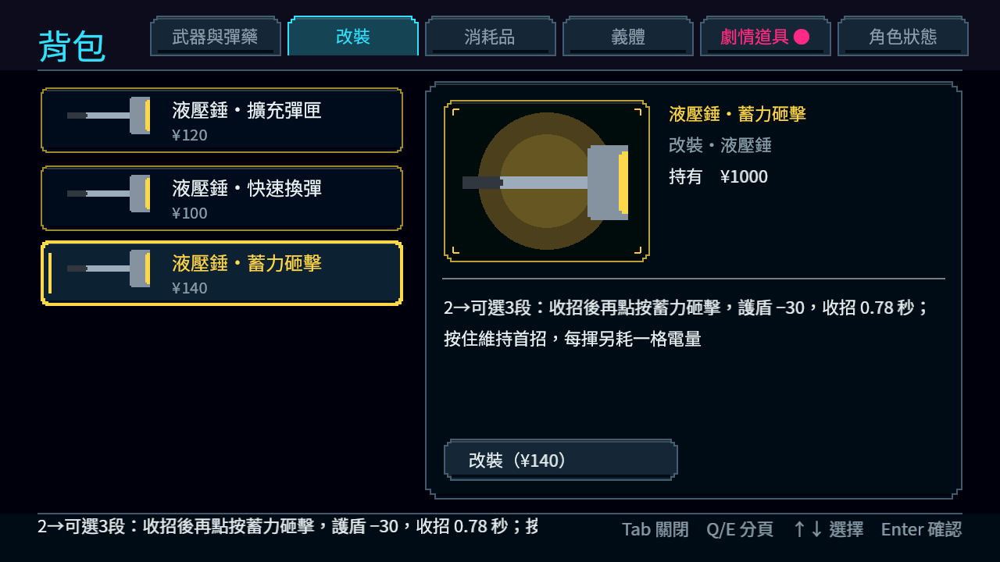
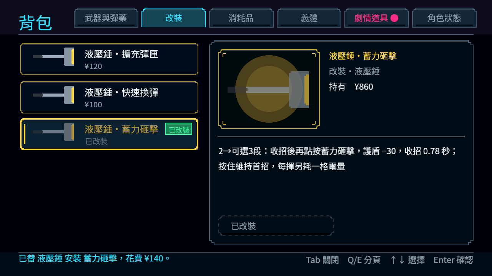

# [NE-231] 調整跨章成長與任務獎勵

> 狀態：進行中

## 內文

### 需求
承接既有信用點與升級，調整序章至第三章的收入、購買、正式任務獎勵與成長選擇，讓玩家敢嘗試且不被必刷支線卡住。

### 來源
2026-10-10，使用者要求逐章完成與累積發行、高清像素UI、全流程手把、豐富合理敘事與動畫、場景減雜，並追加武器差異、子彈、方向護盾、可選連段升級與打擊感總驗收；一般設計選擇由實作者決定，持續推進。

詳見[整體設計](../../design/20-campaign-experience/DESIGN.md)與[研究依據](../../design/20-campaign-experience/RESEARCH.md)。

### 驗收條件
- [ ] 每章主路收入、支線／探索收入、補給、死亡、典當與升級支出有對帳与實際路線驗證。
- [ ] 普通不刷錢可通關，能買到有意義選擇，不要求完成全部支線或強制單一武器。
- [ ] 近戰、槍械与防禦成長都有適用用途，效果／價格／任務獎勵一致，購買前後可理解並立即試用。
- [ ] 升級後打擊感的變化可辨，攻擊強度、速度、控制與耗能保持代價，不用純特效冒充提升。
- [ ] 基礎／升級、雜兵／裝甲／頭目、不同難度與死亡成本有比較，未產生永久硬直或無限資源。
- [x] 重複领奖、交易與讀檔不复制貨幣或物品，必要物品和永久招式按規則保留。

### 測試流程
1. 走各章正常路與可選路，對照收入、购买、死亡與獎勵。
2. 比較升級前後不同武器与敵人的實戰效果，驗證續玩和交易邊界。

---

# 跟其他票的關係

- Blocks：NE-235
- Blocked by：NE-230
- Related：NE-32、NE-33、NE-216、NE-97、NE-237、ST-19、ST-21

---

# Commit-1（一次帳務驗證，進行中）

## 內文

故事款項原本沒有一次結算證據，重播或讀檔容易無法確認已收／已付。現在一次結算會同步保留款項與記錄；重複結算、餘額不足、容量不足及記錄不可信時，款項和原始證據都保持。

已核對日常免費飯、明確點餐、付款、免收、記帳、後續還款及委託淨款七種定義。免收不增加現金，記帳不先發錢，後續還款保留欠款歷史；委託不抵扣另一筆餐酒或市場帳。

### 測試結果

| 項目 | 結果 |
|---|---|
| 帳務回歸 | 183 檢查、0 失敗；同指紋不同金額的原始 2 項失敗已重現並修正 |
| 原工具受影響範圍 | 44 組、33,631 檢查、0 新失敗、0 已知失敗、自然退出 0，759 秒 |
| 腳本與資料 | 0 腳本錯誤；15 份受測來源校驗一致 |
| 原始輸出 | 65 項刻意／既有診斷與 2 項退出錯誤完整保留，非無 ERROR 聲明 |

完整原始紀錄與範圍：[驗證索引](attachments/NE-231/README.md)、[最終摘要](attachments/NE-231/final-console.log)、[原始程序](attachments/NE-231/final-shard-0.log)、[分類](attachments/NE-231/final-diagnostics.json)、[來源校驗](attachments/NE-231/source-sha256.json)。

### 截圖

此交付為帳務服務與資料驗證，玩家畫面没有異動，故沒有新增截圖。

最新主線重裝機槍手修復整合後，15 份受測來源校驗相同，重新匯入及五組局部整合驗證通過：3,055 檢查、0 新／已知失敗、自然退出 0。原始紀錄：[摘要](attachments/NE-231/latest-target-console.log)、[程序](attachments/NE-231/latest-target-shard-0.log)、[整合基準](attachments/NE-231/latest-integration.json)。

# Commit-2（近戰選購與耗能量測）

## 內文

近戰成長現在提供五種各自適用的招式，價格80／100／140／120／100，共540選購；原三項改裝與最低補給570維持，全部改裝910保留。購買前後能看段數、用途、能量及收招，買入後立即在訓練場試用，不以更改章節收益來支付全部可選招式。

追加招是可選接續，短招仍可用；消耗護盾能量，重錘另付電量，末段命中與揮空均付收招。六秒固定距離普通／裝甲／頭目、三種難度對比保留真傷害、反應及消耗。長柄追加換較寬掃擊與單擊，實際樣本DPS略降、鎖定增加，保留選擇成本。

### 測試結果

| 項目 | 結果 |
|---|---|
| 購買與報表 | 必要570／選購540／全部改裝910；五種真購買、重複與不足拒絕 |
| 經濟與成長複驗 | 本階段局部412檢查、0新／已知失敗、自然退出0；文件差異沒有新增runtime測試組 |
| 成長對比 | 基礎50組、追加50組；兩種模式各45組真命中、5組揮空 |
| 頭目反應 | 三難度全部自身擊退0、暈眩0，沒有用強招永久控制頭目 |
| 資源與取消 | 能量不足不部分扣款；尾招全收招，不循環取消 |
| 圖片 | 原改裝介面真Forward+購買前後；與NE-237原圖相同來源與校驗 |

[近戰成長證據](attachments/NE-231-melee/README.md)、[完整量測配對](attachments/NE-237/comparison.json)。

### 截圖

---

# Commit-3（交易與讀檔不複製，兩程序驗收）

## 內文

原本一次帳務與招式選購只在同一個程序內驗過，沒有證明真的關閉遊戲再開以後，獎勵、招式、當票與死亡扣款不會重複或消失。

現在用正式主流程分兩個程序驗收：買下突進斬、領委託報酬、在當舖頁面典當一件護盾電池後關閉視窗；重開續玩後錢包與存檔一致，招式只有一份且不能再買，委託報酬不能再領，當票剩一張，贖回一次拿回東西並扣一次錢，第二次贖回被拒絕，重讀後仍是同一份東西與金額。另一組在電話亭區買招式、領報酬後真的死亡並在同一影格關閉：重開後死亡不重算、扣款不重扣、購買不退回，招式保留，報酬不能重領，玩家回到復原點。

### 測試結果

| 項目 | 結果 |
|---|---|
| 招式、報酬、當票兩程序 | 4＋9 項通過 |
| 死亡後關閉兩程序 | 4＋5 項通過 |
| 再死扣款（NE-230 既有兩程序） | 重跑通過，費用與屍體不重複結算 |
| 受影響測試 | 只改驗收工具，選測工具判定無受影響遊戲套件 |

章節收入與實際路線對帳、普通不刷錢通關、成長效果的實戰對比，仍需要序章至第三章的正式內容進 main 後再走（第一章完整自然路線尚未成立，第二、三章未交付）。

分支：`feature/save-release`

### 截圖

本次是存檔與帳務的跨程序驗收，沒有畫面變更。
