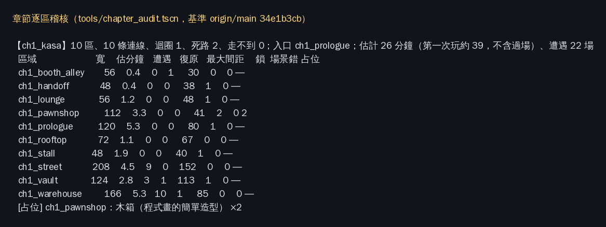

# [NE-233] 驗收並發行序章至第一章

> 狀態：進行中

## 內文

### 需求
在對應章節落地後完整檢查序章至第一章的布局、場景、節奏、敵人與玩家體驗，並交付可獨立啟動的累積章節單檔。

### 來源
2026-10-10，使用者要求逐章完成與累積發行、高清像素UI、全流程手把、豐富合理敘事與動畫、場景減雜，並追加武器差異、子彈、方向護盾、可選連段升級與打擊感總驗收；一般設計選擇由實作者決定，持續推進。

詳見[整體設計](../../design/20-campaign-experience/DESIGN.md)與[研究依據](../../design/20-campaign-experience/RESEARCH.md)。

### 驗收條件
- [ ] 從序章到第一章章末人工完整遊玩，主線、可選支線、死亡、跳過与续玩皆合理。
- [ ] 逐區檢查長度、迴圈、捷徑、落點、檢查點与敘事節奏；問題已修正或有具體阻擋交付的票。
- [ ] 全部場景與電影舞台的比例、支撐、天空／牆面裝飾、人物接地与物件用途合理，沒有明顯占位素材。
- [ ] 敵人種類、重複規則、遭遇密度、預兆與難度符合章節；缺失素材、分割、骨架、動作与音效已整合驗證。
- [ ] 全部可用武器、子彈、盾與近戰有清楚動作和打擊感，升級不破坏平衡，特效不遮住危險。
- [ ] 正式任務、HUD、介面、手把与21:9过渡可完整使用；必需資訊可讀而不雜亂。
- [ ] 對應序章至第一章獨立單檔在Windows乾淨目錄啟動可玩，記錄版本、體積、校驗碼与章末結果。
- [ ] 自动／軟渲染、人工遊玩、實體手把与本機Forward+驗收分開記錄，未驗收项不勾完成。

- [ ] 驗收從正式新遊戲入口自然完成序章與第一章，不跳區、手授旗標或假造完成；對應同一提交的原受影響測試、自然退出紀錄和人工全路線结果留存。

### 測試流程
1. 先核對对应章節完成及素材就緒，再逐區检查与完整遊玩。
2. 測正式累積包、分支、死亡續玩与手把，保存區域與介面截圖、問題修正和版本紀錄。

---

# 跟其他票的關係

- Blocks：NE-234
- Blocked by：ST-16、ST-2、ST-9、ST-10、NE-178、NE-223、NE-228、NE-229、ST-22、NE-232、BG-20、BG-21、BG-22、NE-240、NE-241、NE-244、NE-245、BG-27、BG-28、BG-29、BG-30、NE-246、NE-247、BG-47
- Related：NE-97、NE-154、NE-71、NE-88、NE-153、NE-224、NE-66、BG-17

---

# 2026-10-11 交接紀錄

## 內文

安排到倉庫的閱讀測試只證明局部生命週期，沒有走完宵夜、接案、取得資料與回家。序章候選未採用，故事分支完整範圍測試尚未通過，正式發行條件保留未勾選。

使用者要求本 Session 收尾後停止開發。偏好、研究依據、避免重犯事項與精確接手資訊見 [使用者指南](../user_guide.md)及[本次交接](../SESSION_HANDOFF_2026-10-11.md)。此段保存現況，不是新完成紀錄。

---

# Commit-1（驗收清單與擋路票檢查，待擋住的票進 main）

## 內文

原本三張章節驗收票只有驗收條件，沒有說每一條要用什麼證據、哪些能在雲端自動查、哪些一定要人或實機；也看不出擋住的十幾張票目前完成了沒有，容易在內容還沒進 main 時就開始驗，或拿工具通過冒充人工遊玩。

現在有一份三章共用的[驗收清單](../../design/20-campaign-experience/CHAPTER_ACCEPTANCE.md)：每一條拆成自動檢查、雲端軟體渲染、需要人或實機三欄，寫明用哪個工具、門檻與證據放哪裡，並標出版本鏈的 fixture 不能當自然通關證據。另有唯讀的擋路票檢查，一行指令列出各驗收票還被哪些票擋住、各自狀態與勾選進度；全部完成或審查中才顯示「可開始驗收」。

目前序章至第一章還有 16 張擋住，第二章 2 張、第三章 3 張（見[今日檢查結果](attachments/NE-233/gate-2026-10-11.txt)），所以本票尚未開始逐條驗收，驗收條件都不勾。

### 測試結果

| 項目 | 結果 |
|---|---|
| 擋路票檢查工具測試 | 14 項通過（完成／進行中／取消、無擋路票、找不到、票號重複、相近票號不誤判、只數驗收條件區段、指令列輸出） |
| 對實際票的檢查 | NE-233 擋 16、NE-234 擋 2、NE-235 擋 3 |
| 遊戲測試 | 只新增文件與發行工具，選測判定無受影響遊戲套件 |

已併入 main，提交 [eeb9bfed](https://github.com/deadline314/Nest-Egg/commit/eeb9bfed0dac8874dc625cc6baca8f6745602465)

### 截圖

本次沒有畫面變更。

---

# Commit-2（逐區稽核與占位清單，進行中）

## 內文

原本「逐區檢查長度、迴圈、捷徑、落點、檢查點」與「沒有明顯占位素材」只能靠人一區一區看，沒有可重跑的數字，也看不出哪些上鎖的門其實沒有任何劇情會打開。

現在有一份章節逐區稽核（[說明與門檻](../../design/20-campaign-experience/CHAPTER_AUDIT.md)），從正式關卡、章節設計與故事資料自動算出：每區寬度與估計時間、遭遇數、復原點與出入口的最大間距、上鎖出入口與能不能被解開、區域圖的迴圈／死路／走不到的區域、場景合理性錯誤，以及還在用程式畫的暫代物件。節奏測試會擋住走不到的區域、永遠打不開的鎖、場景錯誤、沒有迴圈的單線章節與過遠的復原點；整章太短與占位只列在報告與票上。發行包內容與章節順序由 NE-232 的匯出檢查負責，本章的候選包結果見 NE-232 Commit-6。

序章至第一章的結果：10 個區域全部從序章走得到，1 個迴圈，2 條死路（電話亭巷、屋頂，都有拾取與人物），9 個上鎖出入口都有開鎖來源，場景合理性 0 錯誤，最大復原點間距是街道的 152 格（門檻 160）；估計約 26 分鐘、第一次玩約 39 分鐘（不含過場），遭遇 22 場。占位：當舖有 2 個程式畫的木箱，連同其他程式暫代的固定物件開成 BG-47。序章至第一章的候選包已能在乾淨資料夾啟動並回報只收錄序章與第一章、停在天亮的當舖（NE-232）。

人工完整遊玩、敘事節奏、畫面、手把與 Windows 原生啟動仍待使用者遊玩與本機原生驗收，驗收條件都不勾；擋住本票的票目前還有 14 張（[今日檢查](attachments/NE-233/gate-2026-10-12.txt)）。

### 測試結果

| 項目 | 結果 |
|---|---|
| 節奏測試（含新稽核） | 82 檢查、0 失敗；把復原點門檻調嚴到 100 格時第一、二章會失敗，確認檢查有在跑 |
| 第一章稽核 | 走不到 0、打不開的鎖 0、場景錯誤 0、迴圈 1、程式暫代物件 2（BG-47） |

分支：`claude/economy-release-mxk279`；已併入 main：[37fbffa3](https://github.com/deadline314/Nest-Egg/commit/37fbffa3ed2159c98e2e7e7371fc775a97ec88cb)

### 截圖

