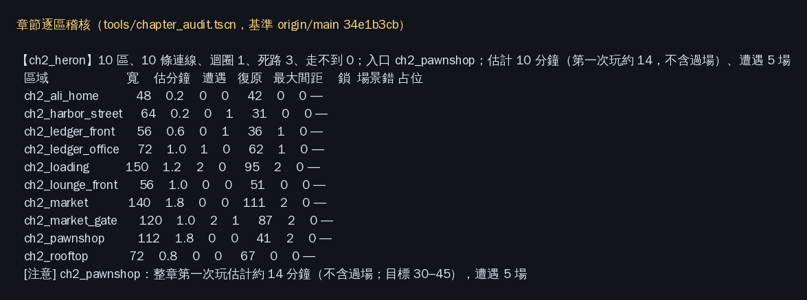

# [NE-234] 驗收並發行序章至第二章

> 狀態：進行中

## 內文

### 需求
在對應章節落地後完整檢查序章至第二章的布局、場景、節奏、敵人與玩家體驗，並交付可獨立啟動的累積章節單檔。

### 來源
2026-10-10，使用者要求逐章完成與累積發行、高清像素UI、全流程手把、豐富合理敘事與動畫、場景減雜，並追加武器差異、子彈、方向護盾、可選連段升級與打擊感總驗收；一般設計選擇由實作者決定，持續推進。

詳見[整體設計](../../design/20-campaign-experience/DESIGN.md)與[研究依據](../../design/20-campaign-experience/RESEARCH.md)。

### 驗收條件
- [ ] 從序章到第二章章末人工完整遊玩，主線、可選支線、死亡、跳過与续玩皆合理。
- [ ] 逐區檢查長度、迴圈、捷徑、落點、檢查點与敘事節奏；問題已修正或有具體阻擋交付的票。
- [ ] 全部場景與電影舞台的比例、支撐、天空／牆面裝飾、人物接地与物件用途合理，沒有明顯占位素材。
- [ ] 敵人種類、重複規則、遭遇密度、預兆與難度符合章節；缺失素材、分割、骨架、動作与音效已整合驗證。
- [ ] 全部可用武器、子彈、盾與近戰有清楚動作和打擊感，升級不破坏平衡，特效不遮住危險。
- [ ] 正式任務、HUD、介面、手把与21:9过渡可完整使用；必需資訊可讀而不雜亂。
- [ ] 對應序章至第二章獨立單檔在Windows乾淨目錄啟動可玩，記錄版本、體積、校驗碼与章末結果。
- [ ] 自动／軟渲染、人工遊玩、實體手把与本機Forward+驗收分開記錄，未驗收项不勾完成。

### 測試流程
1. 先核對对应章節完成及素材就緒，再逐區检查与完整遊玩。
2. 測正式累積包、分支、死亡續玩与手把，保存區域與介面截圖、問題修正和版本紀錄。

---

# 跟其他票的關係

- Blocks：NE-235
- Blocked by：NE-233、ST-19、BG-47、NE-265、NE-266
- Related：NE-97、NE-154、NE-71、NE-88、NE-153、NE-224、NE-66、BG-17

---

---

# Commit-1（驗收清單，待擋住的票進 main）

## 內文

驗收方式與 NE-233 共用[各章驗收清單](../../design/20-campaign-experience/CHAPTER_ACCEPTANCE.md)：自動檢查、雲端軟體渲染、人工與實機三種證據分開記錄。擋住本票的票用 `tools/release/chapter_gate.py NE-234` 查，全部完成或審查中才開始逐條驗；目前結果見 [NE-233 附件](attachments/NE-233/gate-2026-10-11.txt)。驗收條件尚未開始，不勾。

已併入 main，提交 [eeb9bfed](https://github.com/deadline314/Nest-Egg/commit/eeb9bfed0dac8874dc625cc6baca8f6745602465)

---

# Commit-2（逐區稽核，進行中）

## 內文

現在有一份章節逐區稽核（[說明與門檻](../../design/20-campaign-experience/CHAPTER_AUDIT.md)），從正式關卡、章節設計與故事資料自動算出：每區寬度與估計時間、遭遇數、復原點與出入口的最大間距、上鎖出入口與能不能被解開、區域圖的迴圈／死路／走不到的區域、場景合理性錯誤，以及還在用程式畫的暫代物件。節奏測試會擋住走不到的區域、永遠打不開的鎖、場景錯誤、沒有迴圈的單線章節與過遠的復原點；整章太短與占位只列在報告與票上。發行包內容與章節順序由 NE-232 的匯出檢查負責，本章的候選包結果見 NE-232 Commit-6。

第二章的結果：10 個區域全部從當舖走得到，1 個迴圈，3 條死路（阿梨家、復原館外、屋頂，都有人物），10 個上鎖出入口都有開鎖來源，場景合理性 0 錯誤，最大復原點間距 111 格；沒有程式暫代的固定物件（互動點旁缺擺設由場景組的 BG-38～42 處理）。**整章太短**：估計約 10 分鐘、第一次玩約 14 分鐘（目標 30–45），遭遇只有 5 場——市集遭遇與兩種新敵人（NE-266）、阿勇頭目戰（NE-265）都還沒配置，列為擋住本票的原因。序章至第二章的候選包已能在乾淨資料夾啟動並回報收錄到第二章、停在第二章屋頂（NE-232）。

人工遊玩與原生驗收未做，驗收條件不勾。

### 測試結果

| 項目 | 結果 |
|---|---|
| 節奏測試（含新稽核） | 82 檢查、0 失敗 |
| 第二章稽核 | 走不到 0、打不開的鎖 0、場景錯誤 0、迴圈 1；整章長度不足（注意） |

分支：`claude/economy-release-mxk279`；已併入 main：[3100b156](https://github.com/deadline314/Nest-Egg/commit/3100b156c56c3b4edf3c041eba85d48cd232ab74)

### 截圖

