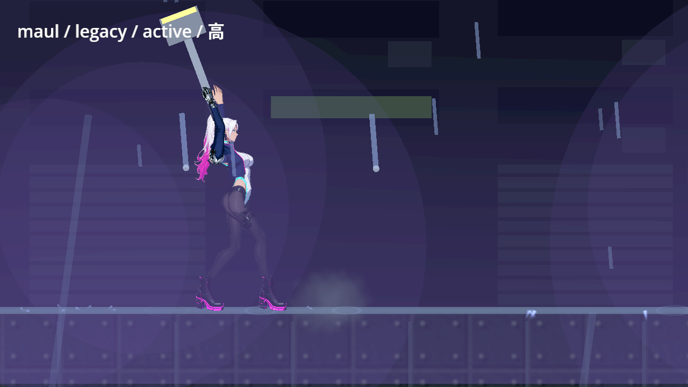
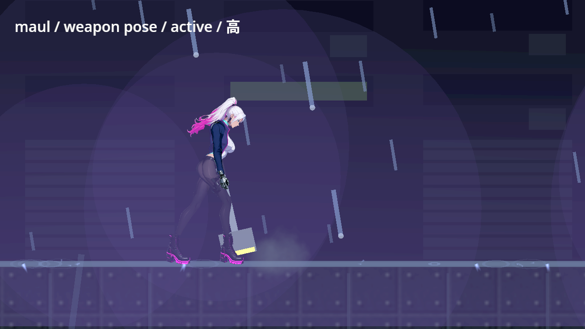
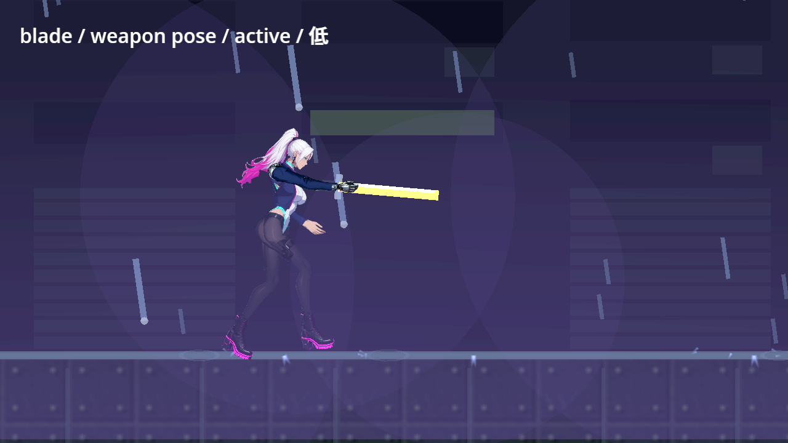
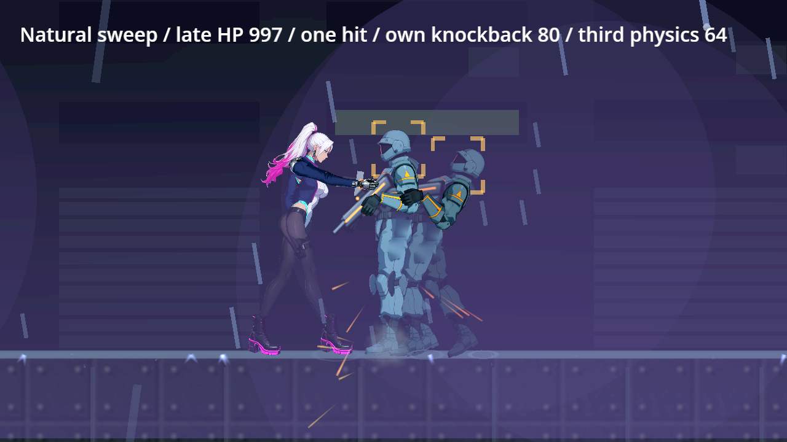
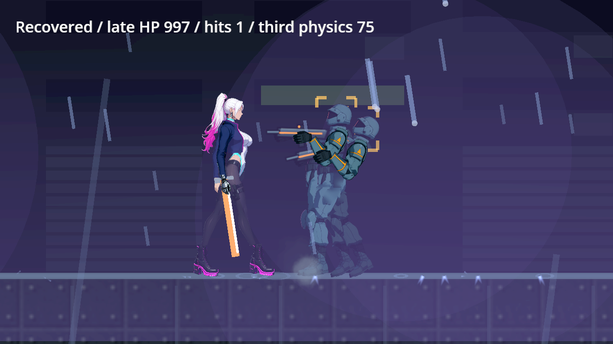
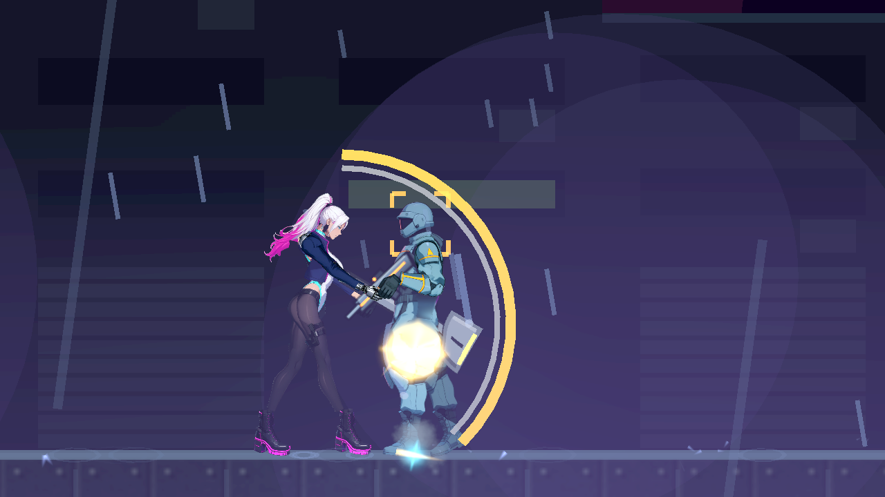
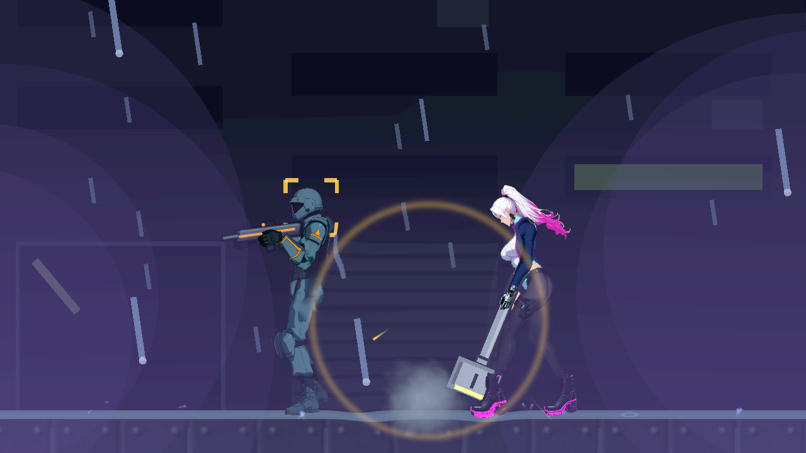
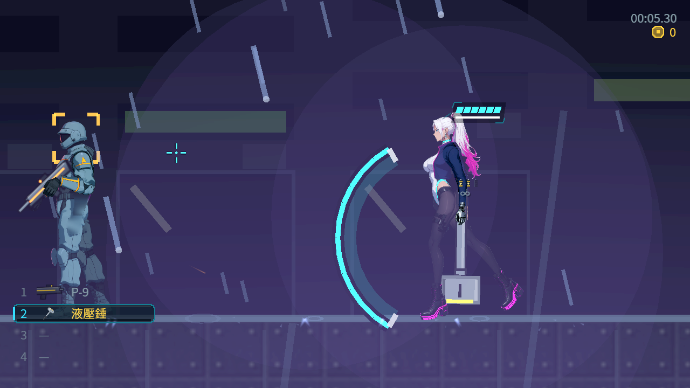
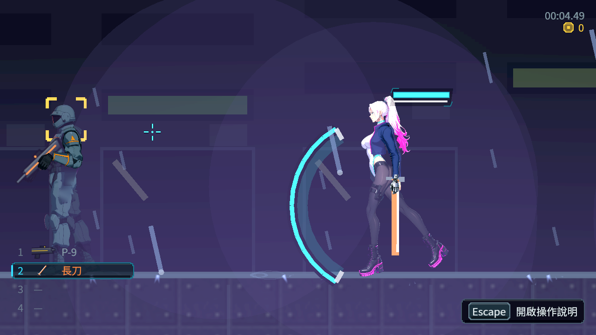

# [NE-236] 區分各武器動作與打擊感

> 狀態：進行中

## 內文

### 需求
讓每個現有武器有不同攻擊動畫、節奏、少量特效、受擊與擊退，打擊感以姿勢、命中、聲音和反應共同成立。

### 來源
2026-10-10，使用者要求逐章完成與累積發行、高清像素UI、全流程手把、豐富合理敘事與動畫、場景減雜，並追加武器差異、子彈、方向護盾、可選連段升級與打擊感總驗收；一般設計選擇由實作者決定，持續推進。

詳見[整體設計](../../design/20-campaign-experience/DESIGN.md)與[研究依據](../../design/20-campaign-experience/RESEARCH.md)。

### 驗收條件
- [ ] 逐一列出並驗收全部現有槍械与近戰武器的姿態、起手、有效段、收招、後座／受力与命中辨識。
- [x] 輕型快速且可選接續較多，重型較慢、單擊較痛且連段較少；每種武器有可理解優勢與风险。
- [ ] 動畫與實際命中窗口／距離一致，命中聲、敵方反應、擊退与短停顿同步，揮空不冒充命中。
- [ ] 不同武器不只換色或套同一動作；裝甲、頭目和小型敵人的反應与抗性合理。
- [ ] 特效精簡且不遮預兆／落點，減震動、減閃光、低特效後仍有力度與必要資訊。
- [ ] 方向、移动、跳跃、换武器、受擊及取消不斷姿或漂移，手把与鍵鼠一致。
- [x] 基礎和升级後的起手、風險、控制、耗能与持續輸出有實際比較，沒有唯一全面優勢武器。

### 測試流程
1. 逐武器測揮空、命中雜兵／裝甲／頭目、移動與跳躍攻擊。
2. 比較動作、聲音、擊退、停顿与升級前後，切換減特效並用真手把實戰。

---

# 跟其他票的關係

- Blocks：NE-237、NE-241
- Blocked by：無
- Related：NE-117、NE-139、NE-142、NE-143、NE-95、NE-222、NE-231、NE-260、NE-261

---

# Commit-1（近戰接觸與安全邊界）

## 內文

近戰原本在命中窗口開始時仍可能處於舉手預備姿勢；換武器、受擊與死亡也會留下旧招式或接續。五種近戰武器現在各有起手、接觸、跟隨與收招姿勢，有效段開始時進入接觸姿勢，保留輕刺、斜斬、重砸、長柄與甩鞭的距離及節奏差異。

按住近戰鍵與持近戰武器的射擊鍵均重複短首招，點按才選擇接續。換武器清舊招式並承擔未完成的動作時間，切成槍也不能立刻開火；受擊與死亡清掉舊接續。格擋接觸不冒稱造成傷害，同一揮對同一目標只接觸一次；後進入掃擊的目標仍受傷，但不重新延長攻擊者停頓，旁觀敵人繼續運作。

訓練場固定距離量測五種武器、三種難度及普通／裝甲／頭目，另驗揮空。重錘單擊與擊退更重，充電、起手及收招限制持續輸出；看門狗保留零擊退與未暈眩結果。固定距離量測與資料計算不等於追逐實戰或人工手感評價。

### 測試結果

| 項目 | 結果 |
|---|---|
| 修正前回歸 | 實跑 84 檢查、9 失敗，保留原始輸出 |
| 受影響範圍 | 76 組、56,095 檢查、0 新／已知失敗、自然退出 0，726 秒 |
| 新增邊界 | 換武器、受擊、死亡、格擋、兩鍵按住、晚進入目標與旁觀敵人均實跑通過 |
| 動作資料 | 11 份武器專用動作；既有動作內容保持，原骨架與動畫稽核通過 |
| 畫面 | Godot 4.7.2 Forward+／llvmpipe；高／低品質與原動作同時序回放，共 45 張真實畫面 |
| 原始診斷 | 刻意容錯、既有引擎與音訊裝置診斷完整保留；不宣稱無 ERROR |

與最新水流及頭目發射位置交付整合後，重新匯入與七組相關複驗通過：7,017 檢查、0 新／已知失敗、自然退出 0。擷取鏡頭亦驗實際倍率為 3.4×，保存每格的倍率與姿勢進度。

[證據與來源校驗](attachments/NE-236/README.md)、[測試摘要](attachments/NE-236/changed-console.log)、[固定距離量測](attachments/NE-236-measurements.json)。

### 截圖

同一武器／時序回放原動作：有效段開始仍舉錘。

有效段開始進入下砸接觸姿勢。

# Commit-2（自然掃擊的晚進目標）

## 內文

前次晚進目標驗證能證明扣血和停頓名單，仍缺自然執行中目標自己的受力證據。現在第一目標實際命中並暫停攻擊者，第二目標於有效段進入，由持續掃擊自然命中；晚目標只扣血一次，自身出現非零擊退與受擊反應，攻擊者恢復後不再停頓。無關第三物件在兩次接觸期間實際持續運作，整招自然收完。

### 測試結果

| 項目 | 結果 |
|---|---|
| 受影響範圍 | 98 檢查、0 新／已知失敗、自然退出 0 |
| 晚進目標 | 999→997 一次；實際水平速度80、暈眩0.45秒，真攻擊者保留 |
| 無關物件 | physics 9→30；最新主線複驗9→31，沒有一起停住 |
| 原始紀錄 | 初次 class cache 腳本失敗與修正後成功均保留；不宣稱無 ERROR |
| 畫面 | 真 Forward+／軟體 Vulkan 自然命中後與自然收招兩張；命中後 draw 已進收招 |
| 最新主線整合 | Main／RunSave／受擊／環境四組8,160檢查，加近戰98檢查，全數0新／已知失敗、自然退出0 |

[完整原始證據與校驗](attachments/NE-236-natural-late/README.md)。

### 截圖

# Commit-3（液壓槌柄與槌頭讀感）

## 內文

原生有效段畫面中，液壓槌的柄到手之間不清楚，槌頭像單色方塊。現在金屬柄連續伸入槌頭，握把跨現有手部位置；槌頭分出外殼、亮斜邊、暗側與液壓縫，保留小型狀態條。三招的粗亮尾跡縮細，降低遮擋，傷害、節奏、消耗、距離與價格維持。

在最新主線以自然物理出招逐格拍攝兩方向三招，高低設定各保留440格數據；每招真命中一次並自然收完。原拒絕畫面、回歸失敗與中間材質試拍原樣保留。

### 測試結果

| 項目 | 結果 |
|---|---|
| 修前回歸 | 301檢查、3新失敗、0已知失敗、退出1；raw保留 |
| 最新主線受影響範圍 | 47組、36,864檢查、0新／已知失敗、退出0，427秒 |
| 自然三招 | 兩方向每招一次扣血：999→993／991／988；高低重拍均通過 |
| 原生畫面 | 1280×720、3.4倍、真Forward+軟體Vulkan；零震動、減閃、低粒子 |
| 原始診斷 | suite無腳本錯誤，刻意／既有診斷完整保留；最終擷取無ERROR、退出0 |

[完整source、raw、原生逐格與hash](attachments/NE-236-maul-drawing/README.md)。

### 截圖

# Commit-4（自然轉盾與舊連段清除）

## 內文

揮空收完才舉盾時，匕首、熱刃、液壓錘與長柄原本仍保留舊連段，放盾後新點按誤接第二招。現在首次舉盾就結束舊接續，放盾的新點按從首招開始；揮空仍須支付完整起手、有效段與收招，格擋窗口與能量規則維持。

五種近戰、左右面向各由真揮擊及短停頓轉盾，再讓真彈體自然飛行接觸。正面窗口後消耗盾量而不扣血，窗口內反彈後對返回受擊者造成一次傷害；背面扣血且不消耗方向盾量。持盾時兩種攻擊輸入都拒絕，不留下舊接續或消耗電量。

### 測試結果

| 項目 | 結果 |
|---|---|
| 修正前 | 591檢查、8新失敗、0已知失敗、退出1，122秒；四種多段武器各兩項失敗 |
| 原始受影響範圍 | 60組、54,807檢查、0新／已知失敗、退出0，954秒 |
| 最新主線交叉複驗 | 7組、6,971檢查、0新／已知失敗、退出0，279秒 |
| 真彈體矩陣 | 五武器×两面向×三結果共30組；普通盾100→76／生命不變，反彈一次2傷害，背面一次1傷害 |
| 原生畫面 | 高品質320、低品質最終325檢查，均0失敗／退出0；各30張1280×720、3.4倍真Forward+軟體Vulkan |
| 原始失敗保留 | 初次腳本錯誤及首輪雙worker的malloc abort均保留；首輪不算通過，cgroup無OOM事件 |
| 執行診斷 | 最終suite無SCRIPT ERROR；刻意／既有物理與退出診斷完整保留，不宣稱無ERROR |

第一次原生試拍的章節卡遮擋與腳部裁切原樣保留；重拍等待真正章節卡完成並重設取景鏡頭平滑。畫面是彈體接觸與返回飛行後的實際狀態，功能驗證與角色美術分開記錄。

[完整source、失敗／成功raw、矩陣、原生圖及hash](attachments/NE-236-weapon-guard/README.md)。

### 截圖

---

# Commit-5（槍械基礎與改裝的實測比較、衝鋒槍不再全面占優）

## 內文

**問題**：槍械實測只有基礎狀態，沒有改裝後的比較，也沒有含換彈的持續輸出；實測裡衝鋒槍在近、中、遠三種距離擊倒都最快、持續輸出也最高，是唯一全面占優的槍，其他輕型槍沒有選它以外的理由。

**改動**：衝鋒槍的子彈射程從約 270 像素縮到約 173 像素（約 11 格），描述改成「射程短，只能近中距離壓制」；長距離（14 格）留給步槍、光束與軌道砲。射速、傷害、彈匣都沒改。槍械實測加上「買齊改裝」的第二輪與 6 秒持續輸出（含換彈）；新增一項資料檢查：每把玩家的槍在射程、單發、連射、持續輸出、貫穿裡至少有一項輸給別把，衝鋒槍打不到 14 格而步槍打得到。

**驗收**：真正的玩家按住射擊、手把右搖桿瞄準（虛擬輸入）打不動的目標，基礎與改裝各一輪：衝鋒槍近中距離仍最快（擊倒雜兵 0.35／0.47 秒），14 格打不到；步槍在 14 格擊倒雜兵 0.66 秒、打手 1.05 秒。改裝只改善換彈與散佈：手槍、步槍、光束持續輸出提高，擊倒時間幾乎不變，沒有讓任何一把變成全面最好。近戰的基礎與付費尾招比較見 NE-237。完整數字見驗收矩陣與附件。

### 測試結果

| 項目 | 結果 |
|---|---|
| 成長套件（含新增的「沒有全面占優的槍」） | 991 項，0 失敗；把衝鋒槍射程改回去時新檢查失敗 |
| 受影響範圍（併入最新 main） | 87,919 項；新失敗都是對負載敏感的計時（載具上下、坑洞重生，單獨重跑主流程 1,515 項全過）與看門狗生命調整試驗（已還原） |
| 槍械實測 | 基礎與改裝各 56 筆＋持續輸出 16 筆 |

[槍械實測原始資料](attachments/NE-241-gun-balance.json)、[全武器驗收矩陣](../../design/15-combat-feel/COMBAT_ACCEPTANCE_MATRIX.md)

分支：`feature/combat`

---

# Commit-6（輕重武器的段數與減特效下的命中回饋）

## 內文

**問題**：「輕型接續多、重型連段少」只在預設連段比較，沒有把付費尾招算進去；揮空與減特效設定下的命中回饋沒有實際揮一次確認。

**改動**：只補驗證，數值沒改。新增檢查：連段段數含付費尾招時，起手最快的匕首段數最多、單擊最重的液壓錘比它少；五把近戰武器各自在一般與「震動關閉＋減少閃光」兩種設定下對空揮一次、打人一次——對空沒有命中聲、命中標記與停頓，打人有命中聲、命中標記與扣血。

**驗收**：近戰武器套件 1,034 項全過，配合既有的「每兩把武器在速度、輸出、距離、衝擊上互有勝負」，第二條打勾。槍械的命中同步與「不遮預兆」、低特效的人工確認仍待驗，第三、五條維持未勾。

分支：`feature/combat`

