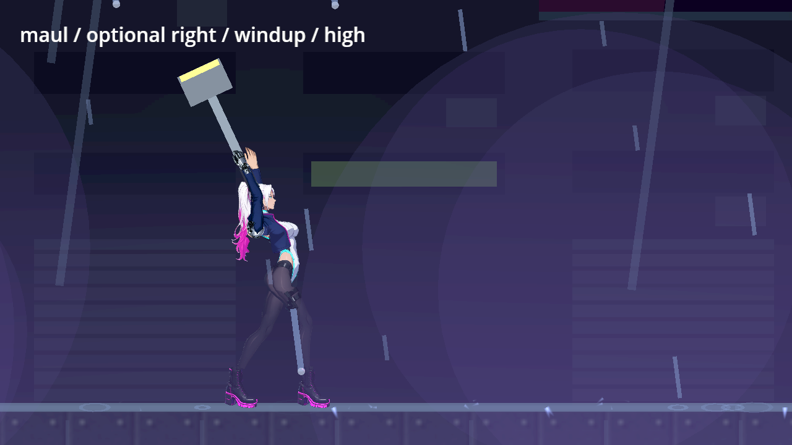
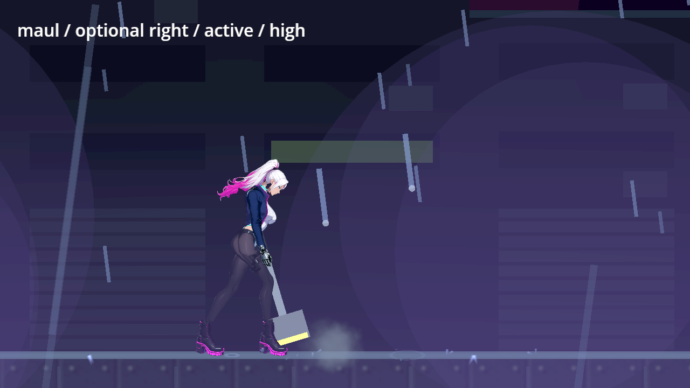
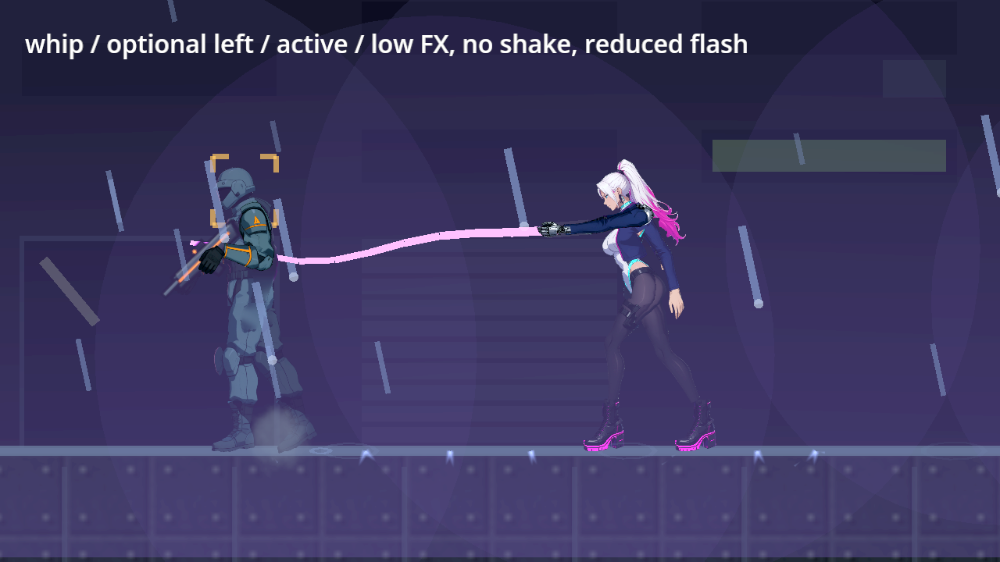
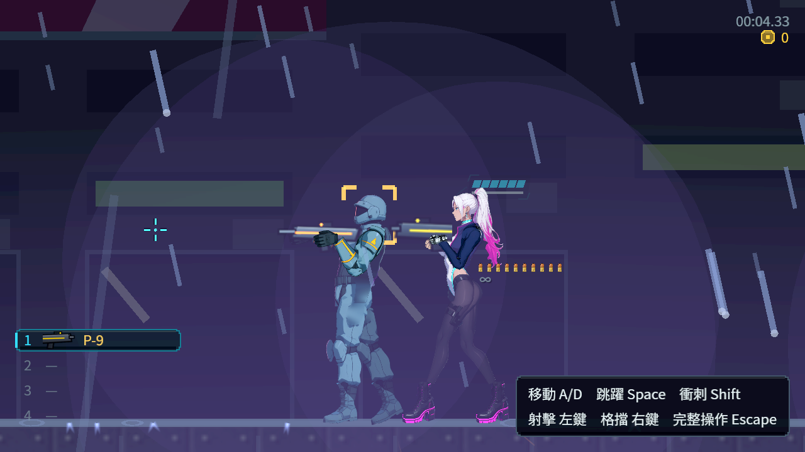
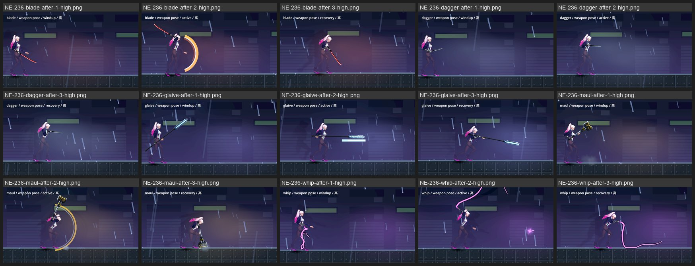
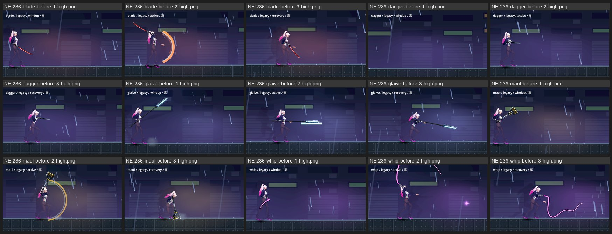
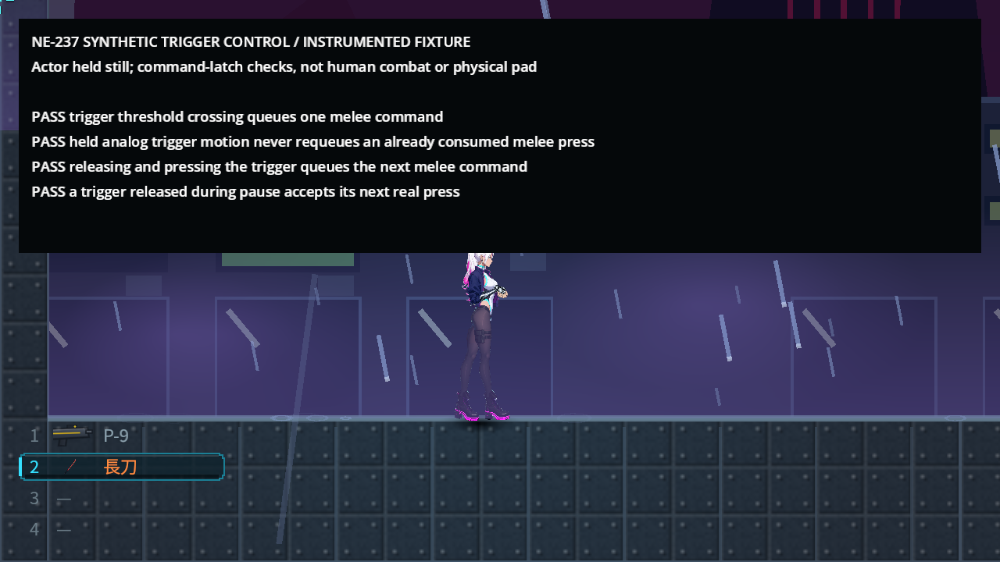

# [NE-237] 擴充近戰連段與招式成長

> 狀態：進行中

## 內文

### 需求
承接既有近戰連段，加入可選招式接續與升級，讓近戰动作和打擊感更丰富，同时保留重武器节奏、收招风险与敵人反制。

### 來源
2026-10-10，使用者要求逐章完成與累積發行、高清像素UI、全流程手把、豐富合理敘事與動畫、場景減雜，並追加武器差異、子彈、方向護盾、可選連段升級與打擊感總驗收；一般設計選擇由實作者決定，持續推進。

詳見[整體設計](../../design/20-campaign-experience/DESIGN.md)與[研究依據](../../design/20-campaign-experience/RESEARCH.md)。

### 驗收條件
- [x] 現有近戰武器可解鎖適合自己的可選接續或分支，輕重武器连段数量、速度与單擊強度不同。
- [x] 升級前後与招式用途可看懂，短連段仍可用，不強迫玩家打更長鎖定動畫。
- [ ] 輸入緩衝、接續与取消窗口明确，鍵鼠／手把按住与連按規則一致。
- [x] 每招预备、有效段与收招有完整動作；命中声、受擊、击退与停顿强化接触，揮空不播命中回饋。
- [x] 每招每目标只伤害一次，多目标不无限堆停顿；換武器、受击、死亡與耗尽後正確重置。
- [x] 基礎／升級、命中／揮空、雜兵／裝甲／頭目、近／遠距與不同难度有比较；無無限取消、永久硬直或無代價終段。
- [x] 招式购买與解锁、耗能和充电符合成長經濟，真正退出续玩保留結果。

- [x] 無效攻擊與取消不提前扣除彈藥、耗能或冷卻，也不顯示成功攻擊；已付費接續仍核對真正耗能與收招風險，不產生免費強力終段。

### 測試流程
1. 逐武器操作基礎与升级招式，測接續、停止、取消、揮空、多目标及中斷。
2. 量測首次傷害延遲、持續輸出、鎖定時間、击退與反制，測頭目和续玩。

---

# 跟其他票的關係

- Blocks：NE-241
- Blocked by：NE-236、NE-230
- Related：NE-117、NE-142、NE-143、NE-216、NE-231、NE-222、NE-260、NE-261

---

# Commit-1（可購買的專屬接續）

## 內文

五種近戰武器原本只有固定連段，成長選擇無法改變招式。現在每種都能在原改裝介面購買一招專屬接續，顯示段數、再點按規則、護盾成本與收招時間；停止仍能用短連段，按住兩個近戰入口均只重複首招。匕首與熱刃提供較多快節奏接續，重錘用較少段、較長起手換單擊與擊退，長柄和鞭保留近身死角。

追加招須付護盾能量，重錘還付電量；不足時不部分扣款。終段命中也吃完整收招，不循環取消。局部停頓仍接受點按，但緩衝按真實期限到期；受擊、電話、載具、暫停、演出及死亡的拒絕或中斷均實跑，沒有保留舊接續。晚進入掃擊的真目標保留自己的擊退與暈眩，攻擊者不重停，無關物件繼續運作。

五招維持80／100／140／120／100價格，共540，另列選購；原必要准备570不變，全部改裝總價910保留，商店售價與章節收入沒有改動。六秒固定距離實測保留每次真傷害、受力、起手、鎖定與消耗。長柄追加在普通雜兵樣本的DPS略降、鎖定增加，提供範圍與較重單擊的選擇，不當成免費被動加強。

### 測試結果

| 項目 | 結果 |
|---|---|
| 受影響範圍（最新主線） | 65組55,932檢查、0新／已知失敗、自然退出0，467秒；前輪55,907亦通過 |
| 購買與經濟 | 公開購買、重複與不足拒絕、實際耗能；必要570／選購540／全部改裝910 |
| 接觸／輸入 | 411檢查0失敗，五種真尾招傷害、兩鍵hold、兩輸入路徑、中斷與拒絕實跑 |
| 量測 | 基礎50組、追加50組；每模式三難度三敵種45組真命中、5組揮空 |
| 畫面 | 真Forward+軟體Vulkan，共90張；高低特效、兩面向、三段及購買前後 |
| 快照契約 | 買入／還原解鎖有驗；不代稱真退出續玩 |
| 原始失敗 | 報表、量測還原時序、腳本／測試時序及擷取activation的失敗raw保留 |

[原始證據、差異與來源校驗](attachments/NE-237/README.md)、[基礎／追加完整配對](attachments/NE-237/comparison.json)。

### 截圖

# Commit-2（預設連段的即時輸入驗證）

## 內文

既有連段檢查在起手同一刻連按兩次，假定命令在後續取消點仍有效。真停頓與较低畫面更新速度會讓命令先到期，造成第二招、早取消與第三重斬三項連帶失敗。原始套件一般速度通過，在30fps上限下精確復現三項失敗；第一刀實際命中、朝向與目標距離正確。

有效接續現在於收招初期點按，仍支付命中後取消成本，原早取消上限與重斬傷害檢查全數保留。另以既有長起手液壓槌驗真正舊命令到期、自然命中與停頓、整招收完且不自動接續；不延長輸入期限，不更改產品攻擊、命中、瞄準或停頓行為。

### 測試結果

| 項目 | 結果 |
|---|---|
| 原始套件 | 一般25檢查0失敗；30fps上限25檢查3失敗、退出1，兩者raw保留 |
| 受影響範圍 | 原selector、單worker，36檢查0新／已知失敗；最新主線重驗退出0，11秒 |
| 原斷言 | 每條原斷言逐字保留；揮空完整收招、單揮一次命中、取消上限及第三重斬仍驗 |
| 聯跑 | 流程／回饋／兩近戰範圍／輸入五組，單worker2,574檢查、0新／已知失敗、退出0，179秒 |
| 原生畫面 | 真Forward+軟體Vulkan、1280×720、3.4倍，自然第三招；38檢查0失敗、退出0 |
| 原始診斷 | 0SCRIPT ERROR；刻意容錯、既有物理／退出清理、首次負案例失敗與遮字原圖完整保留 |

[來源、原始失敗／成功、時序與hash](attachments/NE-237-melee-timing/README.md)。

### 截圖

# 2026-10-11 交接紀錄

## 內文

雲端候選保存在 cloud-weapon-phone-context-review 的 41f326ab09060ebff2b58907ac50122926b9f17d；原受影響測試有 83,447 項通過的分類紀錄，但 raw 中仍保留負測與退出 ERROR。本機正式輸入、手把與整合未完成，既有兩項已勾條件和其餘未勾條件保持。

使用者要求本 Session 收尾後停止開發。偏好、研究依據、避免重犯事項與精確接手資訊見 [使用者指南](../user_guide.md)及[本次交接](../SESSION_HANDOFF_2026-10-11.md)。此段保存現況，不是新完成紀錄。

# Commit-3（採用雲端候選的資料防護與付費尾招）

## 內文

**問題**：上一個 Session 的雲端候選（41f326ab）做了武器與近戰資料的防護，但只停在審查分支；原始紀錄裡有刻意的負面測試與退出時的錯誤訊息，不能直接當成通過。

**改動**：從保存的分支包恢復成審查分支，只挑必要部分併入：武器、升級與近戰招式資料的完整檢查（資料損毀時指出檔案與欄位、改用安全預設）；射擊前先確認武器、子彈、方向與數值有效，無效時不扣彈、不進冷卻、不播放開火回饋；已購買的可選尾招在出招當下再核對一次真正的耗能與收招風險，資料被改壞或刪掉時拒絕出招，不會變成免費的強力終段。沒有採用：只為診斷加的檢查輸出與回饋測試的計時調整。27 個既有武器、升級與近戰平衡數值沒有改動。

**驗收**：在目前的分支上重新跑，不沿用候選的舊結果：近戰武器、近戰與成長三組套件在乾淨的使用者資料下全過，所有錯誤輸出都是測試刻意製造的負面案例並被既有過濾規則認得；受影響範圍見下表。

### 測試結果

| 項目 | 結果 |
|---|---|
| 近戰武器／近戰／成長套件（乾淨使用者資料） | 2,012 項檢查全過；106 行錯誤輸出全是刻意的負面案例 |
| 受影響範圍（`tools/run_tests_changed.sh`，73 組） | 83,907 項檢查，新失敗 0，腳本錯誤 0，退出 0 |

分支：`feature/combat`，提交：https://github.com/deadline314/Nest-Egg/commit/20801afd；候選保存於本機審查分支 `review/weapon-41f326ab`

---

# Commit-4（併入槍燈後的武器資料防護）

## 內文

**問題**：併入最新 main 後，武器多了槍燈的四個數值（照射距離、光錐角度、亮度、閃爍），Commit-3 的武器資料防護還不認得它們；資料被改壞成極大值時不會指出是哪個欄位。

**改動**：槍燈的四個數值納入同一套防護，超出合理範圍時指出欄位並拒絕這份資料。現有武器的數值與槍燈設定都沒有改。

**驗收**：成長套件的「每個浮點欄位改成極大值都會指出該欄位」對槍燈四個欄位全過；受影響範圍併入最新 main 後無新失敗（對負載敏感的蹲下計時檢查單獨重跑通過）。

分支：`feature/combat`，提交：https://github.com/deadline314/Nest-Egg/commit/cbcf8ff8

---

# Commit-5（每招的動作、揮空、多目標停頓與真正退出續玩）

## 內文

**問題**：既有檢查只證明有命中回饋，沒有證明揮空時「不」播命中聲與停頓；每一招有沒有自己的前搖、出招、收招動作沒有檢查；一揮打到好幾個目標會不會疊出很長的全畫面停頓沒有量；買下的付費尾招只在同一個程序裡用快照還原過，沒有真正關掉遊戲再「繼續」。

**改動**：只補驗證與工具，招式與數值沒改。新增檢查：五把武器每一招（含付費尾招）都有自己的角色動作，關鍵格對齊前搖結束、出招結束、收招結束，出招前後姿勢不同；五把武器對空揮都沒有命中聲、命中標記與停頓，打到人時有；一揮打穿三個目標，全畫面停頓最多一次。新增一支分開兩個程序的續玩工具：第一個程序走真正的主流程開新局、拿單分子鞭、買下回甩、存檔後結束；第二個程序從「繼續」讀回並真的接出回甩。

**驗收**：近戰武器套件 1,034 項全過。續玩工具兩個程序共 9 項全過：讀回後回甩仍解鎖、信用點維持已扣、手上仍是單分子鞭，甩打的收招期間再按就接出回甩。比較資料沿用 Commit-1 的實測（基礎與追加各 50 組：三種難度、雜兵／打手／頭目、命中與揮空）；無限取消、免費終段與永久硬直由既有檢查擋下（終段清掉接續不能循環、付費尾招不會被附近的終結技取代、受擊反應後的保護時間）。第一條（鍵鼠與實體手把按住、連按規則一致）需要實體手把，維持未勾。

### 測試結果

| 項目 | 結果 |
|---|---|
| 近戰武器套件（含新增的動作、揮空、多目標停頓） | 1,034 項，0 失敗 |
| 分開程序的續玩工具（`tools/melee_resume_probe.tscn` 寫入、讀回） | 4＋5 項，0 失敗 |

分支：`feature/combat`，提交：https://github.com/deadline314/Nest-Egg/commit/d88acd2e

---

# Commit-6（鍵鼠與手把的連按、提早按、按住規則一致）

## 內文

**問題**：剩下的一條是「輸入緩衝、接續與取消窗口明確，鍵鼠與手把的按住、連按規則一致」。近戰有兩個按鍵（近戰鍵，以及拿著近戰武器時的射擊鍵），鍵鼠是 F 與滑鼠左鍵、手把是 Y 與右扳機；過去只用「直接按下動作」的方式測過，沒有比過真的鍵盤、滑鼠與手把事件走進來的結果是否一樣。

**改動**：近戰的按鍵判斷搬進獨立的近戰模組（NE-277）後，兩個按鍵、四種裝置走同一條路：按下（含提早按的緩衝）出招或排進下一段，第一招打完還按著就接這把武器的按住招式。新增檢查：五把武器各用同一串操作——點一下、出招中提早再按、收招後在接續時間內再按、超過接續時間才按、按住 2.5 秒——分別用鍵盤 F、滑鼠左鍵、手把 Y、手把右扳機送一次，比對每一招開始的影格、第幾段與是不是按住招式。緩衝、接續與取消的時間都寫在資料裡（緩衝 0.2 秒；每把武器的接續時間與每一招的可取消點），數字與意思整理在 [近戰攻擊模組](../../design/14-combat-variety/MELEE_MODULE.md)。

**驗收**：五把武器 × 五種操作 × 四個輸入來源，招式時間軸全部一致（25 項）。這是合成的輸入事件（走和真的按鍵同一條路），實體手把仍要在本機驗：本條維持未勾。待本機原生驗收：實體手把的 Y 與右扳機按住、連按，和鍵鼠各打一輪五把武器。

### 測試結果

| 項目 | 結果 |
|---|---|
| 近戰套件（含新增的鍵鼠與手把一致 25 項；機器滿載時也一致） | 128 項，0 失敗 |
| 受影響範圍（併入最新 main 後，`tools/run_tests_changed.sh`） | 82 個套件、93,479 項，0 失敗 |

分支：`feature/affectionate-feynman-dfv3cp`，提交：https://github.com/deadline314/Nest-Egg/commit/396e2238

# 本機原生驗收（2026-10-12，Arc B580）

## 內文

在這台機器（Intel Arc B580、Godot 4.7.2、原生 Forward+，不是無頭）用 main 的 `feb9645d` 重跑本票的拍攝與量測工具。這一段只記錄跑出來的畫面與數字，沒有改本票的程式；有問題的地方寫在「發現」，交給本票負責的組。

| 項目 | 結果 |
|---|---|
| 五把近戰武器的預備、出手、收招（武器專屬姿勢與舊姿勢各 15 格，場上沒有目標） | 每把武器的姿勢各自不同、和舊姿勢也不同；沒有目標所以沒有命中格（預期） |
| 招式成長的存檔與讀檔 | 寫入 4 項、讀取 5 項，0 失敗 |
| 記錄檔 | 沒有錯誤；只有收帳員外觀的擺動區域警告（和本票無關） |

發現（請本票負責的組處理）：武器連段的拍攝工具為了拍高、低兩種光影品質，會直接改玩家真正的設定檔，結束時停在「低」沒有還原。這台機器上因此有一段時間所有原生截圖（包含別的工作階段的）都是低品質，已手動改回「高」。建議工具改用自己的設定檔，或結束時還原。

還沒驗、這裡也驗不了：實體手把按住與連按、雙手武器出招時兩隻手的特寫逐格看。驗收條件維持原狀，不代勾。

### 截圖

# Commit-7（拍攝不再改玩家設定）

## 內文

本機驗收回報拍攝完連段後，正常遊戲被留在低光影品質；確認後，兩支近戰拍攝工具都會把拍攝用的光影與特效偏好寫到玩家設定。
現在拍攝使用各自的設定檔，玩家的高品質、粒子、震動與減閃光偏好保持原樣；招式成長拍攝也能把新圖輸出到指定資料夾，避免覆蓋舊圖證。招式、姿勢、數值與輸入規則沒有改動。

### 測試結果

| 項目 | 結果 |
|---|---|
| 原始問題 | 原連段拍攝完成 45 張後，玩家設定由高品質變低品質，完整檔案 SHA 改變 |
| 修正後兩支工具 | 45 張連段、12 張單武器成長擷取；兩份玩家原檔的 bytes／SHA 均完全不變，拍攝偏好只留在各自的檔案 |
| 真正冷讀 | 另開程序讀回品質 2、粒子 0.42、震動 0.33、減閃光關閉；兩輪皆退出 0 |
| 原範圍選擇器，固定基準 6db1bc86 | 只改工具與文件，選出 0 套件；沒有把它當成遊戲回歸全過 |
| 引擎退出診斷 | 軟體 Vulkan 修前修後皆有相同 CanvasShaderRD／Decal Atlas 退出錯誤及 250 退出碼；Compatibility 檔案檢查退出 0，仍有資源／PagedAllocator 診斷。原始輸出保留，未當成乾淨 log 或本機畫面驗收 |

[檔案校驗、環境與限制](attachments/NE-237-capture-settings/receipt.json)、[原始設定與完整執行紀錄](attachments/NE-237-capture-settings/evidence.zip)。本次沒有遊戲畫面變更，截圖不作為設定隔離的判據。

# Commit-8

## 內文

右扳機按住時的類比值變動原本會被當作再次點按，反覆排入近戰命令。現在一次點按只排一次，放開再按照常接受，原有按住招式與緩衝期限保持；暫停中放開也不留下會擋住下次操作的舊狀態。

相同公開事件四項控制4／1失敗→4／0；只加鎖存的中間方案另抓到暫停後失效，未採用。最終原選擇器28組45602項、0新／已知失敗，包含原有五把武器四種輸入的完整矩陣。原斷言／輸入／等待保持。

原生同配置5／1→5／0，皆0引擎ERROR／退出洩漏。以下是明示儀器覆層的命令診斷，不是正式UI、自然交戰錄影或實體手把驗收。[研究、拒收方案、中止pilot、全部原檔及驗證界線](attachments/NE-237-trigger-edge/README.md)。

