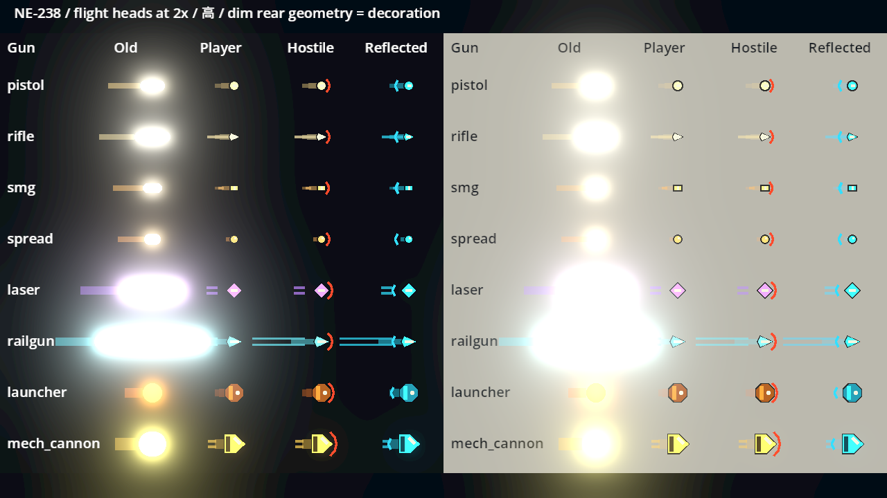
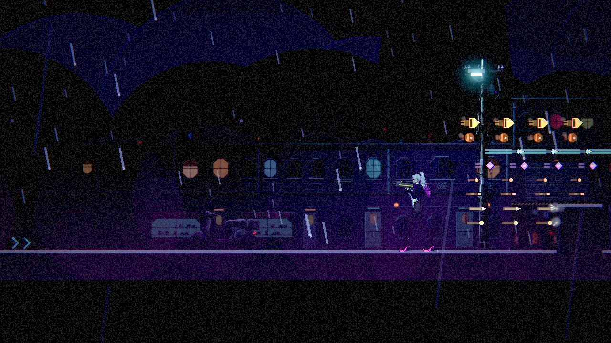
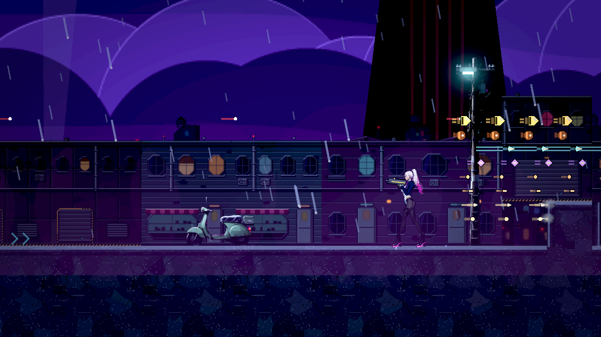
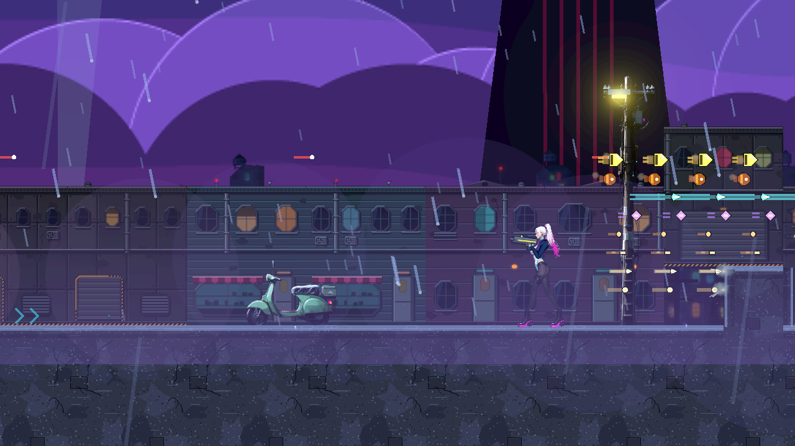
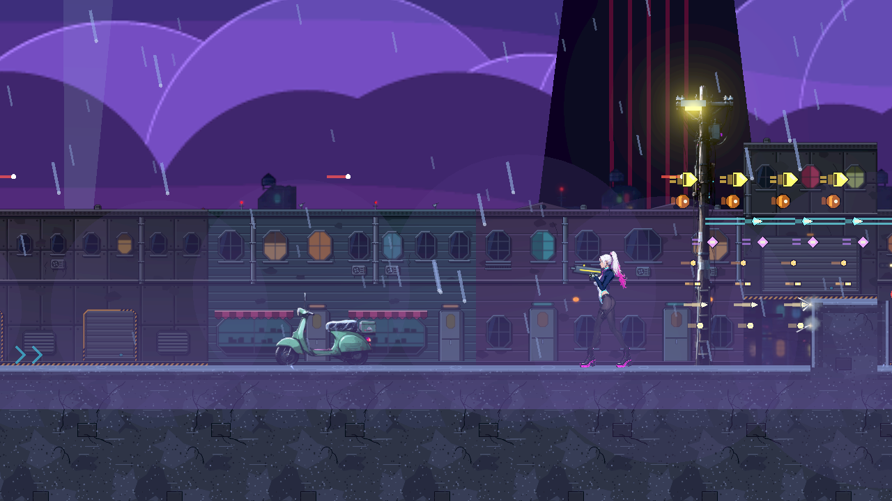

# [NE-238] 區分各槍種的飛行彈體

> 狀態：完成

## 內文

### 需求
替換目前類似色塊的統一彈體，讓各現有槍種有清楚彈型與節奏，配合命中反應提升射擊打擊感。

### 來源
2026-10-10，使用者要求逐章完成與累積發行、高清像素UI、全流程手把、豐富合理敘事與動畫、場景減雜，並追加武器差異、子彈、方向護盾、可選連段升級與打擊感總驗收；一般設計選擇由實作者決定，持續推進。

詳見[整體設計](../../design/20-campaign-experience/DESIGN.md)與[研究依據](../../design/20-campaign-experience/RESEARCH.md)。

### 驗收條件
- [x] 全部現有槍種按彈型有可辨外形／動態，不只換顏色；實彈、散彈、能量、磁軌与榴彈按实际类型区分。
- [x] 一般、亮暗背景與不同特效品質均看得出彈體、敵我威脅與命中，連射不蓋敵人預兆。
- [x] 彈頭、短拖尾、穿透、反射與命中位置符合实际傷害范围，拖尾不误导可命中部分。
- [x] 飛行、命中聲、受擊与擊退共同形成射擊力度；揮空不產生命中回饋，低幀率高速彈不漏判。
- [x] 反彈後保留槍種辨識與正確陣營，连续换枪和重复复用不残留旧型外觀。
- [x] 本機Forward+實際畫面與射擊密集情境可讀；降低裝飾特效仍保留威脅與彈型。

### 測試流程
1. 逐槍射擊静止及移動目标、墙面与空处，檢查實彈／散彈／能量等差異。
2. 測穿透、反射、连续换枪、低幀率与密集射击，保存亮暗與減特效畫面。

---

# 跟其他票的關係

- Blocks：NE-241
- Blocked by：無
- Related：NE-139、NE-95、NE-236

---

# Commit-1

## 內文

原有槍械彈體共用白芯膠囊與偏長的發光尾跡，連射時容易糊成色塊。現在八種玩家槍械與現有敵彈按實際彈種呈現彈頭、金屬殼、能量菱形、磁軌雙線、散彈小珠等差異，亮背景使用貼合彈型的薄描邊。敵彈保留暖色缺口提示，完美反彈後保留槍型並顯示青色尾記號；精簡特效仍保留彈頭與敵我提示。

裝飾尾跡縮短且不參與命中。高速彈在較長影格也能命中薄目標與薄牆，穿透同一敵人的重疊部位只扣一次生命；從受擊框內發射、不可受傷目標、擦邊、揮空與八種槍械的反彈均已檢查。既有命中聲、受擊與擊退回饋維持原本武器設定，有效命中才產生回饋。

### 測試結果

| 項目 | 結果 |
|---|---|
| 受影響範圍（基準 2483fcf3） | 65 組、44,985 項檢查；0 新失敗、0 已知失敗 |
| 最終彈體與曝光局部測試 | 267 項檢查全部通過，包含新增邊界案例 |
| 執行紀錄 | 無 SCRIPT ERROR、無未預期錯誤；沿用原有容錯與退出診斷規則 |
| 本機真實渲染 | Godot 4.7.2、Vulkan Forward+、Intel Arc B580；六張圖片成功輸出 |
| 亮暗背景／特效品質 | 完整與精簡品質均檢查，實景同時發射 48 個彈體可辨 |

### 截圖

