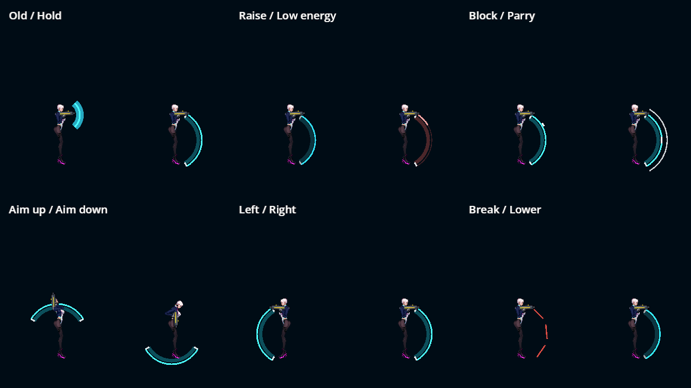
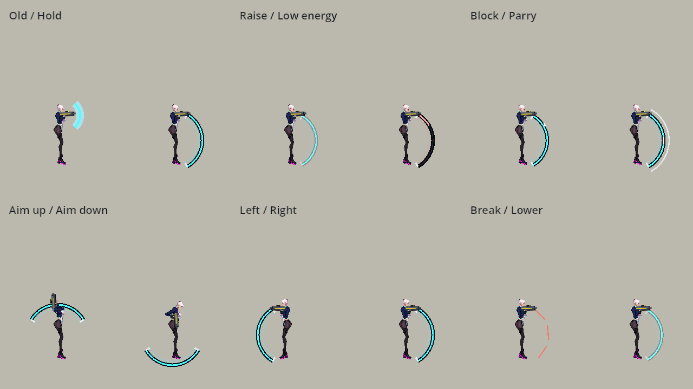
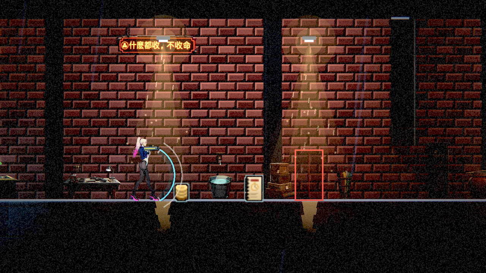
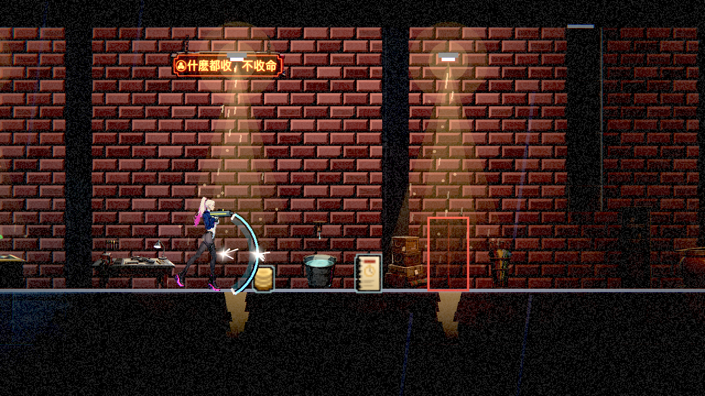
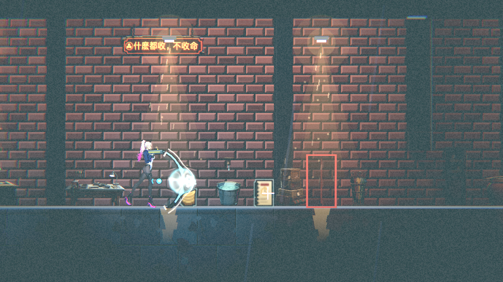
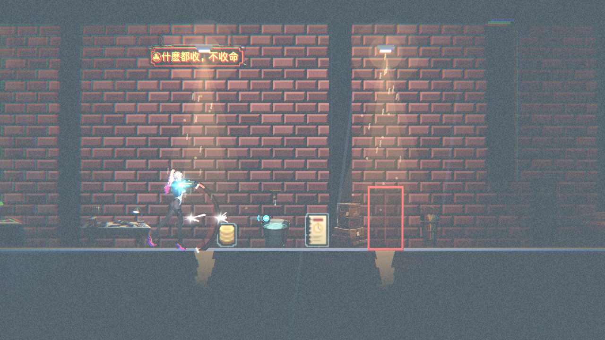
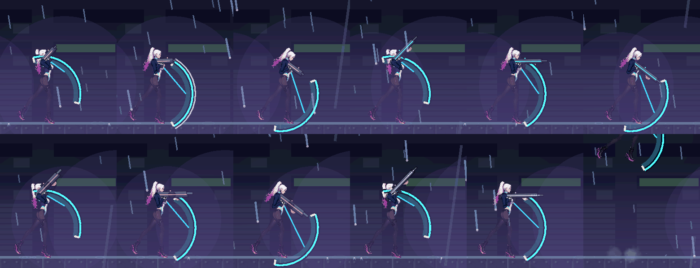

# [NE-239] 完善舉盾動作與盾面演出

> 狀態：進行中

## 內文

### 需求
將過小藍色盾面改為合理、可讀的角色前方弧面，補完整舉盾時序與受力回饋，強化防禦打擊感並忠實表達方向格擋。

### 來源
2026-10-10，使用者要求逐章完成與累積發行、高清像素UI、全流程手把、豐富合理敘事與動畫、場景減雜，並追加武器差異、子彈、方向護盾、可選連段升級與打擊感總驗收；一般設計選擇由實作者決定，持續推進。

詳見[整體設計](../../design/20-campaign-experience/DESIGN.md)與[研究依據](../../design/20-campaign-experience/RESEARCH.md)。

呈現與判定的驗收界線見[方向護盾契約](../../design/20-campaign-experience/SHIELD_PRESENTATION.md)。

### 驗收條件
- [ ] 舉起、維持、普通受擊、完美反彈、破盾與收盾各有連續動作和可辨回饋。
- [ ] 盾面大小與角色姿態合理，方向／角度與真實防禦一致，背面不顯示不存在的全身保護。
- [ ] 左右面向、上下瞄準、不同武器、走／跳／落地時盾與腕／手臂相接，不漂浮或穿插。
- [ ] 衝擊顯示在真實接觸點，聲音、角色受力、盾量與反彈同步；普通／完美／破防明顯不同而不堆閃光。
- [ ] 舉收動作不暗中改變既有完美窗口、連按縮短、能量與反射規則，結算不重複。
- [ ] 右鍵與手把同一防禦語義，亮暗與減動態仍可讀，盾面不蓋敵人或角色關鍵動作。

### 測試流程
1. 測窗口前／中／後、正面／背面與不同距離的攻擊，核對方向和結果。
2. 逐武器與移動姿勢測舉盾／反彈／破防／收盾，核對聲音受力與真手把畫面。

---

# 跟其他票的關係

- Blocks：NE-241
- Blocked by：無
- Related：NE-6、NE-144、NE-95、NE-222、NE-229

---

# Commit-1

## 內文

原盾面太小，舉起後立即出現，受擊亮光也難以看出實際防禦方向。
現在盾面沿角色前方展開，舉起與收起都有過渡；盾量降低時邊緣變暗，反彈在來襲方向留下短促提示，破盾則留下三段消散碎片。
同一張亮暗對照圖呈現修前與修後；另在第一章當舖的實際地形與光影中，透過輸入與子彈碰撞驗證普通格擋、完美反彈及破盾的盾量、生命與演出。畫面樣本關閉進場對話與 HUD，僅用於防禦畫面驗證。

### 測試結果

| 項目 | 結果 |
|---|---|
| 受影響範圍 | 58 組、50,763 項檢查，零新失敗、零已知失敗 |
| 合入最新手把操作後的交叉檢查 | 輸入、防禦特效、可讀性與曝光共 513 項檢查，零失敗 |
| 真實方向防禦 | 正面消耗盾量、背面穿透、可視弧面邊界內外與原完美窗口判定通過 |
| Forward+ 畫面 | Intel Arc B580；亮暗對照及當舖四個防禦狀態共六張圖，已逐張檢視 |
| 執行紀錄 | 無非預期腳本錯誤；測試保留既有物理／退出警告，當舖捕捉退出仍有 210 個 ObjectDB 警告 |

完整紀錄見[防禦驗證附件](attachments/NE-239-shield/changed-tests.txt)、[合入輸入後驗證](attachments/NE-239-shield/merged-tests.txt)及[真實 Forward+ 捕捉](attachments/NE-239-shield/forward-plus-capture.txt)。

### 截圖

---

# Commit-2（盾由前臂投射）

## 內文

**問題**：盾面以身體中心展開，雙手仍握著槍，盾看起來是浮在身體前方的一道弧，看不出跟手腕或義體有關。

**改動**：舉盾時從前手手腕到盾面內緣中點畫一條細投射線與手腕上的小節點，隨盾展開淡入，盾量越低顏色越偏紅，破盾時不畫。盾的圓心、角度、距離與完美窗口都沒改（仍是實際防禦判定的身體中心），只是讓盾讀得出「從前臂投射」。

**驗收**：自動測試用真正的按鍵舉盾、手把右搖桿瞄準，逐一換所有槍械，兩個面向、上中下瞄準、站／跑／跳都量測：手腕都貼在身體旁，投射線長度不超過盾半徑的 1.5 倍。Forward+ 截圖逐把武器與上中下瞄準看過，投射線都從手腕連到盾。尚未做：落地瞬間的逐格檢查、真手把與本機原生畫面，待本機原生驗收；其他驗收條件本次沒有重驗，維持未勾。

### 測試結果

| 項目 | 結果 |
|---|---|
| 受影響範圍（與 NE-237 同一次重跑，73 組） | 83,907 項檢查，新失敗 0，腳本錯誤 0，退出 0 |
| 投射線檢查（全部槍械 × 兩面向 × 三種瞄準 × 站跑跳） | 全過，最長約 39 像素（盾半徑 28） |

### 截圖

分支：`feature/combat`，提交：https://github.com/deadline314/Nest-Egg/commit/484db900

---

# Commit-3（新骨架下的手腕位置）

## 內文

**問題**：最新 main 重建主角骨架後，往正上方瞄準時手腕比身體中心高約 29 像素，超過原本 28 像素的檢查上限，但投射線只有 8～19 像素、盾仍接在手腕上。

**改動**：只放寬測試的手腕高度上限到 36 像素（手舉過頭的合理範圍）；投射線長度上限不變。

**驗收**：併入最新 main 後完整測試 87,351 項檢查、新失敗 0、退出 0。

分支：`feature/combat`
