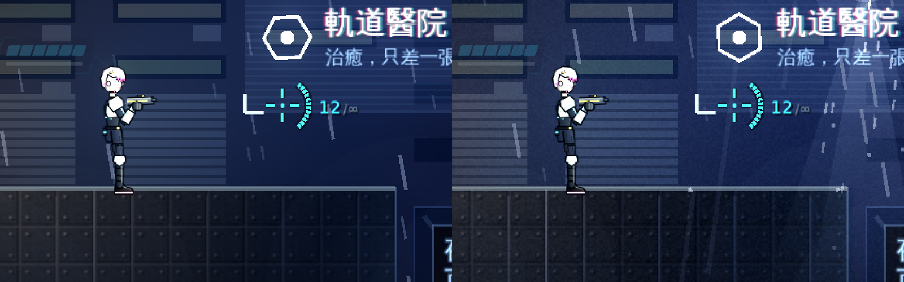
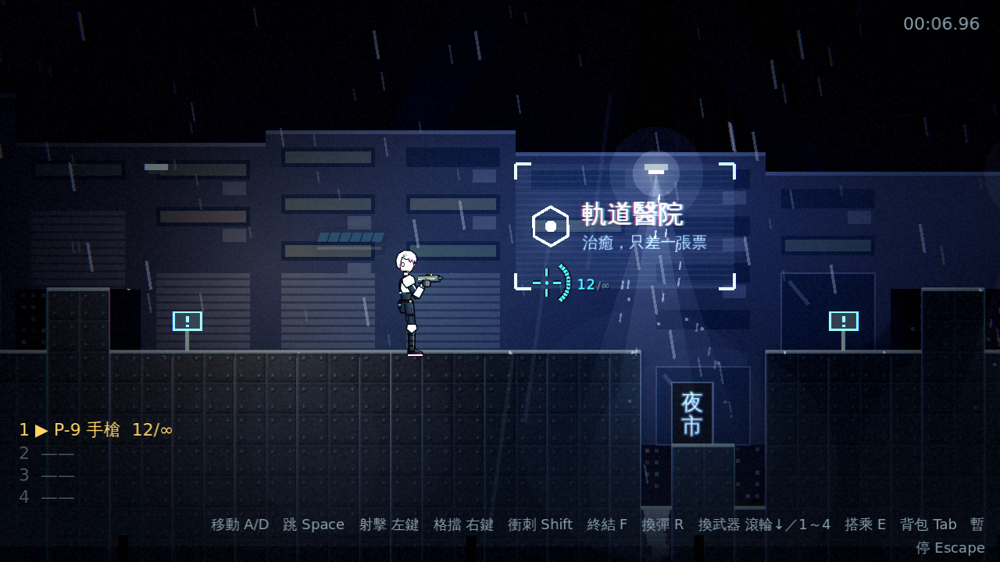
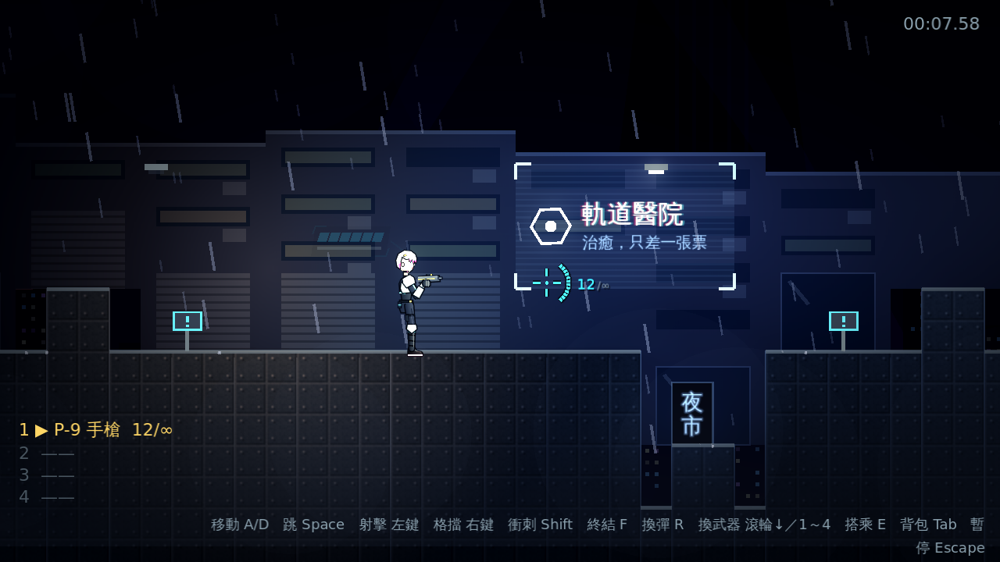

# [NE-23] 加入法線貼圖與輪廓光

> 狀態：完成

## 內文

### 需求
角色與地形是平面貼圖，受光沒有方向感。加入法線貼圖讓盔甲與金屬面有立體感，並在角色邊緣加輪廓光，讓凜在暗處也能與背景分離。設計見 `design/08-lighting/DESIGN.md` 的「架構」第 5 節。

### 來源
2026-10-02，使用者於開發對話中提出：「整個遊戲可以有完整的光影設計，請參考業界最佳實例」「整體的渲染跟場景應該要陰沉一點，遊戲希望整體沉重一點」；確認壓抑程度為重度壓抑、先做光影再做內容。

### 驗收條件
- [x] 角色盔甲與金屬地形受光有方向感：光從哪來，邊緣就亮在哪
- [x] 法線貼圖由工具從現有貼圖自動產生，也能被手繪的同名法線貼圖取代
- [x] 缺法線貼圖時照常顯示平面貼圖並記錄一次提示，不會報錯
- [x] 角色邊緣有輪廓光，在暗處也能與背景分離
- [x] 骨架動畫轉動零件時受光方向依然正確
- [x] 低品質檔位下不使用法線貼圖

### 測試流程
1. 在路燈下繞著光源走動，確認盔甲邊緣亮的方向跟著光源改變
2. 跑、跳、蹲、格擋時確認受光方向沒有錯亂
3. 暫時移除一張法線貼圖，確認遊戲照常運作
4. 執行完整測試套件，全部通過

---

# 跟其他票的關係

- Blocks：無
- Blocked by：NE-18
- Related：NE-25

---

---

# Commit-1

## 內文

角色與地形原本是平面貼圖，受光沒有方向感。
現在角色零件、武器與地形的金屬面板都有法線貼圖：開發工具 `paint_normals` 從現有貼圖自動產生同名的 `_n.png`（也可以換成手繪檔，缺檔時照常顯示平面貼圖並記錄一次提示）；`LitTextures` 負責組成並快取 CanvasTexture，低品質檔位（以及設定切換時）即時關掉法線貼圖。地形的實心區塊改鋪 16×16 的可平鋪金屬面板貼圖。每份光影設定新增 `rim_color`／`rim_energy`，由 `LightingController` 的一盞輪廓光照在角色與地形邊緣，讓凜在暗處也能與背景分離；場景光源的高度統一為 `LightKit.LIGHT_HEIGHT`，法線才有明確的受光方向。
暗場可讀性量測改用第 90 百分位亮度：輪廓光與法線讓周圍地形略微提亮，單一最大值會被高光點拉偏，百分位更貼近肉眼所見。各區段的角色補光（`character_floor`）依新的受光結果重新調整，仍維持重度壓抑的整體亮度。
驗收方式：冒煙測試驗證法線貼圖快取與缺檔回退（只提示一次）、法線圖長寬與透明度保持、品質檔位開關、輪廓光顏色隨區段混合、光源高度、骨架轉動零件仍使用同一份法線貼圖；高／低品質對照截圖。

設計取捨：輪廓光採一盞「高度為 0 的平面點光源」，沒有用 DirectionalLight2D——它會把沒有被任何物件擋住的背景整片提亮，破壞壓抑的色調。

限制：骨架轉動零件時法線方向是否完全正確，無法用自動測試判斷，需要人工在遊戲中跑、跳、蹲、格擋時確認。

### 測試結果

| 項目 | 結果 |
|---|---|
| 完整測試套件 | 通過 929 / 929 |
| 資料驗證 | 0 錯誤 |
| 執行 log | 無非預期 ERROR（缺法線貼圖的提示為預期的警告） |

### 截圖

