# [NE-240] 豐富情境互動與環境動畫

> 狀態：進行中（人物反應、聲響反應、鎖門回饋可觸發；交付的櫃子會跟著交盤換樣子；調查、修理與凜自己的手部動作仍等故事組與角色組）

## 內文

### 需求
增加具故事用途的道具互動、環境動作与短反应，讓玩家在探索與回訪持續發現新演出，避免只靠重複站立對話。

### 來源
2026-10-10，使用者要求逐章完成與累積發行、高清像素UI、全流程手把、豐富合理敘事與動畫、場景減雜，並追加武器差異、子彈、方向護盾、可選連段升級與打擊感總驗收；一般設計選擇由實作者決定，持續推進。

詳見[整體設計](../../design/20-campaign-experience/DESIGN.md)與[研究依據](../../design/20-campaign-experience/RESEARCH.md)。

### 驗收條件
- [x] 列出首批適用序章與第一章的調查、交付、修理、開門及環境反應，每項有用途、位置和演出清單。
- [ ] 首批情境實際可操作或觸發，人物、手、道具、支撐与聲音同步，不用粒子替代动作。
- [x] 故事事件前後有合乎動機的短反應，首次与回訪不同，重复不強迫長演出。
- [ ] 動作包含進入、有效互動与離開，跳過、中斷、死亡、讀檔不重複發物品或留下錯位道具。
- [x] 第二、三章可沿用情境類型並新增符合劇本的演出需求，不重做另一套互動框架。
- [ ] 鍵鼠与手把提示清楚，情境動畫不遮危險，必要來源素材與骨架已核對原角色owner。

### 測試流程
1. 在首批实际地點完成互動，核對人物动作、道具、聲音与前後狀態。
2. 測回訪、中斷、略過、死亡與續玩，保存代表畫面。

---

# 跟其他票的關係

- Blocks：NE-233
- Blocked by：無
- Related：ST-2、ST-9、ST-10、NE-206、NE-221、NE-222、ST-19、ST-21

---

# Commit-1

## 內文

**問題**：第一章的人物只會站在原地等凜按互動鍵，走近時沒有任何反應，初見、回訪、凜死過之後都一樣；在當鋪、復原館、麵攤裡開槍，旁邊的人照樣擦手攪鍋；試開地下室那扇鎖住的門只會跳一行字。第一章目前也沒有可操作的調查、交付、修理物件（交接櫃還沒接進關卡，帳冊箱、抽水機都是擺設）。

**改動**：先列出首批清單（用途、位置、演出），寫在[情境互動與環境反應](../../design/20-campaign-experience/SITUATIONAL_REACTIONS.md)；沿用既有的場景人物、出入口與存檔框架，沒有另做一套：
- 走近反應：凜走近時人物不開口、不鎖操作，用身體做 1～3 秒的反應，條件和對話同一套。老 K 初見時停下擦手抬頭招呼、吃過晚飯後點頭、回訪時揮手要她別杵著、凜死過之後揉後頸；鷺初見點頭、回訪揉眼、交代完差事後抬下巴示意；阿梨在復原館初見看錶、認識後點頭、凜死過之後手按胸口，在麵攤認出凜就揮手。手上在工作的人會先停下來、做完再接回去；來回走動不會一直重複；只做一次的反應會存檔，死亡與讀檔不重做。
- 聲響反應：附近開槍會縮一下、轉頭看聲音來源；幾秒內連開三槍就停下工作、蹲下抱頭，安靜一陣子才放下手站起來回去工作；爆炸聽得更遠。所有有骨架的場景人物自動適用，第二、三章不用另外做。
- 鎖住的門：試開時門框晃一下、喀一聲，附近的人轉頭看門（不會被嚇到）。
- 調查、交付、修理三項的需求（位置、用途、演出、交給誰）寫在同一份文件第 2 節：需要劇本組的調查文字、關卡組把交接櫃與修理狀態接進關卡、角色組做凜蹲下翻看、伸手、修理的動作；演出組之後只在資料裡引用。

**驗收**：在實際的第一章當鋪地圖用新的截圖情境拍連續畫面：凜走近時老 K 轉身招呼；在他右邊連開三槍，他先轉頭、再蹲下抱頭、安靜後站起來繼續擦手（`NE-240-pawnshop-reactions.png`，每格 0.25～1 秒）。各反應的動作停在中段的畫面也逐一看過（老 K、阿梨、鷺），反應與工作循環交接沒有跳格；蹲下抱頭與站起來全程的最大跳格在門檻內（自動測試九位角色）。
待本機原生驗收：Forward+ 原生畫面、實際手把與鍵鼠操作的手感。尚未完成：調查、交付、修理（等其他組的素材與接入），提示與素材 owner 核對。
跨組小改動（已在設計文件記錄）：世界聲響訊號加在共用的特效（拋彈殼、爆炸）與可破壞物；第一章人物資料產生器加入反應欄位；截圖工具加入 reactions 情境。另外修了 NE-250 蹲姿在骨盆下沉上限附近起身會跳格的問題（快角色的深蹲起身也改慢到合理速度）。

分支：[feature/staging](https://github.com/deadline314/Nest-Egg/tree/feature/staging)，已併進 main：[594443e2](https://github.com/deadline314/Nest-Egg/commit/594443e2589f722f2b51d43db2dd51c143b9cfe9)

### 測試結果

| 項目 | 結果 |
|---|---|
| 受影響範圍的測試（83983 項） | 新失敗 1：介面套件「離開調查與過場預覽範圍後恢復遊戲標頭」在六個程序同時跑時失敗一次；單獨跑兩次、同組負載下重跑兩次都通過。該檢查等真實時間的計時器，涉及的場景附近沒有骨架人物，判斷是高負載下的時序問題，記錄在此不改測試 |
| 新增檢查：挑反應（初見、回訪、旗標、死亡、只做一次）、資料驗證（手勢不存在、條件矛盾）、實際關卡走近反應與冷卻、存檔、遠的槍響聽不到、近的縮一下並轉頭、鎖門只轉頭、三聲蹲下停工、安靜後站起來回去工作並轉回原本方向、九位角色蹲下起身無跳格 | 通過 |
| 畫面 | 雲端軟體渲染（Compatibility）；原生 Forward+ 待本機 |

### 截圖

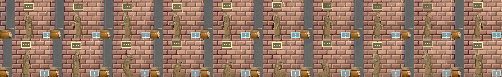
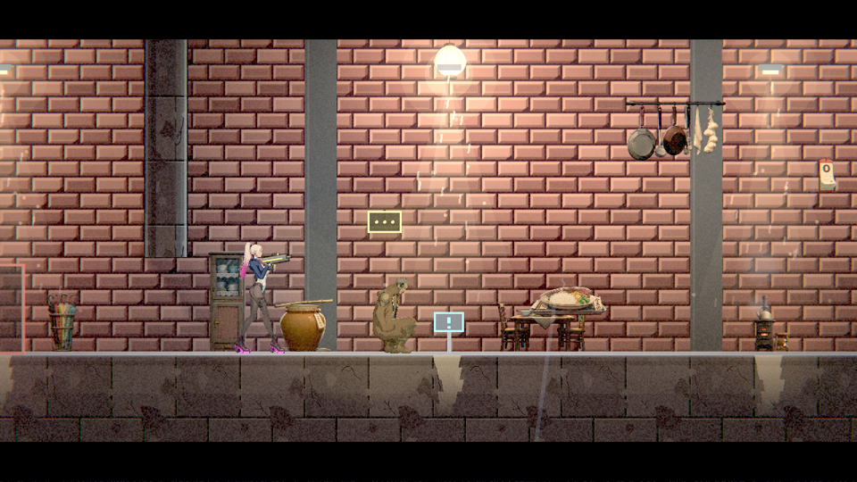
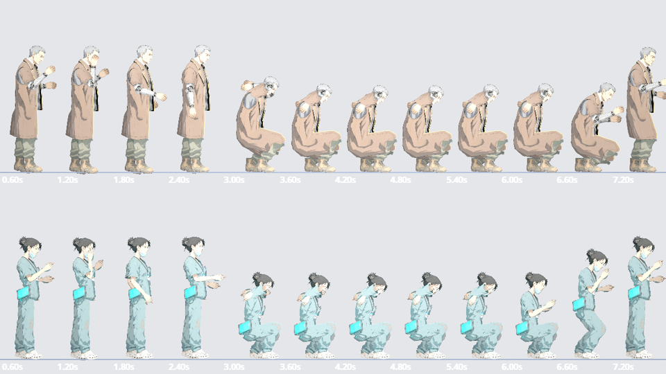
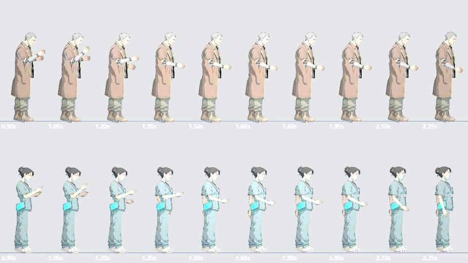
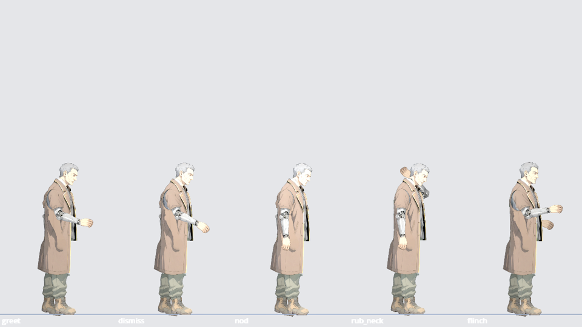
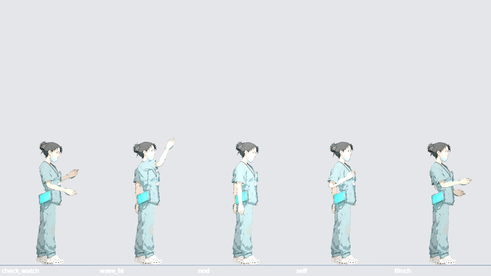
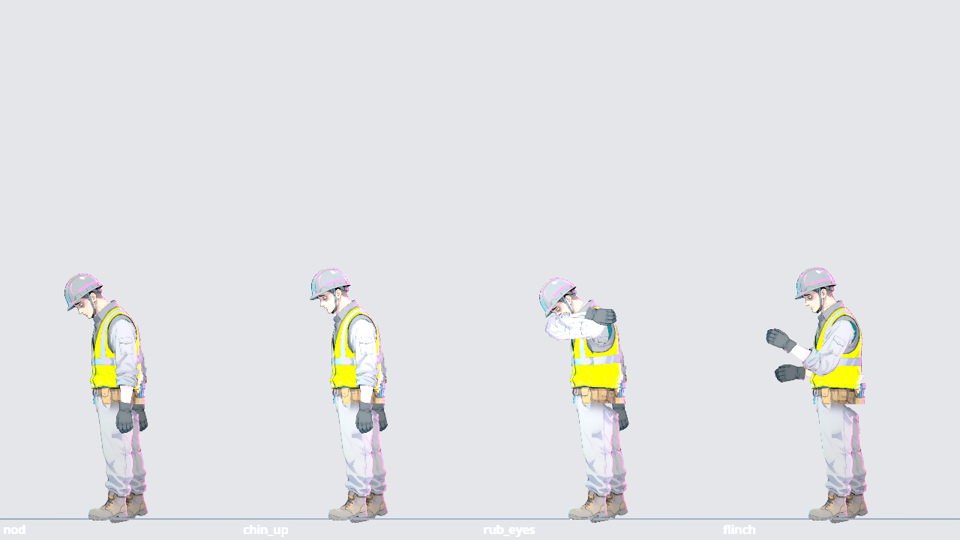

# Commit-2

## 內文

**問題**：調查、交付、修理三類只寫了「需要其他組」，沒有逐條說清楚每一項缺什麼、要誰決定，故事組無從接手；人物反應的畫面只用 Compatibility 看過。另外 main 已經把門換成貼圖，原本鎖門被試開時的晃動只晃到程式畫的門框，門的貼圖不會動。

**改動**：
- 把三項各自缺的東西逐條列成交接清單給故事組：當鋪帳冊箱要決定箱子裡是什麼、伏筆接到哪裡、初看與再看的調查文字、看過的旗標與適用時段；復原館外的交接櫃要放進關卡、確認三個交付步驟綁在櫃子上、回執只發一次；倉庫抽水機要先決定第一章有沒有修理情節、修理條件、修好後的旗標與環境變化。演出組收到後只做人物反應、手勢與道具同步，不寫劇情。清單在 [pm/handoff/NE-240-story-needs.md](../handoff/NE-240-story-needs.md)，設計文件也連過去。
- 鎖住的門被試開時，門的貼圖跟著門框一起晃。

**驗收**：在實際的第一章當鋪地圖用 Forward+（雲端軟體 Vulkan）重拍反應連續畫面：老 K 招呼、擦手、聽到槍響轉頭、蹲下抱頭、安靜後站起來回去擦手，交接沒有跳格、沒有看到破圖。調查、交付、修理仍等故事組的素材，對應的驗收條件沒有勾。

分支：[feature/staging](https://github.com/deadline314/Nest-Egg/tree/feature/staging)，已併進 main：[adf84efc](https://github.com/deadline314/Nest-Egg/commit/adf84efc1c7acbb4bbf2eaf13c9a043d3eb07b00)

### 測試結果

| 項目 | 結果 |
|---|---|
| 鎖門晃動（rebase 時解衝突後）受影響範圍的測試 | 通過，新失敗 0 |
| 畫面 | Forward+（雲端軟體 Vulkan）；實體 GPU 與實際手把待本機 |

### 截圖

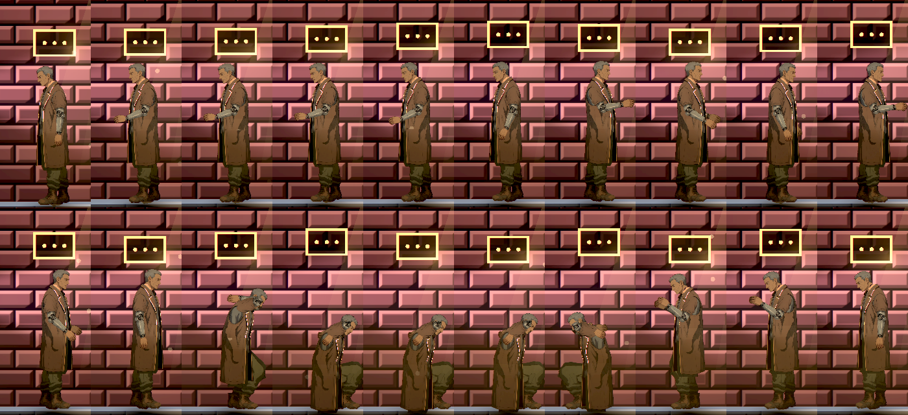

# Commit-3（交接櫃跟著交盤換樣子）

## 內文

**問題**：「交付」這一項原本卡在交接櫃還沒放進關卡。現在交接櫃已經在復原館外，放入資料盤與取回執的對話也接上了，但畫面上什麼都不會發生：櫃子是一張靜態圖，交盤前後一模一樣，回執只出現在物品欄裡。設計上它是「藍燈交接櫃」，實際上也沒有藍燈。

**改動**：交接櫃依交盤進度換樣子，只看劇本原本就會寫的兩個旗標，不改劇本、不發物品：
- 還沒交盤：櫃頂的燈是藍色，緩慢起伏，並照亮櫃子周圍。
- 交盤的當下：燈轉成琥珀色，回執從抽屜口一格一格送出來，有出紙的喀喀聲，送完嗶一聲，紙留在那裡。
- 回執被拿走：紙不見，燈轉綠。
- 死亡、讀檔或重進這一區：直接是當下的結果（回執已經在那裡就在那裡），不重播送紙與聲音。

做成場景擺設共用的功能：任何擺設都可以在資料裡指定「跟著哪些旗標換燈色、要不要出紙」，第二、三章的終端與取件格可以直接用，不用再寫程式。凜伸手把盤放進去的動作是主角動作，仍等角色組；現在是對話結束後櫃子自己反應。

**驗收**：原生 Forward+（Arc B580）在正式的交接櫃區拍連續畫面，逐格看過：藍燈等收件 → 琥珀燈、回執逐格送出 → 回執送完 → 拿走後綠燈；另外重進區域一次，回執已經在那裡、沒有重播。自動檢查用真的旗標變化驗同一套流程，包含玩家在場與重進兩種情況、左右鏡像的擺設、不存在的反應不會讓擺設壞掉。

前兩次交付留下的「待本機原生驗收」也在這台機器補上：人物反應在當鋪（老 K）、屋頂（鷺）、復原館（阿梨）各用原生 Forward+ 拍一段——主角走近、在旁邊連開三槍、安靜下來，每段 20 格，自然結束、0 錯誤。老 K 走近時轉身招呼，槍響後蹲下抱頭，安靜後站起來回去擦手，交接沒有跳格，沒有看到破圖（這個工具的鏡頭比實際遊玩遠，人物在畫面上偏小）。

仍未完成（對應的驗收條件不勾）：調查（當鋪帳冊箱）與修理（倉庫抽水機）等故事組決定內容與旗標；凜的伸手、蹲下翻看、修理動作等角色組；實體手把與鍵鼠的手感待使用者確認。

### 測試結果

| 項目 | 結果 |
|---|---|
| 新增自動檢查（燈色依進度改變、在場才送紙、重進不重播、拿走後消失、鏡像、資料缺漏） | 通過 |
| 原生連續畫面（交接櫃 9 格） | 自然結束、0 錯誤 |
| 原生連續畫面（人物反應，當鋪、屋頂、復原館各 20 格） | 自然結束、0 錯誤 |
| 受影響範圍的測試（併入最新 main 後） | 89761 項檢查；新失敗 2、已知失敗 0，兩項都是機器忙時的計時檢查、和這張票無關：音效「壓低後平順恢復」（乾淨的 origin/main 單獨跑 6 次也失敗 4 次）、「12 個同時爆炸多花的每格時間」（超出預算 0.83 毫秒，單獨重跑 3 次都過） |

### 截圖

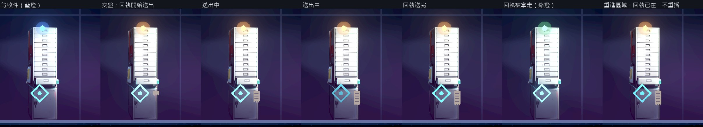
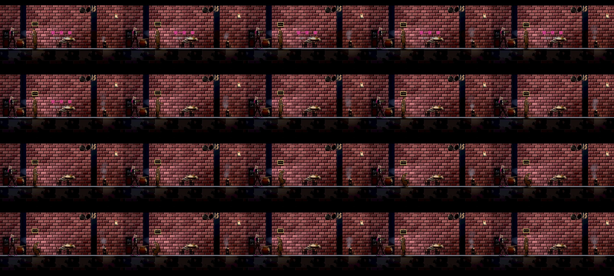
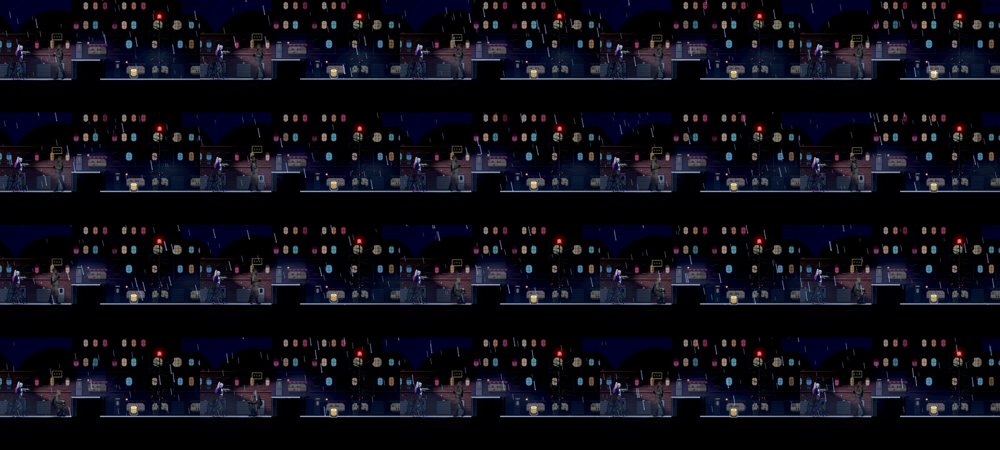
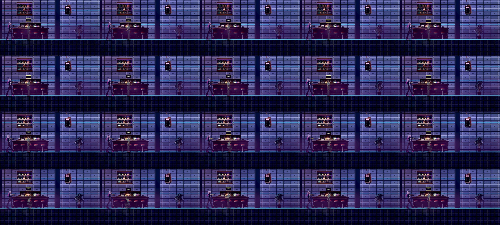

分支 `feature/scene-assets`；提交見[遠端 main 上本票的提交](https://github.com/deadline314/Nest-Egg/commits/main/pm/Nest-Egg/%5BNE-240%5D%E8%B1%90%E5%AF%8C%E6%83%85%E5%A2%83%E4%BA%92%E5%8B%95%E8%88%87%E7%92%B0%E5%A2%83%E5%8B%95%E7%95%AB.md)。

# Commit-4（一次性反應的整輪保存，進行中）

## 內文

原本人物記得已做過的一次性反應，但寫入整輪進度時會遺失這份記憶。現在完整存讀會保留；舊進度沒有紀錄時維持相容，損壞紀錄安全修復。正式人物目前未啟用一次性反應，因此本次沒有調整日常動作或頻率。

同一份新增回歸以舊行為跑550項有8預期失敗，修後550項全過；另以兩個獨立程序核對四處世界狀態及真正人物還原後的一次性資格，2＋9項全過。固定基準的原受影響選擇器結果：checks: 3759, new failures: 0, known failures (tests/known_failures.txt): 0  (wall time 126 s)。

[原始紀錄、來源、逐檔SHA及連續性核對](attachments/NE-240-reaction-save/README.md)。本次為保存修正，沒有新增畫面，整票原驗收條件保持。
