# [NE-240] 豐富情境互動與環境動畫

> 狀態：進行中

## 內文

### 需求
增加具故事用途的道具互動、環境動作与短反应，讓玩家在探索與回訪持續發現新演出，避免只靠重複站立對話。

### 來源
2026-10-10，使用者要求逐章完成與累積發行、高清像素UI、全流程手把、豐富合理敘事與動畫、場景減雜，並追加武器差異、子彈、方向護盾、可選連段升級與打擊感總驗收；一般設計選擇由實作者決定，持續推進。

詳見[整體設計](../../design/20-campaign-experience/DESIGN.md)與[研究依據](../../design/20-campaign-experience/RESEARCH.md)。

### 驗收條件
- [x] 列出首批適用序章與第一章的調查、交付、修理、開門及環境反應，每項有用途、位置和演出清單。
- [x] 首批情境實際可操作或觸發，人物、手、道具、支撐与聲音同步，不用粒子替代动作。
- [x] 故事事件前後有合乎動機的短反應，首次与回訪不同，重复不強迫長演出。
- [x] 動作包含進入、有效互動与離開，跳過、中斷、死亡、讀檔不重複發物品或留下錯位道具。
- [x] 第二、三章可沿用情境類型並新增符合劇本的演出需求，不重做另一套互動框架。
- [ ] 鍵鼠与手把提示清楚，情境動畫不遮危險，必要來源素材與骨架已核對原角色owner。

### 測試流程
1. 在首批实际地點完成互動，核對人物动作、道具、聲音与前後狀態。
2. 測回訪、中斷、略過、死亡與續玩，保存代表畫面。

---

# 跟其他票的關係

- Blocks：NE-233
- Blocked by：無
- Related：ST-2、ST-9、ST-10、NE-206、NE-221、NE-222、ST-19、ST-21

---

# Commit-1

## 內文

**問題**：第一章的人物只會站在原地等凜按互動鍵，走近時沒有任何反應，初見、回訪、凜死過之後都一樣；在當鋪、復原館、麵攤裡開槍，旁邊的人照樣擦手攪鍋；試開地下室那扇鎖住的門只會跳一行字。第一章目前也沒有可操作的調查、交付、修理物件（交接櫃還沒接進關卡，帳冊箱、抽水機都是擺設）。

**改動**：先列出首批清單（用途、位置、演出），寫在[情境互動與環境反應](../../design/20-campaign-experience/SITUATIONAL_REACTIONS.md)；沿用既有的場景人物、出入口與存檔框架，沒有另做一套：
- 走近反應：凜走近時人物不開口、不鎖操作，用身體做 1～3 秒的反應，條件和對話同一套。老 K 初見時停下擦手抬頭招呼、吃過晚飯後點頭、回訪時揮手要她別杵著、凜死過之後揉後頸；鷺初見點頭、回訪揉眼、交代完差事後抬下巴示意；阿梨在復原館初見看錶、認識後點頭、凜死過之後手按胸口，在麵攤認出凜就揮手。手上在工作的人會先停下來、做完再接回去；來回走動不會一直重複；只做一次的反應會存檔，死亡與讀檔不重做。
- 聲響反應：附近開槍會縮一下、轉頭看聲音來源；幾秒內連開三槍就停下工作、蹲下抱頭，安靜一陣子才放下手站起來回去工作；爆炸聽得更遠。所有有骨架的場景人物自動適用，第二、三章不用另外做。
- 鎖住的門：試開時門框晃一下、喀一聲，附近的人轉頭看門（不會被嚇到）。
- 調查、交付、修理三項的需求（位置、用途、演出、交給誰）寫在同一份文件第 2 節：需要劇本組的調查文字、關卡組把交接櫃與修理狀態接進關卡、角色組做凜蹲下翻看、伸手、修理的動作；演出組之後只在資料裡引用。

**驗收**：在實際的第一章當鋪地圖用新的截圖情境拍連續畫面：凜走近時老 K 轉身招呼；在他右邊連開三槍，他先轉頭、再蹲下抱頭、安靜後站起來繼續擦手（`NE-240-pawnshop-reactions.png`，每格 0.25～1 秒）。各反應的動作停在中段的畫面也逐一看過（老 K、阿梨、鷺），反應與工作循環交接沒有跳格；蹲下抱頭與站起來全程的最大跳格在門檻內（自動測試九位角色）。
待本機原生驗收：Forward+ 原生畫面、實際手把與鍵鼠操作的手感。尚未完成：調查、交付、修理（等其他組的素材與接入），提示與素材 owner 核對。
跨組小改動（已在設計文件記錄）：世界聲響訊號加在共用的特效（拋彈殼、爆炸）與可破壞物；第一章人物資料產生器加入反應欄位；截圖工具加入 reactions 情境。另外修了 NE-250 蹲姿在骨盆下沉上限附近起身會跳格的問題（快角色的深蹲起身也改慢到合理速度）。

分支：[feature/staging](https://github.com/deadline314/Nest-Egg/tree/feature/staging)，已併進 main：[594443e2](https://github.com/deadline314/Nest-Egg/commit/594443e2589f722f2b51d43db2dd51c143b9cfe9)

### 測試結果

| 項目 | 結果 |
|---|---|
| 受影響範圍的測試（83983 項） | 新失敗 1：介面套件「離開調查與過場預覽範圍後恢復遊戲標頭」在六個程序同時跑時失敗一次；單獨跑兩次、同組負載下重跑兩次都通過。該檢查等真實時間的計時器，涉及的場景附近沒有骨架人物，判斷是高負載下的時序問題，記錄在此不改測試 |
| 新增檢查：挑反應（初見、回訪、旗標、死亡、只做一次）、資料驗證（手勢不存在、條件矛盾）、實際關卡走近反應與冷卻、存檔、遠的槍響聽不到、近的縮一下並轉頭、鎖門只轉頭、三聲蹲下停工、安靜後站起來回去工作並轉回原本方向、九位角色蹲下起身無跳格 | 通過 |
| 畫面 | 雲端軟體渲染（Compatibility）；原生 Forward+ 待本機 |

### 截圖

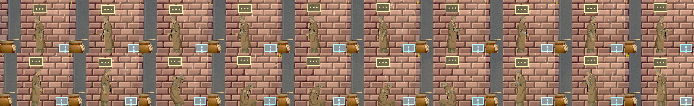
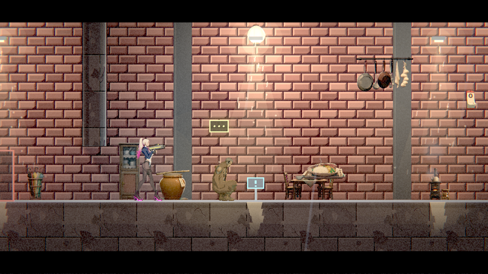
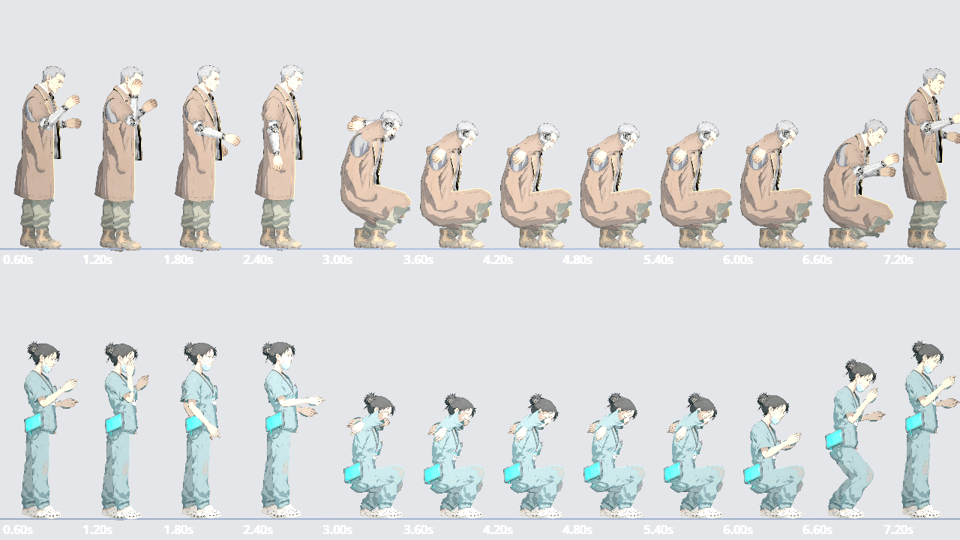
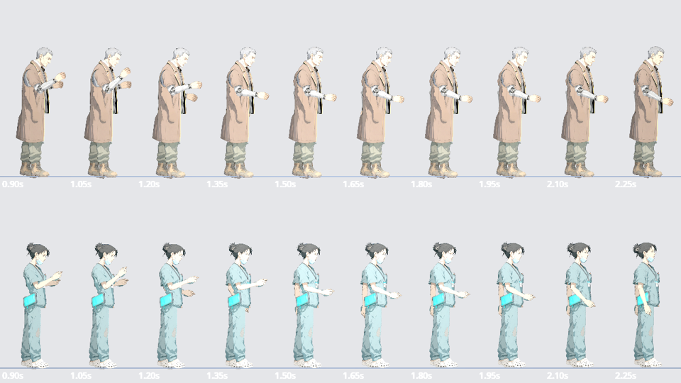
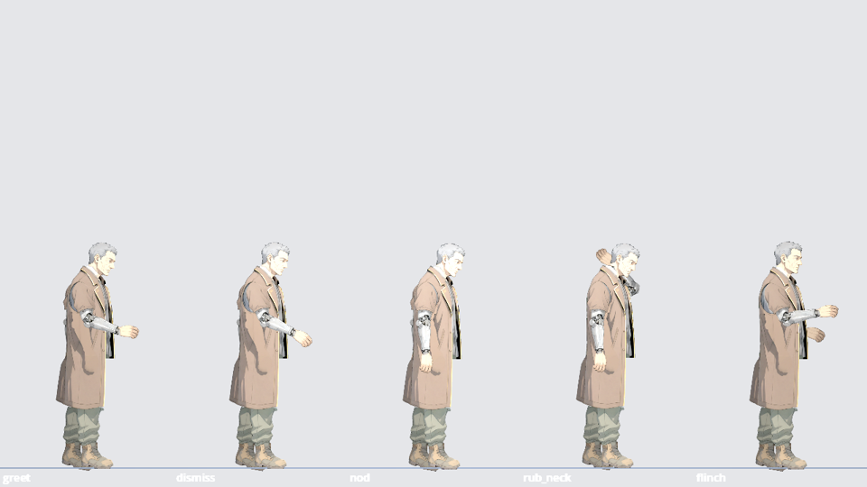
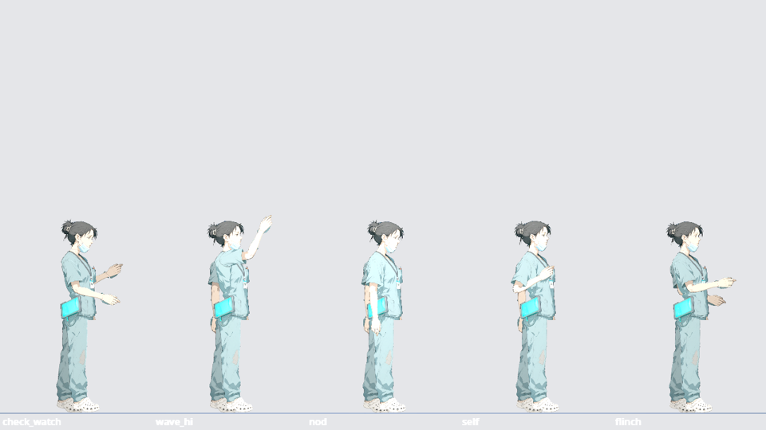
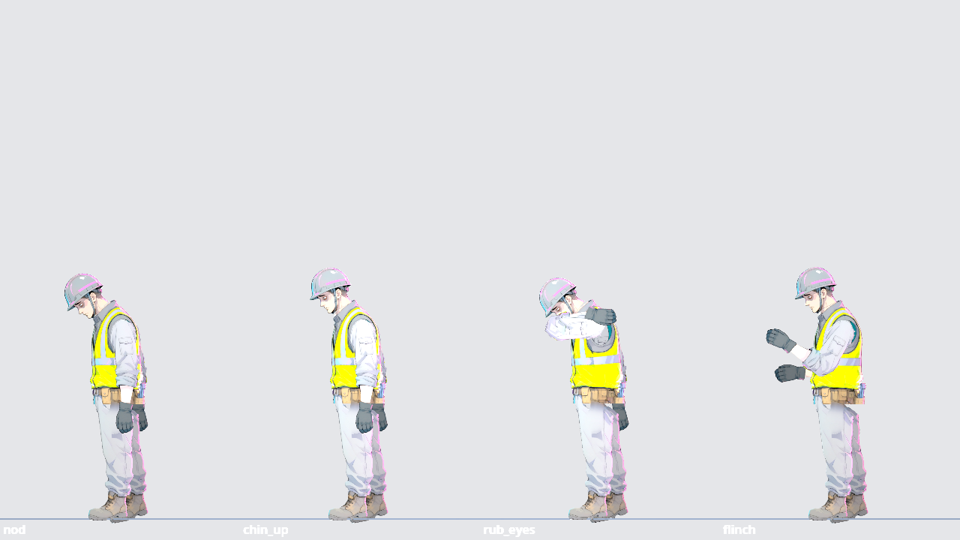

# Commit-2

## 內文

**問題**：調查、交付、修理三類只寫了「需要其他組」，沒有逐條說清楚每一項缺什麼、要誰決定，故事組無從接手；人物反應的畫面只用 Compatibility 看過。另外 main 已經把門換成貼圖，原本鎖門被試開時的晃動只晃到程式畫的門框，門的貼圖不會動。

**改動**：
- 把三項各自缺的東西逐條列成交接清單給故事組：當鋪帳冊箱要決定箱子裡是什麼、伏筆接到哪裡、初看與再看的調查文字、看過的旗標與適用時段；復原館外的交接櫃要放進關卡、確認三個交付步驟綁在櫃子上、回執只發一次；倉庫抽水機要先決定第一章有沒有修理情節、修理條件、修好後的旗標與環境變化。演出組收到後只做人物反應、手勢與道具同步，不寫劇情。清單在 [pm/handoff/NE-240-story-needs.md](../handoff/NE-240-story-needs.md)，設計文件也連過去。
- 鎖住的門被試開時，門的貼圖跟著門框一起晃。

**驗收**：在實際的第一章當鋪地圖用 Forward+（雲端軟體 Vulkan）重拍反應連續畫面：老 K 招呼、擦手、聽到槍響轉頭、蹲下抱頭、安靜後站起來回去擦手，交接沒有跳格、沒有看到破圖。調查、交付、修理仍等故事組的素材，對應的驗收條件沒有勾。

分支：[feature/staging](https://github.com/deadline314/Nest-Egg/tree/feature/staging)，已併進 main：[adf84efc](https://github.com/deadline314/Nest-Egg/commit/adf84efc1c7acbb4bbf2eaf13c9a043d3eb07b00)

### 測試結果

| 項目 | 結果 |
|---|---|
| 鎖門晃動（rebase 時解衝突後）受影響範圍的測試 | 通過，新失敗 0 |
| 畫面 | Forward+（雲端軟體 Vulkan）；實體 GPU 與實際手把待本機 |

### 截圖

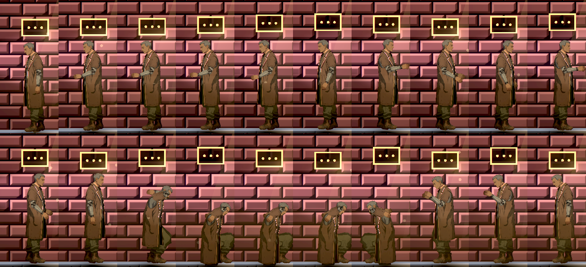

# Commit-3（交接櫃跟著交盤換樣子）

## 內文

**問題**：「交付」這一項原本卡在交接櫃還沒放進關卡。現在交接櫃已經在復原館外，放入資料盤與取回執的對話也接上了，但畫面上什麼都不會發生：櫃子是一張靜態圖，交盤前後一模一樣，回執只出現在物品欄裡。設計上它是「藍燈交接櫃」，實際上也沒有藍燈。

**改動**：交接櫃依交盤進度換樣子，只看劇本原本就會寫的兩個旗標，不改劇本、不發物品：
- 還沒交盤：櫃頂的燈是藍色，緩慢起伏，並照亮櫃子周圍。
- 交盤的當下：燈轉成琥珀色，回執從抽屜口一格一格送出來，有出紙的喀喀聲，送完嗶一聲，紙留在那裡。
- 回執被拿走：紙不見，燈轉綠。
- 死亡、讀檔或重進這一區：直接是當下的結果（回執已經在那裡就在那裡），不重播送紙與聲音。

做成場景擺設共用的功能：任何擺設都可以在資料裡指定「跟著哪些旗標換燈色、要不要出紙」，第二、三章的終端與取件格可以直接用，不用再寫程式。凜伸手把盤放進去的動作是主角動作，仍等角色組；現在是對話結束後櫃子自己反應。

**驗收**：原生 Forward+（Arc B580）在正式的交接櫃區拍連續畫面，逐格看過：藍燈等收件 → 琥珀燈、回執逐格送出 → 回執送完 → 拿走後綠燈；另外重進區域一次，回執已經在那裡、沒有重播。自動檢查用真的旗標變化驗同一套流程，包含玩家在場與重進兩種情況、左右鏡像的擺設、不存在的反應不會讓擺設壞掉。

前兩次交付留下的「待本機原生驗收」也在這台機器補上：人物反應在當鋪（老 K）、屋頂（鷺）、復原館（阿梨）各用原生 Forward+ 拍一段——主角走近、在旁邊連開三槍、安靜下來，每段 20 格，自然結束、0 錯誤。老 K 走近時轉身招呼，槍響後蹲下抱頭，安靜後站起來回去擦手，交接沒有跳格，沒有看到破圖（這個工具的鏡頭比實際遊玩遠，人物在畫面上偏小）。

仍未完成（對應的驗收條件不勾）：調查（當鋪帳冊箱）與修理（倉庫抽水機）等故事組決定內容與旗標；凜的伸手、蹲下翻看、修理動作等角色組；實體手把與鍵鼠的手感待使用者確認。

### 測試結果

| 項目 | 結果 |
|---|---|
| 新增自動檢查（燈色依進度改變、在場才送紙、重進不重播、拿走後消失、鏡像、資料缺漏） | 通過 |
| 原生連續畫面（交接櫃 9 格） | 自然結束、0 錯誤 |
| 原生連續畫面（人物反應，當鋪、屋頂、復原館各 20 格） | 自然結束、0 錯誤 |
| 受影響範圍的測試（併入最新 main 後） | 89761 項檢查；新失敗 2、已知失敗 0，兩項都是機器忙時的計時檢查、和這張票無關：音效「壓低後平順恢復」（乾淨的 origin/main 單獨跑 6 次也失敗 4 次）、「12 個同時爆炸多花的每格時間」（超出預算 0.83 毫秒，單獨重跑 3 次都過） |

### 截圖

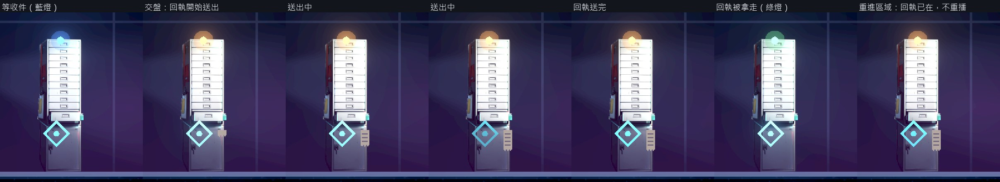
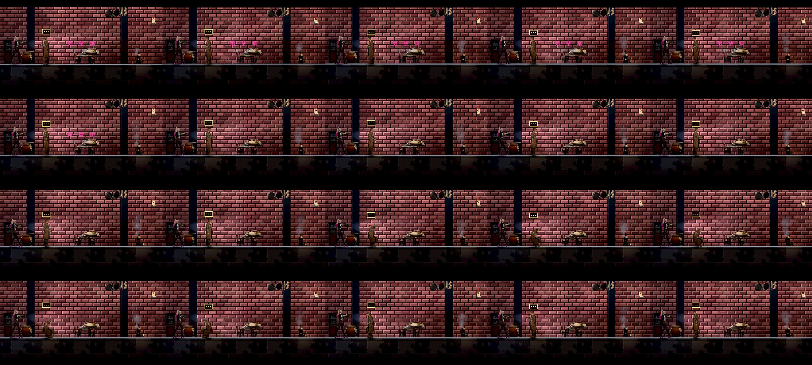
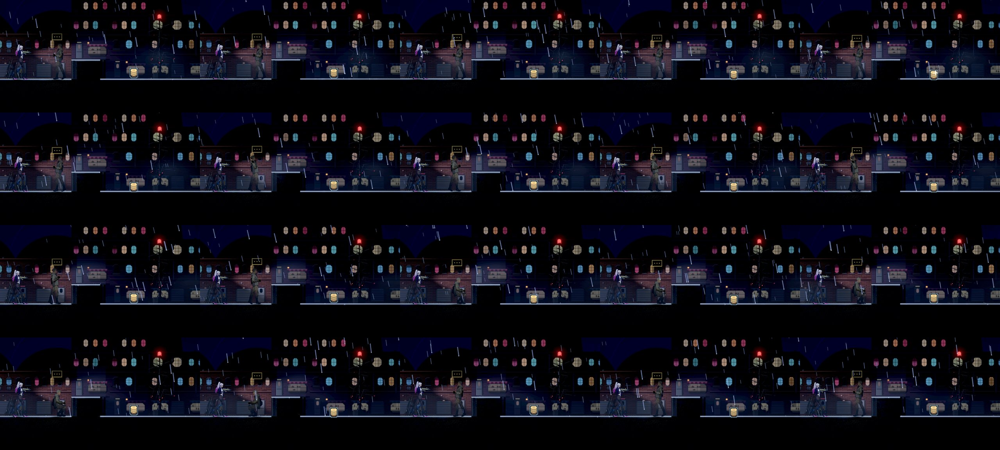
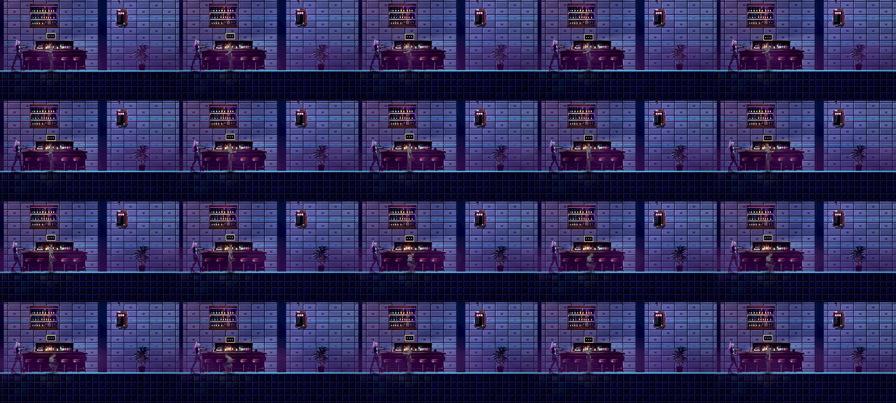

分支 `feature/scene-assets`；提交見[遠端 main 上本票的提交](https://github.com/deadline314/Nest-Egg/commits/main/pm/Nest-Egg/%5BNE-240%5D%E8%B1%90%E5%AF%8C%E6%83%85%E5%A2%83%E4%BA%92%E5%8B%95%E8%88%87%E7%92%B0%E5%A2%83%E5%8B%95%E7%95%AB.md)。

# Commit-4（一次性反應的整輪保存，進行中）

## 內文

原本人物記得已做過的一次性反應，但寫入整輪進度時會遺失這份記憶。現在完整存讀會保留；舊進度沒有紀錄時維持相容，損壞紀錄安全修復。正式人物目前未啟用一次性反應，因此本次沒有調整日常動作或頻率。

同一份新增回歸以舊行為跑550項有8預期失敗，修後550項全過；另以兩個獨立程序核對四處世界狀態及真正人物還原後的一次性資格，2＋9項全過。固定基準的原受影響選擇器結果：checks: 3759, new failures: 0, known failures (tests/known_failures.txt): 0  (wall time 126 s)。

[原始紀錄、來源、逐檔SHA及連續性核對](attachments/NE-240-reaction-save/README.md)。本次為保存修正，沒有新增畫面，整票原驗收條件保持。

# Commit-5（交接櫃手部互動回寫，進行中）

## 內文

交接櫃已從只有燈色／出紙，接上凜的取盤送入與掌心接紙收起。正式物品在保存成功後才改變，取消把同一張紙放回出紙口；途中退出的原選擇可由真正櫃檯續玩完成。

原選擇器83組、97,568項、0新／0已知失敗、517秒；15個原生程序225／0，0引擎ERROR／洩漏；機械／資料／來源／一般凍結續玩86／0（保留原刻意損毀fixture日誌）。

[ST-10正式畫面、同類遊戲參考與原始紀錄](../ST/attachments/ST-10-world-handoff/README.md)。本票的首批調查、修理與完整實體輸入條件維持原驗收，未以單一交付情境代勾。

# Commit-6（當舖收音機調頻手部演出）

## 內文

第二章當舖的收音機修理原本只有接線與調頻選項。現在選擇刻線後，凜會走近低工作檯、蹲下握住旋鈕、調頻、鬆手起身；轉錯時短暫回彈並回到原雜訊提示，調對才接上原廣播。原三個接線選擇、廣播、保存片段或先離開的結果與報酬保持。

真實人物入口驗過取消、道具遺失、死亡、來源離場與略過：手與蹲姿均釋放，保留原武器配置，動作途中不先發修好旗標、片段或報酬。原版與新增動作兩條流程的保存成功、寫入拒絕、載入及回訪對照一致；本支線沿用原本普通自動保存，寫入拒絕時記憶體結果已生效、磁碟保留舊進度，不代稱原子保存。

### 測試結果

| 項目 | 結果 |
|---|---|
| 章節來源重新編譯與故事契約 | 成功；19 / 19 |
| 第二章局部檢查（含實際中斷與保存對照） | 266 / 266，0 腳本錯誤；刻意故障警告保留 |
| 9070 XT 原生 Forward+：修前／修後／最終連續 | 9＋11＋12 項通過；最終無引擎或腳本錯誤 |
| 原生連續接觸 | 194 幀資料、45 張原圖；65 幀轉動／回彈，最大掌心誤差 0.000126 世界像素 |
| 原故事封存資料 | 原 bytes 與 SHA 不變 |
| 正式受影響回歸 | 44組、54,690項，0新／0已知失敗，退出0，1124秒；原故障與結束清理診斷保留，0腳本錯誤 |

### 截圖

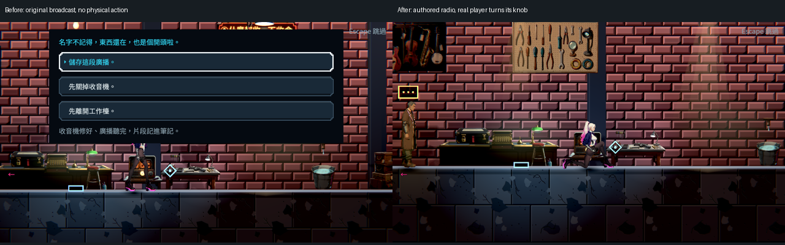
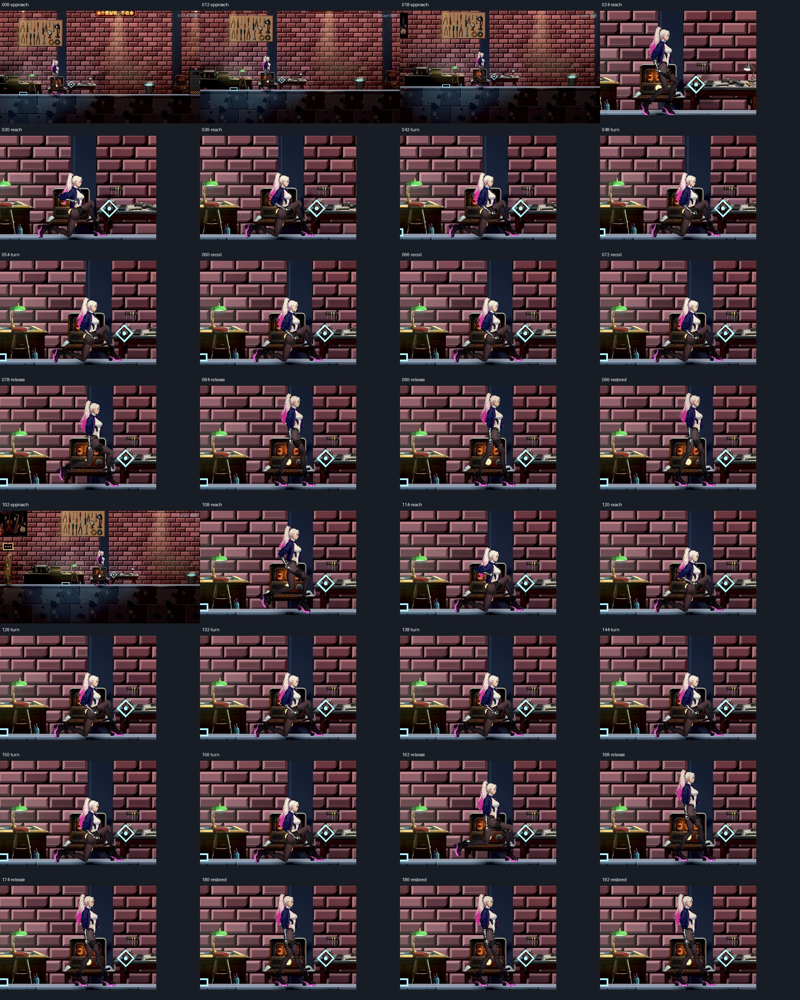

[原圖、連續影格、保存對照與完整錯誤歷史](attachments/NE-240-radio-tune-2026-11-17/README.md)。

# Commit-7

## 內文

夜晚當舖的帳冊箱可以主動查看：凜蹲下握住鎖扣、輕試後回彈、放手起身，箱蓋保持關閉；回訪只短答，老K之後用一次揮手提醒。倉庫通過看門狗後可選擇扶正機殼開關，也可保持原狀；完成後指示燈恆綠，不再彈出維修提示。主線水閘、浮橋、原有十個任務與既有對白結果保持。

取消與死亡不保存完成結果；明確略過沿用既有完成規則，保存一次結果後走回訪。完成、略過、取消、死亡、讀取實際存檔與回訪均驗過：手和蹲姿收回，武器配置、物品與貨幣保持，不重複發獎勵。

重建關卡時保留原本的燈位與牆面材質；目的地提示移位後，文字閱讀需要其位置時會持續讓位。倉庫首次流程估算維持八分鐘內。

### 測試結果

| 項目 | 結果 |
|---|---|
| 正式受影響回歸 | 56組、59,214項，0新／0已知失敗，退出0，552秒 |
| 第一章、環境、任務指引與節奏 | 9,803項全過；原版對照7,753項全過 |
| 作者與結果契約 | 31項全過；原有十個任務及全部既有劇情段落一致 |
| 9070XT原生動作 | 322幀、13張原圖逐張檢視；鎖扣30幀、機殼33幀接觸，最大掌心誤差分別0.000069／0.000252世界像素 |
| HUD雙解析度 | 1280×720、1920×1080，共52項通過；六張原生圖已檢視，裝置切換含合成輸入 |
| 交付附件 | 解包雜湊與正向讀取通過；遭改接觸紀錄、原圖位元均被拒收 |

### 截圖

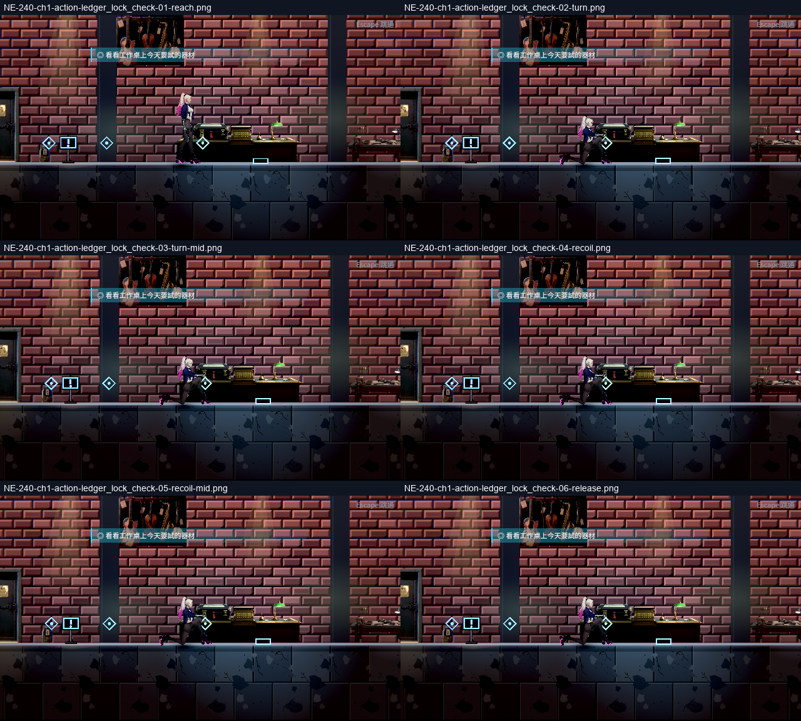
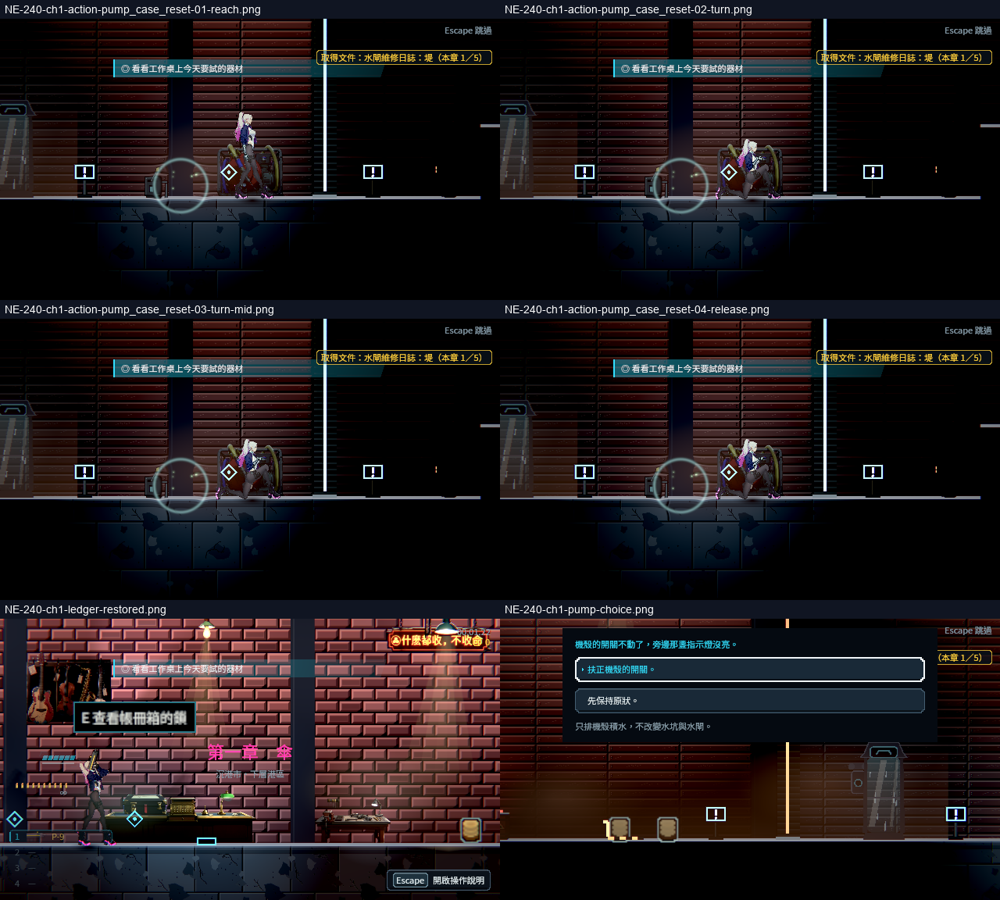
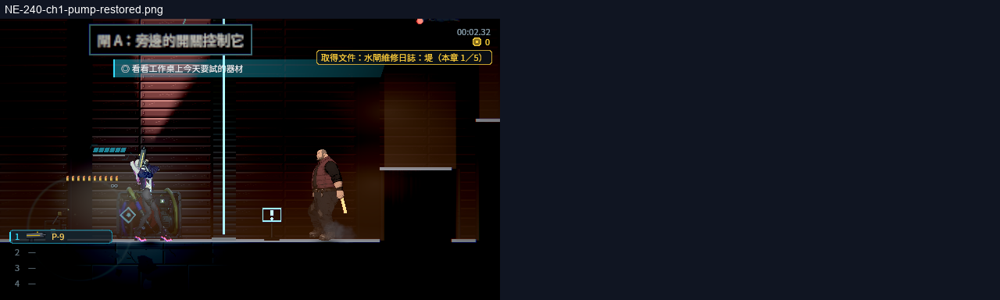

[原生原圖、逐幀紀錄、完整回歸與診斷歷史](attachments/NE-240-first-chapter-2026-11-18/README.md)。

# Commit-8（新增互動後仍能重建三章關卡）

## 內文

新增帳冊箱與抽水機後，第二、三章的關卡重建會因地圖標記撞號而提前停止。現在第一章兩個新增互動改用自己的標記，三章都能重建；互動位置、資源、已發布關卡與完成結果保持。

### 測試結果

| 項目 | 結果 |
|---|---|
| 原問題對照 | 原版獨立重現兩章撞號，修正版通過 |
| 產生器既有單元測試 | 23項通過 |
| 三章機關結果生成比對 | 10＋10＋9張地圖通過，與正式結果一致 |
| 共同整合受影響回歸 | 88組、100,915項，0新／0已知失敗，退出0；同輪另含NE-267演出 |

### 截圖

[CI原錯誤、修前修後生成紀錄與驗證範圍](attachments/NE-240-generator-symbols-2026-11-18/README.md)。

# Commit-9（倉庫水閘與抽水機各用一次互動）

## 內文

靠近水閘 A 時，水閘與旁邊的抽水機外殼有一小段互動範圍重疊。原本按一次就會開水閘並開始維修對話，操作被對話中斷。現在共用現有的最近目標判定，範圍重疊時只提示一個按鍵目標。站在水閘旁可切換水閘並繼續往前，走到抽水機旁再按，才會出現維修選擇。原位置、開關冷卻和兩個物件的保存規則維持原樣。

### 測試結果

| 項目 | 結果 |
|---|---|
| 受影響範圍 | 58 套，63,168 項，0 新失敗、0 已知失敗 |
| 重疊回歸 | 修前重現一按兩用。修後 6 項全過，涵蓋兩側提示、切換與維修選擇 |
| RX 9070 XT 實機 | 同一份正常難度存檔與站位，修前按水閘會開對話並鎖操作。修後先切水閘，再走近外殼按鍵才出現維修選擇 |

[原生前後對照與回歸證據](attachments/NE-240-switch-overlap-2026-11-19/README.md)

### 截圖

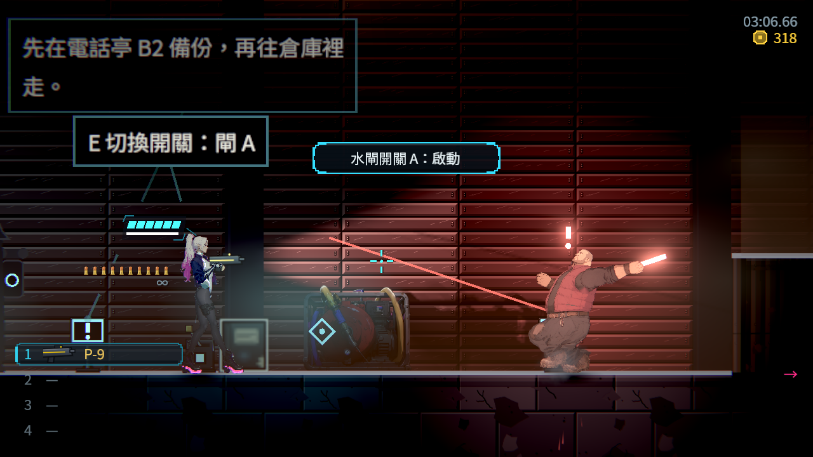

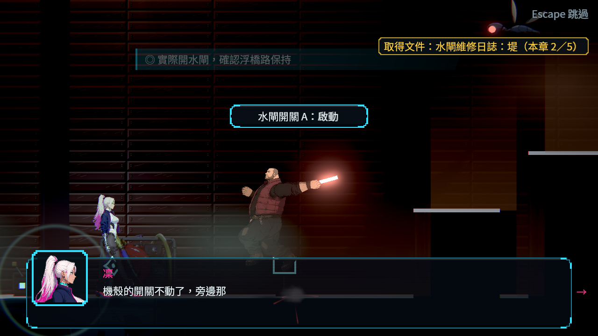

# Commit-10（水閘與抽水機的按鍵提示交接）

## 內文

從水閘 A 走到抽水機旁時，原來的水閘按鍵提示在淡出途中仍和抽水機提示一起出現，兩個地方都顯示同一顆互動鍵。現在切換到下一個目標時，上一個按鍵提示立即退場，畫面只邀請目前可操作的目標。走離所有目標時依原速度淡出。沿用現有的最近目標判定與版面配置，互動、抽水機維修選擇和保存照原規則執行。

### 測試結果

| 項目 | 結果 |
|---|---|
| 正式倉庫的重現 | 同一份正常難度主存檔，鍵盤 E 與合成手把 X 各跑一般配置與 120% 文字／減少動態，四組雙提示均由 8 幀降為 0 |
| 原生操作 | RX 9070 XT、Forward+，修前 40 項、修後 44 項通過。每次先獨立切換水閘，再走近抽水機選擇維修 |
| 聚焦回歸 | 相同 8 項，修前 1 個殘留提示失敗，修後全過 |
| 受影響回歸 | 64 組、64,126 項，0 新失敗、0 已知失敗，555 秒 |

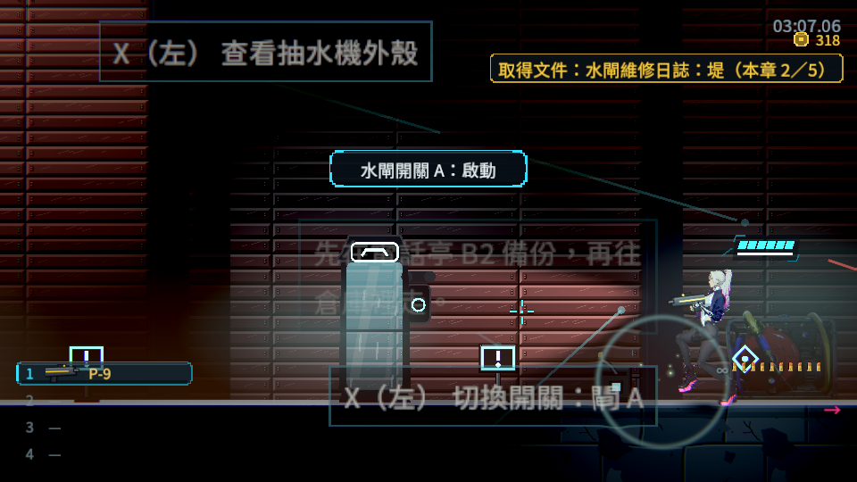
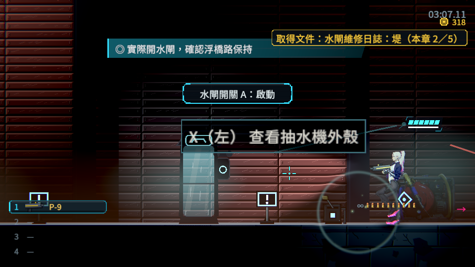

[四種原生配置、逐幀紀錄與回歸](attachments/NE-240-prompt-handoff-2026-11-20/evidence.zip)。本次驗證涵蓋這兩個倉庫互動，票的整體情境與實體手把驗收仍待完成。

---

# Commit-11（世界提示讓開準星）

## 內文

在屋頂對著重擊靶時，準星會蓋到原位置的按鍵文字。世界提示使用準星當格的繪製範圍找空位，提示線仍指向原物件。原瞄準點在修前、修後都相同。隱藏 HUD 時釋出準星占用的位置。

### 測試結果

- RX 9070 XT Forward+ 同場對照，100%、110%、120% 文字各 30 格。準星與提示框重疊由 90 格降到 0 格。
- 一般及減少動態各 90 格移動瞄準，提示始終可見，重疊 0 格。
- 提示、戰鬥 HUD 及對話氣泡聚焦測試 220 項，受影響回歸 30 組、14,467 項全過，0 腳本錯誤。[原生前後畫面與量測紀錄](attachments/NE-240-reticle-2026-11-20/evidence.zip)

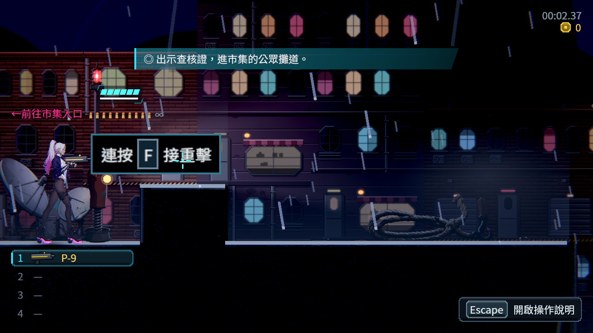

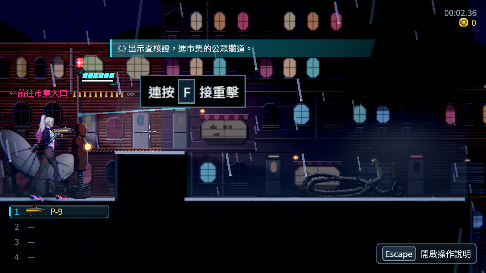

---

# Commit-12（裝卸間橋梯的拉桿互動）

## 內文

初次啟動橋梯時，凜沿同一段平台走到箱旁，蹲下碰觸紅柄再收手。原有旗標讓燈號切換、橋梯展開並開啟捷徑。回訪直接顯示已展開狀態與原提示。

### 測試結果

- RX 9070 XT Forward+、HDR 2D 以正式存檔測左側、右側、演出中略過與冷讀回訪，共 40 項通過。兩側原生接觸的掌心誤差均低於 0.0002 世界單位。接觸當格與正式存檔分開驗證，三份證據與 1,274 元一致。
- 實際通過原橋梯抵達代收處，回程入口可用。略過後橋梯仍開通，冷讀回訪不重播走近與碰觸。
- 65 項劇本測試全過。受影響回歸 39 組、55,306 項全過，570 秒。退出時有既有的清理警告（9 個物件、5 個資源）。

[原生畫面、兩側接觸量測、存檔與回歸紀錄](attachments/NE-240-bridge-lever-2026-11-21/evidence.zip)

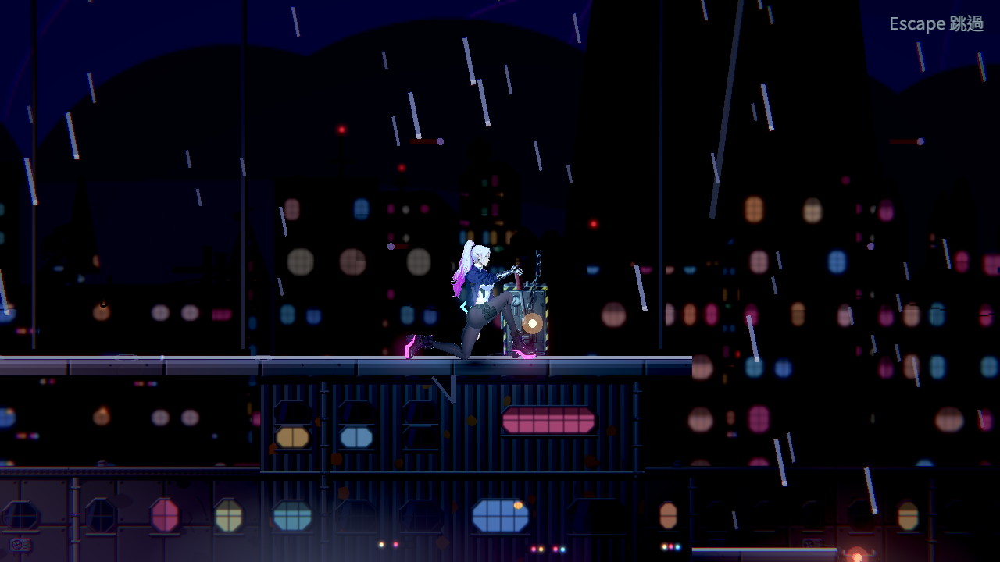

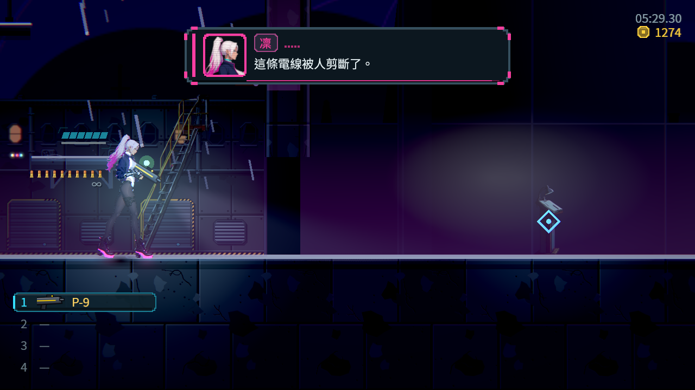

---

# Commit-13（泵室配電盤分辨支路與送電）

## 內文

關掉浸水支路時，原本會亮起與送電後相同的綠燈。現在未隔離亮琥珀色，支路隔離後開門並亮恆藍，接通貨梯主路後才亮恆綠。燈號對準原板面，低一些的光能讓燈色更容易讀。

### 驗收

- 從正式第三章泵室原地操作，排水前、選錯、隔離後先離開、回來送電和重新進區共五個畫面狀態。左右接近以鍵盤 E 與合成手把 X 觸發，原門板、選項、物品和信用點結果一致。
- RX 9070 XT Forward+ 鍵盤原生 50 項、合成手把 50 項全過，受影響回歸 29 組、50,438 項全過，702 秒。

[原生狀態、正式選擇與回歸紀錄](attachments/NE-240-pump-panel-2026-11-23/evidence.zip)

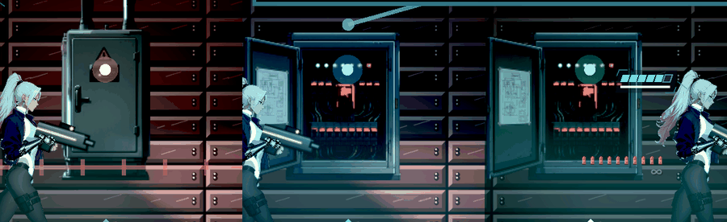

---

# Commit-14（晚窗試坐前把椅子移到陰影）

量 C 晚窗第一次會看到凜接住椅背，向後一步把椅子沿地面移開西曬，再鬆手。窗框、椅子與茶几的尺寸依各自可見範圍量測。茶几留在原位。這段沿用晴岸的窗、椅子與室內材質。三語台詞與原停頓保留，回訪仍讀摘要。

### 驗收

- 正式晴岸的窗前互動覆蓋未登記、登記、第一次、回訪、略過和房間提案。原版 40 項有 3 項缺少動作與聲音，現版 RX 9070 XT Forward+ 的 41 項全過。渲染前接觸點偏差低於 0.001 舞台單位，椅腳距地面不超過 0.18，短木聲一次。
- 略過仍記錄量窗，房間提案由後續玩家選擇，照原規則只給 20 信用點。第 3 章作者產物的 171 場及 9 條任務已核對。第三章完整故事路線正常與略過動畫各跑一次，均到達章末。
- 受影響回歸 35 組、53,153 項全過，565 秒。

[實際路線、作者檢查與回歸](attachments/NE-240-late-window-2026-11-23/evidence.zip)

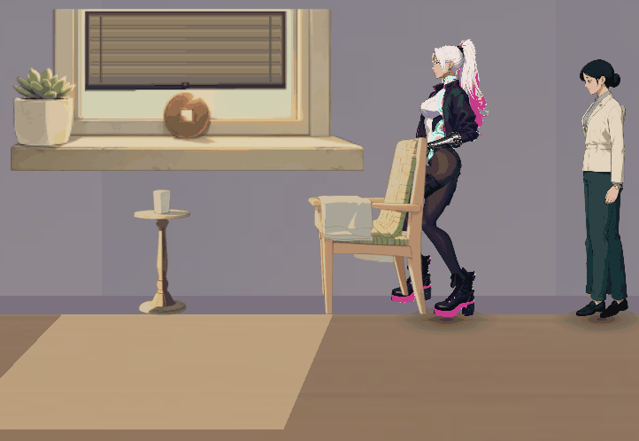
