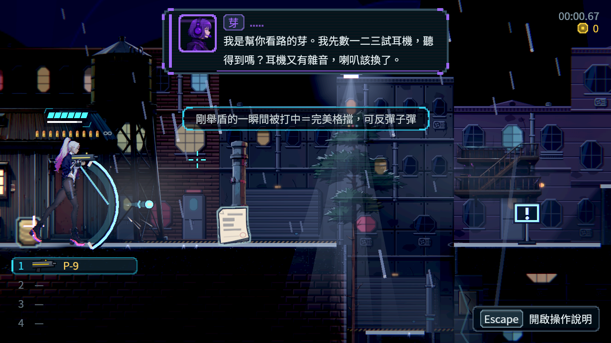

# [NE-241] 完整驗收全武器戰鬥打擊感

> 狀態：進行中

## 內文

### 需求
完成武器、彈體、盾與連段改版後，統一驗證全部現有武器的打擊感与實際戰鬥表現。打擊感是本批戰鬥交付的核心验收，不只看静態外觀或傷害數字。

### 來源
2026-10-10，使用者要求逐章完成與累積發行、高清像素UI、全流程手把、豐富合理敘事與動畫、場景減雜，並追加武器差異、子彈、方向護盾、可選連段升級與打擊感總驗收；一般設計選擇由實作者決定，持續推進。

詳見[整體設計](../../design/20-campaign-experience/DESIGN.md)與[研究依據](../../design/20-campaign-experience/RESEARCH.md)。

### 驗收條件
- [ ] 建立全部現有武器、基礎／升級、命中／揮空、雜兵／裝甲／頭目、鍵鼠／手把的驗收矩陣並完整执行。
- [ ] 逐一核對起手、有效命中、收招、声音、受擊、击退、短停顿与镜头／震动一致，接触清楚且武器身份可辨。
- [ ] 子彈飛行、穿透、反射、命中和盾窗口前／中／後、正／背面結果一致，视觉不误导判定。
- [ ] 轻重武器、完整／短连段、升级路線与敌方抗性有實戰比較，無永久硬直、無限取消或無代價連段。
- [ ] 密集战斗、低幀率、亮暗HDR与減特效时仍辨敵人、落點及危險，揮空不误播命中回饋。
- [ ] 真實手把、Forward+實際畫面、人工打擊感與戰鬥自动回歸分開記錄，發現問題修復後复验。
- [ ] 所有受影響戰鬥、成长、存讀檔与输入測試通過；本票完整檢查戰鬥矩陣，專案全套測試仍由CI負責。

### 測試流程
1. 依矩陣逐武器實戰，記錄動作／命中／防禦／連段／成長的問題與修復。
2. 完成本機真手把、HDR与局部战斗回归，保存代表截图与验收记录。

---

# 跟其他票的關係

- Blocks：NE-233
- Blocked by：NE-236、NE-237、NE-238、NE-239
- Related：NE-95、NE-139、NE-144、NE-231、NE-222、NE-224

---

# Commit-1（驗收矩陣準備）

## 內文

**問題**：NE-236、NE-237、NE-239、NE-253、NE-254 各自交付後，缺一份一起看的總表：每把武器實際打起來差多少、哪些已有證據、哪些還要在本機原生與實體手把上驗。

**改動**：新增槍械實測情境：真正的玩家按住射擊鍵、手把右搖桿瞄準，逐把槍在三種距離打雜兵與打手，記錄首次命中、擊倒時間、開槍與命中數、換彈與擊退。整理成驗收矩陣：槍械與近戰的實測表、讀法與觀察（例如衝鋒槍三種距離都最快、霰彈與榴彈在遠距打不到），以及姿勢、命中、受擊、輕重取捨、裝甲／頭目、減特效、鍵鼠與手把、不斷姿、原生畫面、實體手把各項目前的狀態，最後附本機原生驗收的建議順序。

**驗收**：實測資料已存成附件；矩陣中標「待本機原生／實體手把／人工試玩」的項目尚未執行，所以驗收條件都還沒勾。

### 測試結果

| 項目 | 結果 |
|---|---|
| 槍械實測 | 8 把 × 2 種目標 × 3 種距離，共 48 筆 |
| 受影響範圍 | 只改工具與文件，選擇器判定沒有受影響的測試套件 |

[驗收矩陣](../../design/15-combat-feel/COMBAT_ACCEPTANCE_MATRIX.md)　[槍械實測原始資料](attachments/NE-241-gun-balance.json)

分支：`feature/combat`，提交：https://github.com/deadline314/Nest-Egg/commit/9b952edf

---

# Commit-2（矩陣更新：本輪各票補上的自動驗證）

## 內文

**問題**：驗收矩陣的「輕重取捨」「揮空」「減特效」幾格還是待驗或部分，舉盾、命中回饋位置與鞭的新進度沒有反映。

**改動**：依本輪各票的實際結果更新矩陣：衝鋒槍射程縮短後沒有全面占優的槍（NE-236）、近戰每招有自己的動作且揮空不播命中、一揮多目標全畫面最多停一次（NE-237）、盾的三種結果各一套回饋（NE-239）、命中回饋在實際接觸點（NE-268）、鞭子改用 NE-276 的軟鞭；槍械實測加上改裝與持續輸出。

**驗收**：矩陣每一格都對應到測試或實測紀錄；實體手把、本機原生畫面與人工打擊感三列仍是待驗，本票所有條件維持未勾。

分支：`feature/combat`，提交：https://github.com/deadline314/Nest-Egg/commit/73841f04

---

# Commit-3（矩陣更新：近戰模組、按住招式、鍵鼠與手把一致、畫面距離）

## 內文

**問題**：這一輪近戰改成獨立模組（NE-277），每把武器多了自己的一套動作與按住招式；鍵鼠與手把一致（NE-237、NE-239）、平台往下打的接觸點（NE-268）、畫面上打得到多遠（NE-236）也有了自動檢查，矩陣還是舊的。

**改動**：依實際結果更新[驗收矩陣](../../design/15-combat-feel/COMBAT_ACCEPTANCE_MATRIX.md)：近戰的姿勢一格加上「每把一套加按住招式、武器帶著手、雙手武器兩手都在桿上、身體參與」；命中一格加上多段攻擊、平台往下打與畫面距離；受擊一格加上命中聲兩層；鍵鼠與手把一列的近戰與舉盾改成已驗（合成事件逐格一致）。新增量測工具一節，本機原生驗收順序加上逐把的按住招式與聽兩層命中聲。

**驗收**：矩陣每一格都對應到測試或量測紀錄；本機原生畫面、實體手把與人工打擊感兩列仍是待驗，本票所有條件維持未勾。

### 測試結果

| 項目 | 結果 |
|---|---|
| 受影響範圍 | 只改文件與票，選擇器判定沒有受影響的測試套件 |

分支：`feature/affectionate-feynman-dfv3cp`，提交：https://github.com/deadline314/Nest-Egg/commit/767ff3a1

# Commit-4（格擋檢查等待真正結算）

## 內文

低幀率下的格擋測試原本可能把還在完美格擋中的第二發當成普通格擋，或在破防子彈仍停住時就檢查硬直，導致原本正確的反彈／格擋結果被誤判。現在等實際窗口結束及該發子彈結算再檢查，所有等待都有上限，原戰鬥判定與原有斷言保留。

### 測試結果

| 項目 | 結果 |
| --- | --- |
| 原實際回歸失敗 | 72 組、93,793 項、1 新失敗 |
| 原版低幀率獨立重現 | 5 FPS 再次反彈；第二發前仍在完美格擋窗口 |
| 最後四種幀率格擋／破防流程 | 4 程序、44 項、0 失敗 |
| 原生軟體渲染 5 FPS | 原 10 項 1 失敗；修後 11 項 0 失敗 |
| 原選擇器要求完整回歸 | 88 組、98,315 項、0 新／已知失敗、650 秒 |

[原始失敗、前後重播及全部輸出](attachments/NE-241-block-clock/README.md)。本次只修正檢查時序，不代勾真人、實體手把或完整武器驗收。
