# [NE-242] 補畫後續章節專屬角色素材

> 狀態：進行中

## 內文

### 需求

後續章節已定稿的可見角色需要可辨識的專屬立繪、頭像、分件与必要演出動作，按章節優先序分批交付。第二、三章優先，之後按排程製作；第一章缺口維持由 NE-218 處理。身份、台詞、任務與出場依故事定稿，不由素材製作改寫。

完整清單、優先序與場景邊界見 [後續章節角色素材排程](../../design/12-cast-redraw/FUTURE_CAST_ART.md)。

### 來源

2026-10-10，依 NE-218 的後續角色清單／另開票要求，及使用者指示按具體需求製作、不一次擴大到全部後續章節，核對最新 main 的角色設定與第二、三章劇本整理。

### 2026-10-11 使用者補充：站姿、多一隻手、畫風
使用者指出角色站著時過度挺胸、有些看起來像有兩隻手、新角色的畫風與遊戲差很多且「AI 感太重」；並要求確實檢查骨架拼接後的破圖、沒切好的地方與關節稜角。這四項列為驗收條件，之後每個角色都要過。

### 驗收條件
- [ ] 站姿不挺胸：站著不動時脊椎直立，胸口不前挺、腰不後凹、臀不後翹；耳、肩、髖、踝大致在一條垂直線上。附站姿近拍。
- [ ] 不會看起來像多一隻手：站、走、坐、蹲、持武器與空手時，同一側看不到兩隻手臂並排；底層圖上沒有殘留的手（由建置時的檢查擋下）；衣物脫落後也一樣。
- [ ] 畫風與既有角色一致、符合世界觀：和老 K、護理師並排看是同一套畫風（低彩度、粗黑描邊、兩階硬邊陰影、有磨損與皺褶，沒有噴槍漸層與發亮的塑膠感）；服裝是港區會有的實用衣物，霓虹最多一小處。附並排圖。
- [ ] 拼接後沒有破圖、沒切好的地方與關節稜角：站、坐、蹲、走的近拍逐一看過；逐格接點稽核的每一類失敗都放大看過並歸類，數字記在票上。

- [ ] 第二章阿勇、小薇、利息、榕伯有專屬來源、頭像、分件與適用動作；小薇保持非戰鬥，阿勇呈現兩種存活結果
- [ ] 第三章芷姐、林小姐、JANUS、葉有專屬來源、頭像與場景所需動作；JANUS 本人與外部裝置可分別呈現，葉的手背及透明傘可辨識
- [ ] 第四章棠與裁有專屬素材及坐姿／頭目動作
- [ ] 第五至八章必安、石、燕、麥、蘇、棘、棘母、桐有專屬素材與已定稿場景所需動作
- [ ] 第七至九章沈望、汐有專屬素材，記憶版本依實際場景需求分別交付
- [ ] 每批保留可重跑來源、透明與解析度對照，分件無錯誤所有權、額外肢體或不完整底層
- [ ] 每批全部接點與適用動作於雙朝向、遊戲／過場尺度及受損狀態通過逐格與動畫稽核，再通過實際關卡／Forward+ 檢查並留圖
- [ ] 每批與故事／配置 Session 核對角色掛載及動作介面，不改寫台詞、任務與出場配置

### 測試流程

1. 依優先序核對原圖、頭像、透明背景與每個零件的單件所有權。
2. 逐角色檢查全部適用姿勢與狀態轉換、左右面向、全部接點與裝備／家具掛點。
3. 執行受影響測試與動畫稽核；在 Forward+ 遊戲及過場實際檢查畫質、操作與接合，存檔可重現結果。

---

# 跟其他票的關係

- Blocks：無
- Blocked by：無
- Related：NE-218、NE-89、NE-97、ST-20

---

---

# Commit-1

## 內文

第二章的阿勇、小薇、利息、榕伯在設定文件裡只有年齡、身份與少數道具，沒有長相與衣著；遊戲裡也還沒有這四個人的任何素材。

這次替四個人各做了一套：來源立繪、頭像、分件與骨架、睜眼／半閉／閉眼三種眼睛狀態、各自的動作數值。全部用「直立站姿、近側手垂在大腿旁」的來源畫法，一次一張，逐張看過才往下做。

- **阿勇**（`yong`，45 歲）：碼頭搬運工出身的厚實體型，鏽褐色工作夾克，外面套一副二手的工業外骨骼，胸前一個電池匣，纏著繃帶的手。
- **小薇**（`xiaowei`，12 歲）：齊耳短髮、黃色髮夾，黃色短雨衣、灰毛衣、深藍長褲、紅雨靴。第一張雨衣畫到大腿，坐下時下襬會跟著大腿橫出去，改成只到腰的短外套重畫。
- **利息**（`vig`，約 35 歲）：瘦長，油頭薄鬍，灰背心、捲袖襯衫加袖箍、鬆開的暗紅領帶，腰間掛一顆印章。
- **榕伯**（`banyan`，72 歲）：瘦而結實的老人，白鬚、幾乎全禿，葉紋短袖襯衫敞開套在汗衫外，捲起的褲管與塑膠拖鞋，脖子上一條毛巾。

長相與衣著是這次依世界觀補的設計，已記在 [後續章節角色素材排程](../../design/12-cast-redraw/FUTURE_CAST_ART.md)，故事那邊有不同想法可以再改。

還沒做的：第二章新劇本還沒有產生故事與關卡資料，這四個人目前掛不上任何場景；阿勇的鐵棍、頭目招式、兩種「打倒後存活」的演出與第二階段外殼瑕疵，小薇抱黃傘與扶椅背，利息蓋章，榕伯操作茶攤，都還沒有做。第二章這一條驗收不勾。

過程中修掉兩個會影響之後每個角色的問題（第一章的鷺、阿梨、清掃兵與兩種收帳人也用同樣的修正重建過，外觀沒有其他改變）：
- 袖窿的補色會把透明處的底色抹進衣服，榕伯背後因此出現一塊藍灰色。改成不取透明處的顏色，並且用周圍布料的單一顏色平塗（賽璐璐畫風本來就是平塗）。阿梨頭像肩膀上原本的一抹藍也一起消失。
- 抬頭時頸後會多一點封閉的透明區。放大後確認大多是「髮尾與衣領之間本來就有的空隙被圍起來」，不是零件裂開；另外在頭後面補了一塊藏起來的軀幹重疊，榕伯少了 132 個。

### 測試結果

| 項目 | 結果 |
|---|---|
| 受影響範圍測試 | 25,570 項檢查，0 新失敗、0 已知失敗 |
| 逐格接點稽核（四人，215,040 個取樣） | 真正的缺口：阿勇 258、小薇 276、利息 193、榕伯 370，幾乎都是抬頭時頸後髮尾與衣領之間的空隙；其餘接點合計 44 |
| 底層圖檢查 | 四張「拿掉近側手臂」的底層圖都通過建置時的殘留檢查 |
| 原生畫面 | Godot 4.7.2、RTX 4070 SUPER、Forward+；NPC 八個姿勢與近拍無錯誤訊息 |

固定驗收四項（本批四人）：站姿不挺胸——通過；不像多一隻手——站、坐、走、蹲、揮手逐一看過，通過；畫風一致——和老 K、護理師並排，通過（小薇的黃色比其他人鮮豔，是她的識別色）；拼接——坐與蹲沒有稜角與破圖，頸後的數字如上，尚未歸零。這四項是整張票共用的，其他章節還沒做，先不勾。

### 截圖

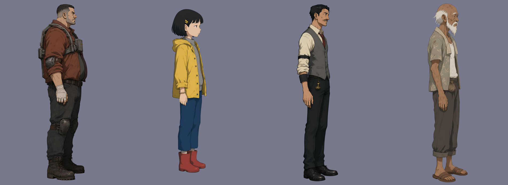

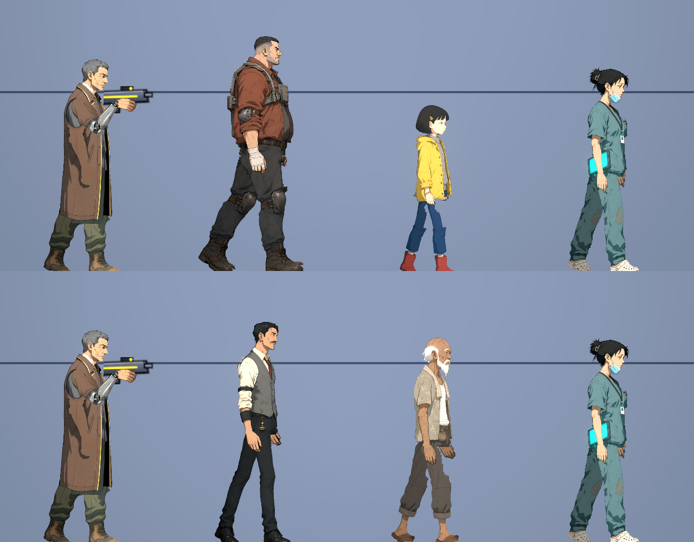

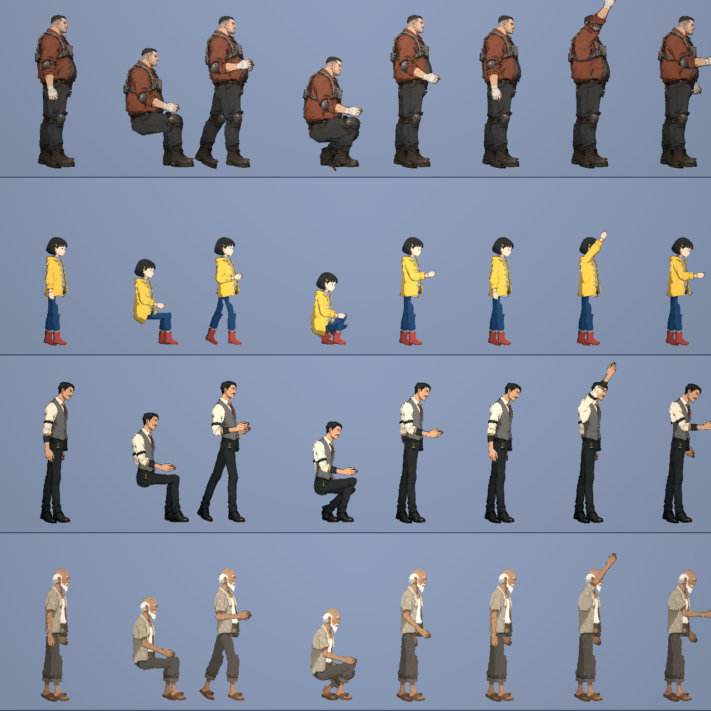

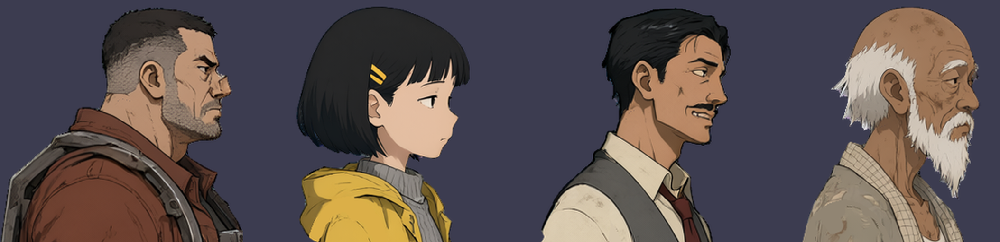

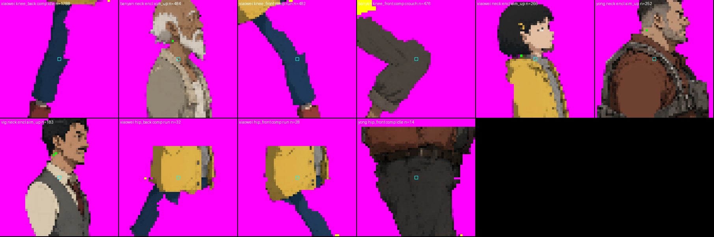

已併入 main：[a0254500](https://github.com/deadline314/Nest-Egg/commit/a0254500)。來源、提示詞與種子在各自的 `art_src/characters/<id>/01_design/`。

---

# Commit-2

## 內文

第三章的芷姐、林小姐、守門人、葉和第二章一樣，設定裡只有年齡、身份與道具，沒有長相與衣著，遊戲裡也沒有素材。

這次替四個人各做了來源立繪、頭像、分件與骨架、三種眼睛狀態與各自的動作數值，做法和第二章相同。

- **芷姐**（`zhi`，36 歲）：低馬尾上插一支原子筆、眼鏡，褪色的玫瑰色針織外套、灰色護士上衣、深藍長褲、磨白的護士鞋、掛繩識別證。和轉運站護理師（青綠色手術服）分得開。
- **林小姐**（`lin`，30 歲）：低髮髻、側分瀏海，肩線略大的米白制服短外套別一枚青綠色徽章、淺藍襯衫、深青綠長褲、磨平鞋跟的黑色低跟鞋。
- **守門人**（`janus`，約 60 歲）：削瘦、梳得整齊的灰髮、空而溫和的眼神，褪色的深藍門房制服（兩排黃銅釦、過大的立領、空白名牌）、側邊有條紋的長褲、發灰的白手套。這次只做他本人；盾架、掃描臂、通訊器與工作架是外部裝置，還沒做。
- **葉**（`ye`，41 歲）：一側有白髮的齊下巴短髮，深灰高領短上衣、黑長褲、平底鞋；近側袖子往上推，手背上有幾行深藍色的字跡。

外觀決定同樣記在 [後續章節角色素材排程](../../design/12-cast-redraw/FUTURE_CAST_ART.md)。

還沒做的：第三章還沒有故事與關卡資料，四個人掛不上場景；守門人的外部裝置、舉盾與掃描的頭目演出、解除後的坐姿；芷姐遞證與解開束帶；林小姐的紙尺、拉椅與蓋章；葉的透明傘、翻手看字與在手背寫字。葉手背上的字在遊戲比例下只是幾行筆跡，內容讀不出來，需要讀得到字的鏡頭要另外做特寫。第三章這一條驗收不勾。

這一批遇到、並在工具裡修掉的問題：
- **兩腿同色又幾乎重疊時，遠側腿切不出來。** 芷姐、林小姐、葉的遠側小腿被近側褲管擋住，只露出一隻鞋，原本「遠側小腿、腳踝、腳掌」三個提示點有兩個落在近側腿上，建置直接停下。新增一個選項，只用遠側鞋子當提示，遠側小腿留在近側腿的輪廓裡。
- **手旁邊的髖部被咬掉一塊。** 林小姐（手錶旁）與守門人（手指前方）的骨盆和大腿在手的位置有缺口，坐下與蹲下時會露出背景；守門人蹲下因此有 922 個接點失敗。把這兩個零件的補洞範圍加大後缺口補平，守門人髖部的失敗歸零。成因只查到「不是手臂遮罩、不是遠側腿遮罩」，還沒有找到是哪一步把那塊像素丟掉的，之後的角色要在第 4 關看骨盆與大腿的單件圖。

### 測試結果

| 項目 | 結果 |
|---|---|
| 受影響範圍測試 | 25,723 項檢查，0 新失敗、0 已知失敗 |
| 逐格接點稽核（四人，215,040 個取樣） | 真正的缺口：芷姐 676、守門人 230、林小姐 28、葉 28。芷姐與守門人的都在抬頭時的頸後（馬尾／後腦與衣領之間的空隙被圍起來）；林小姐與葉的在肩膀，各 1～2 個像素 |
| 場景 30 秒（原生 Forward+、小巷光影） | 第二、三章八個人加老 K 與護理師，30.0 秒、4,287 格，每人眨眼 7～11 次，無錯誤訊息；林小姐的米白外套與小薇的黃雨衣在實際光影下沒有過曝 |
| 底層圖檢查 | 四張底層圖都通過建置時的殘留檢查 |

固定驗收四項（本批四人）：站姿不挺胸——通過；不像多一隻手——站、坐、走、蹲、揮手逐一看過，通過；畫風一致——和老 K、護理師並排，通過；拼接——坐與蹲沒有稜角，髖部缺口已補，頸後的數字如上，尚未歸零。

### 截圖

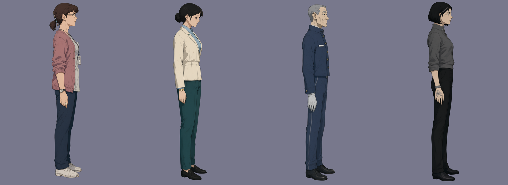

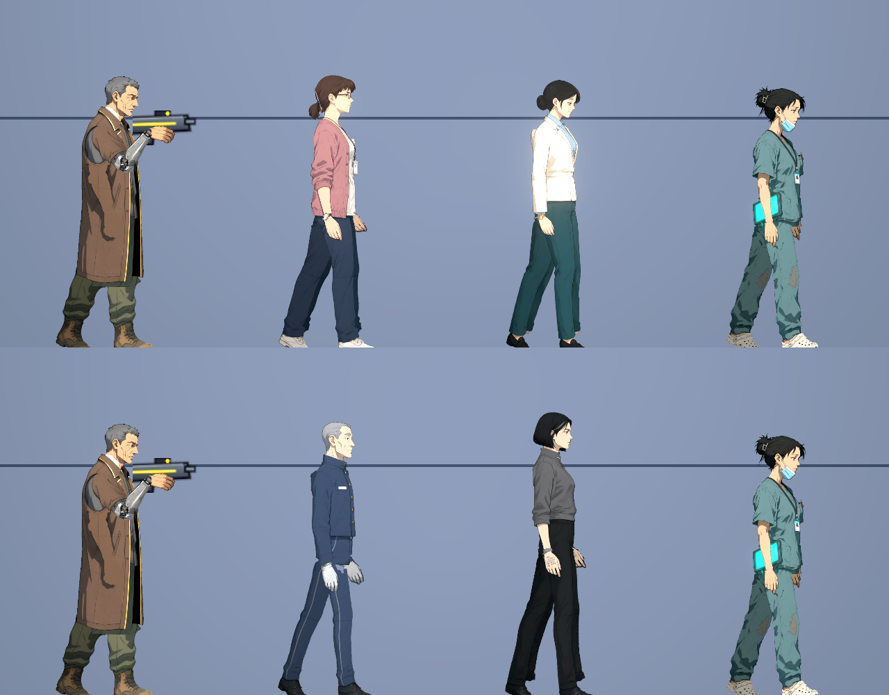

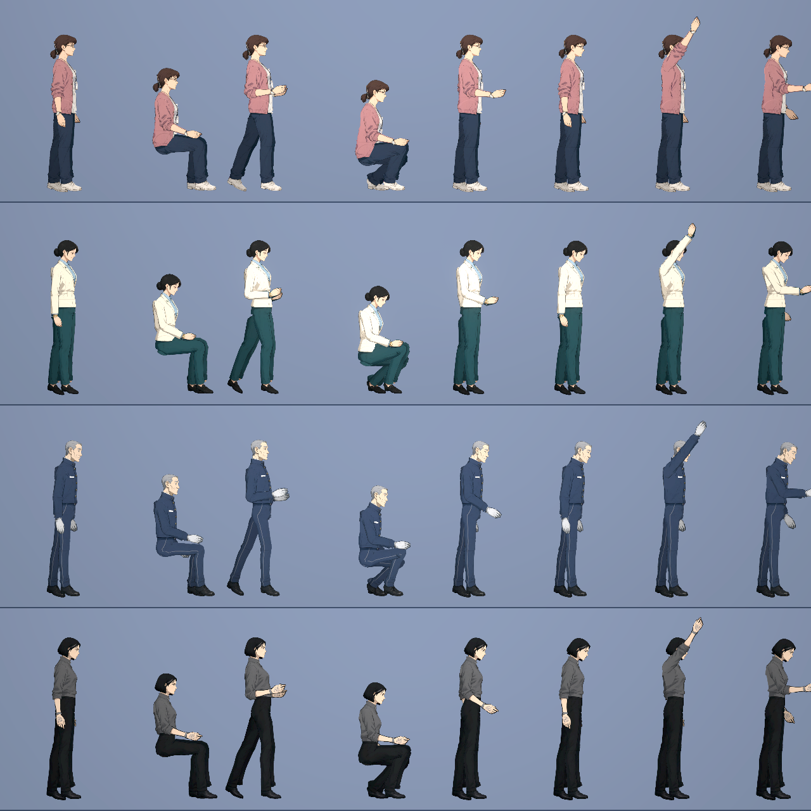

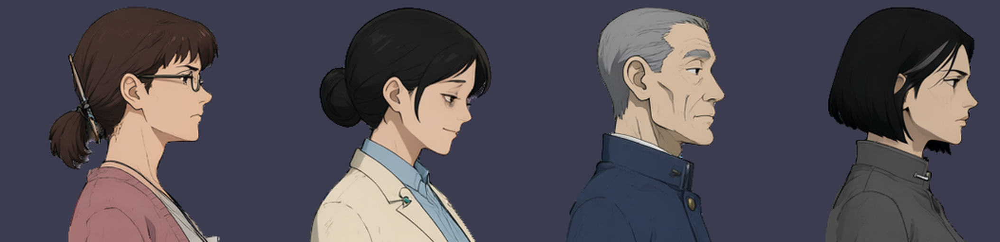

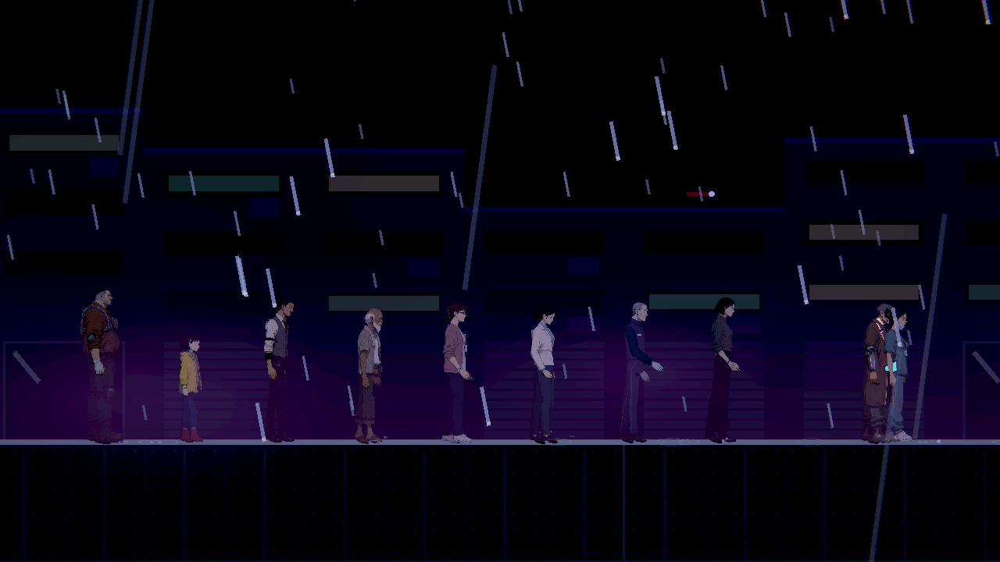

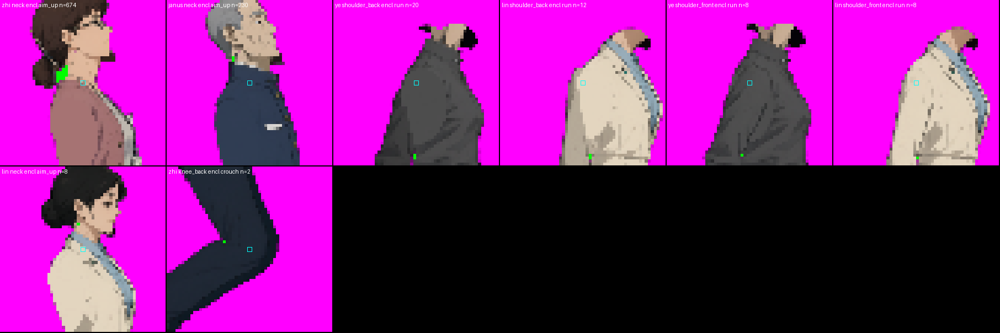

分支 `feature/character-art`。來源、提示詞與種子在各自的 `art_src/characters/<id>/01_design/`。

---

# Commit-3

## 內文

第二、三章八個人走路時髖部前面缺一塊（使用者指出）。成因在分件工具，和第一章新角色是同一個問題，修法與過程記在 NE-218；八個人已用修好的工具全部重建，林小姐與守門人原本用來蓋住缺口的加大補洞也拿掉了。

本票其餘內容沒有變動。第四章以後的角色依使用者指示不在這一輪做。

### 測試結果

| 項目 | 結果 |
|---|---|
| 受影響範圍測試 | 6,061 項檢查，0 新失敗、0 已知失敗 |
| 逐格接點稽核（八人） | 真正的缺口：阿勇 260、小薇 274、利息 189、榕伯 370、芷姐 676、林小姐 28、守門人 230、葉 28；髖部為 0（小薇 8 個游離小點除外），其餘是抬頭時頸後的空隙 |

### 截圖

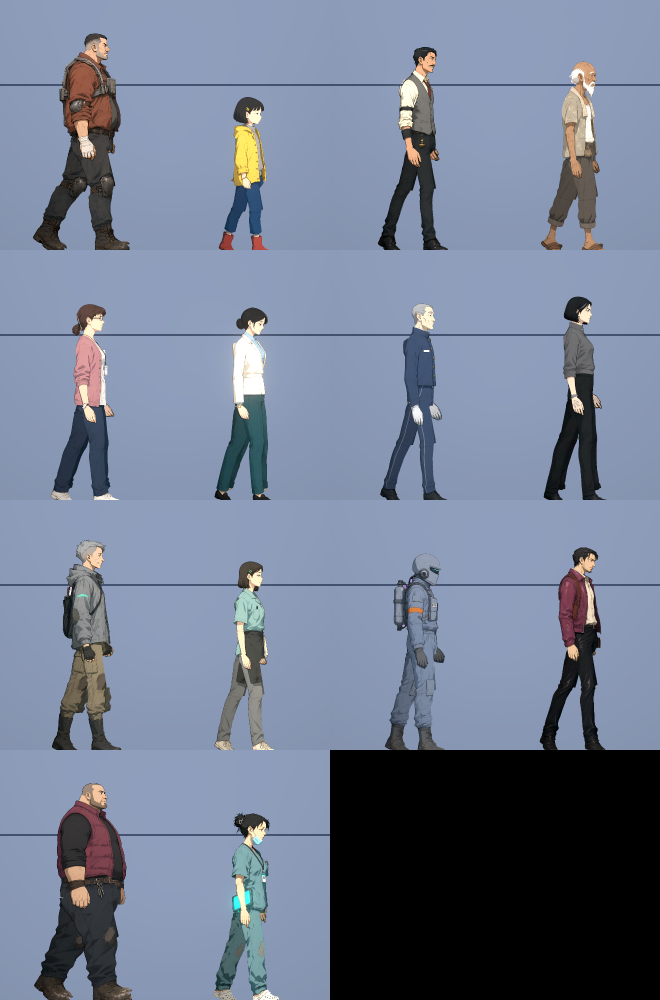

分支 `feature/character-art`。

---

# Commit-4

## 內文

第二章 S08 的市集週年演說使用沈望的專屬造型。同一份透明原圖用於公告屏及對話框，讓玩家在靠近時就能辨認銀灰短髮與炭色外套。公告屏保留原有框架、標記、掃描效果與互動鍵。原演說及氣象欄可照常讀完、重開或跳過。

完整身體、分件、可操作動作與後續章節的記憶版本仍在本票的後續批次。

### 測試結果

| 項目 | 結果 |
|---|---|
| 正式 Godot 回歸 | 88 組、101,281 項通過，0 新失敗、0 已知失敗 |
| 原生 Forward+ 繁中、日文、英文 | 各 16 項，合計 48 項通過 |
| 透明來源與公告屏重建 | 頭像、色彩、發光與法線皆可由保留的來源重建 |
| 原始劇本資料比較 | 191 個場景、10 組任務資料維持等值，講者沈望使用專屬頭像 |

[實機畫面、來源及驗證紀錄](attachments/NE-242-shen-broadcast-2026-11-19/ROOT_REVIEW.md)

### 截圖

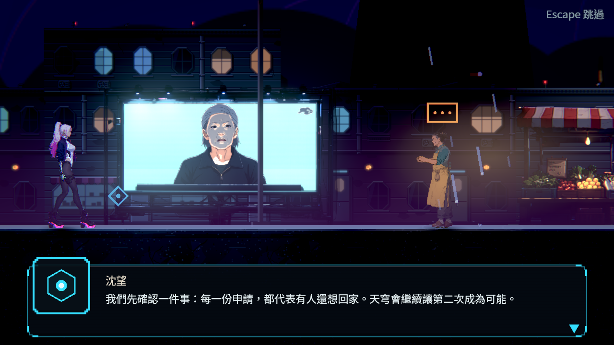

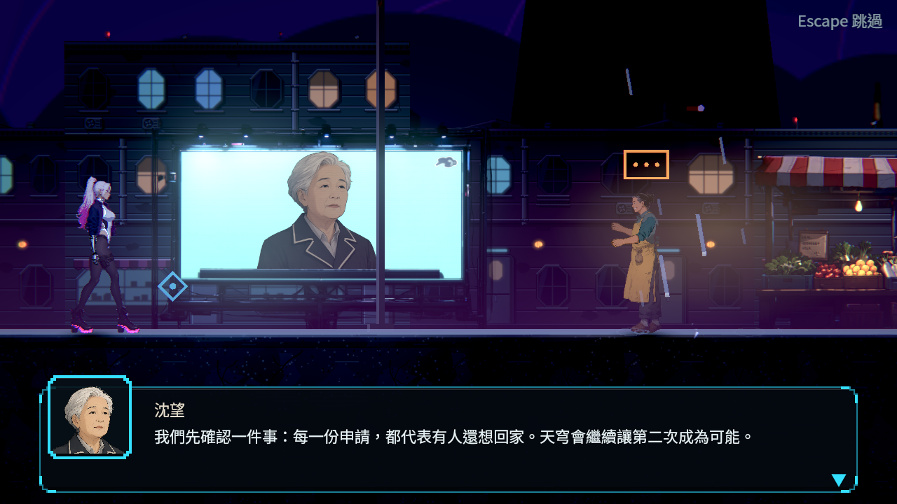

# Commit-5（阿勇的鐵棍貼圖）

## 內文

阿勇持有原創的磨損鐵棍，帶包帶握柄、護箍和鋼材亮邊。蓄力時仍會在棍頭亮起預兆，打斷鎖扣後棄棍。欠缺貼圖時保留線段，並在日誌指出缺失的位置。

### 測試結果

| 項目 | 結果 |
|---|---|
| 受影響的測試 | 8 套、3,384 項、0 新失敗、0 已知失敗 |
| 二樓帳房真正蓄力 | 左右各三格，握點隨手部移動，棍頭預兆清楚 |
| 握點、棄棍與缺圖 | 三版六組位置與狀態同值，三次打中鎖扣後棄棍，缺圖 3 張全畫面與原版相同 |
| 貼圖重建 | 96×20 透明，正式圖可逐像素重建 |

[原生原圖與完整回歸](attachments/NE-242-yong-baton-2026-11-19/README.md)

### 截圖

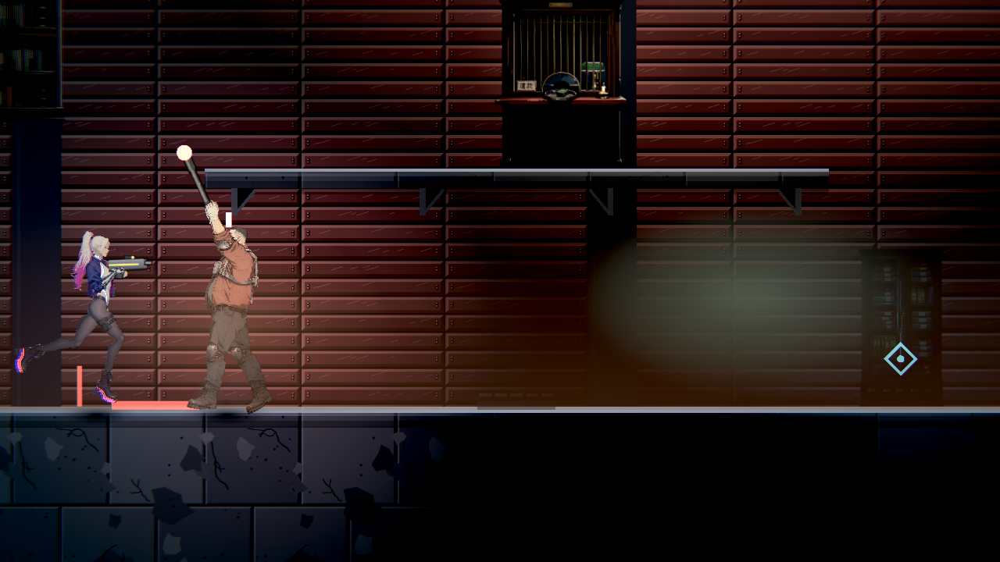

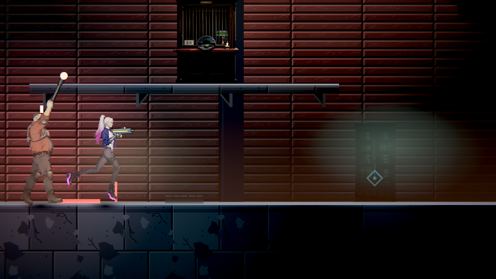

# Commit-6（守門人的外接工作架）

## 內文

門禁大廳掛載獨立的工作架貼圖。盾板、通訊器和掃描臂依工作架朝向翻轉，盾板開裂、通訊器損壞與停機插銷都有清楚的外觀。守門人停機後沿用 [ST-21 已交付的扶坐與櫃檯座位](../ST/images/ST-21-gatekeeper-stool-before-after.png)。

### 測試結果

| 項目 | 結果 |
|---|---|
| 受影響的測試 | 8 套、3,386 項、0 新失敗、0 已知失敗 |
| 門禁大廳 | 七個狀態的部件位置、開關、首領狀態與原版一致，左右低掃時臂鎖可見 |
| 設定異常 | 貼圖遺失、尺寸錯誤、型別錯誤均回到線稿，守門人 21 張原圖與基準一致，阿勇錯型別的六個狀態也一致 |
| 貼圖重建 | 256×272 透明圖，七個區塊，與繪圖來源逐像素一致 |

[原生畫面與回歸](attachments/NE-242-janus-frame-2026-11-19/README.md)

### 截圖

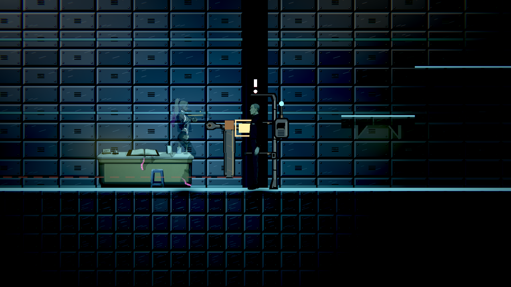

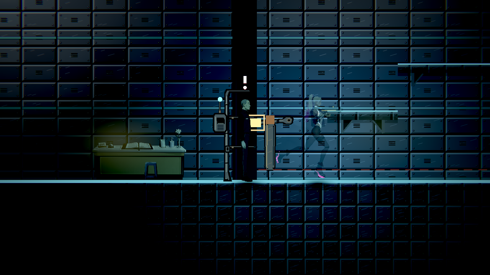

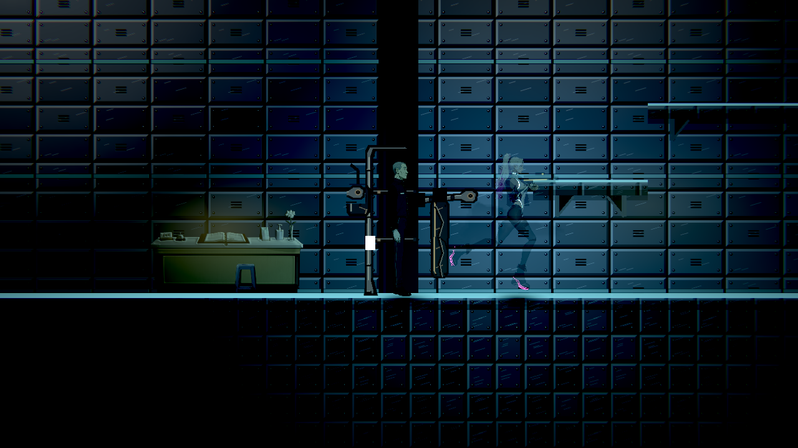

# Commit-7（小薇的座椅與黃傘）

## 內文

小薇坐在二樓帳房的玻璃隔間，合攏的黃色兒童傘靠著腳踏。從兩側接近會自然轉向，本來的交談和提示仍可使用。阿勇制伏後，小薇離開，場內留下空椅。戰後持傘演出與扶椅背動作待交付。

### 測試結果

| 項目 | 結果 |
|---|---|
| 受影響的測試 | 55 套、64,383 項、0 新失敗、0 已知失敗 |
| 實際帳房 | 左右朝向坐姿、原對話、離開後空椅與重進關卡皆通過 |
| 原圖重建 | 兩張 128×112 透明圖與兩張法線圖可逐像素重建 |

[原圖、重進關卡與回歸紀錄](attachments/NE-242-xiaowei-umbrella-2026-11-19/README.md)

### 截圖

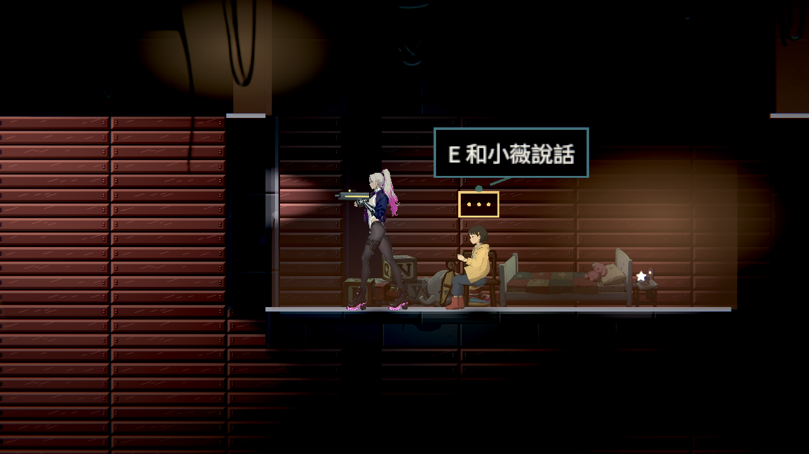

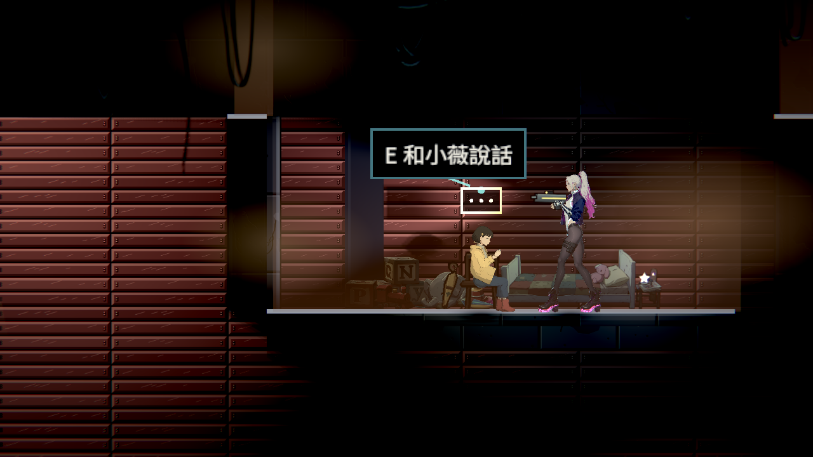

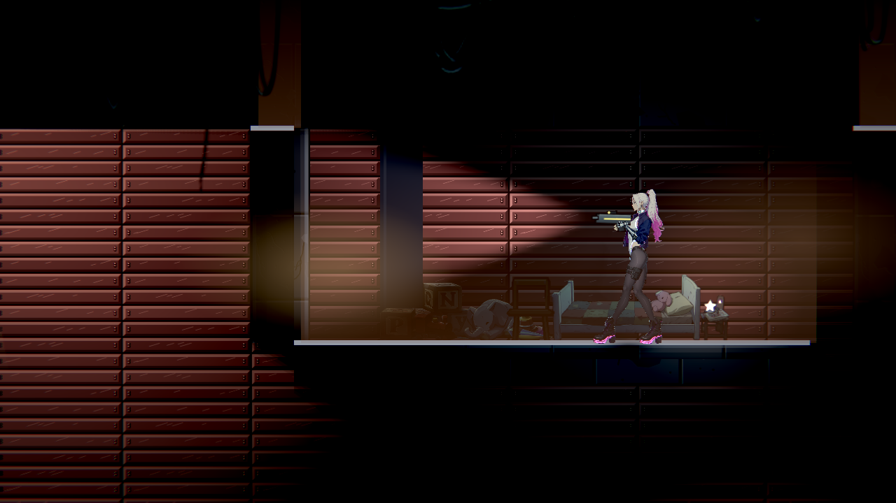

# Commit-8（葉的透明傘）

## 內文

辦公接待廊的透明傘掛在桌沿。公文取件的前一幕桌邊仍是空的，葉提到掛傘時能看見透明傘、傘骨與握柄，後續兩個交易鏡頭也維持位置。手背字樣的近拍仍待交付。

### 測試結果

| 項目 | 結果 |
|---|---|
| 受影響的測試 | 33 套、51,947 項、0 新失敗、0 已知失敗 |
| 正式過場 | C18 像素無變化，C19 與兩張 C20 畫面的變化都落在桌邊傘的位置 |
| 劇本 | 三語台詞、選項、旗標與結果相同 |
| 貼圖重建 | 80×164 透明圖，可逐像素重建 |

[遊戲原圖與完整回歸](attachments/NE-242-ye-clear-umbrella-2026-11-19/README.md)

### 截圖

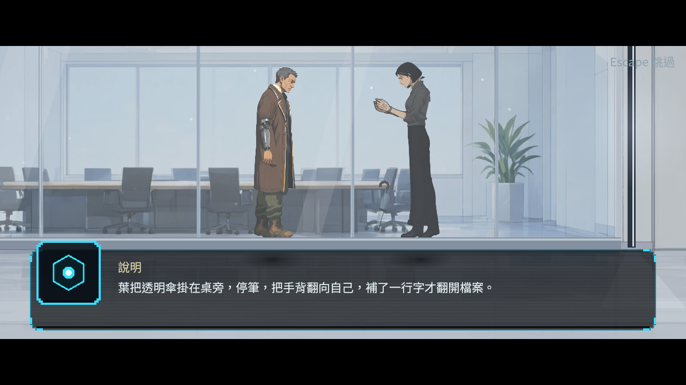

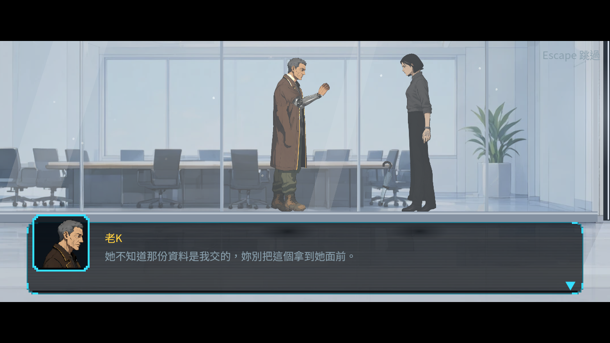

# Commit-9（葉的手背近拍）

## 內文

選擇「看清葉手背上那一行」才會切入近拍。葉的原袖口、腕帶與手背字樣可辨識，字幕依劇本語言顯示。知道錄音與尚未播放錄音的玩家都能看清這行字，原有分支和結果照常。

### 測試結果

| 項目 | 結果 |
|---|---|
| 受影響的測試 | 33 套、51,954 項、0 新失敗、0 已知失敗 |
| 正式過場 | 兩分支各有繁中、日文及英文原圖，近拍字樣區一致 |
| 實際選項獎勵 | 首次閱讀均增加 20 信用點、存旗標，重讀無法再次領取 |
| 圖檔重建 | 900×306 透明圖，可逐像素重建 |

[三語原圖與完整回歸](attachments/NE-242-ye-handwriting-2026-11-19/README.md)

### 截圖

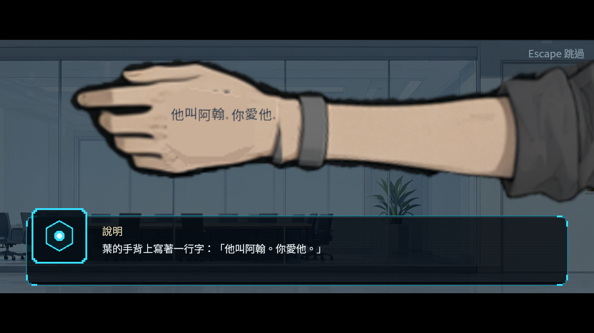

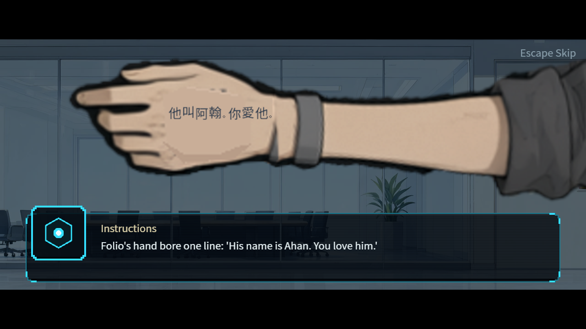

---

# Commit-10（榕伯照看涼茶攤）

## 內文

公眾攤道的榕伯原本朝右攪動，茶桶在左後方。把原茶桶和支架放到榕伯手邊，蒸汽從桶蓋冒出。玩家走近時榕伯收手、轉向玩家；從兩側都能交談，玩家離開後他繼續照看茶桶。初訪與重訪沿用原台詞。

### 測試結果

| 項目 | 結果 |
|---|---|
| 公眾攤道實機 | 同一份正常存檔、RX 9070 XT、Vulkan Forward+。確認從兩側靠近、離開、初訪與重訪 |
| 手與桶蓋 | 40 個行動取樣中，修正前手離蒸汽噴口的水平最大差 41.44 世界像素，修正後 2.67。垂直最大差從 14.27 降為 2.72，支架底與地面同高 |
| 回歸 | 修正前重現桶蓋落點、走近停手與離開復工 3 項失敗。受影響測試 61 組、64,978 項，0 新／已知失敗、0 腳本錯誤，538 秒 |

[前後原圖、量測紀錄與實機存檔](attachments/NE-242-banyan-tea-2026-11-19/evidence.zip)

### 截圖

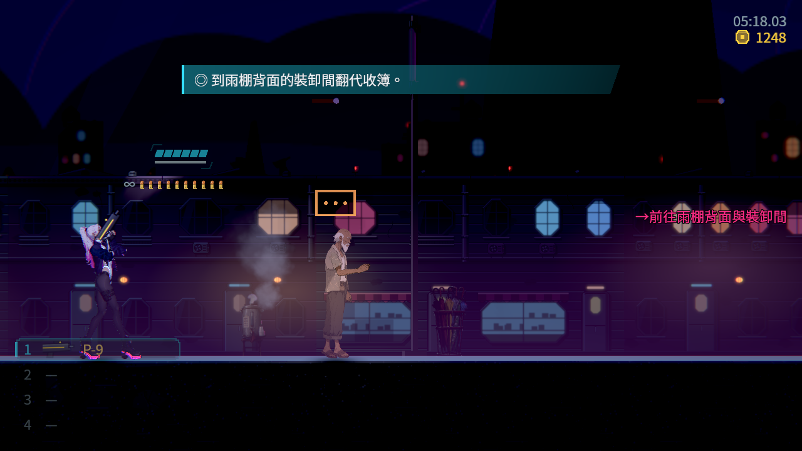
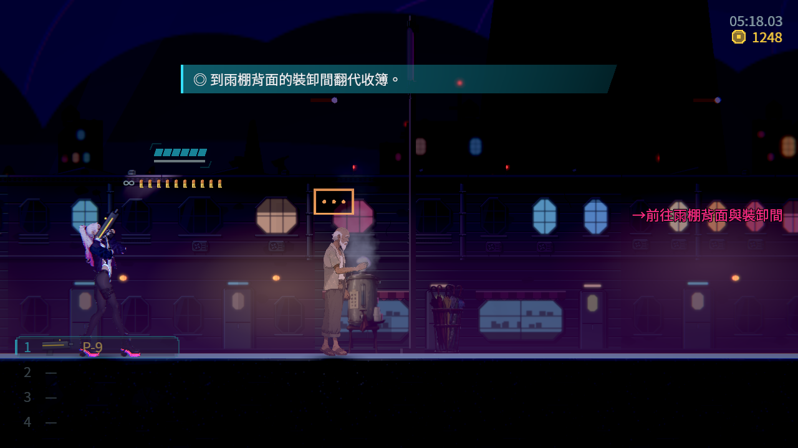

---

# Commit-11（晨窗用紙尺量窗臺）

## 內文

凜在晨窗蹲低，沿窗臺上的紙尺量兩個位置，再回到林小姐邀坐的畫面。紙尺留在窗臺。完整流程保留原本的三句、試坐與起身。量完從原入口再互動會播放簡短回訪。

### 測試結果

| 項目 | 結果 |
|---|---|
| 原生 Forward+、RX 9070 XT | 1280×720 同一份實際存檔。兩個指尖接觸點的誤差都小於 0.01 舞台像素，原站姿曾超出臂長，改用蹲姿後完成接觸。 |
| 完整、跳過與回訪 | 原有試坐及起身正常，量到第二點按 Escape 仍記下晨窗，兩路回訪維持 2,046 點，也都能稍後再選提案。 |
| 受影響測試 | 33 組、52,033 項，0 新／已知失敗、0 腳本錯誤，537 秒 |

[原圖、實機路線、骨架校準與測試紀錄](attachments/NE-242-morning-ruler-2026-11-19/evidence.zip)

### 截圖

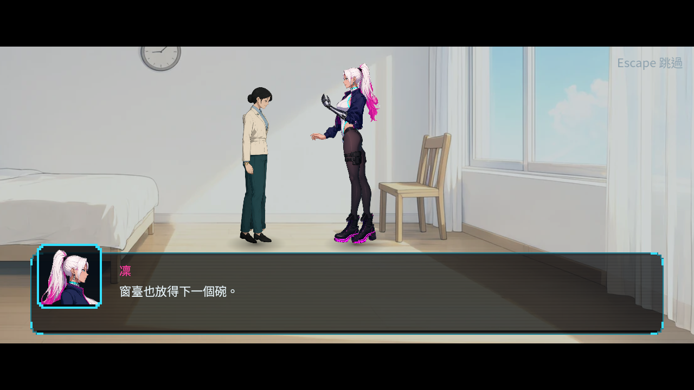
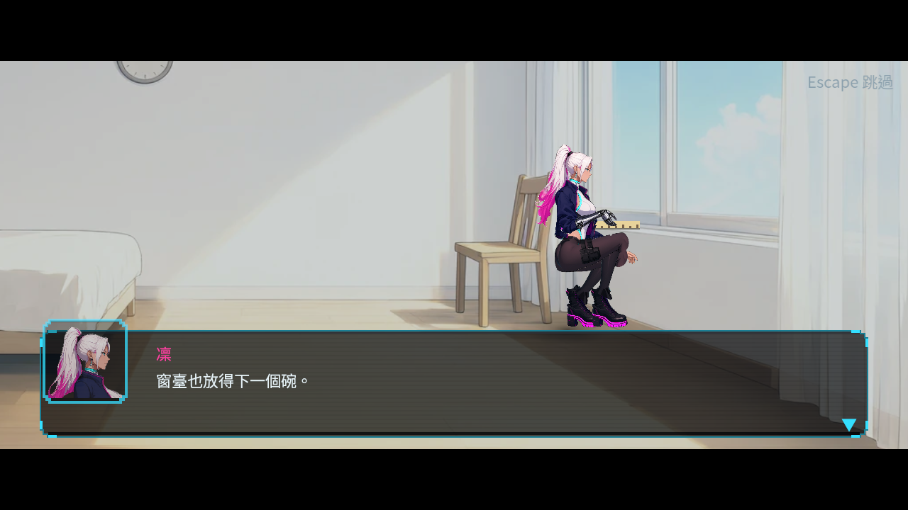
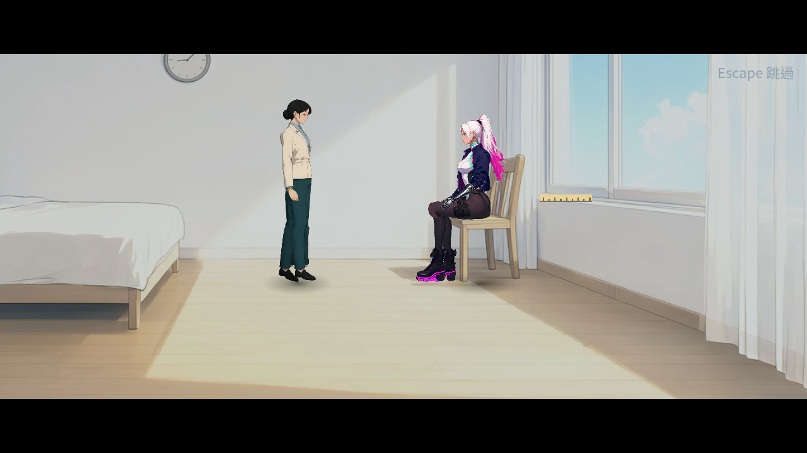

---

# Commit-12（診所櫃檯交付核閱單）

## 內文

芷姐沿櫃檯內側走近，把核閱單遞給凜。凜接過後，芷姐交代公開報表、輪班表與追蹤名冊的位置。櫃檯前緣按左右位置遮住芷姐的腰部，雙手和單據留在檯面上方。沿用原核閱號 Q17、索引門檻和後續核對。

### 測試結果

| 項目 | 結果 |
|---|---|
| 原生 Forward+、RX 9070 XT | 1280×720，同一份真實存檔。芷姐伸手、雙方交接、凜收單，各自握點的偏差小於 0.01 舞台像素 |
| 完整看完及按 Escape | 都只在過場結束時取得 1 張核閱單，費用 0。回訪後數量和餘額相同。完成三份資料仍取得 180 信用點與夾層通行文件 |
| 受影響測試 | 33 組、52,037 項，0 新／已知失敗、0 腳本錯誤，545 秒 |

[原圖、實機路線、骨架校準與測試紀錄](attachments/NE-242-clinic-slip-2026-11-19/evidence.zip)

### 截圖

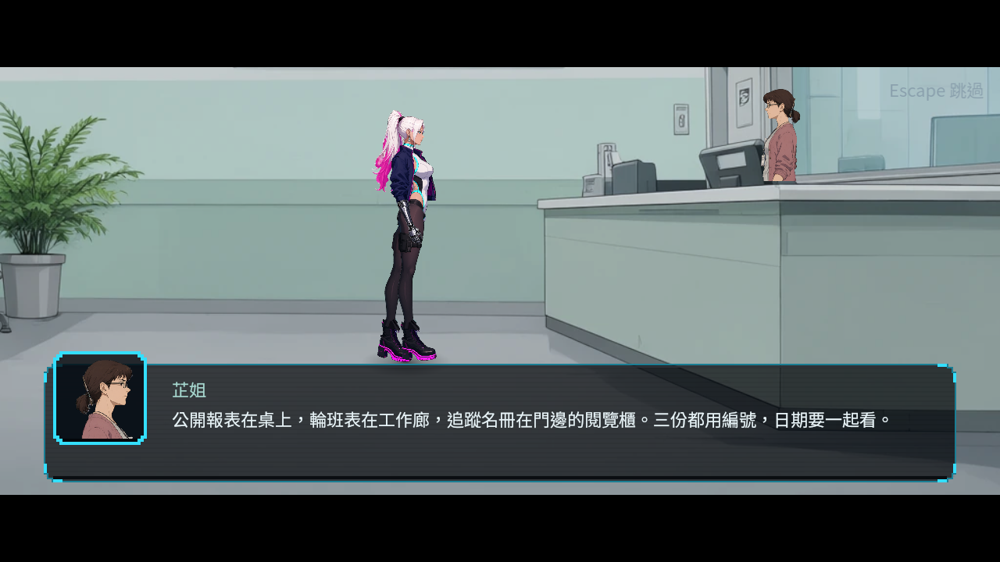

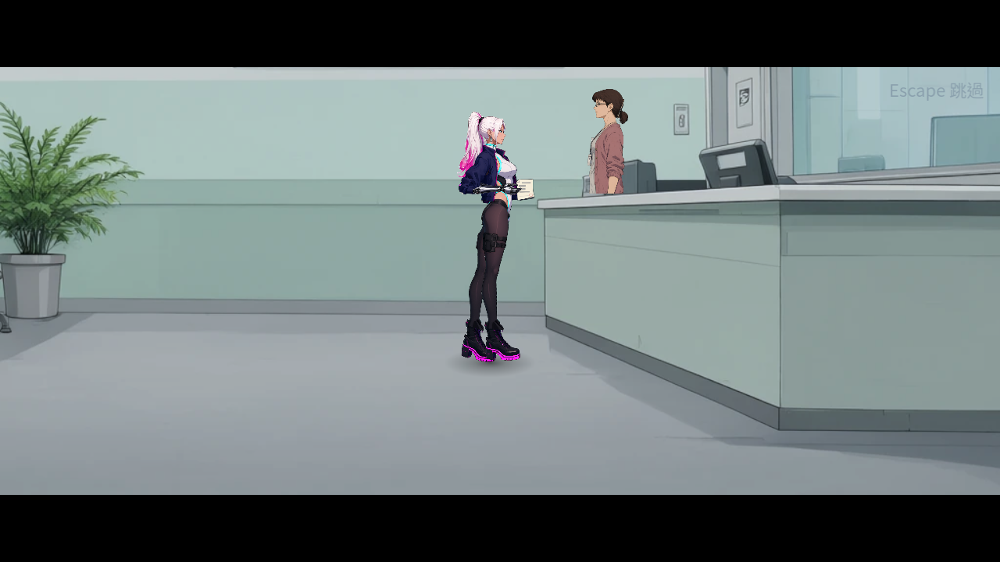

---

# Commit-13（晴岸接待桌蓋收件章）

## 內文

玩家選擇投遞異議後，林小姐拿起印章，在異議回執上蓋收件印，再把印章放回桌上。保留原本的五句對話、看房卡與接續的晨窗。選「先不投遞」時，接待桌照常等待，餘額與看房進度都相同。第一輪回歸發現接待桌比關卡尺寸大 53%，修正後按原尺寸擺放，重新對準印章與紙面。

### 測試結果

| 項目 | 結果 |
|---|---|
| 原生 Forward+、RX 9070 XT | 1280×720，由同一真實看房前存檔測試。握點與印章接觸紙面的誤差都小於 0.01 舞台像素，印章回到原放置點 |
| 完整投遞、略過與稍後 | 完整或按 Escape 都保留原看房卡、費用 0。完整路線接著走到晨窗完成測量。選稍後時不發卡、不蓋章 |
| 受影響測試 | 33 組、52,051 項，0 新／已知失敗、0 腳本錯誤，546 秒 |

[原圖、接觸座標、三條實機路線與測試紀錄](attachments/NE-242-showroom-receipt-stamp-2026-11-19/evidence.zip)

### 截圖

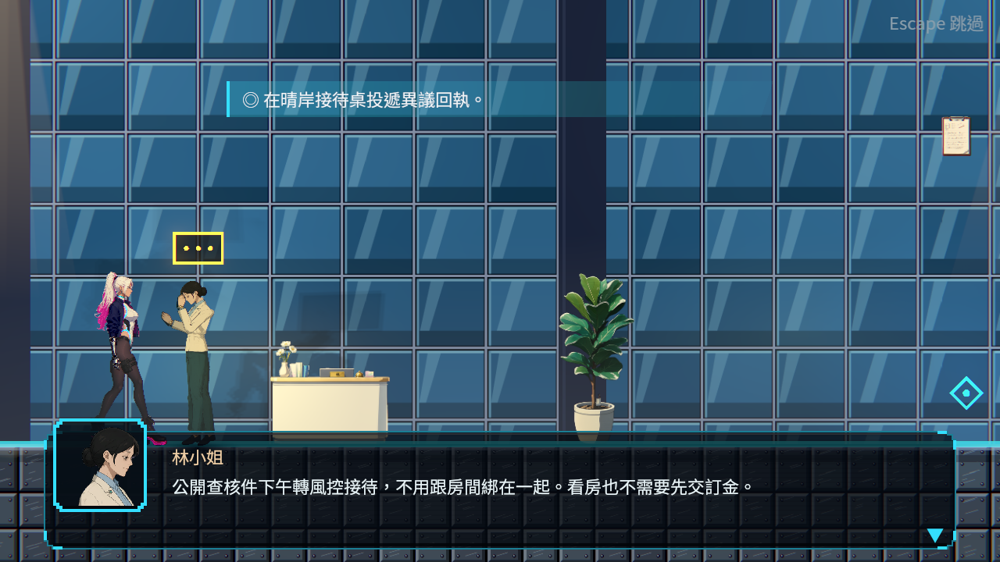
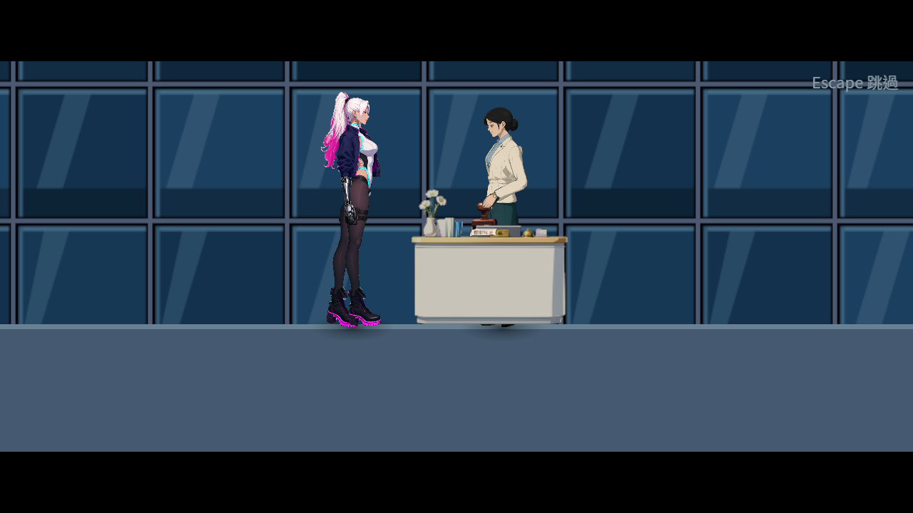
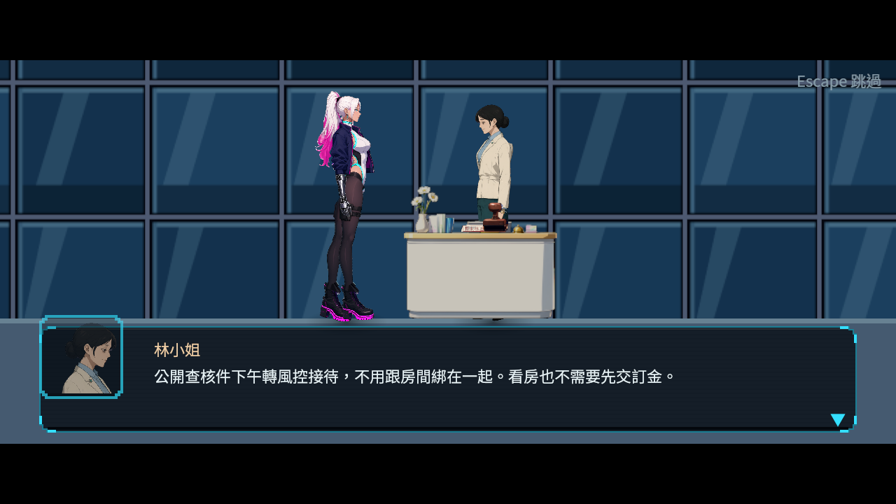
