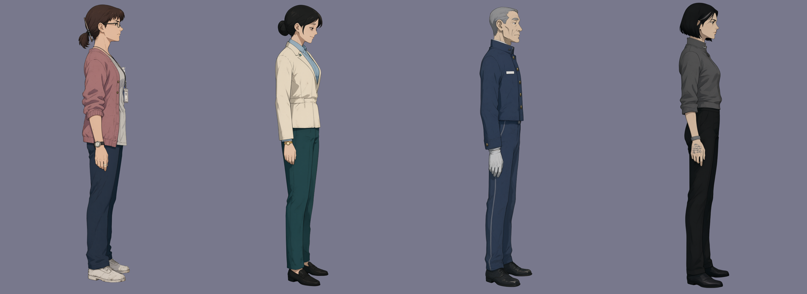
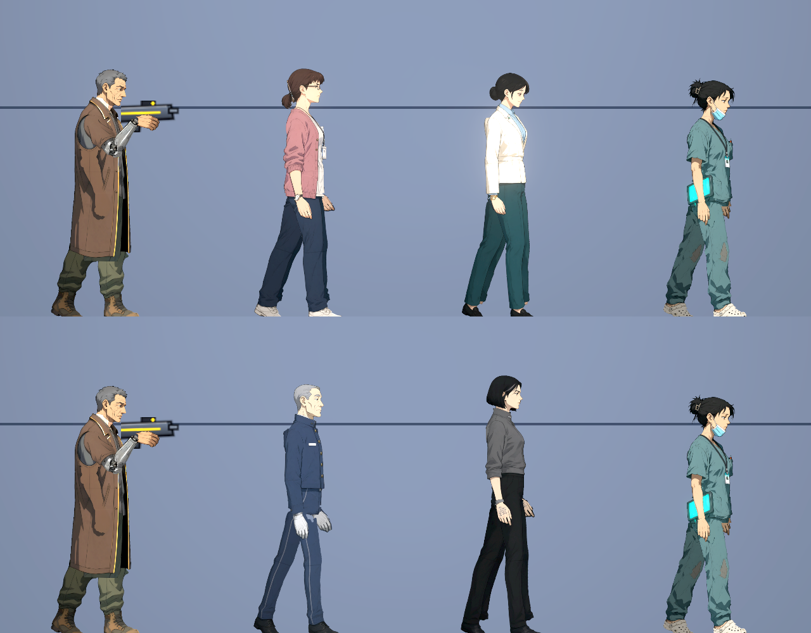
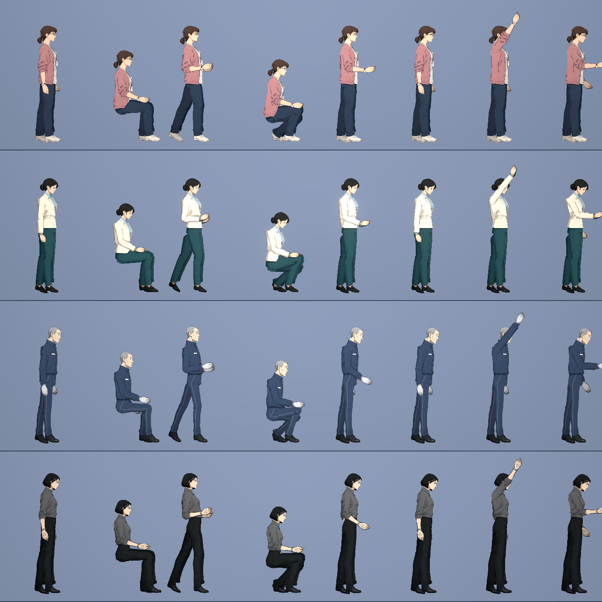
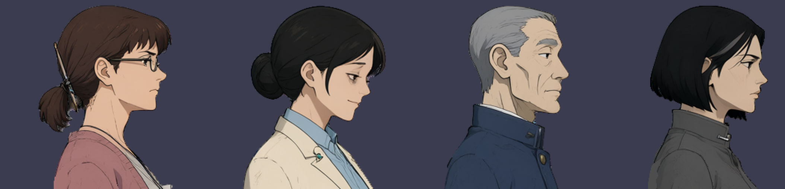
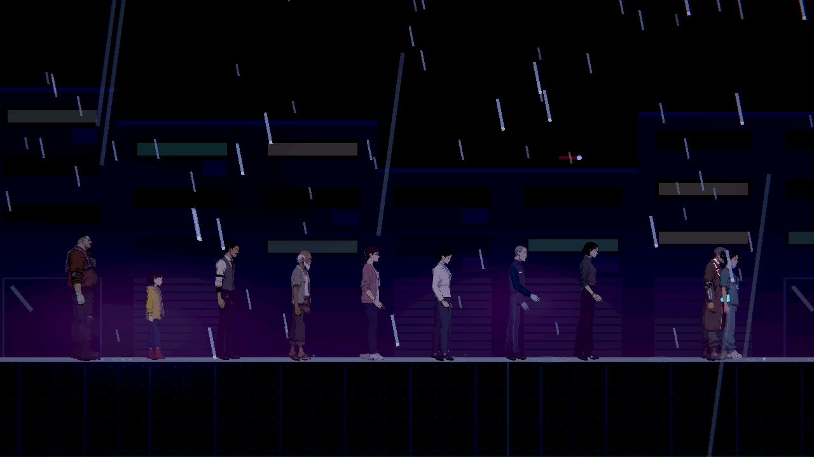
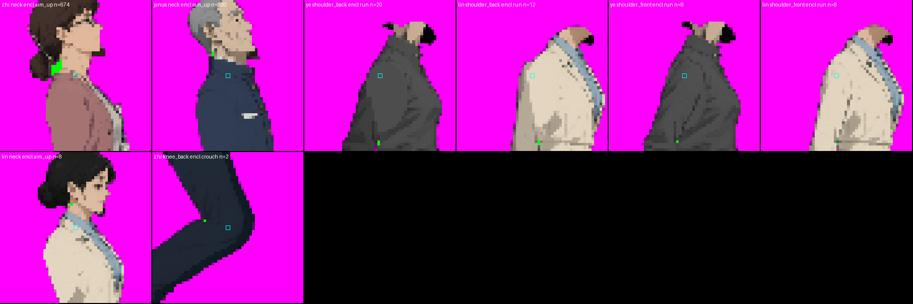

# [NE-242] 補畫後續章節專屬角色素材

> 狀態：進行中

## 內文

### 需求

後續章節已定稿的可見角色需要可辨識的專屬立繪、頭像、分件与必要演出動作，按章節優先序分批交付。第二、三章優先，之後按排程製作；第一章缺口維持由 NE-218 處理。身份、台詞、任務與出場依故事定稿，不由素材製作改寫。

完整清單、優先序與場景邊界見 [後續章節角色素材排程](../../design/12-cast-redraw/FUTURE_CAST_ART.md)。

### 來源

2026-10-10，依 NE-218 的後續角色清單／另開票要求，及使用者指示按具體需求製作、不一次擴大到全部後續章節，核對最新 main 的角色設定與第二、三章劇本整理。

### 2026-10-11 使用者補充：站姿、多一隻手、畫風
使用者指出角色站著時過度挺胸、有些看起來像有兩隻手、新角色的畫風與遊戲差很多且「AI 感太重」；並要求確實檢查骨架拼接後的破圖、沒切好的地方與關節稜角。這四項列為驗收條件，之後每個角色都要過。

### 驗收條件
- [ ] 站姿不挺胸：站著不動時脊椎直立，胸口不前挺、腰不後凹、臀不後翹；耳、肩、髖、踝大致在一條垂直線上。附站姿近拍。
- [ ] 不會看起來像多一隻手：站、走、坐、蹲、持武器與空手時，同一側看不到兩隻手臂並排；底層圖上沒有殘留的手（由建置時的檢查擋下）；衣物脫落後也一樣。
- [ ] 畫風與既有角色一致、符合世界觀：和老 K、護理師並排看是同一套畫風（低彩度、粗黑描邊、兩階硬邊陰影、有磨損與皺褶，沒有噴槍漸層與發亮的塑膠感）；服裝是港區會有的實用衣物，霓虹最多一小處。附並排圖。
- [ ] 拼接後沒有破圖、沒切好的地方與關節稜角：站、坐、蹲、走的近拍逐一看過；逐格接點稽核的每一類失敗都放大看過並歸類，數字記在票上。

- [ ] 第二章阿勇、小薇、利息、榕伯有專屬來源、頭像、分件與適用動作；小薇保持非戰鬥，阿勇呈現兩種存活結果
- [ ] 第三章芷姐、林小姐、JANUS、葉有專屬來源、頭像與場景所需動作；JANUS 本人與外部裝置可分別呈現，葉的手背及透明傘可辨識
- [ ] 第四章棠與裁有專屬素材及坐姿／頭目動作
- [ ] 第五至八章必安、石、燕、麥、蘇、棘、棘母、桐有專屬素材與已定稿場景所需動作
- [ ] 第七至九章沈望、汐有專屬素材，記憶版本依實際場景需求分別交付
- [ ] 每批保留可重跑來源、透明與解析度對照，分件無錯誤所有權、額外肢體或不完整底層
- [ ] 每批全部接點與適用動作於雙朝向、遊戲／過場尺度及受損狀態通過逐格與動畫稽核，再通過實際關卡／Forward+ 檢查並留圖
- [ ] 每批與故事／配置 Session 核對角色掛載及動作介面，不改寫台詞、任務與出場配置

### 測試流程

1. 依優先序核對原圖、頭像、透明背景與每個零件的單件所有權。
2. 逐角色檢查全部適用姿勢與狀態轉換、左右面向、全部接點與裝備／家具掛點。
3. 執行受影響測試與動畫稽核；在 Forward+ 遊戲及過場實際檢查畫質、操作與接合，存檔可重現結果。

---

# 跟其他票的關係

- Blocks：無
- Blocked by：無
- Related：NE-218、NE-89、NE-97、ST-20

---

---

# Commit-1

## 內文

第二章的阿勇、小薇、利息、榕伯在設定文件裡只有年齡、身份與少數道具，沒有長相與衣著；遊戲裡也還沒有這四個人的任何素材。

這次替四個人各做了一套：來源立繪、頭像、分件與骨架、睜眼／半閉／閉眼三種眼睛狀態、各自的動作數值。全部用「直立站姿、近側手垂在大腿旁」的來源畫法，一次一張，逐張看過才往下做。

- **阿勇**（`yong`，45 歲）：碼頭搬運工出身的厚實體型，鏽褐色工作夾克，外面套一副二手的工業外骨骼，胸前一個電池匣，纏著繃帶的手。
- **小薇**（`xiaowei`，12 歲）：齊耳短髮、黃色髮夾，黃色短雨衣、灰毛衣、深藍長褲、紅雨靴。第一張雨衣畫到大腿，坐下時下襬會跟著大腿橫出去，改成只到腰的短外套重畫。
- **利息**（`vig`，約 35 歲）：瘦長，油頭薄鬍，灰背心、捲袖襯衫加袖箍、鬆開的暗紅領帶，腰間掛一顆印章。
- **榕伯**（`banyan`，72 歲）：瘦而結實的老人，白鬚、幾乎全禿，葉紋短袖襯衫敞開套在汗衫外，捲起的褲管與塑膠拖鞋，脖子上一條毛巾。

長相與衣著是這次依世界觀補的設計，已記在 [後續章節角色素材排程](../../design/12-cast-redraw/FUTURE_CAST_ART.md)，故事那邊有不同想法可以再改。

還沒做的：第二章新劇本還沒有產生故事與關卡資料，這四個人目前掛不上任何場景；阿勇的鐵棍、頭目招式、兩種「打倒後存活」的演出與第二階段外殼瑕疵，小薇抱黃傘與扶椅背，利息蓋章，榕伯操作茶攤，都還沒有做。第二章這一條驗收不勾。

過程中修掉兩個會影響之後每個角色的問題（第一章的鷺、阿梨、清掃兵與兩種收帳人也用同樣的修正重建過，外觀沒有其他改變）：
- 袖窿的補色會把透明處的底色抹進衣服，榕伯背後因此出現一塊藍灰色。改成不取透明處的顏色，並且用周圍布料的單一顏色平塗（賽璐璐畫風本來就是平塗）。阿梨頭像肩膀上原本的一抹藍也一起消失。
- 抬頭時頸後會多一點封閉的透明區。放大後確認大多是「髮尾與衣領之間本來就有的空隙被圍起來」，不是零件裂開；另外在頭後面補了一塊藏起來的軀幹重疊，榕伯少了 132 個。

### 測試結果

| 項目 | 結果 |
|---|---|
| 受影響範圍測試 | 25,570 項檢查，0 新失敗、0 已知失敗 |
| 逐格接點稽核（四人，215,040 個取樣） | 真正的缺口：阿勇 258、小薇 276、利息 193、榕伯 370，幾乎都是抬頭時頸後髮尾與衣領之間的空隙；其餘接點合計 44 |
| 底層圖檢查 | 四張「拿掉近側手臂」的底層圖都通過建置時的殘留檢查 |
| 原生畫面 | Godot 4.7.2、RTX 4070 SUPER、Forward+；NPC 八個姿勢與近拍無錯誤訊息 |

固定驗收四項（本批四人）：站姿不挺胸——通過；不像多一隻手——站、坐、走、蹲、揮手逐一看過，通過；畫風一致——和老 K、護理師並排，通過（小薇的黃色比其他人鮮豔，是她的識別色）；拼接——坐與蹲沒有稜角與破圖，頸後的數字如上，尚未歸零。這四項是整張票共用的，其他章節還沒做，先不勾。

### 截圖

已併入 main：[a0254500](https://github.com/deadline314/Nest-Egg/commit/a0254500)。來源、提示詞與種子在各自的 `art_src/characters/<id>/01_design/`。

---

# Commit-2

## 內文

第三章的芷姐、林小姐、守門人、葉和第二章一樣，設定裡只有年齡、身份與道具，沒有長相與衣著，遊戲裡也沒有素材。

這次替四個人各做了來源立繪、頭像、分件與骨架、三種眼睛狀態與各自的動作數值，做法和第二章相同。

- **芷姐**（`zhi`，36 歲）：低馬尾上插一支原子筆、眼鏡，褪色的玫瑰色針織外套、灰色護士上衣、深藍長褲、磨白的護士鞋、掛繩識別證。和轉運站護理師（青綠色手術服）分得開。
- **林小姐**（`lin`，30 歲）：低髮髻、側分瀏海，肩線略大的米白制服短外套別一枚青綠色徽章、淺藍襯衫、深青綠長褲、磨平鞋跟的黑色低跟鞋。
- **守門人**（`janus`，約 60 歲）：削瘦、梳得整齊的灰髮、空而溫和的眼神，褪色的深藍門房制服（兩排黃銅釦、過大的立領、空白名牌）、側邊有條紋的長褲、發灰的白手套。這次只做他本人；盾架、掃描臂、通訊器與工作架是外部裝置，還沒做。
- **葉**（`ye`，41 歲）：一側有白髮的齊下巴短髮，深灰高領短上衣、黑長褲、平底鞋；近側袖子往上推，手背上有幾行深藍色的字跡。

外觀決定同樣記在 [後續章節角色素材排程](../../design/12-cast-redraw/FUTURE_CAST_ART.md)。

還沒做的：第三章還沒有故事與關卡資料，四個人掛不上場景；守門人的外部裝置、舉盾與掃描的頭目演出、解除後的坐姿；芷姐遞證與解開束帶；林小姐的紙尺、拉椅與蓋章；葉的透明傘、翻手看字與在手背寫字。葉手背上的字在遊戲比例下只是幾行筆跡，內容讀不出來，需要讀得到字的鏡頭要另外做特寫。第三章這一條驗收不勾。

這一批遇到、並在工具裡修掉的問題：
- **兩腿同色又幾乎重疊時，遠側腿切不出來。** 芷姐、林小姐、葉的遠側小腿被近側褲管擋住，只露出一隻鞋，原本「遠側小腿、腳踝、腳掌」三個提示點有兩個落在近側腿上，建置直接停下。新增一個選項，只用遠側鞋子當提示，遠側小腿留在近側腿的輪廓裡。
- **手旁邊的髖部被咬掉一塊。** 林小姐（手錶旁）與守門人（手指前方）的骨盆和大腿在手的位置有缺口，坐下與蹲下時會露出背景；守門人蹲下因此有 922 個接點失敗。把這兩個零件的補洞範圍加大後缺口補平，守門人髖部的失敗歸零。成因只查到「不是手臂遮罩、不是遠側腿遮罩」，還沒有找到是哪一步把那塊像素丟掉的，之後的角色要在第 4 關看骨盆與大腿的單件圖。

### 測試結果

| 項目 | 結果 |
|---|---|
| 受影響範圍測試 | 25,723 項檢查，0 新失敗、0 已知失敗 |
| 逐格接點稽核（四人，215,040 個取樣） | 真正的缺口：芷姐 676、守門人 230、林小姐 28、葉 28。芷姐與守門人的都在抬頭時的頸後（馬尾／後腦與衣領之間的空隙被圍起來）；林小姐與葉的在肩膀，各 1～2 個像素 |
| 場景 30 秒（原生 Forward+、小巷光影） | 第二、三章八個人加老 K 與護理師，30.0 秒、4,287 格，每人眨眼 7～11 次，無錯誤訊息；林小姐的米白外套與小薇的黃雨衣在實際光影下沒有過曝 |
| 底層圖檢查 | 四張底層圖都通過建置時的殘留檢查 |

固定驗收四項（本批四人）：站姿不挺胸——通過；不像多一隻手——站、坐、走、蹲、揮手逐一看過，通過；畫風一致——和老 K、護理師並排，通過；拼接——坐與蹲沒有稜角，髖部缺口已補，頸後的數字如上，尚未歸零。

### 截圖

分支 `feature/character-art`。來源、提示詞與種子在各自的 `art_src/characters/<id>/01_design/`。

---

# Commit-3

## 內文

第二、三章八個人走路時髖部前面缺一塊（使用者指出）。成因在分件工具，和第一章新角色是同一個問題，修法與過程記在 NE-218；八個人已用修好的工具全部重建，林小姐與守門人原本用來蓋住缺口的加大補洞也拿掉了。

本票其餘內容沒有變動。第四章以後的角色依使用者指示不在這一輪做。

### 測試結果

| 項目 | 結果 |
|---|---|
| 受影響範圍測試 | 6,061 項檢查，0 新失敗、0 已知失敗 |
| 逐格接點稽核（八人） | 真正的缺口：阿勇 260、小薇 274、利息 189、榕伯 370、芷姐 676、林小姐 28、守門人 230、葉 28；髖部為 0（小薇 8 個游離小點除外），其餘是抬頭時頸後的空隙 |

### 截圖

分支 `feature/character-art`。
