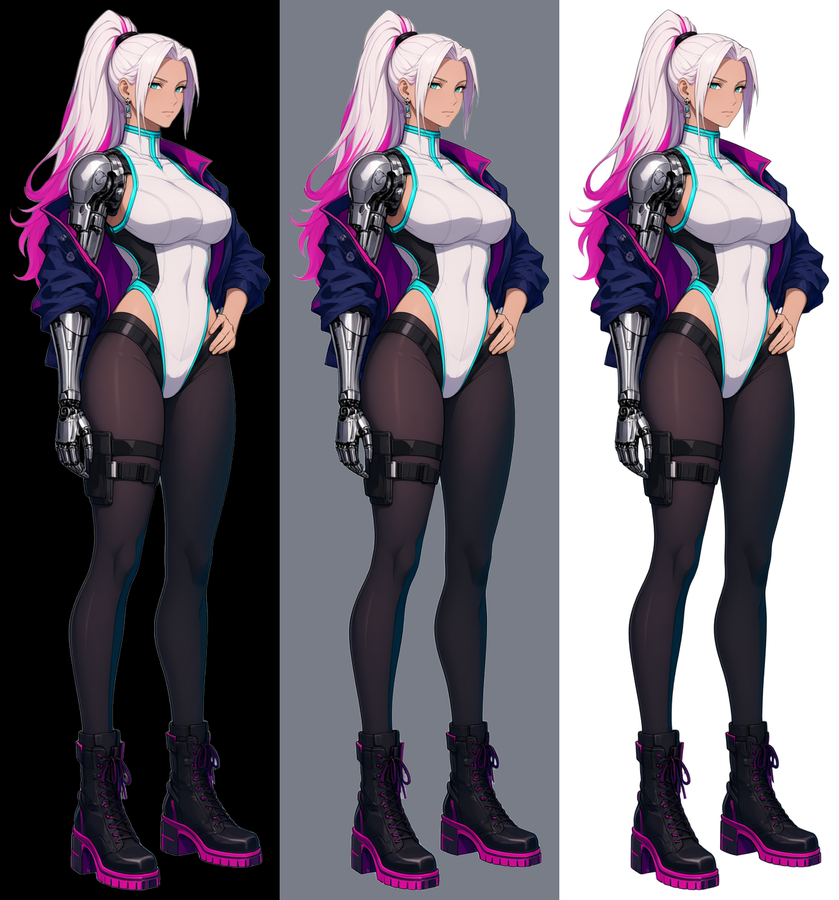

# [NE-243] 製作凜的中性背包立繪

> 狀態：進行中

## 內文

### 需求
製作適合背包旁展示的凜立繪，保留遊戲的角色身份與服裝，使用合理放鬆姿勢，讓角色陪伴清單閱讀。

### 來源
2026-10-10，使用者提供背包參考圖與屋頂遊戲截圖，要求中性角色立繪、一般畫面減噪、合理材質與陰影、移除普通戰鬥封路、修正高低差造成的背景鏤空，並保留目前文字避開角色的告示提示。

詳見[本輪設計與研究](../../design/20-campaign-experience/INVENTORY_WORLD_CLARITY.md)。

### 驗收條件
- [ ] 外觀與已確認的凜一致；姿勢適合選單，沒有瞄準、戰鬥弓步或不合理手勢。
- [ ] 手、頭、衣物與身體比例自然；展示框內完整且清楚，沒有裁切、透明殘片或過曝。
- [x] 透明來源、生成提示詞與種子可追溯；原有遊戲立繪與骨架保留。
- [ ] 在背包目標尺寸、放大文字與亮暗背景確認清晰；附原圖與真正遊戲畫面對照。

### 測試流程
1. 核對原有角色身份，逐區檢查新圖的手、臉、外套、輪廓與透明邊界。
2. 放入背包展示框，在三種視窗尺寸及文字放大設定保存原生畫面。

---

# 跟其他票的關係

- Blocks：NE-244
- Blocked by：無
- Related：NE-222、NE-227、NE-228

---

---

# Commit-1

## 內文

背包畫面旁邊沒有適合陪伴閱讀的凜立繪；現有的圖不是戰鬥用的側面骨架，就是只有頭的對話頭像。

現在有一張獨立的全身立繪：正面偏側的角度，重心平均放在兩腳、肩膀放鬆，機械手自然垂在身側，另一隻手輕放在腰上，沒有武器、沒有瞄準或弓步。髮色、連身衣、絲襪、槍套、靴子與外套都沿用已確認的樣子。來源是用已同意的定稿當身份參照、在本機以固定種子生成的；提示詞、種子與重建方式都留在來源資料夾，原本的定稿、遊戲骨架與對話頭像沒有動。

這張圖的外套滑落在機械手那一側的肩膀下，和定稿立繪一樣；遊戲內骨架的外套則是穿好的。兩者是否要一致，留給使用者決定。

還沒做的：放進背包展示框後在三種視窗尺寸與放大文字下的實機確認，要等 NE-244 的版面。

### 測試結果

| 項目 | 結果 |
|---|---|
| 透明邊界 | 468×1506，黑、灰、白底並排檢查沒有殘邊、霧或游離碎片 |
| 受影響範圍測試 | 1 組、561 項檢查，0 新失敗、0 已知失敗 |
| 生成紀錄 | 共生兩張：第一張是側面且機械手被畫成一般手臂，退回；第二張（種子 24302）採用 |

### 截圖

分支 `feature/character-art`。遊戲用的圖在 `art/portraits/rin_inventory.png`，來源在 `art_src/characters/rin_inventory/`。

