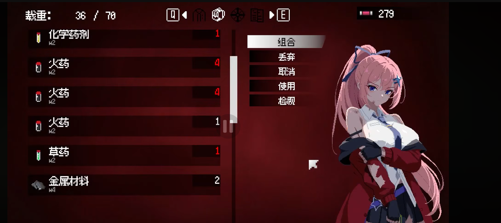
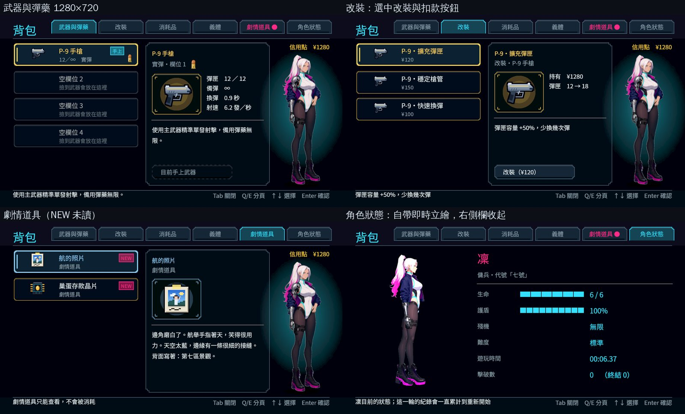
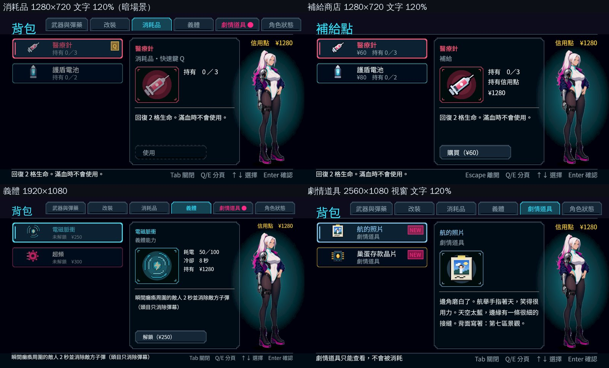
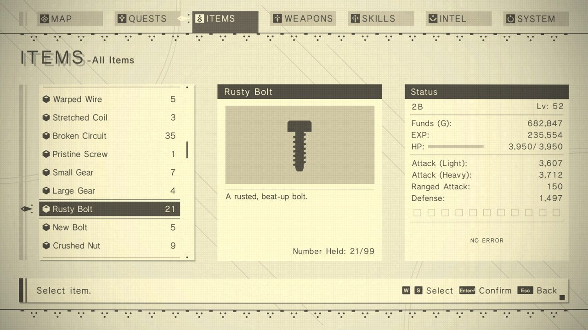
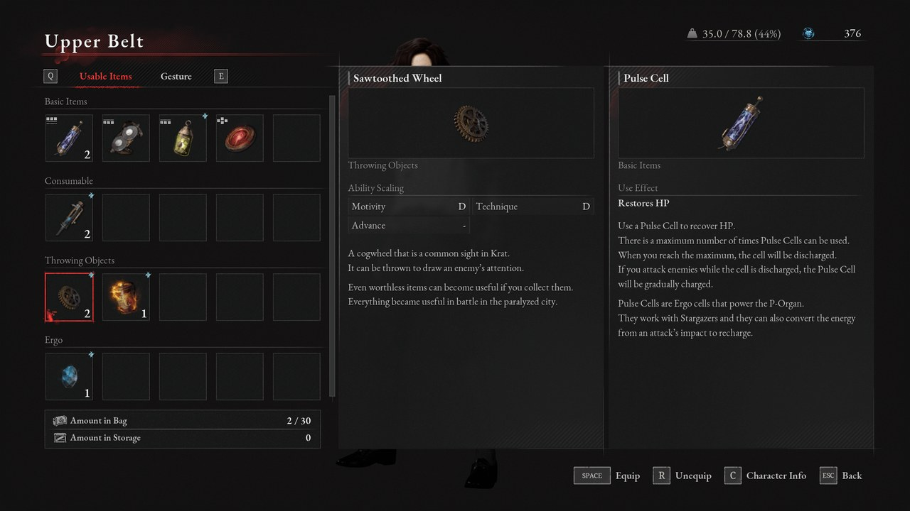
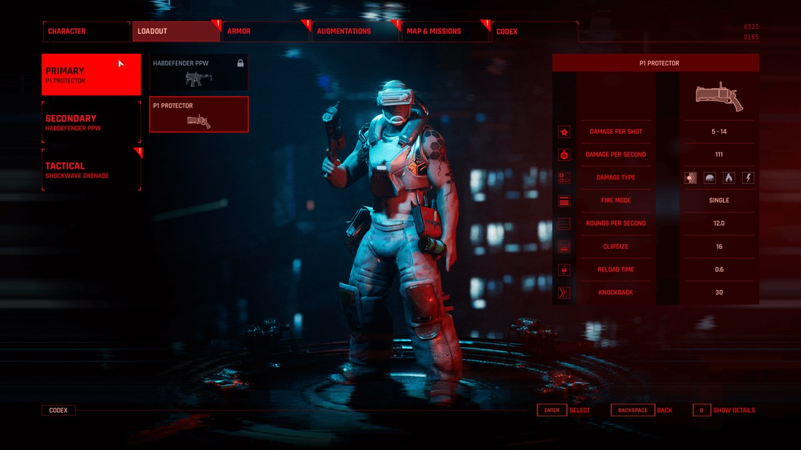
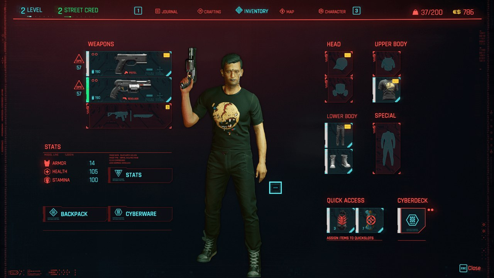
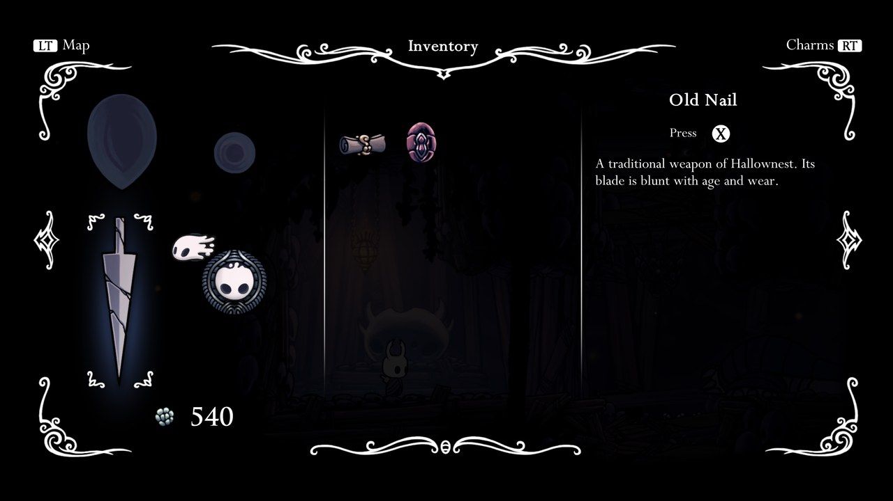
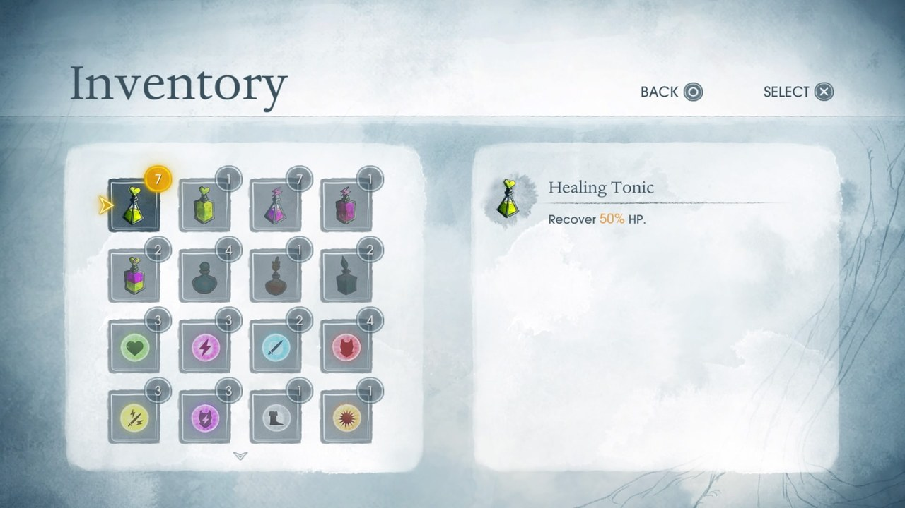
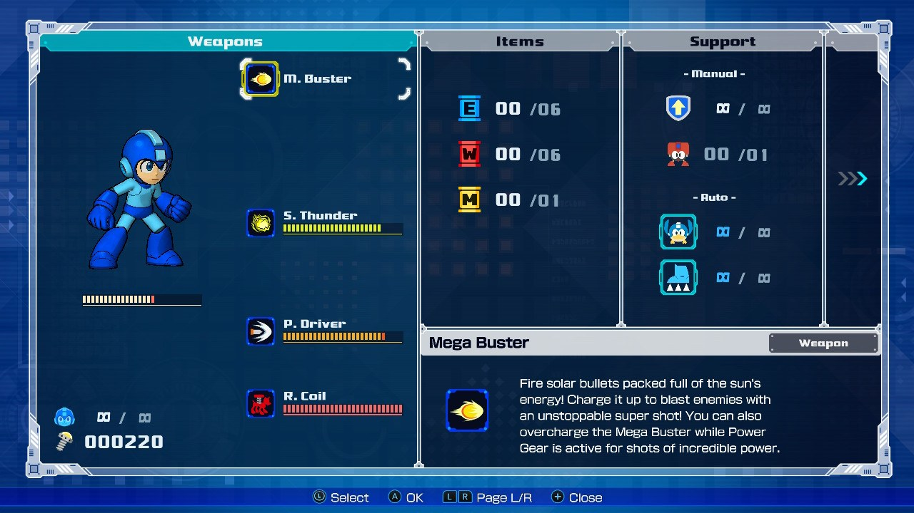

# [NE-244] 重排背包清單與側邊立繪

> 狀態：進行中

## 內文

### 需求
採用左側物品清單、右側角色立繪的版面重心，融合現有高清像素與賽博龐克配色；清楚呈現真實數量、貨幣、詳情和動作。

### 來源
2026-10-10，使用者提供背包參考圖與屋頂遊戲截圖，要求中性角色立繪、一般畫面減噪、合理材質與陰影、移除普通戰鬥封路、修正高低差造成的背景鏤空，並保留目前文字避開角色的告示提示。

詳見[本輪設計與研究](../../design/20-campaign-experience/INVENTORY_WORLD_CLARITY.md)。

參考來源圖：

### 驗收條件
- [x] 物品清單、選取狀態、詳情與立繪層次明確；不靠縮小正文或遮住按鈕硬塞內容。
- [x] 使用已驗收的中性凜立繪，角色圖不擋文字、焦點或操作。
- [ ] 鍵鼠與手把均可選物、切頁、確認與返回，改鍵後提示正確。
- [x] 裝備、改裝、消耗品、義體、故事道具已讀與商店交易維持正確；沒有虛構負重或合成資料。
- [x] 正常與放大文字、寬螢幕及720p均完整；開關背包後不累積多份角色大圖。

### 測試流程
1. 逐頁使用選取、確認、取消與切頁，核對實際數量、信用點和故事已讀。
2. 用鍵鼠與手把測共用背包及商店頁，保存三種尺寸原生畫面。

---

# 跟其他票的關係

- Blocks：NE-233
- Blocked by：NE-243
- Related：NE-227、NE-228、NE-229

---

# Commit-1

## 內文

背包是「左邊卡片清單、右邊一大塊詳情」，畫面上沒有角色；使用者要的是左側清單、右側凜的立繪陪著閱讀，並清楚看到真實的數量、信用點、詳情與動作。

先查業界實例：在 interfaceingame.com 看了 7 款不同公司作品的背包／裝備畫面原圖（NieR:Automata、Lies of P、The Ascent、Cyberpunk 2077、Hollow Knight、Child of Light、Mega Man 11），加上使用者給的 Leyla In Veil 參考圖。取用的是：詳情把名稱放在最上面一整行、下面才是圖與數值（NieR）；貨幣放在右側欄上方（Leyla、Lies of P、Cyberpunk）；立繪佔畫面大半高度並有背光（The Ascent）。不照抄三欄等寬、角色壓在文字後面、負重與合成欄。每個來源實際看到什麼、取什麼、不照抄什麼寫在[設計文件](../../design/20-campaign-experience/INVENTORY_WORLD_CLARITY.md)。

改動：畫面分成左側清單、中間較窄的詳情、右側一欄。詳情改成名稱一整行、下面圖示與數值、說明、動作按鈕，數值與說明會折行，正文字級不變。右側欄上方是真實的信用點（買東西、改裝時立刻更新），下面是 NE-243 的中性凜立繪，加一道柔和的冷青背光與腳下接觸影；立繪停在底部操作提示的上方，不放任何操作。角色狀態頁本來就有會動的凜，這一頁收起右側欄，畫面上不會同時出現兩個凜。補給商店沿用同一個版面。立繪只在背包開著時讀進來，關閉就放掉，開關幾次都只有一份。

驗收在 Forward+（雲端軟體 Vulkan）：亮的當舖與暗的碼頭倉庫，1280×720 與 1920×1080、文字 100% 與 120%，以及 2560×1080 的視窗（畫面維持 16:9、兩側黑邊，背包內容與 1080p 相同），每一頁與補給商店都做版面檢查：沒有文字超出畫面或被裁切、立繪沒有壓到任何文字或按鈕，全部 0 問題。自動檢查補上：狀態頁收起右側欄、清單頁顯示立繪與真實信用點、立繪不壓到文字與按鈕、關閉後放掉貼圖、開關三次仍只有一份；手把 Back 開背包、RB／LB 換頁、方向鍵選物、A 改裝扣款且右側信用點跟著更新、B 回到遊戲；把背包鍵改成 O 後底部提示立刻變成 O。

「鍵鼠與手把均可選物、切頁、確認與返回」這一項，合成手把的自動檢查都通過，但實體手把待本機原生驗收，所以先不勾；本票維持進行中。

### 測試結果

| 項目 | 結果 |
|---|---|
| 版面檢查（每頁＋補給商店） | 1280×720 100%、1280×720 120%（暗）、1920×1080 100%、2560×1080 視窗 120%（暗）：都是 0 問題 |
| 介面畫面套件 | 234 檢查、0 失敗（新增背包手把與改鍵 9 項） |
| 受影響範圍（rebase 到 origin/main 0ce1c4d1 後重跑） | 選擇器選了全部套件（共用的圖示底板有改），93,386 檢查；0 新失敗、0 已知失敗，432 秒。第一輪抓到預設底板的像素圖示從 3 倍變 2 倍，已修正後重跑 |

分支 `claude/ui-2i98t8`，已併入 main：[800c1ced](https://github.com/deadline314/Nest-Egg/commit/800c1ced)。

### 截圖

### 業界參考（interfaceingame.com 原圖）

