# [NE-246] 凍結重要通訊以供完整閱讀

> 狀態：審查中

## 內文

### 需求
重要上方通訊出現時停止世界，由玩家確認繼續，避免閱讀途中被敵人攻擊或訊息自動消失。

### 來源
2026-10-10，使用者提供通訊與衝刺殘影的實機截圖，要求Freeze閱讀與符合當下動作的深色殘影，並保存票務紀錄。詳見[設計與研究](../../design/20-campaign-experience/INVENTORY_WORLD_CLARITY.md)。

### 驗收條件
- [x] 重要通訊可停下完整閱讀；敵人、角色、彈道、傷害與遊玩計時停止，介面仍可操作。
- [x] 確認鍵與手把提示依目前綁定顯示；每句只前進一次，連續通訊順序正確。
- [x] 普通環境氣泡不過度打斷遊玩；通訊與普通交談的閱讀形式清楚。
- [x] 開關暫停選單不提前解凍，取消、死亡、換區、退出與續玩不留下凍結或跳過訊息。
- [x] 真實戰鬥與連續通訊的原生畫面及受影響測試留存。

- [x] 重要通訊與暫停頁不被背景 HUD 的 Hover／聚焦提示遮住；關閉後正常提示可恢復。
- [x] 正式通訊的保存拒絕、重試、取消與獨立程序續玩走真遊戲入口；同一活子彈、敵人和時鐘的凍結有原生證據，不以安排場景代替整章通關。

### 測試流程
1. 在敵人、子彈與玩家正在移動時觸發重要通訊，停留閱讀，再按確認繼續。
2. 測連續通訊、改鍵與手把，穿插暫停、換區及死亡重試，確認解凍時機。

---

# 跟其他票的關係

- Blocks：NE-233
- Blocked by：BG-31
- Related：NE-228、NE-229、NE-230、ST-9

---

# 2026-10-11 交接紀錄

## 內文

正式來源分支已有七條閱讀／保存路徑 528 項與活子彈閱讀 97 項通過的局部原生證據；真畫面仍發現背景說明遮住講者。完整故事受影響測試有 126 項新失敗，原始紀錄保留，全部條件維持未勾選。

使用者要求本 Session 收尾後停止開發。偏好、研究依據、避免重犯事項與精確接手資訊見 [使用者指南](../user_guide.md)及[本次交接](../SESSION_HANDOFF_2026-10-11.md)。此段保存現況，不是新完成紀錄。

# Commit-1

## 內文

戰鬥中燈的教學提示、看門狗與水位謎的通訊會在幾秒後自動消失，讀到一半可能被打，也可能沒讀完就沒了；保存分支的做法把每一則通訊都接上保存結算，帶著上百項失敗沒有合進主線。
這次改成資料標記：第一章的教學、頭目、謎題、資料盤與電話亭錄音標為重要通訊，出現時整個世界停住（敵人、子彈、玩家、遊玩計時），面板右下顯示目前的確認鍵，按一下補齊句子、再按一下換下一句，最後一句讀完才解凍。死後回來的一句反應與清場的一句話維持原本邊玩邊看。凍結時可以開暫停選單，關掉選單世界仍停到讀完；換區、回主選單、重試都會取消通訊並解凍，被取消的通訊之後會重播。閱讀與暫停時任務列的滑鼠提示關掉，不會蓋住講者。

### 測試結果

| 項目 | 結果 |
|---|---|
| 受影響範圍（基準 5a8b7db1，原選擇器） | 40,598 項、0 新失敗、0 已知失敗 |
| 凍結測試（UI 套件） | 凍結世界、計時與玩家不動、不自動消失、確認鍵提示、開關暫停不解凍、一次一句、補齊半句、讀完解凍、換區取消不留凍結也不算看過、任務列提示關閉與恢復 |
| 真街道探針（軟體 Vulkan 與無頭） | 0 失敗：真的開槍後子彈在飛時播出，同一顆子彈、所有敵人與計時在閱讀與開關暫停時都不動；按 Enter 逐句讀完後子彈繼續飛 |
| 第一章流程探針（留下吃麵／付清回家） | 兩條路線各 0 失敗；探針改為像玩家一樣按確認讀完重要通訊（整組收尾檢查時發現原探針不會確認，電話亭錄音因此停在第一句） |
| 待本機原生驗收 | 手把按鍵圖示畫面、死亡與續玩交錯的原生紀錄、真實戰鬥連續通訊原生畫面 |

### 截圖

雲端軟體 Vulkan（Forward+）截圖，街道的紅色是當下戰鬥光影，以本機原生為準。

分支：`claude/nest-egg-main-story-flow-ph1dnu`（[分支提交紀錄](https://github.com/deadline314/Nest-Egg/commits/claude/nest-egg-main-story-flow-ph1dnu)）。設計見 [RADIO_LIFECYCLE.md](../../design/20-campaign-experience/RADIO_LIFECYCLE.md) 最後一節。存檔沒有新增欄位（NE-230 不需跟進）；暫停選單改經 `GameplayLock` 開關、任務列在暫停時關閉滑鼠提示，請 NE-228 知悉。

# Commit-2

## 內文

使用者回報對話名牌前面的「交談／」看起來很奇怪，也不需要「通訊／」「閱讀／」這類字樣。
名牌現在只寫講者名字，閱讀物件時寫物件名稱；對話、通訊、閱讀仍用面板顏色區分（灰色紙本、藍色通訊）。偏好已記進使用者指南。

### 測試結果

| 項目 | 結果 |
|---|---|
| 受影響範圍（基準 83bef163，原選擇器） | 18,289 項、0 新失敗、0 已知失敗；名牌相關檢查改為確認「只有講者名字」 |
| 序章與重要通訊探針（軟體 Vulkan） | 兩支都 0 失敗 |

### 截圖

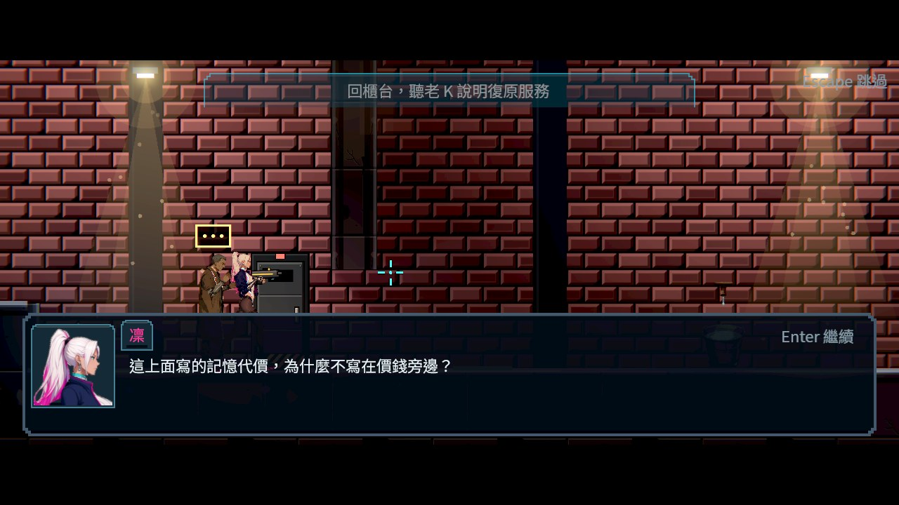
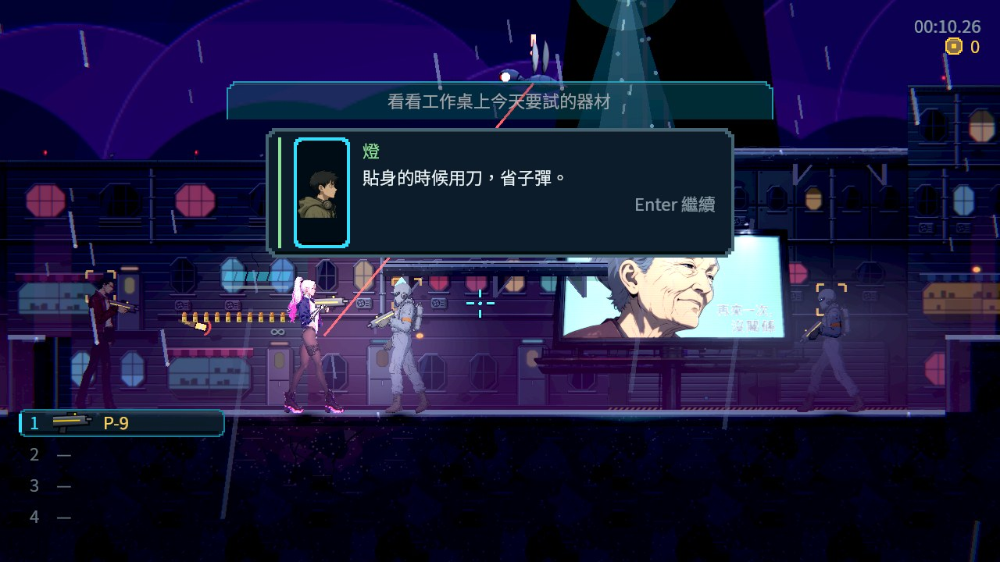

分支：`claude/nest-egg-main-story-flow-ph1dnu`（[分支提交紀錄](https://github.com/deadline314/Nest-Egg/commits/claude/nest-egg-main-story-flow-ph1dnu)）。

# Commit-3

## 內文

上次留給本機的兩條，其實能用真的遊戲入口在雲端驗：手把確認、連續兩則通訊的順序，以及死亡、退出與續玩後會不會留下凍結。
這次在同一條港區街道上加測：拿起手把按一下，通訊右下的提示變成手把的確認鍵；連續播兩則重要通訊，用手把確認鍵逐句讀，每按一次只前進一句、兩則照順序播完、讀完才解凍。讀到一半主角死亡，通訊收起、不算讀過、閱讀的鎖放開，死亡照常只算一次。另外分成兩個獨立程序：第一個從主選單開新遊戲進街道、在重要通訊顯示時正常退出；第二個按「繼續遊戲」，畫面沒有凍結、那則通訊沒有被當成讀過，重播後可以完整讀完並解凍。換區時取消並解凍已在既有測試中涵蓋。

### 測試結果

| 項目 | 結果 |
|---|---|
| 街道探針（無頭與軟體 Vulkan） | 0 失敗：子彈與敵人凍結、開關暫停仍凍結、鍵盤逐句；手把提示、兩則連續通訊一次一句且順序正確、讀到一半死亡不留凍結 |
| 跨程序退出與續玩 | 0 失敗：退出時通訊在畫面上，繼續後沒有凍結、通訊未算讀過、可以重播讀完 |
| 受影響範圍 | 見同一輪的 BG-22 Commit-2（46,601 項） |
| 待本機原生驗收 | 真實戰鬥中連續通訊的原生畫面（第 20 條）、實體手把 |
| 尚未做 | 第 23 條「保存被拒絕、重試」需要存檔組的整段原子保存（STORY_DURABLE_WRITE 尚未接到 Main） |

### 截圖

雲端軟體 Vulkan（Forward+）截圖；手把是送出真的手把按鍵事件，沒有接實體手把。

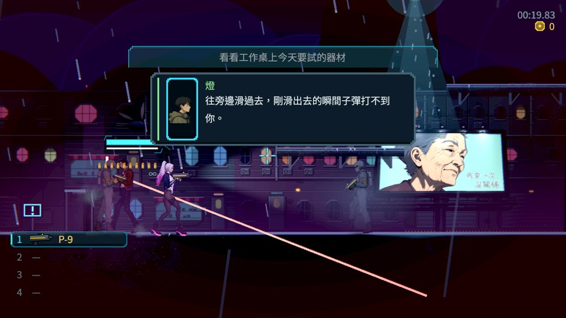

分支：`feature/story`。探針：`tools/radio_freeze_probe.tscn`（`--mode=quit|resume --save-dir=…` 走跨程序）。

# 本機原生驗收（2026-10-12，Arc B580）

## 內文

在這台機器（Intel Arc B580、Godot 4.7.2、原生 Forward+，不是無頭）用 main 的 `feb9645d` 重跑本票的拍攝與量測工具。這一段只記錄跑出來的畫面與數字，沒有改本票的程式；有問題的地方寫在「發現」，交給本票負責的組。

| 項目 | 結果 |
|---|---|
| 通訊凍結主流程檢查 | **19 項通過、1 項失敗**，連跑兩次結果相同 |
| 離開遊戲再回來 | 2 項通過、0 失敗 |
| 續玩 | 5 項通過、0 失敗 |
| 畫面：閱讀中、通訊上開暫停頁、手把閱讀 | 通訊框完整；暫停頁的聚焦說明沒有和通訊重疊；手把閱讀時敵方子彈停在半空 |

發現（請本票負責的組確認）：主流程失敗的一項是「每一句完整顯示後按一次換下一句」，工具回報兩句用了三次按鍵（`FAIL one press per fully shown line (3 presses for 2 lines)`）。票上記的是 0 失敗，這台機器原生執行兩次都重現；雲端的軟體渲染每秒格數低，可能因此沒有遇到。

還沒驗、這裡也驗不了：實體手把的按鍵圖示、真實戰鬥中連續通訊由真人操作、保存被拒後重試與取消。驗收條件維持原狀，不代勾。

### 截圖

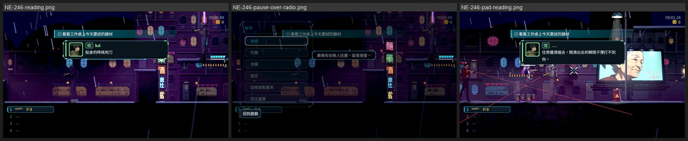

# Commit-4（重要通訊先保存再完成）

## 內文

最後一句確認後，原本會先記成讀完、才嘗試保存；保存被拒絕時只有短暫提示，無法留在原處重試。現在先成功保存，再一起發布閱讀結果；失敗時持續顯示重試與取消，原進度保留、世界繼續暫停。取消不記為讀完，之後能再聽；死亡與退出會清掉自己擁有的閱讀鎖。

已成功保存卻遇到狀態異動時，顯示「已保存」並重新載入，不能再取消已提交的結果；回滾也失敗時則清楚說明「尚未保存」，從完整原備份續玩。首次建檔失敗後的重試同樣不提前記為讀完。地圖探索、世界、錢包與物品不會為完成一則通訊而被重建。

連續通訊的驗證工具改成等待文字實際完整顯示，不再以固定影格數猜打字時間；一次一句的原檢查保留。開始前重新檢視五款相近遊戲的圖片，採用理由及來源見[設計與狀態矩陣](../../design/20-campaign-experience/RADIO_DURABLE_COMPLETION.md)。

### 測試結果

| 項目 | 結果 |
|---|---|
| 真實拒寫的原 Main 負控制 | 阻擋暫存路徑的真目錄讓保存失敗；原 Main 重現 3 項失敗，完整輸出保留 |
| Main 正式通訊 | 保存拒絕、重試、取消、死亡、原備份還原、已提交恢復，以及不同程序成功／取消續玩；結果見證據收據 |
| 觀察者 | 正常完成只發布一次旗標，通知時磁碟與完成紀錄已一致；完整還原沿用 Main 的公開事件契約 |
| 凍結原生證據 | 同一活子彈、16 個敵人的位置、生命值與時鐘在閱讀及保存拒絕期間完全相同；連續手把通訊 20 項、0 失敗 |
| 保存與三語介面套件 | 首次建檔、非所屬物品修復拒絕、回滾失敗、三語 120% 字級、重試／取消與焦點均納入最終受影響測試 |
| 受影響範圍，固定基準 7b032bcc | 75 組、91,147 項、0 新失敗、0 已知失敗；原門檻、錯誤過濾與已知失敗清單未改 |

[完整證據與環境](attachments/NE-246-durable-completion/receipt.json)、[原始成功與失敗紀錄](attachments/NE-246-durable-completion/logs.zip)。以下為安排戰鬥位置的雲端軟體 Vulkan Forward+ 驗證，並非整章通關；手把為合成事件，沒有替代實體裝置驗收。

### 截圖

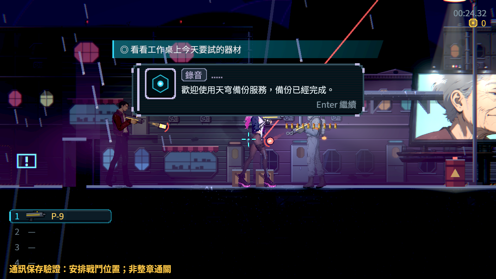
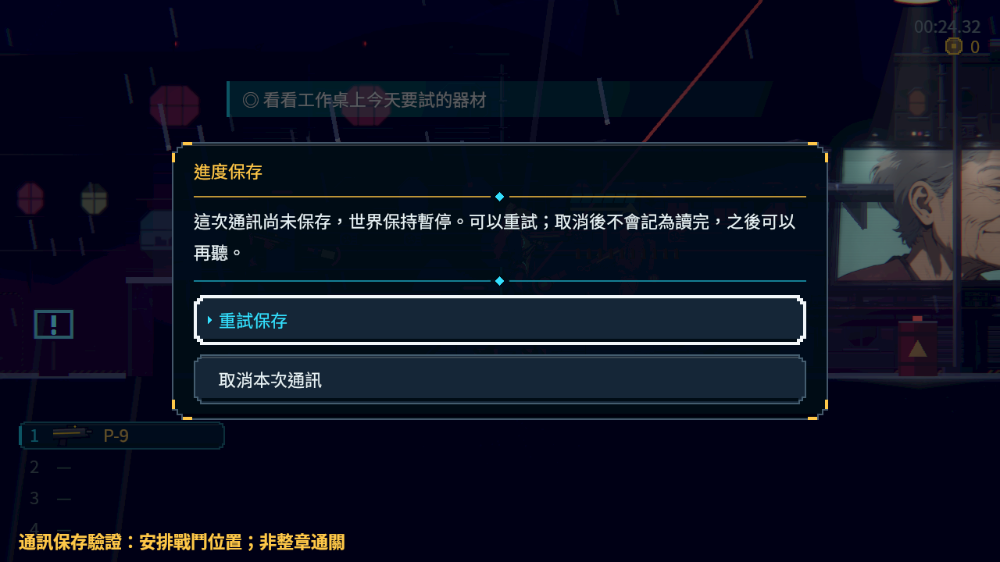
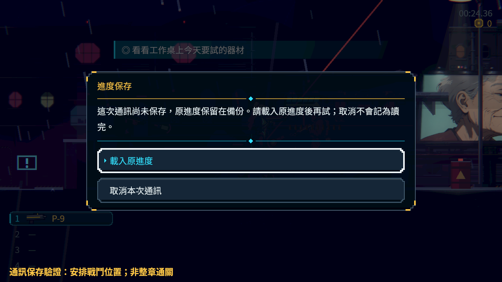
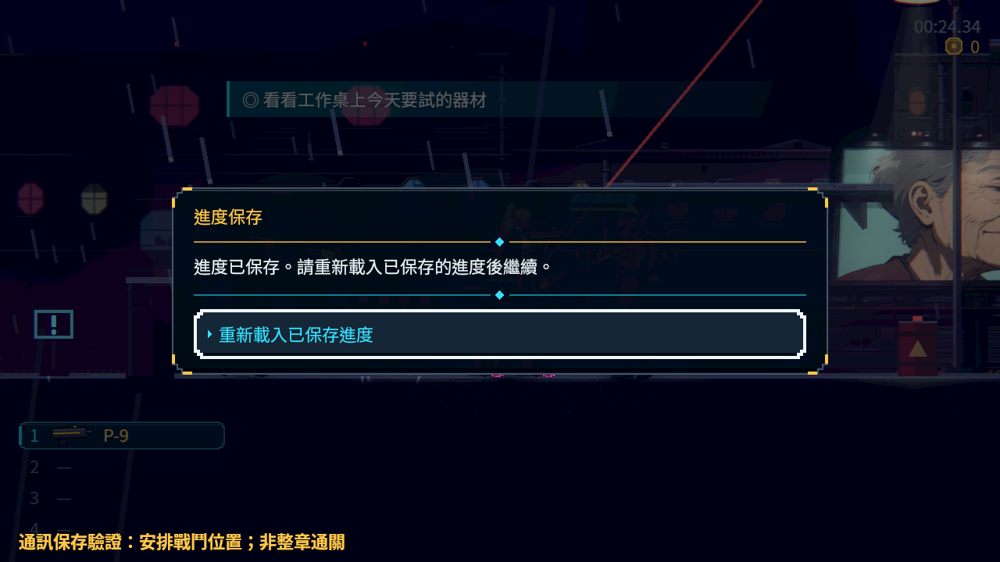

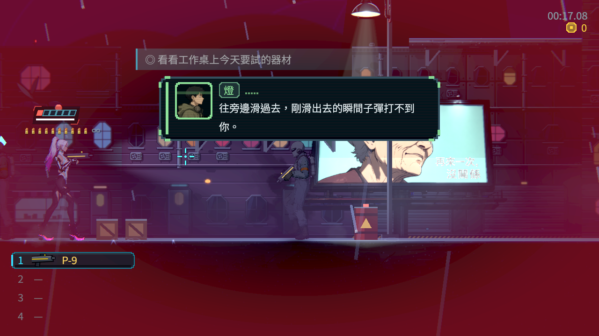

# Commit-5（完整文字後持續顯示確認鍵）

## 內文

重要通訊已完整顯字、世界正在等玩家時，確認提示會閃到完全看不見。現在確認鍵持續顯示，下一句打字時才收起，仍跟隨改鍵及裝置；一次一句、保存與解凍規則不變。

同一正式Main街道重播先重現兩項提示消失，修後19項全部通過。實際戰鬥後同一活子彈、16個敵人、生命與時計在連續通訊及暫停期間完全相同，兩句依序確認、保存後才回到戰鬥。固定基準原受影響範圍60組／63040項、0新失敗；三輪原生0引擎／腳本ERROR。雲端公開輸入與軟體Forward+證據不代稱本機／實體手把驗收。

[完整研究圖、原生對照、世界帳與全部原始紀錄](attachments/NE-246-combat-confirm/README.md)。

# Commit-6

## 內文

真正Main驗證工具把主遊戲也設成暫停中繼續執行，會錯估世界凍結。現在工具保留正式入口的暫停政策；正式遊戲規則不變。

同一真正戰鬥來源探針，修前93項／6失敗、修後93／0。五次重要閱讀中，同一活敵人、玩家、子彈與時鐘保持；公開開關暫停與逐句確認通過。街道有真正連續來源，水坑前以真開槍和移動保證活子彈案例可重現。

[來源研究、安排條件、所有中途失敗與原檔](attachments/NE-246-observer-policy/README.md)。本批為無頭來源驗證，原生驗收條件保持未勾；原選擇器對工具選0組，未變更原測試或門檻。

# Commit-7

## 內文

重要通訊的真實戰鬥與連續來源已完成原生驗證。街道四段來源依序閱讀；看門狗、水坑提示逐句確認，閱讀及開關暫停時同一活子彈、活敵人、玩家、生命與時計保持。實際踏板、死亡、電話亭保存後，以另一程序正常續玩，路線及已完成任務保留。

兩程序127項、0失敗，18張原圖逐張檢視，沒有引擎／腳本ERROR。原無頭同探針負控制93／6與修後93／0一併留存。正式內容未新增修改；本次補齊最後一條驗收，轉審查中。

[完整研究圖、安排條件、五次世界帳、冷續玩與所有中途失敗](attachments/NE-246-real-combat/README.md)。雲端Forward+、公開合成輸入與明示的舊存檔／位置安排，不稱為真人整章或實體手把驗收；普通世界提示的版面屬NE-228。

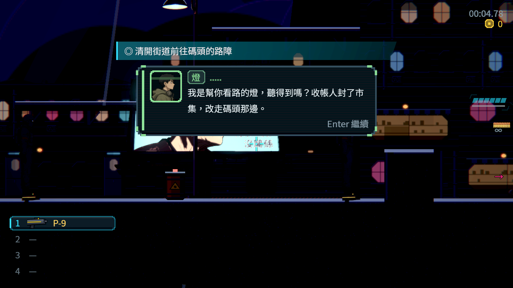
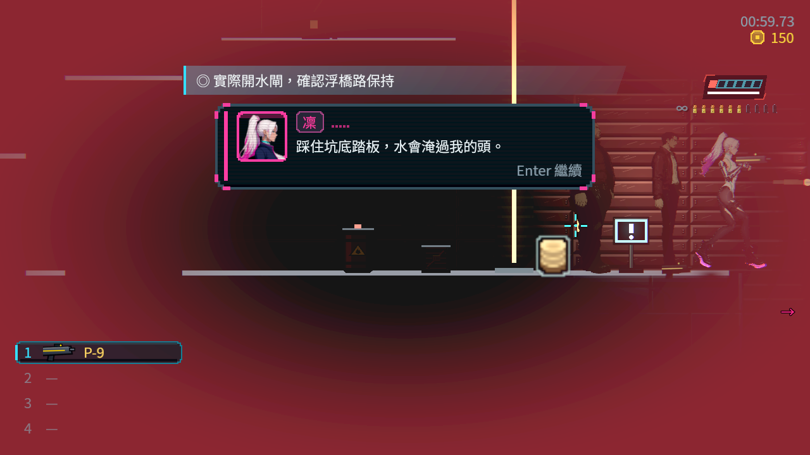
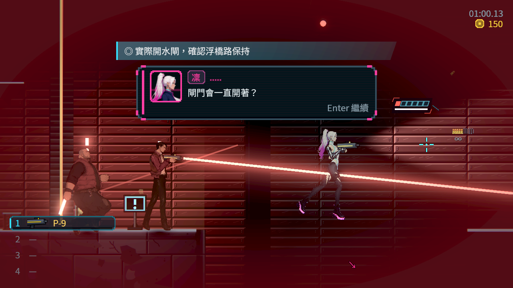
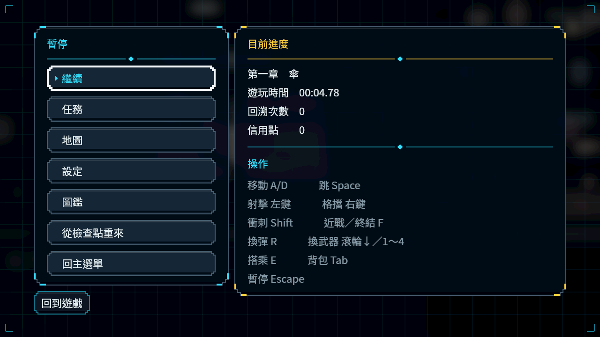
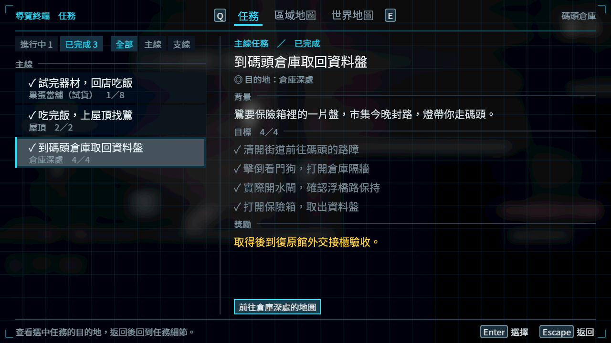
