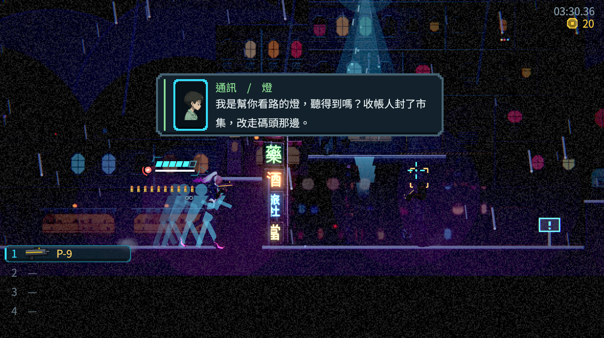
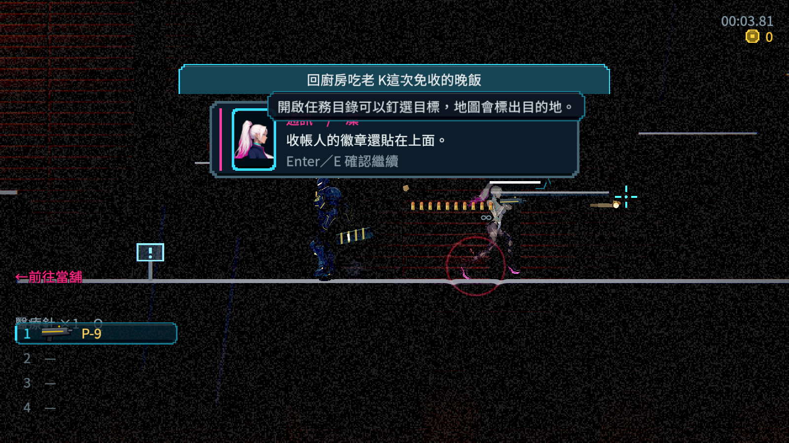
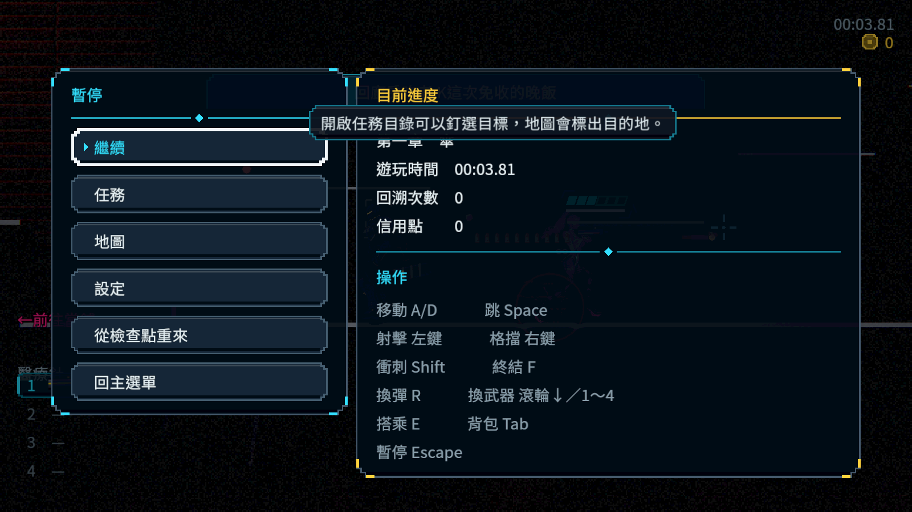
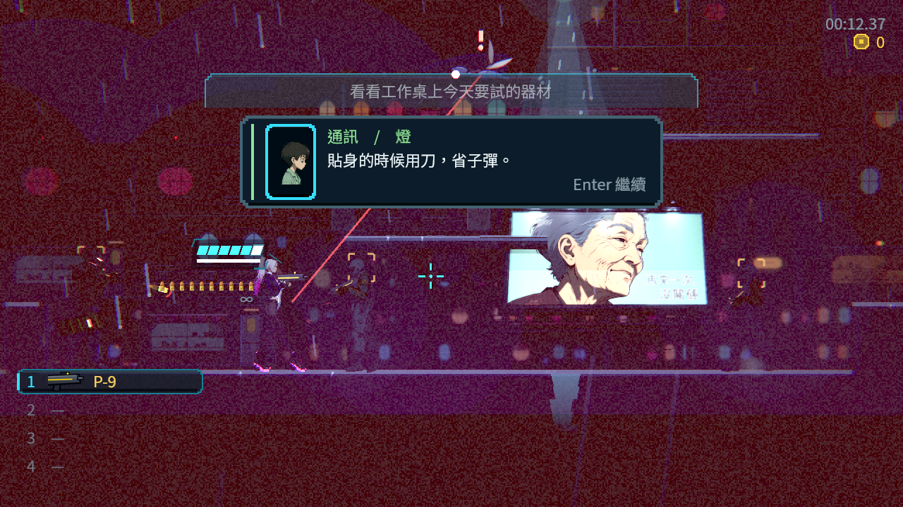
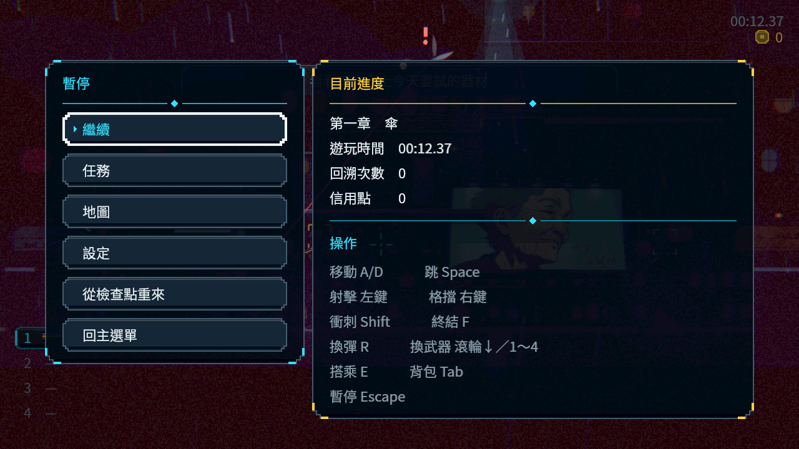

# [NE-246] 凍結重要通訊以供完整閱讀

> 狀態：進行中

## 內文

### 需求
重要上方通訊出現時停止世界，由玩家確認繼續，避免閱讀途中被敵人攻擊或訊息自動消失。

### 來源
2026-10-10，使用者提供通訊與衝刺殘影的實機截圖，要求Freeze閱讀與符合當下動作的深色殘影，並保存票務紀錄。詳見[設計與研究](../../design/20-campaign-experience/INVENTORY_WORLD_CLARITY.md)。

### 驗收條件
- [x] 重要通訊可停下完整閱讀；敵人、角色、彈道、傷害與遊玩計時停止，介面仍可操作。
- [ ] 確認鍵與手把提示依目前綁定顯示；每句只前進一次，連續通訊順序正確。
- [x] 普通環境氣泡不過度打斷遊玩；通訊與普通交談的閱讀形式清楚。
- [ ] 開關暫停選單不提前解凍，取消、死亡、換區、退出與續玩不留下凍結或跳過訊息。
- [ ] 真實戰鬥與連續通訊的原生畫面及受影響測試留存。

- [x] 重要通訊與暫停頁不被背景 HUD 的 Hover／聚焦提示遮住；關閉後正常提示可恢復。
- [ ] 正式通訊的保存拒絕、重試、取消與獨立程序續玩走真遊戲入口；同一活子彈、敵人和時鐘的凍結有原生證據，不以安排場景代替整章通關。

### 測試流程
1. 在敵人、子彈與玩家正在移動時觸發重要通訊，停留閱讀，再按確認繼續。
2. 測連續通訊、改鍵與手把，穿插暫停、換區及死亡重試，確認解凍時機。

---

# 跟其他票的關係

- Blocks：NE-233
- Blocked by：BG-31
- Related：NE-228、NE-229、NE-230、ST-9

---

# 2026-10-11 交接紀錄

## 內文

正式來源分支已有七條閱讀／保存路徑 528 項與活子彈閱讀 97 項通過的局部原生證據；真畫面仍發現背景說明遮住講者。完整故事受影響測試有 126 項新失敗，原始紀錄保留，全部條件維持未勾選。

使用者要求本 Session 收尾後停止開發。偏好、研究依據、避免重犯事項與精確接手資訊見 [使用者指南](../user_guide.md)及[本次交接](../SESSION_HANDOFF_2026-10-11.md)。此段保存現況，不是新完成紀錄。

# Commit-1

## 內文

戰鬥中燈的教學提示、看門狗與水位謎的通訊會在幾秒後自動消失，讀到一半可能被打，也可能沒讀完就沒了；保存分支的做法把每一則通訊都接上保存結算，帶著上百項失敗沒有合進主線。
這次改成資料標記：第一章的教學、頭目、謎題、資料盤與電話亭錄音標為重要通訊，出現時整個世界停住（敵人、子彈、玩家、遊玩計時），面板右下顯示目前的確認鍵，按一下補齊句子、再按一下換下一句，最後一句讀完才解凍。死後回來的一句反應與清場的一句話維持原本邊玩邊看。凍結時可以開暫停選單，關掉選單世界仍停到讀完；換區、回主選單、重試都會取消通訊並解凍，被取消的通訊之後會重播。閱讀與暫停時任務列的滑鼠提示關掉，不會蓋住講者。

### 測試結果

| 項目 | 結果 |
|---|---|
| 受影響範圍（基準 5a8b7db1，原選擇器） | 40,598 項、0 新失敗、0 已知失敗 |
| 凍結測試（UI 套件） | 凍結世界、計時與玩家不動、不自動消失、確認鍵提示、開關暫停不解凍、一次一句、補齊半句、讀完解凍、換區取消不留凍結也不算看過、任務列提示關閉與恢復 |
| 真街道探針（軟體 Vulkan 與無頭） | 0 失敗：真的開槍後子彈在飛時播出，同一顆子彈、所有敵人與計時在閱讀與開關暫停時都不動；按 Enter 逐句讀完後子彈繼續飛 |
| 待本機原生驗收 | 手把按鍵圖示畫面、死亡與續玩交錯的原生紀錄、真實戰鬥連續通訊原生畫面 |

### 截圖

雲端軟體 Vulkan（Forward+）截圖，街道的紅色是當下戰鬥光影，以本機原生為準。

分支：`claude/nest-egg-main-story-flow-ph1dnu`（[分支提交紀錄](https://github.com/deadline314/Nest-Egg/commits/claude/nest-egg-main-story-flow-ph1dnu)）。設計見 [RADIO_LIFECYCLE.md](../../design/20-campaign-experience/RADIO_LIFECYCLE.md) 最後一節。存檔沒有新增欄位（NE-230 不需跟進）；暫停選單改經 `GameplayLock` 開關、任務列在暫停時關閉滑鼠提示，請 NE-228 知悉。
