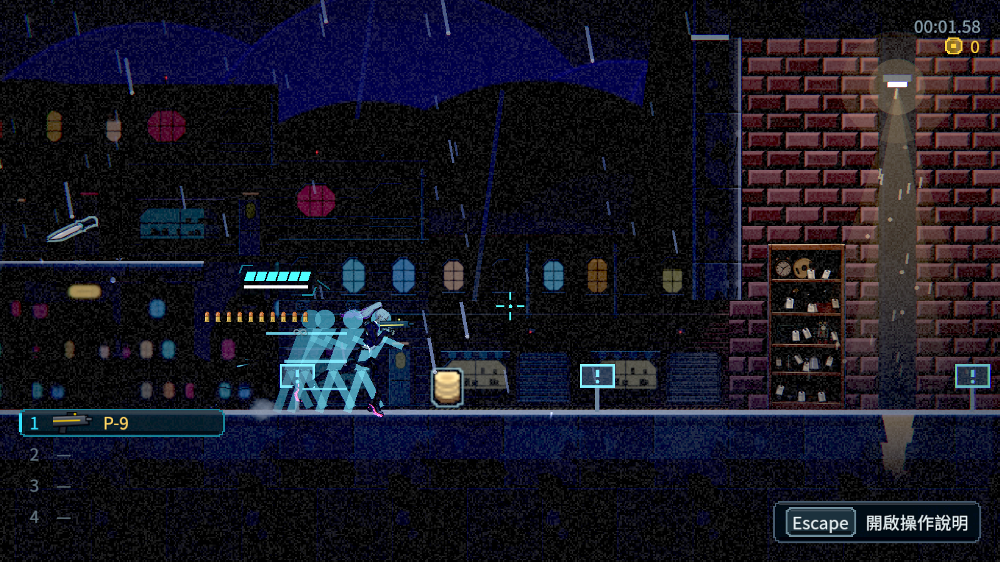
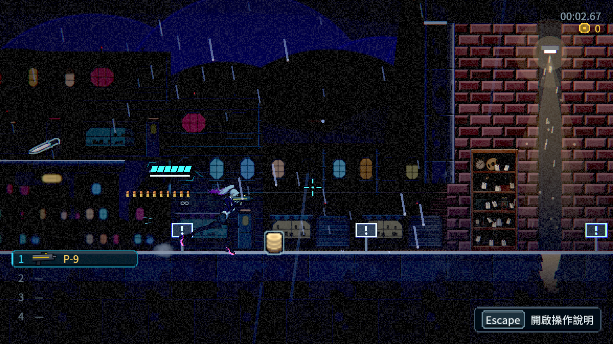
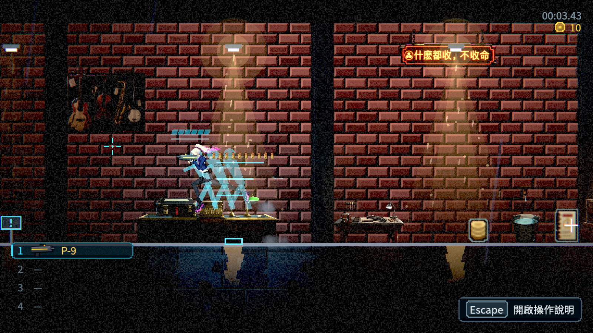
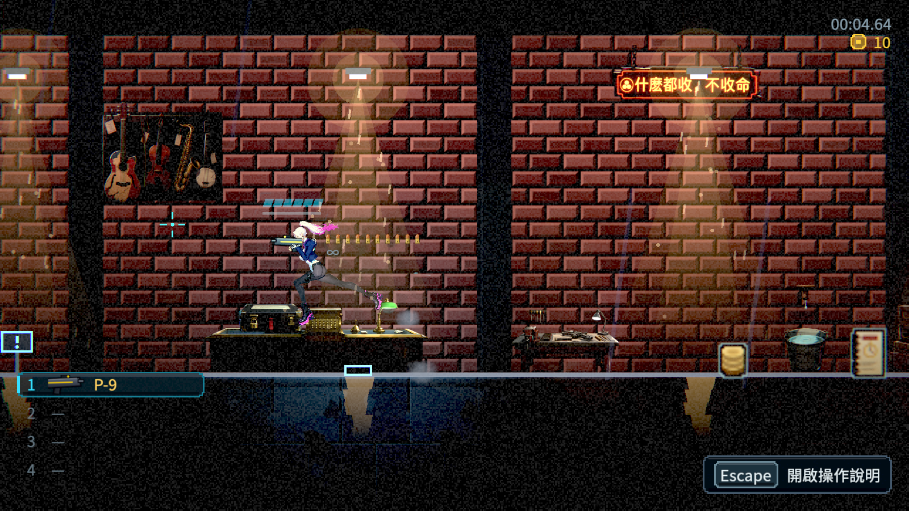
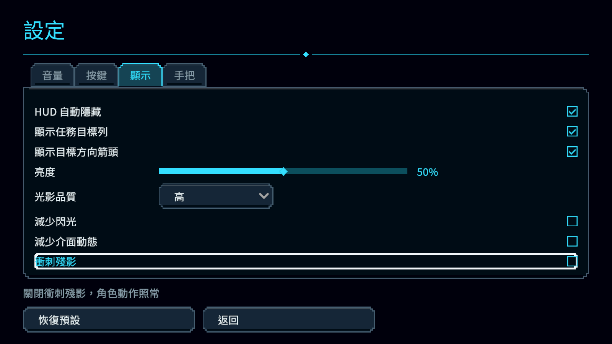

# [NE-247] 改用角色姿勢製作衝刺殘影

> 狀態：完成

## 內文

### 需求
衝刺殘影採角色當下輪廓與短淡出，移除藍色簡化人形，讓速度感符合現有角色與畫風。

### 來源
2026-10-10，使用者提供通訊與衝刺殘影的實機截圖，要求Freeze閱讀與符合當下動作的深色殘影，並保存票務紀錄。詳見[設計與研究](../../design/20-campaign-experience/INVENTORY_WORLD_CLARITY.md)。

### 驗收條件
- [x] 殘影符合衝刺當下的真實角色姿勢、衣物與武器，沒有簡化幾何人形或殘影追著角色移動。
- [x] 深色低透明度與少量短淡出不遮住敵人、路徑、狀態或子彈，在亮暗背景均合理。
- [x] 左右換向、不同武器、衝刺中斷、受傷、死亡與換區後殘影正確退場。
- [x] 衝刺速度、距離、無敵與碰撞不變，獨立殘影選項可關閉並保存，減少閃光時減量顯示殘影。
- [x] 連續衝刺成本有界且不累積大圖，附原生前後畫面、局部測試與效能紀錄。

### 測試流程
1. 在明暗場景左右衝刺與換向，切換武器並在中斷、受傷、死亡後檢查輪廓退場。
2. 連續衝刺並切換殘影及減少閃光設定，核對操控、記憶體與真正畫面。

---

# 跟其他票的關係

- Blocks：NE-233
- Blocked by：無
- Related：NE-95、NE-222、NE-240、NE-241

---

# Commit-1

## 內文

衝刺原本留下藍色的簡化人形，與凜的姿勢、衣物和武器不一致。現在留下當下角色及武器的淡黑色輪廓，固定在經過的位置並短暫淡出。明暗場景、左右方向、跳躍及五種武器均已看過真實畫面；受傷、死亡、重試及暫停中關閉選項不留下舊輪廓。

新增獨立的「衝刺殘影」設定，關閉後角色動作照常；設定可以保存，低品質和減少閃光會減量顯示。原有衝刺速度、距離、無敵與碰撞規則保留。

研究採用以角色姿勢和玩法辨識為優先的動畫原則；淡黑色是本遊戲依現有畫風及實際畫面選定的做法，未宣稱所有玩家偏好同一種殘影。

### 測試結果

| 項目 | 結果 |
|---|---|
| 原受影響測試 | 選測結果為81組，58,700檢查、0新失敗、0已知失敗，exit 0；選測與原斷言保留 |
| 原生新版 | Godot 4.7.2、Forward+／HDR 2D，1,619檢查、0失敗、exit 0；19張原生圖已逐張檢視 |
| 原生原版對照 | 相同兩個實際場景，808檢查、0失敗、exit 0；兩張藍色殘影原圖已檢視 |
| 來源核對 | 385份新版來源與測試及最新整合版一致；原版共同來源、換行及內容差異另有逐筆紀錄 |
| 執行紀錄 | 原生前後皆無SCRIPT／Parse／Compile／ERROR；雲端85條原ERROR保留並分類為81條預期負控、4條結束診斷，無腳本編譯錯誤 |
| 衝刺反覆成本 | 20次實際衝刺後，節點及資源數不增加；固定8個殘影位置保留。單一遊戲程序WorkingSet峰值約609 MiB，暖機至結束WorkingSet略降 |

效能數字是這次實際程序觀察；原版兩案例與新版完整驗收的工作量不同，不能用兩者峰值差當殘影成本。未量測VRAM，亦未將此結果當成整個遊戲無洩漏或完整章節驗收。首次舊類別快取失敗、人工停止及被退回的診斷畫面均保留；快取重建後才接受原版對照。

[原生、來源、審查與效能紀錄](attachments/NE-247-dash-silhouette/README.md)／[雲端原始驗收](attachments/NE-247-dash-silhouette/cloud/validation-summary.json)／[相同案例比較](attachments/NE-247-dash-silhouette/before/README.md)。

### 截圖

| 情境 | 原版 | 新版 |
|---|---|---|
| 暗處向右衝刺 |  |  |
| 亮處向左空中衝刺 |  |  |

