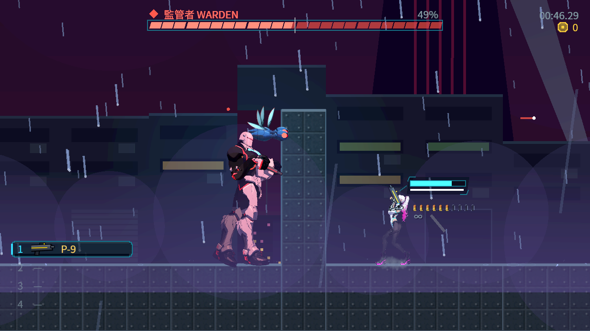

# [NE-248] 修正外露核心的彈丸命中

> 狀態：進行中

## 內文

### 需求
監管者核心外露時，玩家瞄準核心發射真實手槍子彈，會先撞到包住核心的整體身體受擊範圍，被算成普通身體命中；目前紀錄中的核心倍率為 2，但命中部位空白、沒有弱點標記。修正後，彈道確實經過可受傷核心時，部位、傷害與回饋應一致；偏離、核心關閉、牆壁或其他敵人擋住時仍遵守原本規則。

### 來源
2026-10-10，Session 1 承接 NE-81 的實際交戰稽核。原始 headless 重現共 11 項、1 項失敗、exit 1：外露核心中心距整體身體撞擊點約 20.25 像素，玩家實際射擊後生命 44→42，但部位不是核心。這是跨組共用命中判定缺口；本票供戰鬥系統 Session 接手，不以角色分件或掛點位移掩蓋。

### 驗收條件
- [x] 真實玩家子彈在核心外露且彈道穿過核心時，選中核心、使用當前部位倍率並產生弱點回饋。
- [x] 偏離核心的身體命中仍為普通命中；核心關閉時不產生外露核心弱點命中。
- [x] 兩面向與實際父節點變換下，命中與畫面中的有效核心位置一致。
- [x] 先碰到的牆壁或其他敵人維持阻擋順序，不能穿過阻擋物去選後方核心。
- [x] 整體與部位受擊範圍重疊時，同一發子彈只扣血一次；穿透武器維持目標去重。
- [x] 核心開關切換使用該物理步實際有效狀態；不擴大核心、不移動立繪、不放寬門檻。
- [ ] 原始失敗案例修後通過，受影響的命中、重裝敵人與武器回歸通過，附實際操作及原生畫面。

### 測試流程
1. 以真實玩家手槍使監管者自然進入第二階段及核心外露，不直接變更敵人生命、階段或狀態。
2. 在無阻擋的射程內，分別射核心與偏離核心的身體位置，核對命中部位、倍率及回饋。
3. 重驗核心關閉、兩面向、父變換、牆壁、其他敵人、重疊及穿透情況。
4. 保留修前／修後相同条件的事件及原生畫面。既有失敗紀錄不是通過證據。

---

# 跟其他票的關係

- Blocks：NE-81
- Blocked by：無
- Related：NE-238、NE-241

---

# Commit-1

## 內文

保存原始實際子彈的失敗紀錄並建立接手範圍。headless 案例重現普通身體命中取代核心弱點；另外兩輪原生觀察沒有重現相同有效碰撞，最後一輪射擊沒有命中事件，不能拿來證明相同根因或修好。原生圖片只補充核心外露的場景情境。需求已整理，狀態待辦，驗收條件均未勾。

### 檢查結果

| 項目 | 結果 |
|---|---|
| 原始 headless 缺口 | 11 項、1 項失敗、exit 1；有效身體命中未選核心 |
| 原生情境觀察 | 最後一輪 14 項、2 項失敗、exit 1；沒有核心射擊碰撞事件，不作相同根因證據 |
| 本次文件交付 | 需求、雙向相依、原始紀錄與圖片核對；沒有實作或遊戲測試通過宣稱 |

### 截圖

[原始紀錄、來源與跨組接手說明](attachments/NE-248-core-hit-handoff/README.md)

---

# Commit-2

## 內文

**問題**：子彈先碰到包住核心的整個身體範圍時，只用「碰到的那一點」判斷部位；核心在身體裡面約 16～24 像素，所以瞄準外露核心的子彈一律算成普通身體命中，沒有弱點倍率與回饋。這和 NE-252 看門狗的頭打不到不是同一個成因（那是頭整個在受擊範圍外，見 NE-252）。

**改動**：子彈碰到身體範圍時，沿著它的飛行方向、只在同一個敵人的身體範圍裡往前看，取路徑上第一個碰到的啟用部位；這段路徑若先碰到牆或其他敵人，就維持原本的身體命中。近戰、爆炸等沒有方向的攻擊照舊用接觸點。核心大小、位置、倍率與立繪都沒有改。

**驗收**：用真實子彈打監管者：從左右兩邊、兩個面向射外露核心，都算核心命中、傷害兩倍、出現弱點回饋，而且只扣一次血；射核心下方的身體是普通命中；核心關閉時不是弱點；中間擋著另一隻敵人時由前面那隻吃到；牆在前面時打不到。修正前同一組檢查失敗（核心命中全部變成部位空白的普通命中），修正後全過。尚未做：在本機原生畫面以實際操作自然打到第二階段再射核心（雲端無實機與 GPU），待本機原生驗收。

### 測試結果

| 項目 | 結果 |
|---|---|
| 新增檢查（核心沿彈道命中、偏離、關閉、兩面向、前方敵人、牆、路徑判定契約） | 修正前失敗，修正後全過 |
| 受影響範圍（`tools/run_tests_changed.sh`，69 組套件） | 75823 項檢查，新失敗 0，腳本錯誤 0 |
| 畫面 | Forward+（軟體 Vulkan）截圖；本機原生畫面待驗 |

### 截圖

分支：`feature/combat`，提交：https://github.com/deadline314/Nest-Egg/commit/f15fec43
