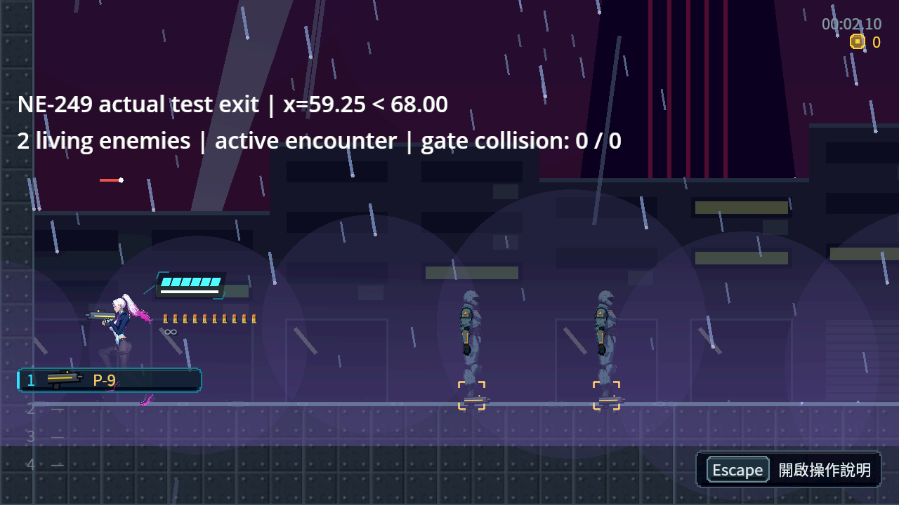

# [NE-249] 隔離遭遇區測試的瞄準前提

> 狀態：審查中

## 內文

### 需求

普通遭遇區的離場測試須在完整 CI 或獨立局部測試中得到一致結果，不受前序測試留下的瞄準裝置與方向影響。保留玩家原有倒退減速，以及普通遭遇區可以自由進出的行為。

### 來源

2026-10-11 Session 1 核對角色套件交付後的 CI 新失敗。CI run 38064900178 兩次執行同一離場斷言失敗；本機同程序前序重現與隔離手把方向控制確認測試前提差異。實測交接見 design/12-cast-redraw/CI_CHARACTER_DELIVERY_HANDOFF.md。

### 驗收條件

- [x] 普通遭遇區的實際進出移動、兩名敵人仍存活、遭遇仍啟動及閘門無碰撞均通過，離場位置門檻保持不變。
- [x] 原滑鼠、手把向左及手把沿用向右的前序狀態皆得到正確且一致的測試結果；測試結束恢復裝置／瞄準狀態，不污染後續套件。
- [x] 同程序主流程及 CI 前序套件後執行遭遇區測試通過，受影響局部測試無新增失敗或 SCRIPT ERROR；完整測試由 CI 確認。
- [x] 玩家前進／倒退速度及原有操作規則未改，沒有刪除斷言、放寬位置門檻或加入已知失敗清單。

### 測試流程

1. 對照 [原始失敗與方向控制紀錄](attachments/NE-249-input-isolation/manifest-sha256.json)，重現手把沿用向右時的離場失敗。
2. 完成測試前提隔離後，在相同移動、存活及啟動狀態門檻核對三種輸入歷史。
3. 執行受影響測試及同程序 CI 前序重現，檢查後續測試沒有裝置狀態污染；由 CI 跑完整測試。

---

# 跟其他票的關係

- Blocks：無
- Blocked by：無
- Related：NE-79、NE-80、NE-224、ST-11

---

# Commit-1

## 內文

前序測試沿用手把向右瞄準時，原離場測試會按正確的倒退減速移動，60 格後仍停在 x=105.49，沒有越過既定 x<68 的門檻。現在測試明確建立所需瞄準前提，保留原移動影格與全部遭遇判定，並在關卡清理後完整恢復原裝置、方向與時間戳。

三種輸入歷史均在原門檻通過；實際離場時 x=59.25，兩名成員仍存活、遭遇仍啟動、兩道閘門碰撞均為零。原生畫面只驗證本票的遭遇測試狀態，不代表畫面中的角色美術已驗收。

### 測試結果

| 項目 | 結果 |
|---|---|
| 修前手把向右控制 | 157 checks／1 failure，原失敗保留 |
| 三種前序狀態的完整遭遇套件 | 各 158 checks／0 failures，exit 0 |
| 函式返回後的外部狀態對照 | 各 8 checks／0 failures，三欄逐值恢復 |
| 同程序主流程與四個相關套件 | 2051 checks／0 failures，exit 0；非完整測試 |
| 固定修前基底的受影響測試 | EncounterSuite，158 checks／0 新失敗／0 已知失敗 |
| 實際 Forward+／HDR 擷取與公開路徑重播 | 各 8 checks／0 failures，1280×720，RTX 4070 SUPER |
| 執行診斷 | 遭遇局部與原生擷取無 ERROR／SCRIPT ERROR；同程序有 14 條與修前完全相同的 ERROR 診斷，含兩條引擎 body_test_motion，原樣保留；無 SCRIPT ERROR |

證據、重跑命令、差異與來源雜湊：[交付紀錄](attachments/NE-249-input-fix/README.md)。完整測試由 CI 確認，該驗收條件保持未勾選。

### 截圖

---

# Commit-2

## 內文

已由完整 CI 確認 Commit-1 的實際提交 d74625fd7d6b503656215774738cbcc0adfeabb8。83 組套件共 85,189 項檢查，新增失敗 0、已知失敗 0，整個工作成功；普通遭遇區離場測試亦包含在完整測試順序中。本次只補確認紀錄，沒有再次更改測試或玩家操作。

### 測試結果

| 項目 | 結果 |
|---|---|
| 完整 CI | [run 38072594244](https://github.com/deadline314/Nest-Egg/actions/runs/38072594244)，success |
| 精確受測提交 | d74625fd7d6b503656215774738cbcc0adfeabb8 |
| CI 引擎與範圍 | Linux Godot 4.7 stable，83 組，85,189 checks／0 新失敗／0 已知失敗，320 秒 |
| 本次文件核對 | 完整 CI 狀態、受測提交及原始摘要逐項一致；沒有宣稱新增本機遊戲測試 |

原始 CI 狀態及摘要：[確認紀錄](attachments/NE-249-input-fix/ci-confirmation.json)、[原始測試步驟輸出](attachments/NE-249-input-fix/ci-tests.log)。使用者審查由使用者進行。

### 截圖

沿用 Commit-1 的實際 Forward+ 遭遇離場擷取；本次 CI 為 headless，沒有另外產生遊戲畫面。

