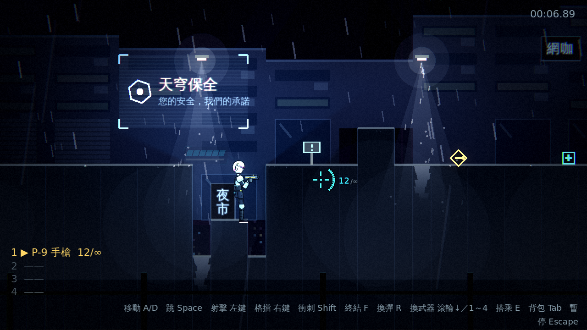
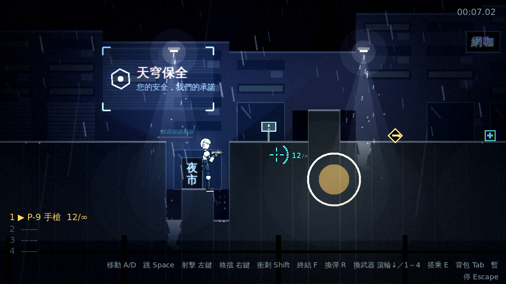
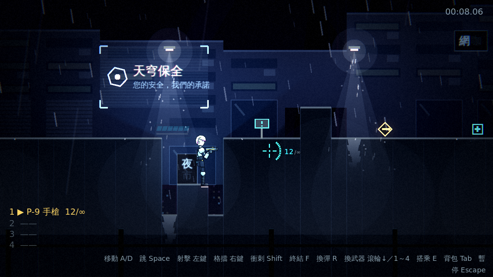
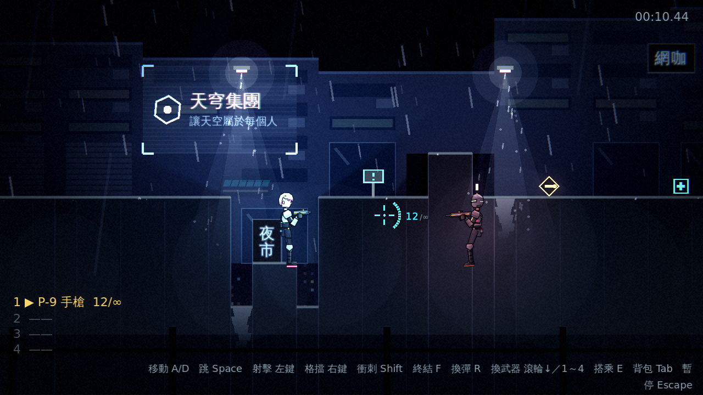
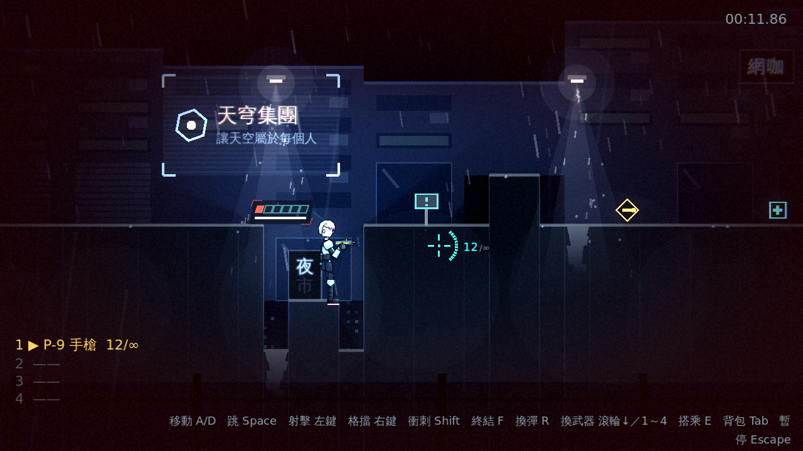

# [NE-24] 加入戰鬥動態光影與閃電

> 狀態：完成

## 內文

### 需求
戰鬥中的光影還是靜態的，爆炸與受傷沒有把整個畫面「打亮」或「壓緊」的感覺，也沒有雨夜該有的閃電。要讓戰鬥與環境的光影動起來，同時顧及光敏感的玩家。設計見 `design/08-lighting/DESIGN.md` 的「架構」第 6 節。

### 來源
2026-10-02，使用者於開發對話中提出：「整個遊戲可以有完整的光影設計，請參考業界最佳實例」「整體的渲染跟場景應該要陰沉一點，遊戲希望整體沉重一點」；確認壓抑程度為重度壓抑、先做光影再做內容。

### 驗收條件
- [x] 爆炸瞬間環境光被閃亮一下並隨即回復
- [x] 命中與擊殺時有短暫的點光
- [x] 低血量時暗角收緊並帶紅色脈動
- [x] 敵人的攻擊預兆帶紅光，暗處也看得到
- [x] 閃電：不定時的環境光閃爍並配合遠方雷聲，閃電瞬間能看清整個場景的輪廓
- [x] 暫停、背包與劇情過場期間不會閃電；兩次閃電之間有最短間隔
- [x] 設定選單有「減少閃光」選項，開啟後爆炸與閃電的閃光強度大幅降低

### 測試流程
1. 引爆爆炸物，確認環境光閃亮後回復
2. 把生命打到最低，確認暗角收緊與紅色脈動
3. 在室外區段等待閃電，確認閃光與雷聲；開啟「減少閃光」後再確認強度降低
4. 執行完整測試套件，全部通過

---

# 跟其他票的關係

- Blocks：無
- Blocked by：NE-18、NE-20
- Related：無

---

# Commit-1

## 內文

戰鬥中的光影是靜態的，爆炸與受傷沒有把畫面「打亮」或「壓緊」的感覺，也沒有雨夜該有的閃電。
現在爆炸瞬間整個環境光被閃亮一下（越大的爆炸越亮）並在零點三秒內衰減回去；命中有小而冷的點光，擊殺有更大更暖的點光；生命低於三分之一時暗角收緊並帶紅色脈動，血量回復後淡出；敵人的攻擊預兆帶紅光脈動，暗處也看得到要出招了。室外區段（屋頂巷弄、霓虹市集、貨運站）會不定時打閃電：環境光瞬間閃到全亮、第二次較弱的閃光，延遲一兩秒後傳來雷聲，兩次閃電至少間隔六秒；室內區段沒有閃電，暫停與劇情過場期間也不會打。設定選單的顯示分頁新增「減少閃光」：開啟後爆炸與閃電的閃光強度降到四分之一，閃電只閃一次，低血量的脈動幅度也大幅縮小；「恢復預設」會一併關閉。
驗收方式：冒煙測試驗證環境光閃亮與衰減回區段光影、爆炸觸發閃光、命中與擊殺的點光、低血量的暗角進入與淡出、預兆紅光亮起與熄滅、只有室外區段有閃電、閃電強度與最短間隔、減少閃光的強度倍率與單次閃電、設定的預設／損毀／重設；自動截圖確認各項效果。

### 測試結果

| 項目 | 結果 |
|---|---|
| 完整測試套件 | 通過 917 / 917 |
| 資料驗證 | 0 錯誤 |
| 執行 log | 無非預期 ERROR |

### 截圖

