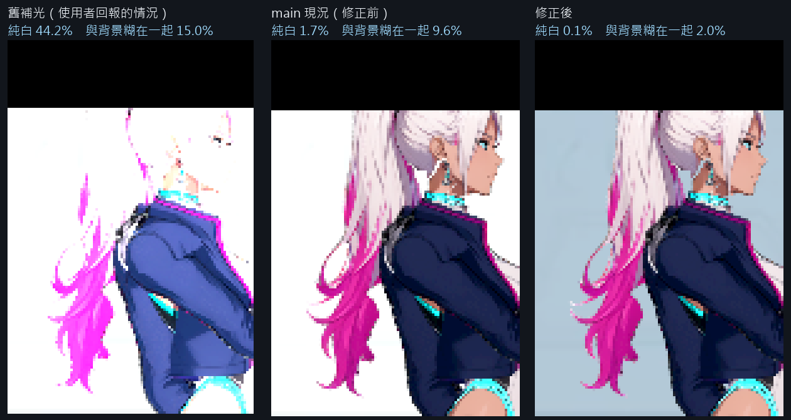
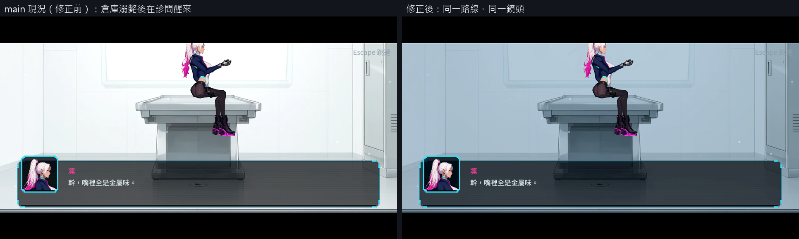
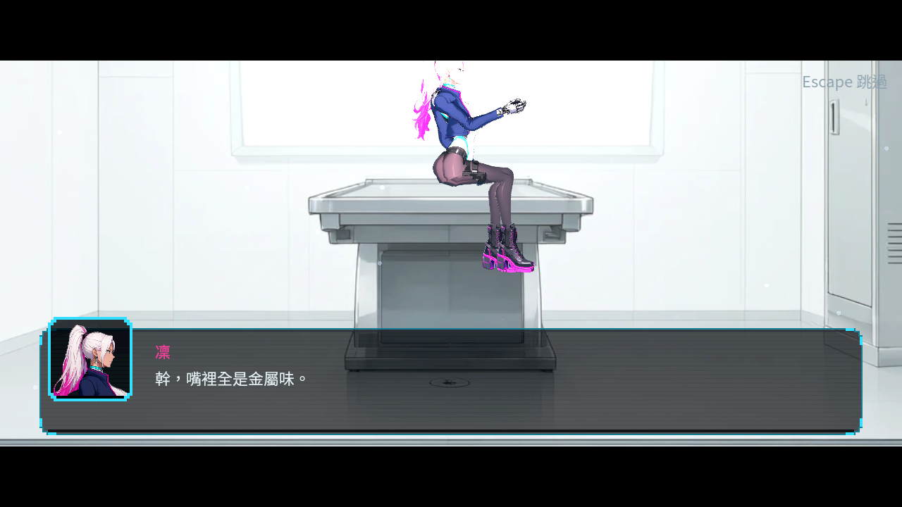
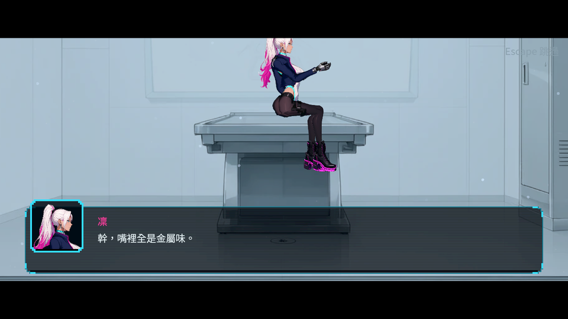
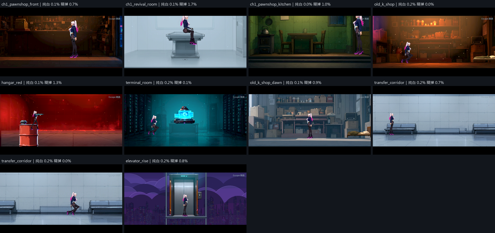

# [NE-251] 修正診間醒來時主角頭部過亮

> 狀態：審查中

## 內文

### 需求
NE-213 修過之後，主角過曝的情況好很多，但少數情況仍會發生：第一次在水下死亡後，在診間醒來時，主角的頭很亮、看不清楚頭髮與臉。要在這條實際路線上重現並修好，同時找出其他還會發生的場合。

### 來源
使用者 2026-10-11：「NE-213 過曝的情況好很多了，但在少數情況下還是會（第一次在水下死亡後在診間醒來的時候，主角的頭會很亮）」。

### 驗收條件
- [x] 在最新版本走實際路線重現：倉庫水位謎溺斃 → 診間醒來，記錄頭部區域的亮度量測與原生畫面
- [x] 說明成因（光源、材質、發光或前一場景留下的狀態），並確認 NE-222 已交付的診間補光修正為何沒有涵蓋這個情況
- [x] 修正後同一路線、同一鏡頭，頭髮與臉的細節清楚，沒有大片純白；附修前修後對照
- [x] 其他死亡方式醒來、讀檔續玩進診間、重複死亡多次後，結果一致
- [x] 逐一檢查其他「從暗場景切到獨立舞台」的過場，列出還會過亮的地方並修正或另開票
- [x] 主角的霓虹發光保留，沒有用整體調暗或關掉發光來掩蓋

### 測試流程
1. 新遊戲玩到碼頭倉庫，在水坑溺斃
2. 在診間醒來，看主角頭部
3. 預期頭髮與臉清楚可辨，不過亮

---

# 跟其他票的關係

- Blocks：無
- Blocked by：無
- Related：NE-213、NE-222、BG-30

---

# Commit-1

## 內文

用真正的主程式重走這條路線：進碼頭倉庫、在水坑溺斃、死亡流程接到診間醒來。倉庫很暗，角色的補光倍率是 2.23 倍；診間播放時倉庫還留在底下，舊版的舞台演員會跟著用這個倍率，頭部有 44% 的像素變成純白，就是回報的那團白。NE-222 的診間補光修正讓舞台演員不再跟著關卡補光，在這條實際路線上量到的倍率確實回到 1.0，所以它有涵蓋這個情況；只是當時只單獨播放診間、用診斷鏡頭，沒有走實際路線，也沒有量頭部像素。修正之後還剩一個問題：診間的窗是全白的，正後方又疊了一層白色柔光，白頭髮貼在上面，頭部有 9.6% 的像素和背景糊在一起、1.7% 純白。

診間舞台的背景改成偏冷的淡藍色調，柔光改成淡青色並調弱，讓背景比白髮暗一階。主角本身沒有調暗，頸圈、鞋與衣服的霓虹發光不變，角色來源圖沒有動。另外加了一支量測工具，量頭部的純白比例，以及白髮和正後方背景分不分得開，之後新增舞台可以直接重跑。

同一路線、同一鏡頭下，頭部純白從 1.7% 降到 0.1%，糊在一起的比例從 9.6% 降到 2.0%，髮絲、耳環與臉看得清楚。改成受擊致死、醒來途中回主選單再續玩，數字相同；連死三次時第 2、3 次出現死亡畫面，不會再進診間。所有有主角登場的過場舞台共 9 個、10 組位置逐一量過：修正前只有診間不通過，修正後全部通過。量測時也看到診間鏡頭把主角頭頂切到上方黑邊，屬於鏡頭構圖，留給 ST-10 一起處理。

### 測試結果

| 項目 | 結果 |
|---|---|
| 實際路線：舊補光／main 現況／修正後 | 純白 44.2%／1.7%／0.1%；糊掉 15.0%／9.6%／2.0% |
| 受擊致死、續玩進診間、連死三次 | 純白 0.1%；糊掉 1.8%、1.7%、1.9%；第 2、3 次不再進診間 |
| 所有過場舞台（9 個舞台、10 組） | 修正前 1 組不通過（診間）；修正後 10 組全過 |
| 原生執行紀錄 | 8 個獨立程序自然結束，0 錯誤 |
| 受影響測試 | 10272 項檢查；新失敗 0、已知失敗 0（首次執行有 1 項與本票無關的音效計時檢查失敗，該套件單獨重跑 3 次與整組重跑皆通過） |

量法、門檻與每一組數字見[量測紀錄](attachments/NE-251-clinic-exposure/README.md)。分支 `feature/scene-lighting`；提交見[遠端 main 上本票的提交](https://github.com/deadline314/Nest-Egg/commits/main/pm/Nest-Egg/%5BNE-251%5D%E4%BF%AE%E6%AD%A3%E8%A8%BA%E9%96%93%E9%86%92%E4%BE%86%E6%99%82%E4%B8%BB%E8%A7%92%E9%A0%AD%E9%83%A8%E9%81%8E%E4%BA%AE.md)。

### 截圖

