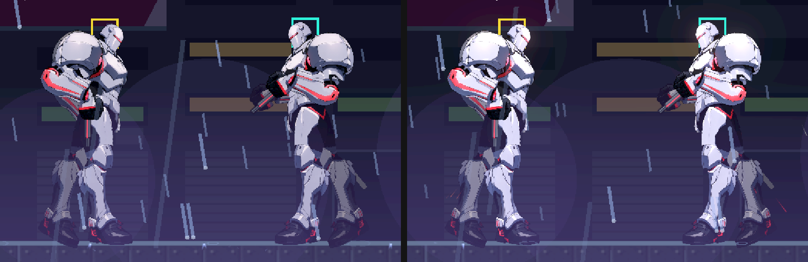
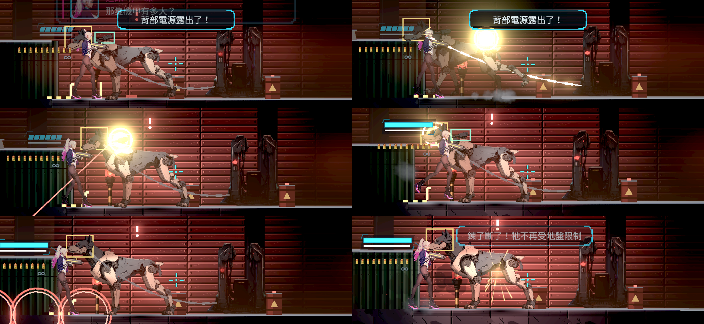

# [NE-252] 修正看門狗頭部射不到

> 狀態：進行中

## 內文

### 需求
頭目看門狗的頭射不到：玩家瞄準畫面上的頭部開槍，沒有命中或沒有算成頭部命中。要讓畫面上看得到的頭與實際可命中的範圍一致。

### 2026-10-11 補充：外觀已換成四足
看門狗的外觀在 NE-218 換成四足機械犬（身長約 82、耳尖離地約 66 世界像素，頭在面向的前方、高度約 50～66），子彈改從背上的砲塔射出。判定框沒有動，仍是原本直立的 34×78，頭與後半身都在框外。本票的「畫面上的頭與可命中範圍一致」要以新的外形為準；目前固定位置的部位判定不會跟著面向左右翻，頭部判定需要跟著面向。

### 來源
使用者 2026-10-11：「看門狗的頭還射不到」。

### 驗收條件
- [x] 在實際頭目戰重現，記錄瞄準位置、子彈路徑與命中結果
- [x] 確認與 NE-248（外露核心被整體身體範圍擋住）是否同一成因；同因就一起修，不同因在本票修
- [x] 修正後，瞄準畫面上的頭部開槍會命中頭部，傷害與回饋符合該部位設定
- [x] 左右面向、看門狗各個動作與階段下，頭部可命中範圍跟著畫面走
- [x] 沒有靠放大命中範圍到畫面外或移動立繪來過關；牆壁與其他敵人仍照原規則阻擋
- [ ] 附實際操作的原生畫面與受影響測試結果

### 測試流程
1. 進第一章碼頭倉庫的看門狗頭目戰
2. 用手槍瞄準頭部射擊
3. 預期出現頭部命中的回饋與對應傷害

---

# 跟其他票的關係

- Blocks：無
- Blocked by：無
- Related：NE-218、NE-248、NE-253、ST-7

---

# Commit-1

## 內文

**問題**：看門狗借用監管者的骨架外觀，但受擊範圍比監管者矮（78 對 86 像素），畫面上的頭整顆在受擊範圍上方約 7～19 像素，而且沒有頭部判定，所以瞄準頭開槍時子彈直接穿過去。逐一檢查所有骨架敵人後，監管者、看守長、迫擊砲手與回收員也有同樣「看得到頭、打不到頭」的情形。和 NE-248 不是同一個成因：NE-248 是核心在身體範圍裡、選部位只看接觸點；這裡是頭根本不在任何受擊範圍內。兩者一起修，NE-248 的路徑判定也讓斜著射進身體的子彈能選到頭。

**改動**：看門狗與上述敵人都加上跟著頭骨移動的頭部判定，大小與位置對準畫面上的頭。看門狗的頭是弱點（1.5 倍、弱點回饋）；監管者、看守長、回收員的頭只負責「打得到」，倍率 1，不改頭目平衡；迫擊砲手比照其他一般人形敵人 1.5 倍。之後換成四足立繪時，只要改資料裡的頭骨與大小。沒有放大身體範圍、沒有移動立繪；牆與其他敵人照原規則阻擋。

**驗收**：在正式第一章碼頭倉庫，讓看門狗自然醒來，玩家站在左邊與右邊各用真正的手槍瞄準畫面上的頭開一槍，都算頭部命中並出現弱點回饋。測試場地另外驗：兩個面向、從左右兩側射頭都是頭部命中且只扣一次；射身體是普通命中；第一、二階段的待機、點射、跳壓、扇形彈幕、暴走各狀態下，頭部判定都跟著畫面上的頭走。新增一條全敵人檢查：每個骨架敵人畫面上的頭都落在受擊範圍內。修正前這些檢查失敗（頭部射擊完全沒有命中），修正後全過。尚未做：本機原生畫面的實際操作錄影（雲端沒有實機），待本機原生驗收。

### 測試結果

| 項目 | 結果 |
|---|---|
| 新增檢查（全敵人頭部覆蓋、看門狗頭部命中、各狀態跟隨、正式倉庫真實手槍） | 修正前失敗，修正後全過 |
| 受影響範圍（`tools/run_tests_changed.sh`，69 組套件） | 75823 項檢查，新失敗 0，腳本錯誤 0 |
| 畫面 | Forward+（軟體 Vulkan）截圖；本機原生畫面待驗 |

### 截圖

分支：`feature/combat`，提交：https://github.com/deadline314/Nest-Egg/commit/23c7cd53

---

# Commit-2

## 內文

**問題**：NE-253 重做看門狗後，頭部改成「平常有裝甲、抬頭吠叫時才打開」，要確認畫面上的頭仍然一定有命中回饋。

**改動**：頭部判定一直存在；平常打到頭算頭部命中但被裝甲擋下（火花彈開、顯示「擋下」），吠叫預兆中打到才是弱點命中並扣血。不是穿過去沒反應。

**驗收**：兩個面向、左右兩側射畫面上的頭：平常都記為頭部被擋下，吠叫時都是頭部弱點命中；正式倉庫裡讓看門狗自然吠叫，真正的手槍瞄頭左右各一次都是頭部弱點命中。本機原生畫面仍待驗。

分支：`feature/combat`，提交：https://github.com/deadline314/Nest-Egg/commit/145c43d9（與 NE-253 同一次提交）

---

# Commit-3（併入最新 main 後的測試穩定）

## 內文

**問題**：最新 main 重建了主角的遊戲內骨架，槍口位置改變；兩個「真正的手槍瞄頭」檢查在忙碌的平行測試裡偶爾失敗。

**改動**：只改測試：先轉身、等畫面上的骨架更新再用新槍口瞄準；改用沒有隨機散佈的同一把手槍（量的是命中判定，不是準度）；從正面往上射時看門狗舉著的槍臂會先擋住，這是正確的遮擋，測試改從牠背後射抬起的頭。遊戲行為沒有改。

**驗收**：同時跑六份全過；併入最新 main 後完整測試 87,351 項檢查、新失敗 0、退出 0。

分支：`feature/combat`

---

# Commit-4（換成四足外觀後，判定跟著四足的頭、砲塔與背）

## 內文

**問題**：併入最新 main 後，看門狗換成四足機械犬（NE-218），但頭、槍臂與背部電源的判定還找人形骨架的骨頭，找不到就停在固定位置；身體判定也還是直立的 34×78。結果頭在判定外、背上看不到的地方反而擋子彈，頭目戰的頭部與背部測試全部失敗。

**改動**：部位判定改成也能跟著零件式外觀的零件走（頭跟著頭、槍臂改成背上的砲塔、背部電源在後半身的背上），兩個面向都跟著翻；身體判定改成貼合四足的 50×60。其他零件式敵人有頭的，也一併檢查畫面上的頭在判定內。沒有改任何零件圖、分件或接縫，也沒有放大判定到畫面外。

**驗收**：兩個面向、前後兩側射畫面上的頭：平常記為頭部被擋下，吠叫時是頭部弱點命中；從背後要從高處往下射才越過砲塔（水平射被砲塔擋下是正確的遮擋）；真正的手槍站在牠前方斜射抬起的頭是頭部弱點命中；各招式預兆與三個階段中頭的判定都跟著畫面上的頭。Forward+（軟體 Vulkan）開受擊框截圖，六個時刻的頭、砲塔、背部框都貼在四足的對應位置。本機原生畫面與實際操作仍待驗，最後一條維持未勾。

### 測試結果

| 項目 | 結果 |
|---|---|
| 受影響範圍（併入最新 main，`tools/run_tests_changed.sh`） | 87,617 項檢查；唯一的新失敗是對負載敏感的蹲下計時檢查，單獨重跑 670 項全過 |
| 頭目與重裝敵人、第一章敵人、零件式生物、投擲物 | 740 項，0 失敗 |
| 畫面 | Forward+ 軟體 Vulkan（llvmpipe）；本機原生畫面待驗 |

### 截圖

分支：`feature/combat`，提交：https://github.com/deadline314/Nest-Egg/commit/3b2bc478

