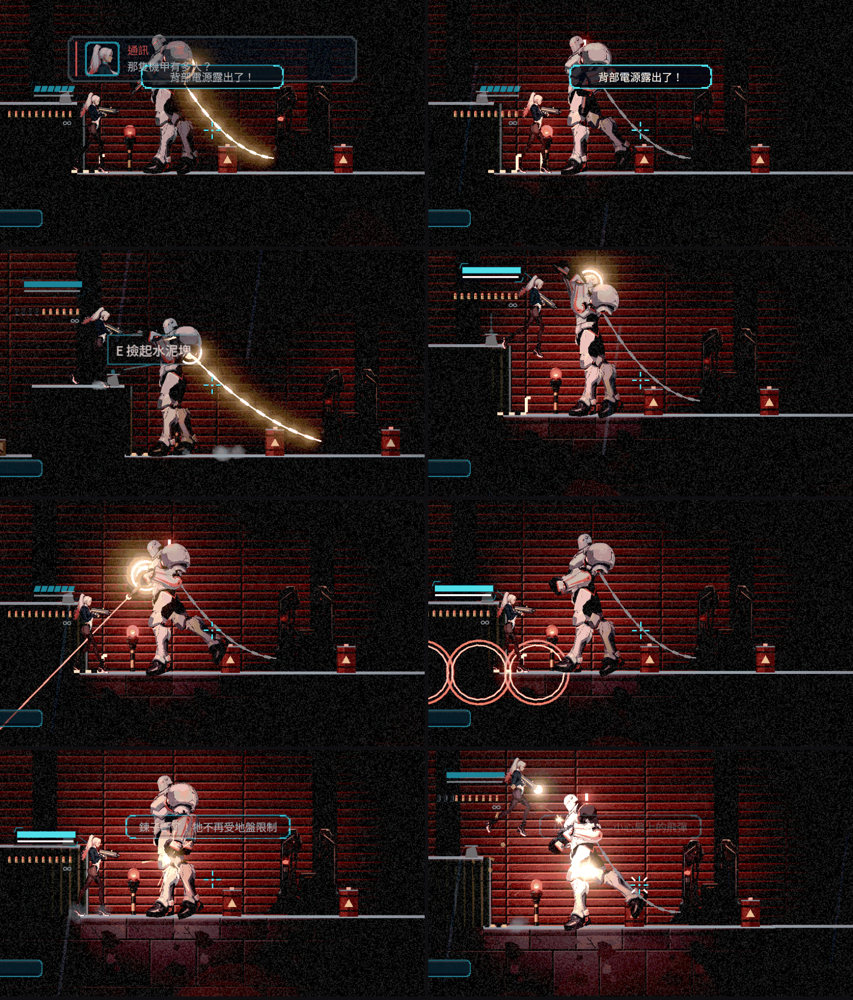

# [NE-253] 重做頭目戰讓每個頭目各有機制

> 狀態：進行中

## 內文

### 需求
現在的頭目太單調，打法都差不多。使用者很喜歡 Project Revenant 的頭目戰：每個頭目有獨立的機制與設計、不同的攻擊方式與攻擊習慣。要重新設計 Nest Egg 的頭目，讓每一個都有自己的核心機制、招式組合、階段變化與玩家的應對方式，並且符合該章的故事與場地。先做第一章的看門狗，設計與資料格式要讓後續頭目可以沿用。

### 來源
使用者 2026-10-11：「我很喜歡 Project Revenant 在 Boss 戰設計，像是每個 Boss 都有獨立機制、設計，不同的攻擊方式，攻擊習慣。現在設計的 Boss 太單調了」。

### 驗收條件
- [x] 先查 Project Revenant 與其他頭目戰做得好的實例，寫明來源、實際看到的做法、採用與不採用的理由，寫進 `design/`；沒看到的內容不寫成已查證
- [x] 設計文件列出每個已定稿頭目的核心機制、招式、預兆、階段、弱點與玩家應對，彼此不重複；與該章劇本、場地、成長階段一致
- [x] 看門狗依新設計實作：至少三種不同性質的攻擊、可辨認的攻擊習慣、階段變化，並保留水位謎與「死後狀態保留」的既有規則
- [x] 每一招有清楚預兆與可行的應對方式（閃、擋、打斷或利用場地），沒有無法反應的傷害
- [x] 頭目的招式、階段與數值由資料描述，新增頭目以資料為主
- [ ] 鍵鼠與手把都能完成頭目戰；普通難度不靠刷錢可通過，各難度有實際紀錄
- [ ] 附實際頭目戰的原生連續畫面，由使用者確認

### 測試流程
1. 進第一章碼頭倉庫頭目戰，完整打一輪，再死亡重試一輪
2. 預期看得出看門狗有自己的打法，每一招看得懂、躲得掉

---

# 跟其他票的關係

- Blocks：無
- Blocked by：無
- Related：NE-252、NE-254、NE-218、NE-81、NE-241、ST-7

---

# Commit-1

## 內文

**問題**：看門狗是監管者的縮小版，三招輪流丟，沒有自己的打法；畫面上也看不出該打哪裡、什麼時候打。

**改動**：先查了 Project Revenant 與幾個頭目戰做得好的例子（Project Revenant 的公開資料只有「每個頭目有獨特機制」與「精準瞄準」的原則，沒有招式細節，已在設計文件寫明），整理成頭目戰的共同規則與九個頭目各自的核心機制表，彼此不重複。看門狗改成「鍊子的長度就是牠的地盤」：牠被鍊在狗屋旁，地上的黃黑線就是鍊子盡頭；在線內引牠撲咬，撲到盡頭會被鍊子扯回、踉蹌，背部電源亮橙色，這是主要的輸出時機。身體全程是裝甲，子彈會彈開並顯示「擋下」；頭只在抬頭吠叫時打開（連打三下可以打斷），槍臂只在舉槍點射時打開。點射的紅線最後一刻會鎖定，跳起或舉盾就能閃。60% 時槍臂壞掉、改打肩部飛彈（地上紅圈、不追蹤）；30% 時鍊子斷掉，牠會連撲與跳壓，撲完或落地都會失衡露出背部。牠有自己的習慣：太近就吠、線內就撲、線外就開槍或叫飛彈、被扯過一次會先退回狗屋喘口氣再換招。每一招都有至少 0.5 秒的預兆與應對方式，招式、階段、部位開關都由資料描述，新頭目可以用同一套格式。看門狗與狗屋移到前廳第 58 欄，左側黃黑線剛好在貨櫃右邊，貨櫃頂是地盤外的高台。生命改為 60（仍符合第一章每區 8 分鐘的節奏預算）。死後保留傷勢的規則不變，而且因為階段由血量推得，斷掉的槍臂和鍊子也會保留；水位謎沒有改動。

**驗收**：自動測試驗證資料讀取與損毀時的安全預設、各距離的選招習慣、三種難度的預兆長度、撲到鍊子盡頭被扯回並打開背部、扯回後退回狗屋、階段轉換、死後回來直接套用階段不重播演出、飛彈離開紅圈就不會受傷、頭部與裝甲的命中。另外用機器人在正式碼頭倉庫以真正的按鍵（滑鼠瞄準與手把右搖桿瞄準各一輪）打完三種難度，全部擊敗。尚未做：真人用實體手把打完、本機原生畫面的連續錄影由使用者確認，待本機原生驗收。

### 測試結果

| 項目 | 結果 |
|---|---|
| 完整測試（新增套件使選擇器跑全部） | 85,673 項檢查，新失敗 0，腳本錯誤 0，退出 0 |
| 機器人實戰（滑鼠瞄準） | 簡單 50 秒／標準 56 秒／困難 49 秒，全部擊敗 |
| 機器人實戰（手把右搖桿，虛擬輸入） | 簡單 110 秒／標準 52 秒／困難 43 秒，全部擊敗 |
| 畫面 | Forward+（軟體 Vulkan）連續截圖；本機原生畫面待驗 |

### 截圖

分支：`feature/combat`，提交：https://github.com/deadline314/Nest-Egg/commit/55403f1f

---

# Commit-2（近戰的應對與看門狗自己的動作）

## 內文

**問題**：近戰一律打敵人的整個身體，看門狗的身體有裝甲，所以近戰在任何時候都被擋下，連背部電源露出時也砍不到；另外看門狗借用了監管者的骨架動作，違反「動作不共用」的規則。

**改動**：有裝甲與弱點窗口的頭目，近戰碰到打開的部位時就打那個部位（一般敵人近戰仍打整體，數值不變）。看門狗被扯回時背部電源在牠背對你的那一側、而且很高：衝刺穿過繞到背後、跳起來砍，就是兩倍的弱點傷害；子彈從正面就打得到。踉蹌、暴走、登場改用看門狗自己的動作資料（目前從監管者複製，之後換四足立繪時各自調整），狀態動作也寫在頭目資料裡。

**驗收**：自動測試：站著近戰平常被裝甲擋下；背部露出時從背後跳起來近戰，兩邊各一次都打到背部電源、兩倍、弱點回饋；看門狗引用的每個動作都存在而且是牠自己的。

### 測試結果

| 項目 | 結果 |
|---|---|
| 受影響範圍（`tools/run_tests_changed.sh`） | 86,648 項檢查，新失敗 0，腳本錯誤 0，退出 0 |

分支：`feature/combat`，提交：https://github.com/deadline314/Nest-Egg/commit/7929c6c8

---

# Commit-3（頭目框架接上四足外觀）

## 內文

**問題**：最新 main 把看門狗換成四足機械犬（NE-218），但頭目的招式姿勢還是人形骨架的動作，換外觀後牠出招時不會蹲低、撲出或抬頭；槍臂壞掉後背上的砲塔也還在，看起來像還能開槍；頭目程式還呼叫一個已經被 NE-262 拿掉的弱點框畫法，整個頭目無法載入。

**改動**：同一份頭目資料可以用在骨架或零件式外觀：招式的預兆與出招姿勢改成四足自己的動作（撲咬前壓低、撲出、點射前縮身、吠叫與叫飛彈時抬頭、被扯回時蹲伏）；槍臂壞掉的階段把整個砲塔從背上拿掉；鍊子扣在頭上。背部電源移到後半身的背上，應對方式隨外形調整：近戰繞到背後砍，子彈從正面要壓低槍口從頭底下斜射，或繞到背後射；設計文件同步。原本為人形骨架做的四個看門狗專用動作已經用不到，移除。

**驗收**：自動檢查：每個姿勢都是四足外觀裡的動作；被扯回時從正面低處斜射背部電源是兩倍弱點命中；背部打開時繞到背後近戰是兩倍弱點命中；槍臂壞掉後砲塔不在畫面上、點射不再出現；三個階段、鍊斷、死後保留傷勢與既有檢查全過。Forward+（軟體 Vulkan）連拍七個招式時刻看過：頭、砲塔與背部的受擊框貼著四足的對應位置；吠叫時抬頭、點射時砲塔對準、飛彈紅圈落在玩家附近；槍臂壞掉後（飛彈與鍊斷兩個時刻）背上已經沒有砲塔。鍵鼠與手把的實戰、本機原生連續畫面與使用者確認仍待驗，兩條維持未勾。

### 測試結果

| 項目 | 結果 |
|---|---|
| 受影響範圍（併入最新 main） | 87,617 項檢查；唯一的新失敗是對負載敏感的蹲下計時檢查，單獨重跑 670 項全過 |
| 第一章敵人、重裝敵人、零件式生物、投擲物 | 740 項，0 失敗 |
| 畫面 | Forward+ 軟體 Vulkan（llvmpipe）七個招式時刻；本機原生畫面待驗 |

### 截圖

分支：`feature/combat`，提交：https://github.com/deadline314/Nest-Egg/commit/9f14f616

