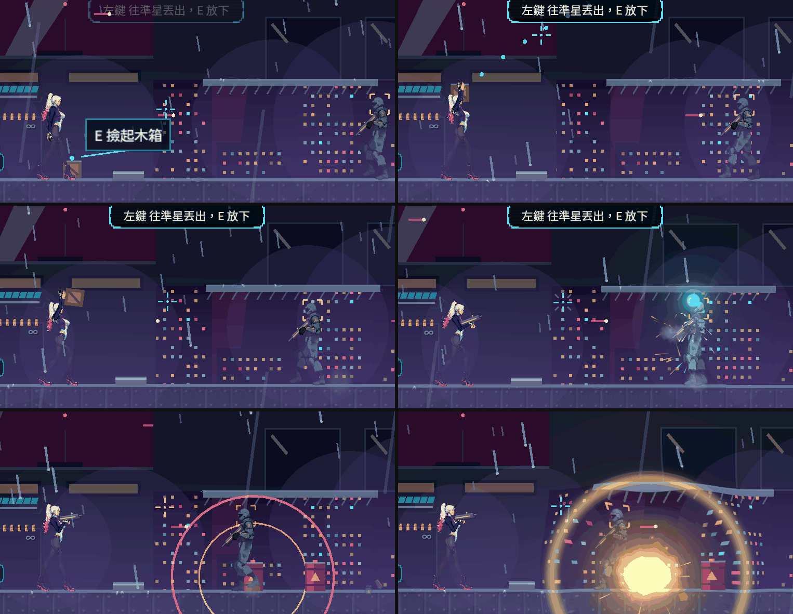
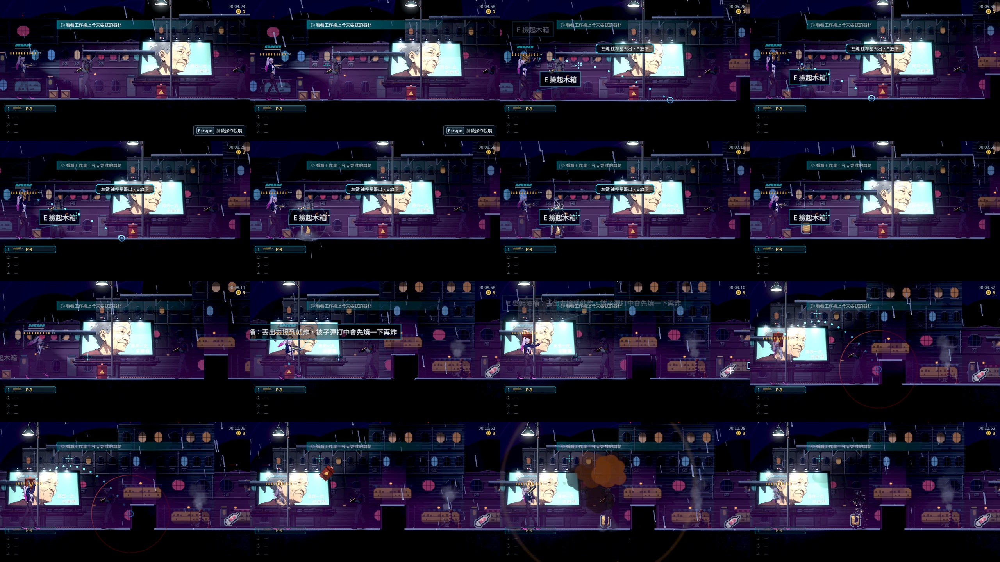
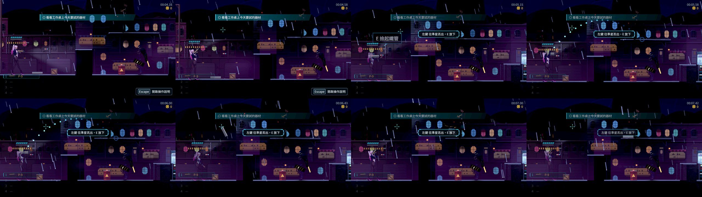
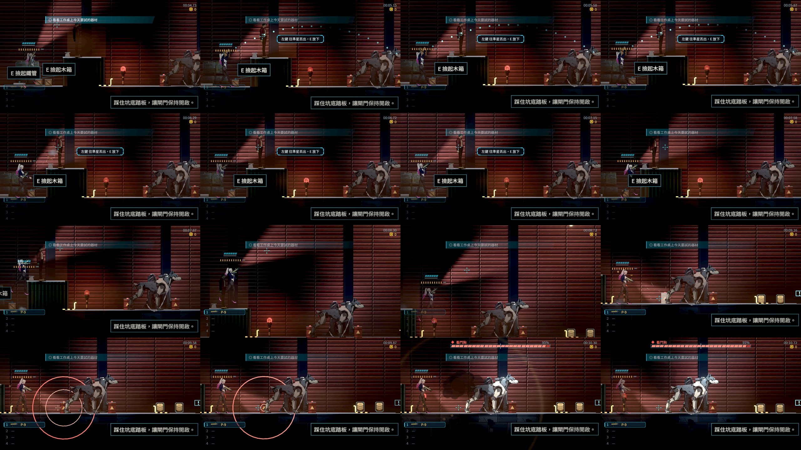
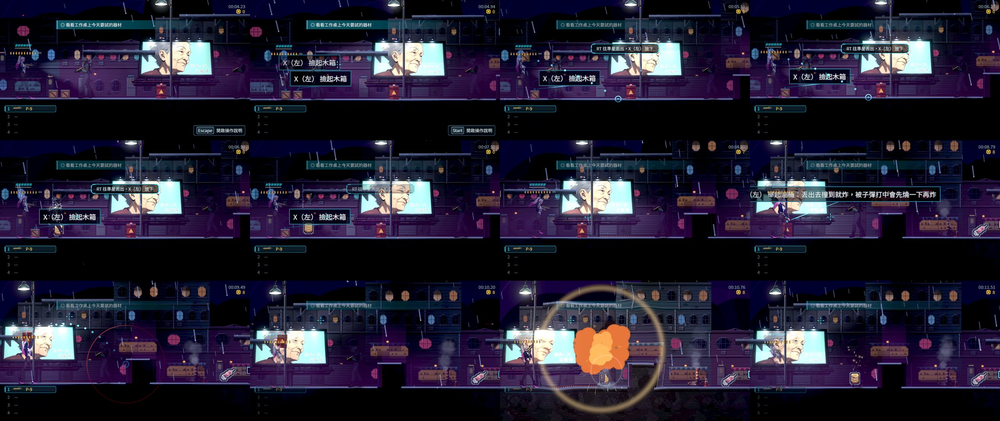
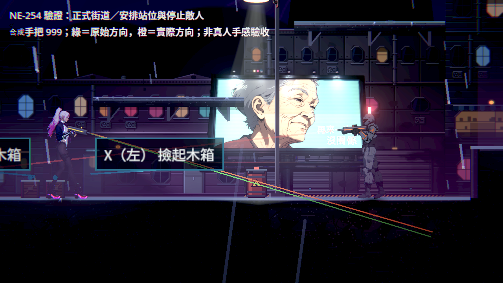
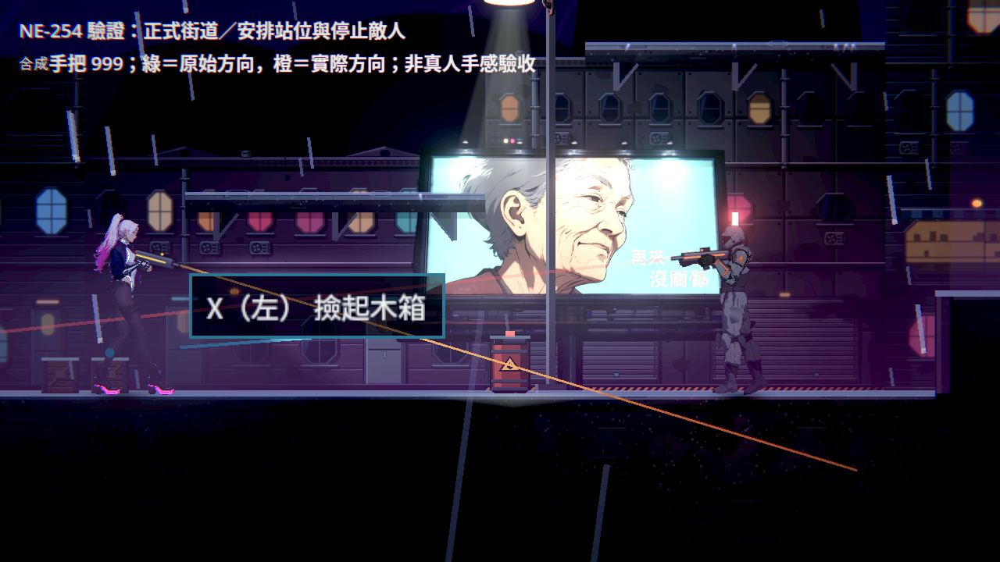
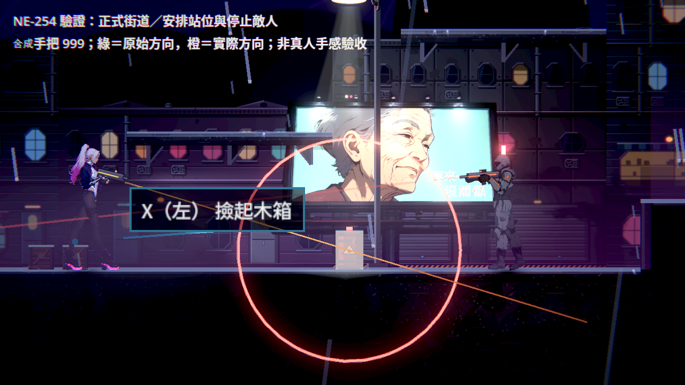

# [NE-254] 加入可撿取投擲物與爆炸油桶

> 狀態：進行中

## 內文

### 需求
使用者很喜歡 Leyla In Veil 的場景互動：可以撿起地上的東西丟向敵人，丟油桶會爆炸，光影與爆炸特效做得好。要在 Nest Egg 加入可撿取並投擲的場景物件，以及會爆炸的油桶，讓戰鬥多一種利用場地的打法。Nest Egg 的地圖有高低起伏與多方向路線，這點與該作不同，投擲要在這樣的地形上好用。

### 來源
使用者 2026-10-11：「我蠻喜歡 Leyla In Veil 的美術設計，特別是地圖的效果，像是光影、爆炸特效、可以撿取地上的東西丟向敵人，丟油桶會爆炸之類的」。

### 驗收條件
- [x] 先查 Leyla In Veil 的實際畫面與做法，寫明來源、實際看到的內容、採用與不採用的理由，寫進 `design/`；沒看到的內容不寫成已查證
- [x] 玩家可以撿起指定的場景物件並丟向瞄準方向；撿、舉、丟各有動作，丟出後依重量有不同軌跡與落點
- [x] 丟中敵人有傷害、擊退與命中回饋；丟空會落地並留下合理結果
- [x] 油桶被丟出撞擊或被子彈打中會爆炸，範圍傷害對敵人與玩家都有效，有清楚預兆與爆炸特效，不過曝、不遮住危險
- [x] 高低平台、斜向與上下投擲都可用，物件不會卡進地形或穿牆
- [ ] 鍵鼠與手把都能操作，提示一句講清楚；撿取、投擲與既有的射擊、近戰、格擋不互相卡住
- [x] 可投擲物與油桶由資料描述與擺放，新增種類不用改程式；物件數量有上限，重進場景不累積
- [x] 第一章至少兩處有擺放並實際可用，附原生連續畫面

### 測試流程
1. 進第一章有擺放的區域，撿起物件丟向敵人
2. 把油桶丟向一群敵人，再試用子彈引爆
3. 預期命中有回饋，油桶爆炸造成範圍傷害

---

# 跟其他票的關係

- Blocks：無
- Blocked by：無
- Related：NE-240、NE-95、NE-236、NE-253、BG-21

---

# Commit-1

## 內文

**問題**：場景裡的東西只能當背景或打爆，不能拿來用；油桶只能在原地被射爆。

**改動**：先查了 Leyla In Veil 公開的商店頁與開發公告（證實有可投擲物、會被子彈引爆的油桶與爆炸特效，也修過「近距離射油桶讓互動卡住」；投擲的操作細節沒有公開資料，已在設計文件寫明），以及 Bulletstorm、Dead Cells 等例子。現在站在木箱、鐵管、水泥塊或油桶旁按互動鍵會彎腰撿起、舉在頭上（雙手空出、武器收起、越重走越慢），按射擊鍵往準星方向丟、再按互動鍵放下；拿著時畫出拋物線與落點，往上、往下、斜丟都看得出會落在哪。輕的飛得遠而平、重的近而彎；丟中敵人有傷害、擊退與硬直，木箱撞到就碎，鐵管與水泥塊落地彈一下後可以再撿；打到看門狗的裝甲一樣會彈開。油桶丟出撞到東西立刻爆；放在地上被子彈打壞時先燒 0.6 秒引信（警示燈快閃、地上畫出越縮越緊的爆炸範圍）再爆，敵我都會受傷、會穿過裝甲，旁邊的油桶會一個接一個連鎖。衝刺、近戰、格擋會先放下東西再照常動作，受傷時東西掉在原地。種類與擺放都是資料，每個區域最多 24 個，重進區域依地圖重擺不會累積。第一章擺在碼頭倉庫前廳（貨櫃前、貨櫃頂高台、狗屋兩側的油桶）、倉庫閘門廳前、街道廣場與街道路障（往高處平台上的槍手斜丟）。

**驗收**：自動測試用真正的按鍵撿起、舉著、丟出：打中敵人扣血、丟空落地平躺可再撿、往斜上落到單向平台、從高處往下丟落到地面、往牆丟不穿牆；油桶被射先燒引信再爆、敵人與太近的玩家都受傷、兩個油桶依序連鎖、丟出的油桶撞到敵人立刻爆；拿著時射擊不開槍、衝刺先放下且照常衝刺、互動放下、放下後可開槍、受傷會放下；第一章兩個區域有擺放、離出入口夠遠、在上限內、重進區域數量不變。尚未做：實體手把操作與本機原生連續畫面，待本機原生驗收。

### 測試結果

| 項目 | 結果 |
|---|---|
| 新增投擲物套件 | 78 項檢查全過（同時跑三份也全過） |
| 完整測試（新增套件使選擇器跑全部） | 85,673 項檢查，新失敗 0，腳本錯誤 0，退出 0 |
| 畫面 | Forward+（軟體 Vulkan）連續截圖；本機原生畫面待驗 |

### 截圖

分支：`feature/combat`，提交：https://github.com/deadline314/Nest-Egg/commit/0d0c7053

---

# Commit-2（擺放改由第一章產生器輸出、爆炸確認走共用火球）

## 內文

**問題**：第一章的投擲物與油桶是直接改在產生器的輸出檔上，下次重產地圖就會消失；而且借用了全章已經有意思的地圖字元（同一個字元在別的區域是箱子、文件或樓梯出入口），地圖資料前後矛盾。併入最新 main 後，爆炸已改成全遊戲共用的火球（NE-95），需要確認油桶沒有另做一套。

**改動**：投擲物與油桶登記進第一章產生器，用全章沒用過、也不是引擎保留的字元，擺放位置不變（街道廣場、路障前；倉庫前廳看門狗地盤兩側的油桶、貨櫃前的鐵管與箱子、貨櫃頂的水泥塊、閘門廳的油桶與箱子），重產後其他區域逐位元不變。新增一項檢查：第一章每個區域的地圖字元都指同一種東西。油桶爆炸沿用共用的爆炸與火球，沒有另做特效。

**驗收**：重產第一章後，與原本的擺放逐格比對只有字元換成新登記的字元；投擲物套件 148 項全過，包含兩個區域都有擺放、離出入口夠遠、上限內、重進不累積、全章字元一致、丟出的油桶撞到敵人爆炸且畫面由共用火球畫在油桶的位置。實體手把操作與本機原生連續畫面仍待驗，兩條維持未勾。

### 測試結果

| 項目 | 結果 |
|---|---|
| 投擲物套件 | 148 項，0 失敗 |
| 產生器重產 | 只改街道與倉庫兩個區域；其他區域輸出不變 |

分支：`feature/combat`，提交：https://github.com/deadline314/Nest-Egg/commit/afdef772

---

# Commit-3（手把這條路、丟出時多開一槍，與第一章的原生連續畫面）

## 內文

**問題**：前兩次交付留下兩條待本機驗收：手把操作，以及第一章實地可用的原生連續畫面。原本的自動測試直接送「動作」、而且射擊鍵只按一格就放開，沒有經過手把的按鍵綁定，也不像真人按一下會跨好幾格。

**改動**：
- 補了一組送真正手把事件的檢查（X 撿起、右搖桿瞄準、RT 丟出、X 放下；拿著時按近戰 Y、格擋 LT）。這組檢查抓到一個真的問題：丟出去之後扳機還按著的那幾格會被當成開槍，每丟一次就多開一槍（拿近戰武器時是多揮一刀）；滑鼠左鍵也一樣。現在丟東西用掉的那一下射擊鍵要先放開，才會再算開槍或近戰；放開後下一次扣扳機照常開槍，衝刺、格擋、近戰不受影響。
- 新增一個在正式第一章地圖上拍連續畫面的情境，用的是地圖本來就擺好的東西：街道廣場撿木箱丟清掃兵、再舉起油桶丟向下一個敵人；街道路障撿鐵管，隔著路障斜丟高台上的槍手；碼頭倉庫前廳撿木箱丟貨櫃頂的槍手，翻過貨櫃後開槍打看門狗地盤旁的油桶。
- 設計文件的操作說明原本寫「滑鼠或右搖桿」丟出，容易讀成右搖桿是丟出鍵，改寫清楚：射擊鍵丟出（滑鼠左鍵；手把 RT），準星用滑鼠或右搖桿；互動鍵撿起與放下（E；手把 X）。

**驗收**：原生 Forward+（Arc B580）在三個地點各拍一段，鍵鼠與手把各一輪，逐格看過：走到物件旁出現「撿起」提示、撿起後舉在頭上並出現一行操作提示、瞄準時畫出拋物線與落點（路障那一段往斜上越過路障、前廳那一段往貨櫃頂）、丟中敵人掉出掉落物；油桶舉起時地上畫出爆炸範圍，丟出撞到就爆；前廳的油桶被子彈打中後先畫出越縮越緊的警示圈再爆。手把那一輪的提示是「RT 往準星丟出，X 放下」與「X 撿起木箱」。為了看得清楚每一格，拍攝時敵人站在地圖原本的位置不行動（照樣受傷、被炸死）、主角不會受傷、沿路的通訊與鎖場遭遇關掉；敵人會動會開火時的互動由自動測試驗。畫面左上的任務提示停在序章的目標，是因為拍攝直接從新存檔開第一章的地圖，不是正式流程的畫面。

第 19 條（鍵鼠與手把都能操作）仍未勾：手把這條路目前是「合成的手把事件經過按鍵綁定」通過，還沒有人拿實體手把操作過。待使用者拿實體手把確認：X 撿起與放下、右搖桿瞄準時拋物線跟不跟手、RT 丟出、拿著時按 B／Y／LT 會不會卡。另外手把的瞄準輔助只認敵人：拍廣場那一段時用搖桿瞄油桶，子彈都飛向油桶後面的敵人，油桶沒被打到（所以那一段改成把油桶舉起來丟）。要不要讓油桶也算輔助瞄準的目標，交戰鬥組判斷。

### 測試結果

| 項目 | 結果 |
|---|---|
| 投擲物套件（含新增的手把事件檢查） | 188 項，0 失敗 |
| 修正前用同一組檢查 | 「RT 丟出時不開槍」失敗：彈匣 12 → 11 |
| 原生連續畫面 | 3 段 × 鍵鼠、手把各一輪，自然結束、0 錯誤 |
| 受影響範圍的測試（併入最新 main 後） | 89761 項檢查；新失敗 2、已知失敗 0，兩項都是機器忙時的計時檢查、和這張票無關：音效「壓低後平順恢復」（乾淨的 origin/main 單獨跑 6 次也失敗 4 次）、「12 個同時爆炸多花的每格時間」（超出預算 0.83 毫秒，單獨重跑 3 次都過） |

### 截圖

分支 `feature/scene-assets`；提交見[遠端 main 上本票的提交](https://github.com/deadline314/Nest-Egg/commits/main/pm/Nest-Egg/%5BNE-254%5D%E5%8A%A0%E5%85%A5%E5%8F%AF%E6%92%BF%E5%8F%96%E6%8A%95%E6%93%B2%E7%89%A9%E8%88%87%E7%88%86%E7%82%B8%E6%B2%B9%E6%A1%B6.md)。

# Commit-4（投擲先撞牆、油桶瞄準與可撿提示）

## 內文

同一格跨過薄牆時，鐵管原本會先傷到牆後的敵人，才處理牆的碰撞。現在先確認物件這一格真正能走到哪裡，只在那段路徑內找命中；牆前的敵人仍會先被打到，反彈、單向平台、油桶引信與連鎖保留。

上一輪留下的手把問題也已處理：搖桿已經瞄到前方油桶時，後面的敵人不再拉走方向；旁邊、牆後、敵人後面與拿在手上的油桶不搶瞄準。近處有好幾件東西時，只由實際會撿到的那件顯示邀請；空中尚未落定、拿著別件物品時不再出現按了無效的撿取提示。

正式街道的原生驗證使用地圖原有油桶與真正玩家開火：合成手把 RT 兩次消耗兩發並點燃油桶。原版同一案例仍能打中油桶，但方向會偏離原始搖桿輸入，因此沒有把它說成「原版一定射空」。本次仍沒有實體手把與真人全流程，第 19 條維持未勾。

[完整結果、失敗版本、原始畫面與同類遊戲參考](attachments/NE-254-boundaries/README.md)；[實作範圍](../../design/15-combat-feel/THROWABLE_BOUNDARIES.md)。原選擇器回歸與各階段數字記在附件 validation.json。

### 截圖

### 測試結果

| 項目 | 結果 |
|---|---|
| 原範圍選擇器（固定 a66794ec） | 66 組、64,100 檢查、0 新／已知失敗、退出 0，557 秒 |
| 最終套件的原版負控制 | 全新隔離目錄，326 檢查、6 個缺陷失敗；最終測試來源與候選還原 SHA 相同 |
| 薄牆的真物理原生對照 | 原版 3 檢查／1 失敗、敵人 4→1；修後 3／0、敵人 4→4；皆完整 30 Hz 步進 |
| 正式街道的原生輸入 | 修後 6／0、RT 兩發與引信成立；軟體 Forward+，0 ERROR |

薄牆修前／修後、研究原圖及所有限制見上方附件，完整 CI 以本次推送的 Actions 為準。
