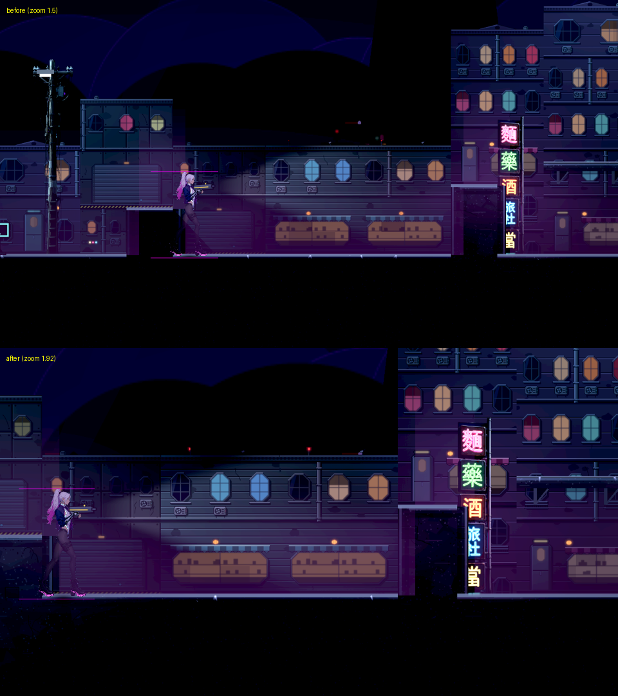
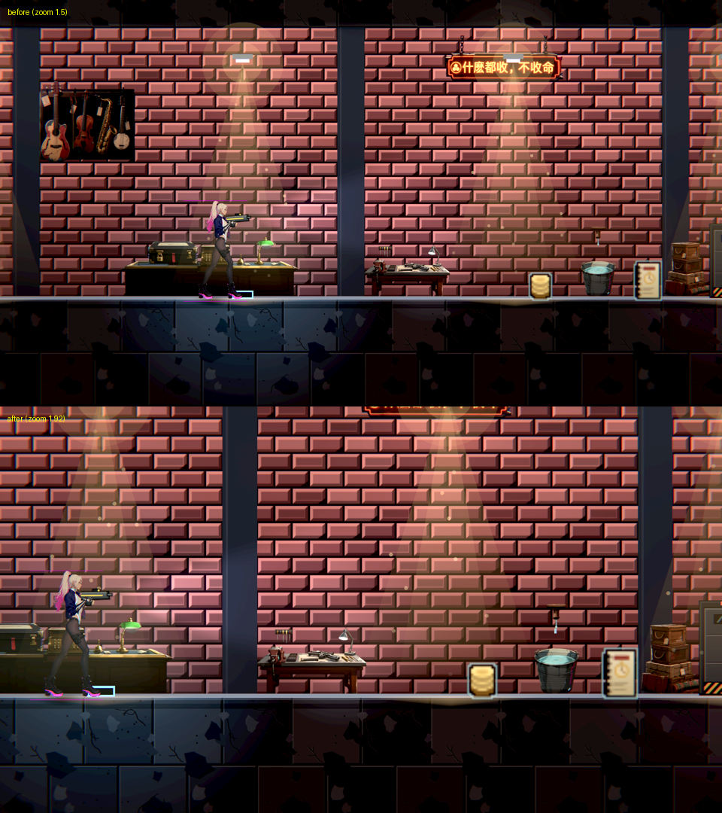
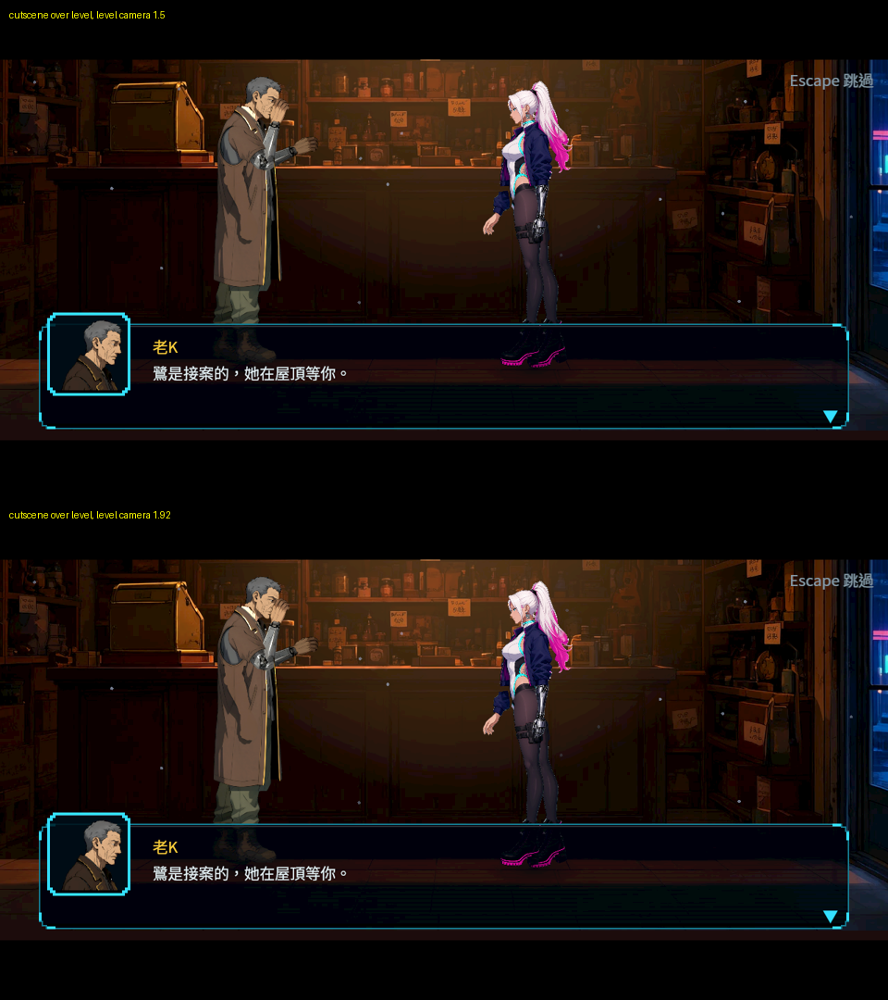
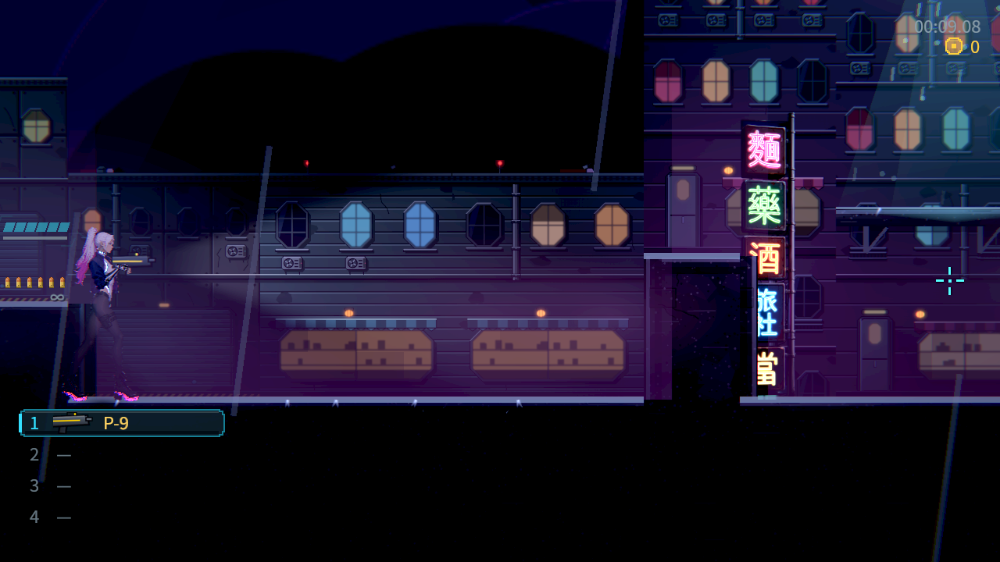
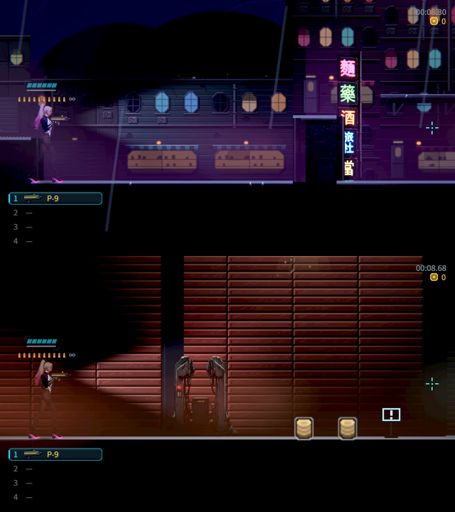

# [NE-256] 拉近關卡鏡頭讓主角佔畫面三分之一

> 狀態：進行中（鏡頭已拉近並驗證構圖、視野、過場與畫面範圍效果；序章與第一章逐關試玩待序章進 main 與本機實際操作）

## 內文

### 需求
一般關卡裡主角在畫面上太小，站立時只佔畫面高度約四分之一，角色的細節與動作看不清楚。把關卡鏡頭拉近，讓主角站立時至少佔畫面高度三分之一，同時不讓玩家因為看得比較近而來不及反應。

現況數字、業界資料與採用方向見[鏡頭遠近與次級擺動](../../design/20-campaign-experience/FRAMING_AND_SECONDARY_MOTION.md)。

### 來源
2026-10-11，使用者：「調整一下遊戲的視角，就是要放大一點，現在主角占畫面大概只有 1/4，可以的話我覺得至少要 1/3」「看一下業界大家都是怎麼做以及怎麼調會比較好」。

### 驗收條件
- [x] 一般關卡中主角站立時佔畫面高度 31%～35%：在 1280×720 與 1920×1080 的原生畫面截圖上量頭頂到腳底的像素高度，附修前修後同位置對照。
- [x] 主角面向的前方可見距離不少於拉近前（約 300 世界像素）：以截圖或量測工具確認；跑、跳、下落、瞄準上下時主角不會貼到畫面邊緣，鏡頭不抖、不急拉。
- [ ] 序章與第一章每個關卡走一遍：敵人進畫面時玩家仍有時間反應，沒有「畫面外被打」變多的情況；平台跳躍的落點在起跳前看得到。
- [x] 依畫面範圍運作的效果正常：燈光、雨、霧、地圖上的對話氣泡、敵人與道具進畫面啟動、鏡頭震動；HUD 與提示不被角色遮住。
- [x] 過場動畫的構圖與拉近前相同。
- [x] 鏡頭倍率與相依的偏移值寫在資料檔，改數字不用改程式；資料遺失或數值不合理時記錄錯誤並退回預設值。
- [x] 參考作品的角色佔比用實際截圖量過並記在設計文件（至少 Leyla In Veil 與另外兩款同類作品），標明量測方式。

### 測試流程
1. 進入第一章任一關卡，站在平地截圖，量主角高度佔比。
2. 往兩個方向跑、跳上平台、從高處落下、上下瞄準，看鏡頭與前方視野。
3. 逐關走過序章與第一章，注意敵人出現的時機與平台落點。
4. 播放三場過場，和拉近前的截圖比對構圖。
5. 執行受影響範圍的測試。

---

# 跟其他票的關係

- Blocks：無
- Blocked by：無
- Related：NE-222、NE-228、NE-254、NE-257、BG-30、NE-264

---

# Commit-1

## 內文

**問題**：關卡裡主角站著只佔畫面高度約四分之一（實測 24.9%），角色的細節與動作看不清楚；鏡頭的倍率與相依的偏移全部寫死在程式裡，改一個數字要動好幾個地方。

**改動**：
- 先量參考作品：Steam 官方遊戲截圖裡，Leyla In Veil 的主角約佔 22%～25%、Blasphemous 約 11%、Katana ZERO 約 9%，量法與數字記在設計文件。三款都比我們拉近後小，所以拉近的代價（視野變窄）要另外補。
- 鏡頭的倍率、前瞻、瞄準偏移、垂直偏移、上下死區、下落預視、跟隨速度全部移到資料檔，改數字不用改程式；某一項不合理或檔案讀不到時，記錄是哪個檔、哪個欄位，退回預設值，遊戲照常進行。拉近前的整組數值也保留在資料裡，可以整組切回。
- 倍率從 1.5 拉到 1.92，主角約佔畫面高度 32%。
- 前方視野補回來：鏡頭往面向的方向偏更多，面向的前方仍看得到 303 世界像素（拉近前 299）。代價是背後只看得到約 31 像素，所以加了兩條規則：背後近處有正在交戰的敵人時，鏡頭自動讓出空間讓牠留在畫面裡；畫面裡有敵人站在較高的平台上時，鏡頭稍微往上抬，頭不會被切掉。
- 轉身時鏡頭的橫移速度有上限，邊跑邊轉身時不會比拉近前甩得更快。
- 垂直構圖重調：跳到最高時頭頂不會出畫面，腳下仍留下落時的預視。
- 鏡頭震動與開槍後座換算成和拉近前一樣的畫面幅度，不會因為拉近而晃得更大。
- 新增構圖量測工具：量主角在畫面上的像素高度與前後視野，也能用真的按鍵跑、跳、轉身、上下瞄準，記錄主角離畫面四邊多近、鏡頭橫移多快；還能在真實關卡上播過場，比對不同鏡頭設定下的過場畫面。

**驗收**（Forward+，雲端軟體 Vulkan）：
- 主角高度：第一章六個地點（當鋪、街道、屋頂、倉庫、復原館、麵攤），1280×720 與 1920×1080 都是 31.8%～31.9%；修前同位置 24.7%～25.0%。
- 前方視野 303 世界像素（修前 299）。
- 實際按鍵跑、跳、轉身、上下瞄準：主角離左右邊緣至少 59 設計像素，跳到最高時頭頂離上緣 44～47（修前 29），腳下至少 41；轉身時畫面橫移最快 576～594 設計像素／秒（修前 604）。
- 過場：在當鋪關卡上播開場過場，關卡鏡頭 1.5 與 1.92 兩張畫面只差 0.05% 的像素（飄塵與待機小動作），構圖相同。過場有自己的鏡頭與畫布，不受關卡倍率影響。
- 可讀性：拉近後先發現看守長場地站在上層平台的敵人上半身被畫面切掉，敵人對比掉到 0.36。加了「高處敵人時鏡頭上抬」後恢復到 0.51／0.52；四組完整結果見下表。
- 依畫面範圍運作的效果：燈光預算、雨、霧、地圖氣泡都是依實際畫面範圍計算，拉近後在截圖裡正常；敵人進畫面啟動的邊距沒變，前方啟動距離和拉近前相同；震動已換算。
- 主角身旁的彈帶與護盾條在面向前方時原本被畫面邊緣切掉（屬介面排版，已開 [NE-264](%5BNE-264%5D%E4%BF%AE%E6%AD%A3%E5%BD%88%E5%B8%B6%E5%9C%A8%E6%8B%89%E8%BF%91%E9%8F%A1%E9%A0%AD%E5%BE%8C%E8%A2%AB%E7%95%AB%E9%9D%A2%E9%82%8A%E7%B7%A3%E5%88%87%E6%8E%89.md) 交介面組）。介面組修好後 rebase 到最新 main 重拍：彈帶與護盾條在畫面邊緣時移到頭頂，完整顯示，武器欄不碰腳（下方截圖）。地面霧每個關卡都有，截圖裡正常。
- 還沒過：序章還沒進 main，序章與第一章逐關試玩（敵人出現時機、平台落點）要等序章與本機實際操作。

分支：[feature/staging](https://github.com/deadline314/Nest-Egg/tree/feature/staging)，已併進 main：[a49cbd33](https://github.com/deadline314/Nest-Egg/commit/a49cbd331c0cb3f0f0239433e004624887ad187f)

### 測試結果

| 項目 | 結果 |
|---|---|
| 受影響範圍的測試（選擇器挑出 2 套件，832 項） | 通過，新失敗 0 |
| 整個分支相對最新 main 的受影響範圍（86183 項） | 通過，新失敗 0。過程中抓到兩個測試的前提被拉近改變：武器欄測試把主角移開後仍面向右（拉近後面向右時主角固定在畫面左側，和武器欄重疊時讓位是對的），改成轉身面向左再檢查；幽影現形測試沒有指定主角面向，面向左時燈在背後的視野外被燈光預算關掉，改成明確面向幽影。兩項檢查的意思都沒變 |
| 另外挑的 20 個依畫面範圍運作的套件（遭遇、打擊、近戰、地圖氣泡、環境、提示、HUD、地圖、移動、死亡流程等，10356 項） | 通過，新失敗 0 |
| 新增檢查：資料檔沒有錯誤、壞值逐欄回報並退回預設、主角佔比與前方視野、背後交戰的敵人留在畫面裡、前方敵人不縮前瞻、高處敵人上抬且有上限、別層樓的敵人不上抬、轉身橫移有上限 | 通過 |
| 第一章可讀性檢查（Forward+，光影低／高） | 低、高都通過（主角 ≥ 0.6、敵人 ≥ 0.45、地面邊緣 ≥ 1.0） |
| 第一、二關可讀性檢查（Forward+，光影低／高） | 低、高各 16 個點全部通過（看守長場地敵人 0.53／0.50，最低的夾層區主角 0.65／0.66） |

### 截圖

