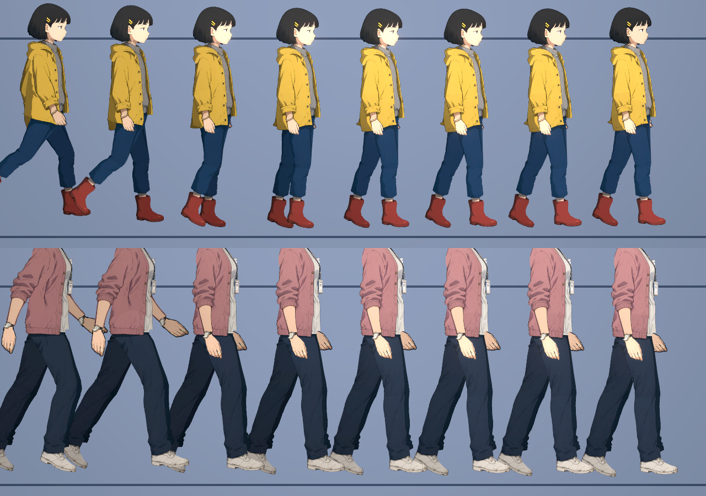
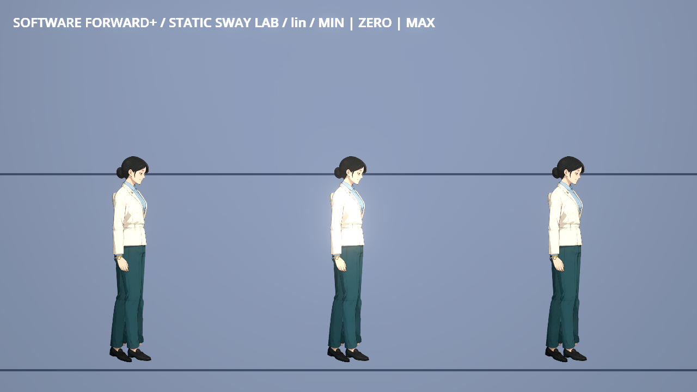
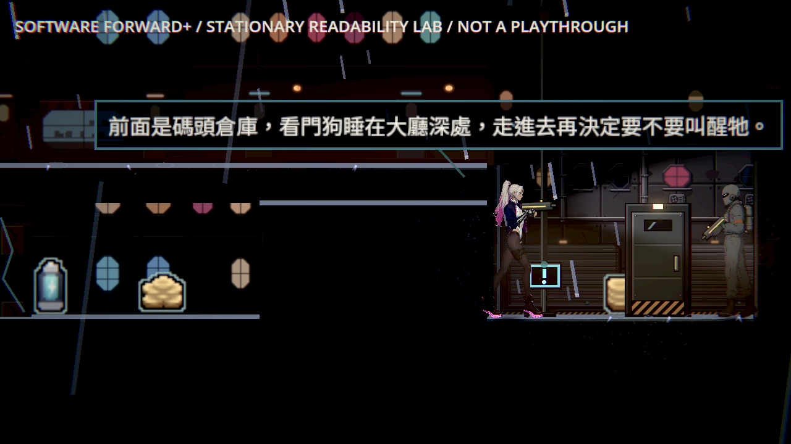
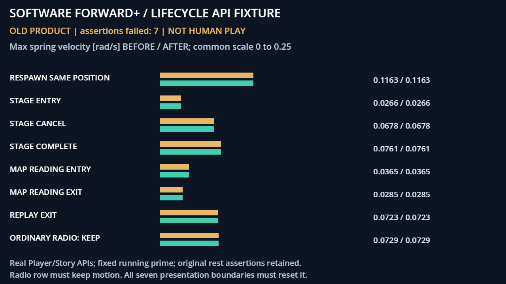
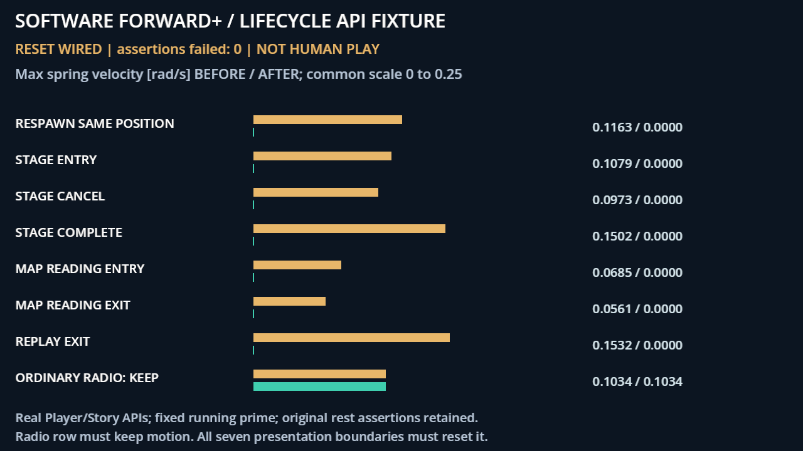
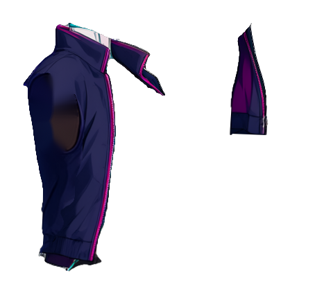
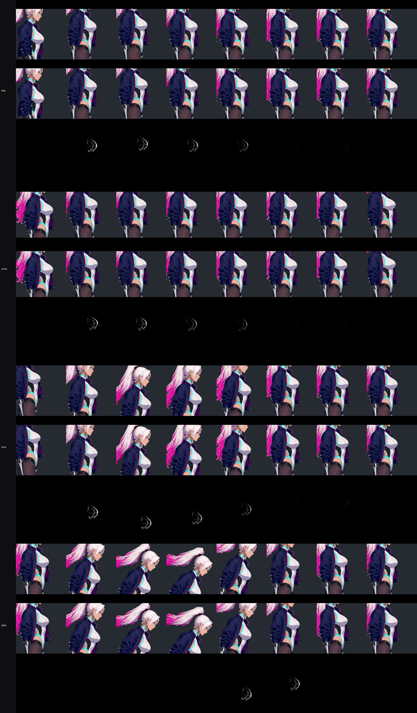
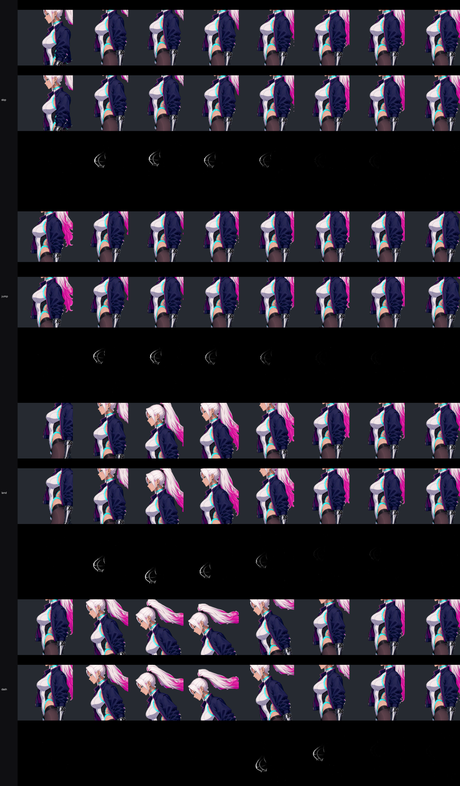
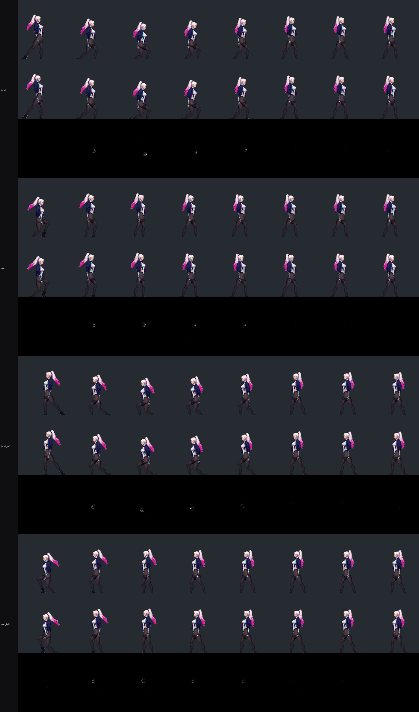

# [NE-257] 加入衣服頭髮與胸部的次級擺動

> 狀態：進行中

## 內文

### 需求
主角動起來時身上的東西幾乎不跟著動，看起來僵硬。讓頭髮、衣服、胸部等部位在移動、起跳、落地、急停、轉身時有合理的跟隨與延遲，幅度克制、看起來自然，不誇張、不持續亂晃。

現況、業界資料與採用順序見[鏡頭遠近與次級擺動](../../design/20-campaign-experience/FRAMING_AND_SECONDARY_MOTION.md)。

### 來源
2026-10-11，使用者：「可以增加一些東西的擺動，例如衣服、頭髮、胸部等等，最好是合理的擺動。看一下業界大家都是怎麼做以及怎麼調會比較好」。

### 驗收條件
- [x] 馬尾：跑、急停、起跳、落地、衝刺、轉身時根部先動、末端晚一點跟上；靜止 2 秒內停下來；任何動作都不會甩到穿過臉或折成不合理的角度。
- [ ] 外套：下襬與袖口在起停與落地時有很小的延遲，站著不動時不飄；外套仍然讀成穿在身上的短夾克。
- [x] 胸部：落地、急停、起跳時有一次輕微的跟隨後就停，走路與站立時不持續晃動；輪廓不變形、不和外套或手臂穿插。
- [x] 每一項都附原生畫面的連續影格（跑→急停、起跳→落地、衝刺、轉身各一組），兩個面向、遊戲倍率與過場倍率都看過。
- [x] 翻面、瞬移、重生、進出過場時不會甩一大下；畫面更新率 30 與 60 時擺動幅度相近。
- [x] 擺動的設定寫在角色自己的資料檔，沒有設定的角色維持原樣；設定缺漏或不合理時記錄錯誤並退回不擺動。
- [x] 效能：每個角色每格增加的成本用既有的效能探針量過並記在票上，胸口若使用可變形區域，頂點數算進現有預算。
- [x] 接點逐格稽核與既有的動畫、動作測試沒有新的失敗。

### 測試流程
1. 用角色預覽工具輸出跑→急停、起跳→落地、衝刺、轉身的連續影格，兩個面向各一組。
2. 進關卡實際操作，看站立、走、跑、跳、蹲、受擊、倒地時各部位的擺動。
3. 播放一場過場，確認進出時沒有甩動。
4. 執行效能探針與受影響範圍的測試。

---

# 跟其他票的關係

- Blocks：無
- Blocked by：NE-222
- Related：NE-221、NE-256

---

---

# Commit-1

## 內文

使用者 2026-10-12 要求把衣服、頭髮的擺動做下去（含主角）。這次先做機制與 NPC，主角只做了一項修正。

**做了的。**
- **不重切零件的區域擺動**：頭髮、衣襬、掛牌這些原本烤在頭或身體整張圖裡，不會動。新增一種寫法：在角色資料裡標出一塊區域的根部與末端，這一塊會繞著根部跟彈簧彎，其他部分不動。不需要多切零件、不多骨頭。
- **10 個角色加上擺動區域**：小薇（短髮、雨衣後襬）、阿梨（短髮）、葉（短髮）、芷姐（馬尾、識別證、開襟衫後襬）、榕伯（鬍子、襯衫前後襬）、鷺／收帳人槍手／林小姐（外套後襬）、收帳人打手（鑰匙串）、利息（懷錶鍊）。幅度都設得很小。
- **阿梨、阿婆的圍裙**是獨立零件，有自己的彈簧，坐下時搭在腿上。
- **彈簧撞到上下限時速度歸零**（設計文件列的共通規則之一）。這一項對主角的馬尾與外套也生效。

**還沒做的（驗收條件都還不能勾）。**
- 主角：馬尾收緊上限與「根部先動、末端晚跟」、外套袖口、胸部，都還沒動。
- 翻面、瞬移、重生、進出過場時重設彈簧，還沒做。
- 區域擺動只看了「跑→急停」的靜態連續格，幅度很小，從靜態圖我分辨不出頭髮與衣襬是不是真的在動、動得自不自然。需要在遊戲裡實際走動看，或錄連續畫面。這一點我沒有驗證到。
- 效能探針還沒量。區域擺動多了每個零件的著色器參數，沒有多頂點。
- 沒有設定的角色維持原樣，這一點由既有測試覆蓋（全部通過）；設定錯誤時會記錄警告並略過。

### 測試結果

| 項目 | 結果 |
|---|---|
| 受影響範圍測試 | 58,519 項檢查，0 新失敗、0 已知失敗，輸出沒有腳本錯誤 |
| 新增的自動檢查 | 阿梨的頭髮擺動區域有接到頭部零件 |
| 原生畫面 | 小薇、芷姐的跑→急停八格（看不出擺動幅度，見上） |

### 截圖

分支 `feature/character-art`。

---

# Commit-2

## 內文

**主角。**
- 翻面與瞬移（重生、過場換位）時，頭髮與衣襬直接回到靜止位置，不再甩一大下。另外提供一個重設的入口給重生與進出過場用（還沒有接到那些地方）。
- 馬尾：上限收緊（原本整條可以甩到接近水平以上），並改成根部反應快、末端較慢較軟，末端會晚一點跟上。

**新增的自動檢查**：跑步時馬尾不超過上限；停下 2 秒內靜止；翻面、瞬移不甩；更新率 30 與 60 時擺幅相近。全部通過。

**驗收條件還不能勾的原因。**
- 我只有靜態的連續格。停、跳、衝刺三組新舊對照看起來差異很小，「根部先動、末端晚跟」從靜態圖看不出來，需要實際操作或錄影確認。
- 外套袖口、胸部沒有做。主角的軀幹是會脫落的裝甲層加底層加外套三層疊在一起，胸口要擺動得三層一起變形，這一輪沒有動。
- 重設入口還沒接到重生與過場；效能探針還沒量。

### 測試結果

| 項目 | 結果 |
|---|---|
| 受影響範圍測試 | 31,478 項檢查，0 新失敗、0 已知失敗，輸出沒有腳本錯誤 |
| 新增檢查 | 上限、2 秒靜止、翻面、瞬移、30／60 更新率，共 5 類通過 |

分支 `feature/character-art`。

---

# Commit-3

## 內文

**問題**：部分角色的衣襬已設定擺動，實際卻沒有動；共用法線偏差也影響角色受光。

**改動**：網格上的既有擺動現在會生效，法線取樣一致；碼頭以局部霧量調整維持敵人的辨識度。

**驗收**：10種外觀14區域綁定與移動檢查5427項通過；兩面向20張固定極值圖，另做第一章18點、第二章20點的高低品質及復原館／帳房檢查。腳本成本、首輪失敗與重測均保留，這次沒有完成主角胸口、袖口與全動態條件。

[完整測試、失敗、效能與來源](attachments/NE-257-mesh-sway/README.md)；[本票提交](https://github.com/deadline314/Nest-Egg/commits/main/pm/Nest-Egg/%5BNE-257%5D%E5%8A%A0%E5%85%A5%E8%A1%A3%E6%9C%8D%E9%A0%AD%E9%AB%AE%E8%88%87%E8%83%B8%E9%83%A8%E7%9A%84%E6%AC%A1%E7%B4%9A%E6%93%BA%E5%8B%95.md)。

---

# Commit-4

## 內文

**問題**：同一位置重生或從過場回來時，可能接續上一次的頭髮與衣襬動量。

**改動**：重生、過場進出與取消、地圖閱讀進出、回看結束都重設既有動態；普通通訊保持原來的持續動作。

**驗收**：正確負控制抓到七個缺口；修後相關19組42,590檢查、0新失敗。相同原生機制觀察七處都回到靜止、普通通訊保持，這些數值不替代整票未勾的完整動作與部件外觀。

[全部測試、原生範圍、失敗與來源](attachments/NE-257-lifecycle-reset/README.md)。

---

# Commit-5

## 內文

**問題**：凜的衣襬彈簧沒有帶動真正外套，靜止時微風也讓衣髮持續動。

**改動**：近遠下襬現在有小幅跟隨，肩領與原袖片保持固定，站定後收束。

**驗收**：正確負控制5438項抓到8失敗；修後原受影響與額外動畫7組9596項、0新失敗。兩側活動區實際像素會動、肩領固定區0差異；保存兩面向、1×/3.4×連續取樣及街道正式Player畫面。原版與修改版肩袖／袖口各15360取樣均有1039失敗，新增0，全部保留且不算通過；整票維持進行中。

[修前／後、逐格失敗、效能、研究圖及全部原始檔](attachments/NE-257-rin-cloth/README.md)。

---

# Commit-6

## 內文

**問題**：凜的胸口完全不會動；馬尾「根部先動、末端晚跟」只看過靜態圖；擺動資料寫錯（例如硬度 0、上下限顛倒）時沒有檢查，可能甩出奇怪的角度。

**改動**
- 胸口用區域擺動同時彎軀幹的外層與受損後露出的底層，只彎胸口一塊，胸口下緣之後逐漸回到不動，腰線、臀腿和外套不跟著動。不加頂點。
- 胸口只在起跳、落地、跑動中急停時跟一下就停；站、走、跑、衝刺中、轉身都不動。上限 ±0.06 弧度：試過 ±0.1，胸口下方的腰線會被帶歪，所以降低。
- 擺動資料可以指定只對哪些事件反應；數值不合理（不是數字、硬度 ≤ 0、上下限顛倒、未知事件）時記錄角色與欄位，該項不擺動。
- 新的量測工具：只動一個區域並量畫面改變範圍、真實輸入序列的擺動曲線（30／60 更新率）、連續影格加「這個區域固定在 0」的對照組與差異圖。
- 袖口維持固定：凜的袖口是貼腕的羅紋收口，布料模擬慣例是合身收口（袖口、腰頭、領口）固定在身上，延遲由寬鬆的下襬表現（Commit-5 已做）。所以「外套」這一條還沒勾，請確認可以接受這個做法。

**驗收**
- 胸口峰值：急停 0.036、起跳 0.026、落地 0.042 弧度，0.3 秒內停下；站、走、跑、衝刺中都是 0；30 與 60 更新率一致。固定 ±0.06 弧度時，關卡倍率下只有胸口約 15×18 螢幕像素在變，其他部位 0 差異。
- 馬尾：起跑時根部 0.30 秒到峰值、末端 0.42 秒；急停後根部 0.72 秒停、末端 1.05 秒停，2 秒內全部靜止；連續影格中衝刺、轉身、落地都在頭後方，沒有甩過臉。
- 連續影格：急停、起跳、落地、衝刺、轉身，朝右與朝左，關卡倍率 1.92 與特寫倍率 6（比過場 3.4 倍更近）。畫面是雲端軟體 Vulkan 的 Forward+，不是本機 GPU。
- 效能：10 隻凜有／沒有胸口擺動交替各量三輪，差異在量測雜訊內（剛體零件中位數每隻每格多約 7 微秒）；網格頂點 423 不變。

### 測試結果

| 項目 | 結果 |
|---|---|
| 受影響範圍（76 組） | 93,893 項檢查，0 新失敗、0 已知失敗，無腳本錯誤，959 秒 |
| 新增檢查 | 胸口兩層一起彎、限定範圍；站走跑不動；急停與落地跟一下後停；30／60 更新率相近；轉身歸零；擺動設定錯誤指出欄位 |

### 截圖

[曲線、固定角度量測與連續影格的原始數字](attachments/NE-257-chest-follow/README.md)。

