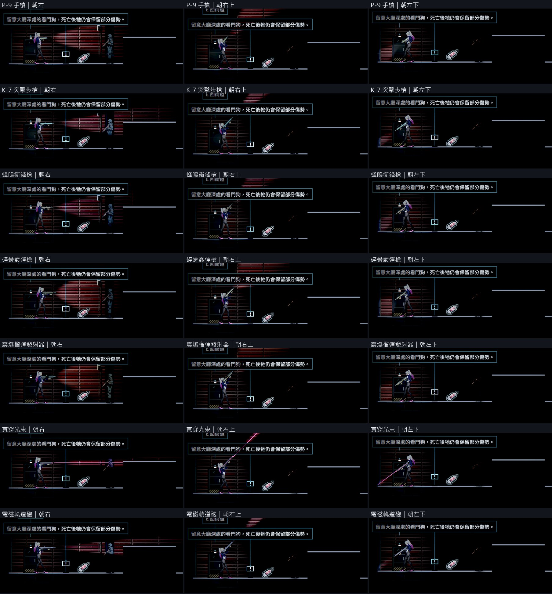
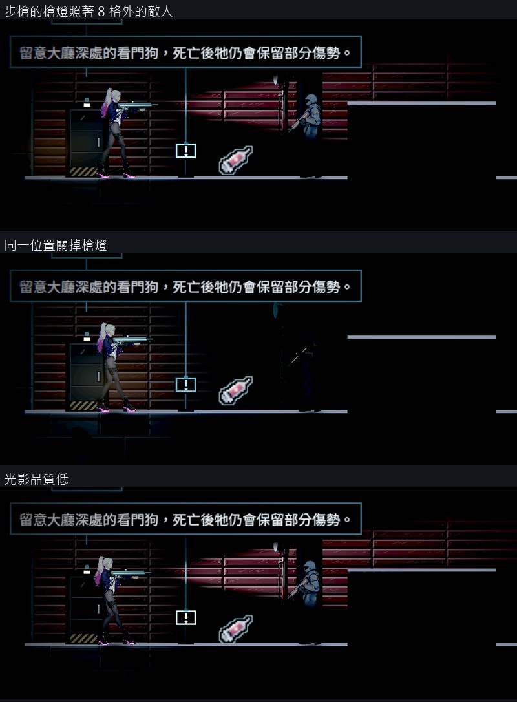

# [NE-258] 讓槍械自帶照明且各槍的光不同

> 狀態：審查中

## 內文

### 需求
槍現在只有開火瞬間的槍口閃光，沒有常亮的照明；主角身上的光是一盞不跟瞄準方向、看不到來源的全向光。使用者要主角的槍有類似手電筒的光，不同槍可以有不同的光，光源少的場景要靠它才看得清楚。

### 來源
2026-10-11，使用者看完場景與光影那批票之後提出（原話整理在 `pm/user_guide.md` 的「光影要從光源出發，近戰武器要換一批」）。設計與查到的資料見 [光源驅動的光影](../../design/08-lighting/LIGHT_SOURCES.md)。

### 驗收條件
- [x] 拿著槍時有一道常亮的光從槍口朝瞄準方向照出去，跟著滑鼠或右搖桿轉；不需要電量，開火、換彈、衝刺時都不會熄
- [x] 光掃到的牆、平台與敵人被照亮；主角身邊留一小圈微光，背後的平台與落點仍看得到
- [x] 七把槍的光各不相同並寫在武器資料裡（寬窄、遠近、顏色、是否抖動）：手槍中等暖白、步槍窄而遠、衝鋒槍連射時輕微抖動、霰彈槍寬而短、榴彈發射器寬而暗、光束槍是一條常亮的細瞄準光、軌道砲開火後變暗而可以再開火時恢復全亮；換槍時光跟著換
- [x] 暗的區域裡不開槍也能靠槍燈看到 8 格內的敵人與平台；拿掉槍燈對照時看不到（原生截圖對照）
- [x] 槍口火光在暗的區域會照亮主角與附近一小段時間；主角的白色頭髮不過曝（沿用既有的曝光量測）
- [x] 潛行者被槍燈照到會現形（和被場景燈照到一樣）
- [x] 載具與過場裡不出現槍燈；主角死亡時熄滅
- [x] 光影品質低、中、高都有槍燈；連續戰鬥的每影格耗時不高於修前的 105%（同機、關垂直同步）
- [x] 設定的「減少閃光」打開時，衝鋒槍的抖動與槍口火光的強度降低

### 測試流程
1. 原生進暗的區域，七把槍各拍一張朝右、朝上、朝左下瞄準的畫面
2. 同一位置開、關槍燈對照
3. 對著潛行者照
4. 跑曝光量測與連續戰鬥的耗時量測
5. 跑受影響的測試

### 參考
- [Leyla In Veil 的 Steam 商店頁（預告片）](https://store.steampowered.com/app/3904870/)：約 0:30，準星位置牆上的手電筒光與槍口的暖光
- [Doom 3 手電筒與武器互斥的批評](https://gamingpastime.com/doom-3-review/)、[九個手電筒設計的整理](https://www.avclub.com/9-great-videogame-flashlights)
- [光錐要玩家自己控制、沒電就失敗的設計被建議拿掉](https://babel.speldesign.uu.se/?p=2004627)
- [Godot 的手電筒要用光錐貼圖](https://uhiyama-lab.com/en/notes/godot/godot-2d-lighting-pointlight2d-shadows/)

---

# 跟其他票的關係

- Blocks：BG-33
- Blocked by：無
- Related：BG-34、NE-213、NE-95

---

---

# Commit-1

## 內文

槍只有開火瞬間的槍口閃光；主角身上的光是一盞不跟瞄準方向、看不到來源的全向光，照不到 8 格外。在暗的地方，敵人要走到很近才看得到。

現在每把槍都有一道常亮的光，從槍口朝瞄準方向照出去，跟著滑鼠或右搖桿轉，不需要電量，開火與衝刺時都亮著。光會被地形擋住，被它照到的潛行者會現形。七把槍的光各不相同：手槍中等暖白、步槍窄而遠、衝鋒槍連射時輕微抖動、霰彈槍寬而短、榴彈發射器寬而暗、光束槍多一條常亮的細瞄準光、軌道砲開火後變暗而可以再開火時恢復全亮（原本寫的「蓄力時變亮」改成這樣，因為軌道砲沒有蓄力）。拿著槍時主角身邊的微光縮成一小圈；拿近戰武器時沒有槍燈，微光維持原本的大小。死亡、搭載具、講電話時槍燈熄掉；載具的砲沒有槍燈。設定的「減少閃光」打開時，衝鋒槍的抖動與槍口火光都降到四分之一。

原生畫面在第一章倉庫整關套上停電的光影驗收：七把槍各朝三個方向照，光的寬窄遠近都不同。步槍照著 8 格外的敵人時，敵人身上亮部的亮度是 0.09；關掉槍燈是 0.0006，修前的版本同樣是 0.0006，看不到。主角待機、受擊、開火、舉盾四種狀態的全白像素都是 0。連續開火時每影格耗時和修前相同。

### 測試結果

| 項目 | 結果 |
|---|---|
| 8 格外敵人的亮度（步槍，高／中／低品質） | 開槍燈 0.089～0.095；關掉 0.0005～0.0007；修前的版本 0.0006 |
| 主角曝光（待機、受擊、開火、舉盾） | 全白像素 0，峰值 0.69 |
| 連續開火每影格耗時（修前與修後各三次交替，取中位數） | 高品質 3.06 → 3.01 ms（98%）；低品質 2.94 → 2.94 ms（100%） |
| 新增的自動檢查 | 通過：七把槍的光各不相同、光錐頂點是暗的而且不照到側面與背後、光跟著瞄準走、換槍跟著換、軌道砲開火後變暗再恢復、近戰與載具武器沒有槍燈、潛行者被照到現形而光移開又隱形、減少閃光時抖動與槍口火光變弱、死亡立刻熄滅 |
| 受影響測試（73 組） | 83627 項檢查；新失敗 0、已知失敗 0 |

做法與數值見[光源驅動的光影](../../design/08-lighting/LIGHT_SOURCES.md)的「槍燈」。分支 `feature/light-sources`；提交見[遠端 main 上本票的提交](https://github.com/deadline314/Nest-Egg/commits/main/pm/Nest-Egg/%5BNE-258%5D%E8%AE%93%E6%A7%8D%E6%A2%B0%E8%87%AA%E5%B8%B6%E7%85%A7%E6%98%8E%E4%B8%94%E5%90%84%E6%A7%8D%E7%9A%84%E5%85%89%E4%B8%8D%E5%90%8C.md)。

### 截圖

