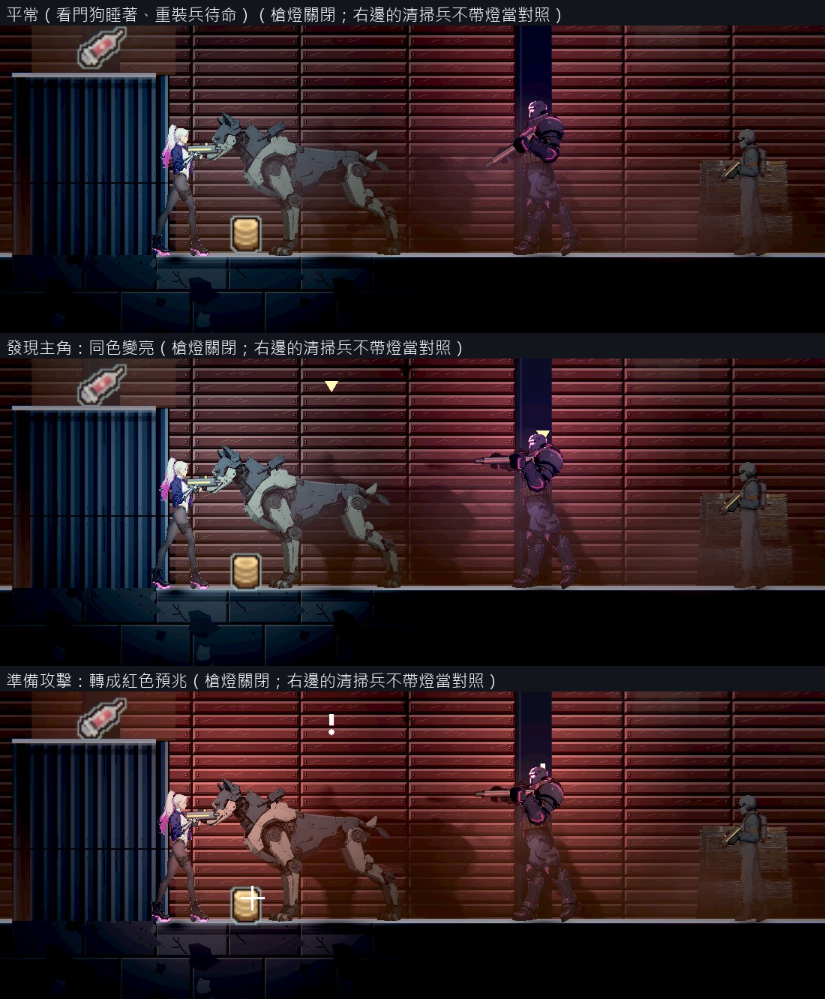
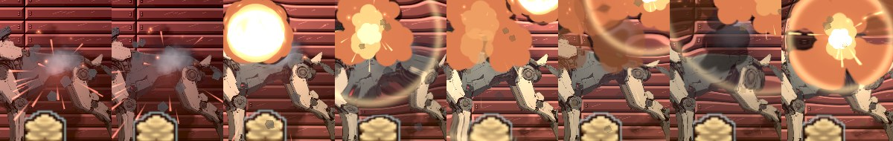

# [NE-259] 讓部分敵人自帶光源

> 狀態：審查中

## 內文

### 需求
現在自帶光的敵人只有探照無人機、砲塔的光錐、噴火兵的火與擬態怪，其餘只有攻擊預兆的紅光。畫面調暗後，使用者要部分敵人自帶光源，成為暗場裡的光源之一。

### 來源
2026-10-11，使用者看完場景與光影那批票之後提出（原話整理在 `pm/user_guide.md` 的「光影要從光源出發，近戰武器要換一批」）。設計與查到的資料見 [光源驅動的光影](../../design/08-lighting/LIGHT_SOURCES.md)。

### 驗收條件
- [x] 看門狗（眼睛）與重裝兵（面罩的橫條燈）有自己的光，光的位置跟著頭部動作走；探照無人機、砲塔、噴火兵維持既有的光
- [x] 光的位置、顏色與大小寫在敵人資料裡；新增一種帶燈的敵人只要填資料
- [x] 光色表示狀態：平常是它自己的顏色，發現主角時變亮，準備攻擊時轉成既有的紅色預兆；三種狀態在暗的區域一眼分得出來
- [x] 敵人的光會照亮它腳邊的地面與旁邊的牆，暗的區域裡不用槍燈也看得到它在哪裡；敵人死亡時光在死亡演出內熄滅
- [x] 清掃兵、收帳人等一般敵人不帶燈，暗的區域裡要靠槍燈或場景燈才看得清楚
- [x] 畫面上 6 個帶燈的敵人時，每區同時亮著的燈數不超過光影品質的上限，每影格耗時不高於修前的 105%
- [x] 原生截圖：看門狗與重裝兵在暗的區域的三種狀態各一張

### 測試流程
1. 原生在暗的區域放看門狗與重裝兵，拍三種狀態
2. 擊殺後確認光熄滅
3. 放 6 個帶燈的敵人量燈數與耗時
4. 跑受影響的測試

### 參考
- [Metroid Dread 的 E.M.M.I. 用三種光色表示狀態](https://www.nintendo.com/au/news-and-articles/metroid-dread-report-vol-2-researching-the-emmi)
- [Mark of the Ninja：警衛的手電筒光錐就是視野](https://popmatters.com/166432-mark-of-the-ninja-2495791612.html)
- [Returnal：用發光預告攻擊](https://blog.playstation.com/?p=348148)

---

# 跟其他票的關係

- Blocks：無
- Blocked by：BG-33
- Related：BG-34、NE-218、NE-94

---

# Commit-1

## 內文

自帶光的敵人只有探照無人機、砲塔、噴火兵與擬態怪；其餘敵人在調暗後的倉庫裡，沒被槍燈或場景燈照到就幾乎看不見，也看不出牠現在是在巡邏還是要攻擊。

現在看門狗（眼睛）與重裝兵（面罩）有自己的光，位置跟著頭走、轉身時跟著換邊。光色表示狀態：平常是牠自己的顏色（看門狗冷青色、重裝兵和面罩一樣的洋紅色），發現主角時同色變亮到 1.7 倍，準備攻擊時轉成全遊戲共用的紅色預兆並更亮；狀態改變是漸變，不是一格跳過去。光會照亮牠腳邊的地面與旁邊的牆，敵人死亡後約 1 秒內熄滅。光的位置、顏色、大小、跟著哪個零件，以及哪些狀態算「還沒發現主角」，都寫在敵人資料裡，敵人的零件、貼圖與骨架都沒有動；替別的敵人加光只要填資料。清掃兵、收帳人等一般敵人不帶燈。探照無人機、砲塔、噴火兵維持原本的光。這些光登記在場景光源裡，所以受光源預算管理，也會讓附近的角色在牆上投影（BG-34）。

重裝兵的面罩本來就有洋紅色的發光圖層，所以牠的光用同一個顏色、不另外畫標記；看門狗的眼睛在圖上只有一個小紅點，平常用一小塊冷青色的發光標記蓋在眼睛的位置上，準備攻擊時變回紅色。

驗收（Arc B580，原生 Forward+，倉庫、槍燈關閉）：三種狀態各拍一張，工具同時核對每個敵人的光確實在那個狀態；擊殺看門狗後 0.97 秒光熄滅。畫面上 6 個帶燈的重裝兵時同時亮著 8 盞燈（上限：高品質 24、低品質 8），每影格耗時是把這些光關掉時的 101.8%（高）與 102.8%（低），成對交替 60 組取中位數。可讀性在低與高品質都達標。

### 測試結果

| 項目 | 結果 |
|---|---|
| 受影響的測試（`run_tests_changed.sh`） | 通過 84,066 項檢查，新失敗 0 |
| 原生量測（`tools/enemy_glow_probe.tscn`，高與低品質） | 三種狀態正確、死亡後 0.97 秒熄滅、8 盞燈在上限內、耗時 101.8%／102.8% |
| 可讀性（第一章 14 點、舊兩關 16 點，低與高） | 全部達標（60 筆）：主角 0.62 以上、敵人 0.50 以上、地面邊緣 1.82 以上 |
| 原生 log | 無 ERROR |

分支 `feature/lighting-assets`，提交見[遠端 main 上本票的提交](https://github.com/deadline314/Nest-Egg/commits/main/pm/Nest-Egg/%5BNE-259%5D%E8%AE%93%E9%83%A8%E5%88%86%E6%95%B5%E4%BA%BA%E8%87%AA%E5%B8%B6%E5%85%89%E6%BA%90.md)。

### 截圖

三種狀態（左：看門狗，中：重裝兵，右：不帶燈的清掃兵；主角的槍燈關閉）：

擊殺後每 0.1 秒一格，光在死亡演出內熄滅：

