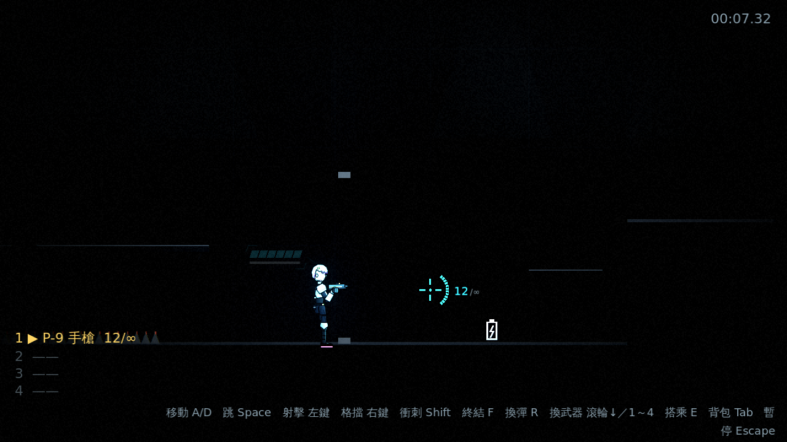
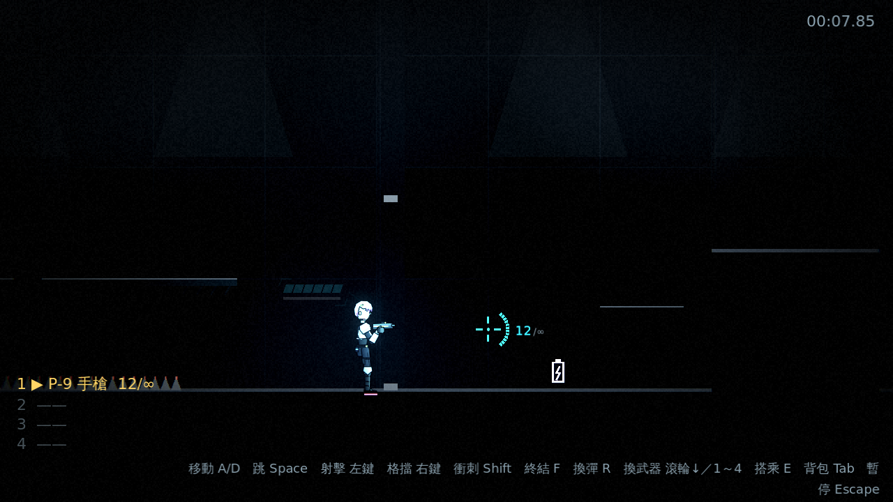
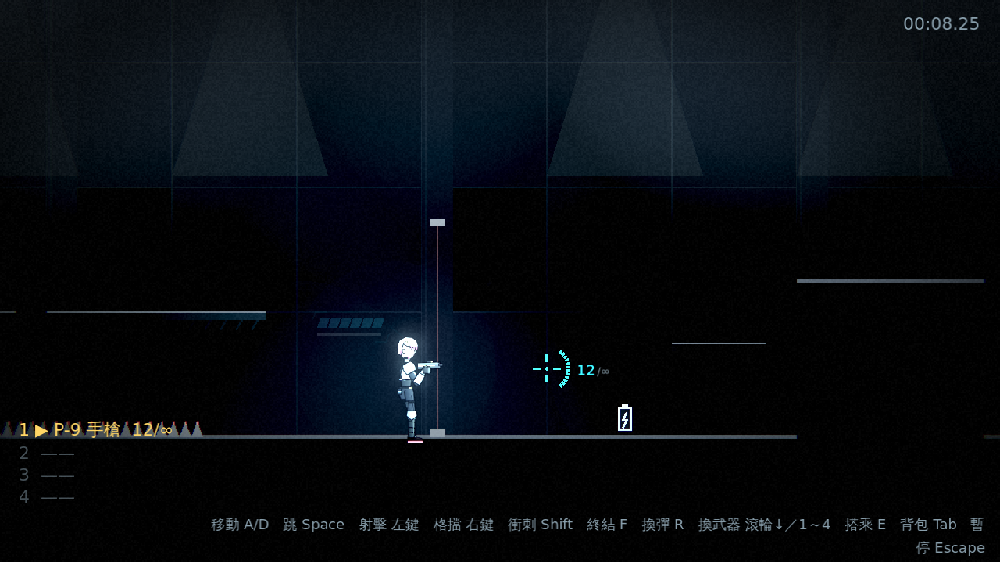
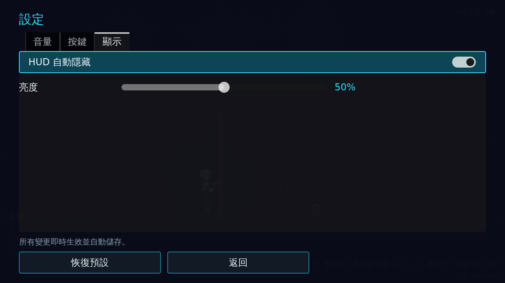
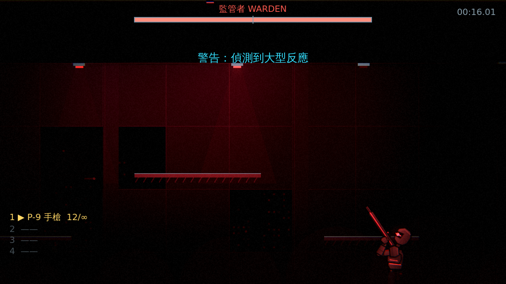

# [NE-25] 建立暗場可讀性與亮度設定

> 狀態：完成

## 內文

### 需求
重度壓抑的畫面不能讓玩家看不到敵人或落點。要定下暗場的可讀性守則，用測試守住，並提供亮度設定給對暗場不適應的玩家。設計見 `design/08-lighting/DESIGN.md` 的「暗場可讀性守則」。

### 來源
2026-10-02，使用者於開發對話中提出：「整個遊戲可以有完整的光影設計，請參考業界最佳實例」「整體的渲染跟場景應該要陰沉一點，遊戲希望整體沉重一點」；確認壓抑程度為重度壓抑、先做光影再做內容。

### 驗收條件
- [x] 敵人、敵方子彈與危險物（尖刺、雷射柵欄、爆炸預警圈）在最暗的區段也清楚可見
- [x] 凜在任何位置都有最低亮度，與背景有足夠的對比
- [x] 所有平台頂面都有亮邊，跳躍落點看得清楚
- [x] 設定選單有「亮度」滑桿，預設為設計值，調整即時生效並儲存
- [x] 測試以量測方式驗證最暗區段的玩家輪廓與平台邊緣對比，低於門檻即失敗
- [x] 亮度滑桿有一句 tooltip，說明預設值就是設計的壓抑程度

### 測試流程
1. 把亮度滑桿調到最低與最高，確認畫面即時變化且設定會保存
2. 在最暗的區段，確認敵人、子彈、尖刺與平台邊緣都看得見
3. 執行完整測試套件（含對比測試），全部通過

---

# 跟其他票的關係

- Blocks：NE-26、NE-28、NE-30、NE-32
- Blocked by：NE-19、NE-20
- Related：NE-23

---

# Commit-1

## 內文

重度壓抑的畫面可能讓玩家看不到敵人或落點。
現在有一套暗場可讀性守則：角色（主角與敵人）有「最低可讀亮度」，環境光比它暗時角色零件會被補亮，環境可以很暗但角色永遠看得到；敵人、子彈、尖刺、雷射柵欄與預警原本就是自發光；地形與單向平台的頂面有自發光的亮邊，跳躍落點看得清楚。每份光影設定都會被檢查，角色亮度過低會被回報。設定選單的顯示分頁新增「亮度」滑桿（預設 50% 就是設計的壓抑程度，調高提亮暗部、調低更暗），即時生效並儲存，tooltip 說明預設值的意義；「恢復預設」會一併還原。另有開發工具實際渲染每個區段，量測玩家輪廓與地面亮邊的對比，低於門檻就以非零代碼結束。
驗收方式：冒煙測試驗證每份光影設定的角色亮度與亮邊對比、過暗的設定被回報、補光倍率跟著區段與停電、角色骨架套用補光、地形亮邊自發光而本體受光、亮度設定的預設／調整／損毀／夾限／重設與後製即時跟隨；渲染量測（量測值見下）與亮度 0%／50%／100% 的對照截圖。

渲染量測（對比 = (內 − 外) / (外 + 0.02)；門檻：玩家 ≥ 0.3、亮邊 ≥ 1.0）：

| 區段 | 玩家對比 | 地面亮邊對比 |
|---|---|---|
| 屋頂巷弄 | 0.71 | 1.58 |
| 霓虹市集 | 0.41 | 2.07 |
| 貨運站 | 0.93 | 1.20 |
| 設施入口 | 0.88 | 4.14 |
| 停電走廊 | 1.86 | 11.05 |
| 頭目機庫 | 1.14 | 4.39 |

### 測試結果

| 項目 | 結果 |
|---|---|
| 完整測試套件 | 通過 786 / 786 |
| 資料驗證 | 0 錯誤 |
| 執行 log | 無非預期 ERROR |
| 渲染量測（6 個區段） | 全部通過 |

### 截圖

