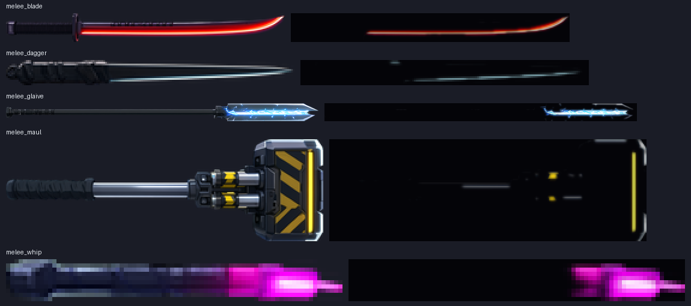
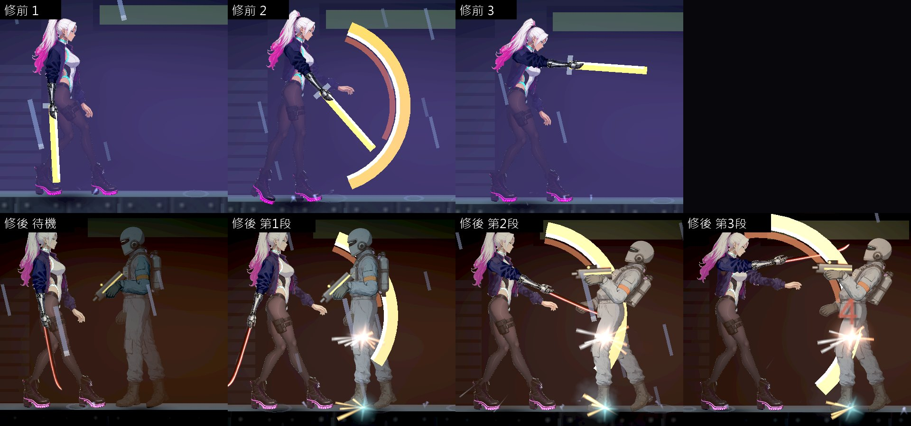
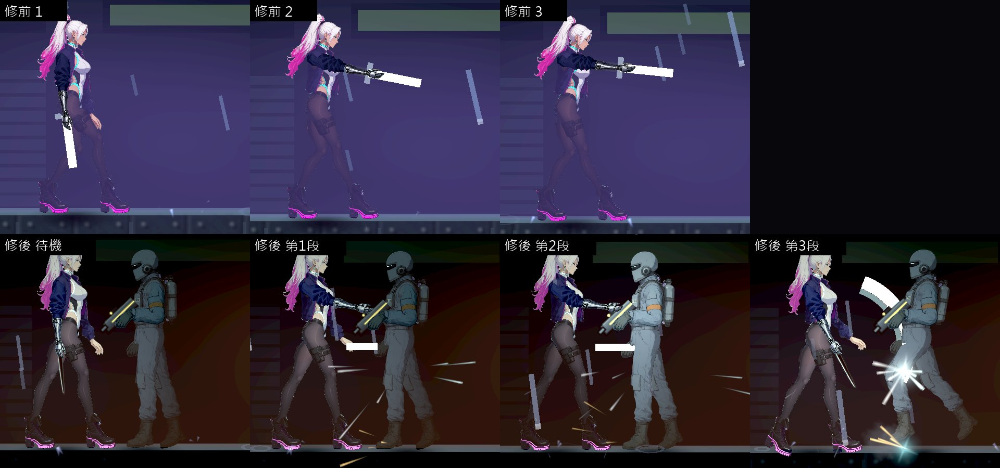
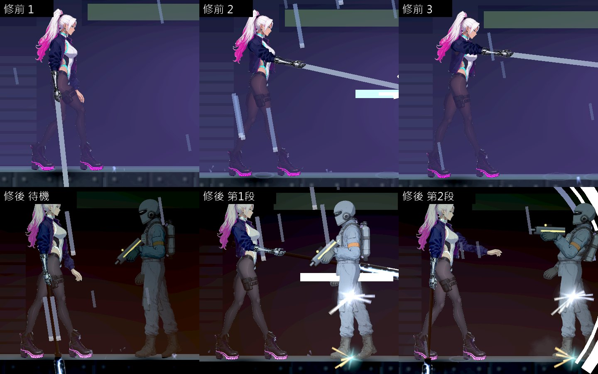
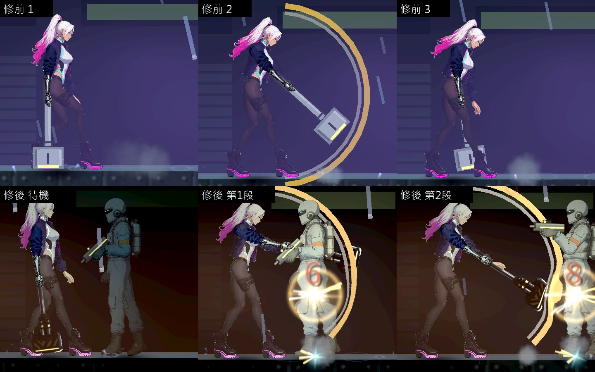
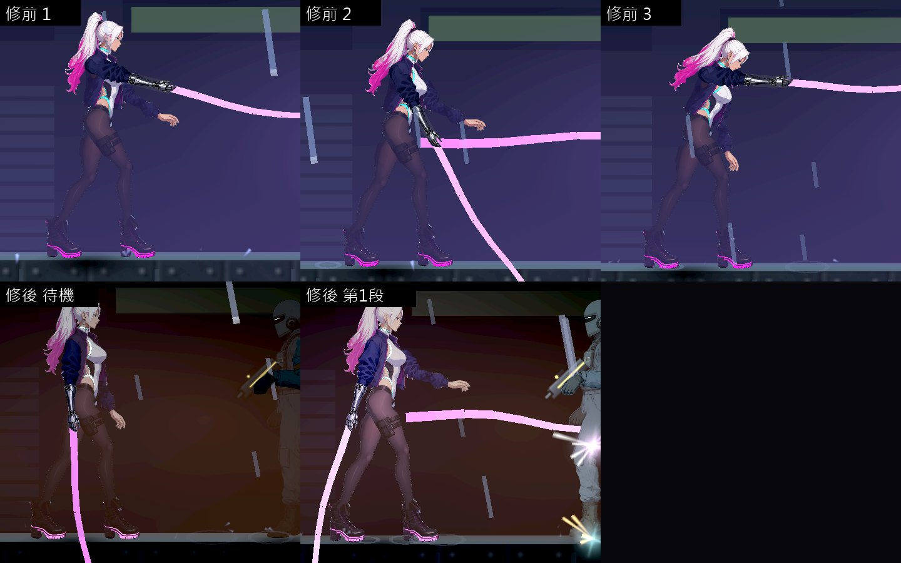
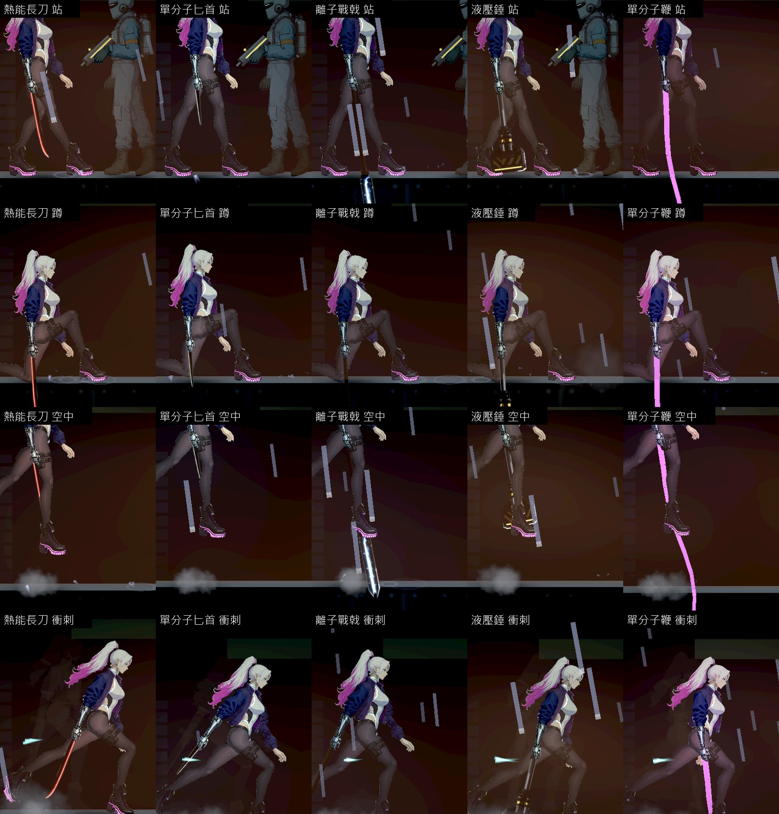
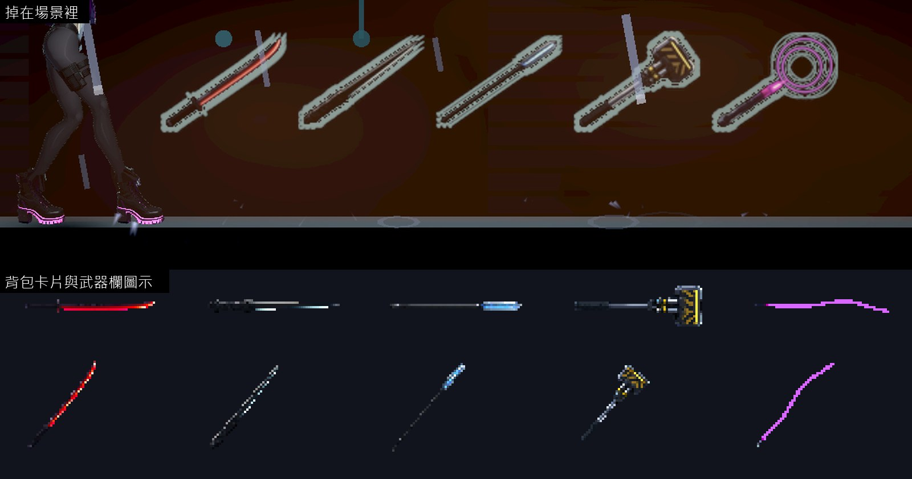

# [NE-260] 把近戰武器換成會發光的賽博龐克外觀

> 狀態：審查中

## 內文

### 需求
五把近戰武器拿在手上的樣子是程式畫的幾條線，沒有圖、不發光，使用者覺得很沒有賽博龐克的感覺，要換一批，而且近戰武器也要自帶光源。招式、手感與數值是戰鬥組調過的，這張票只換外觀與光，不改招式。

### 來源
2026-10-11，使用者看完場景與光影那批票之後提出（原話整理在 `pm/user_guide.md` 的「光影要從光源出發，近戰武器要換一批」）。設計與查到的資料見 [光源驅動的光影](../../design/08-lighting/LIGHT_SOURCES.md)。

### 驗收條件
- [x] 五把近戰武器拿在手上、收在背包、掉在場景裡都用新的圖，三處看得出是同一把；畫風與槍和角色一致（賽璐璐、深色描邊）
- [x] 每把武器有自己的發光部位與顏色：熱能長刀的刃口橘紅、單分子匕首的刃口青白、離子戰戟的戟頭電藍、液壓錘的錘頭琥珀、單分子鞭的線洋紅
- [x] 刃光是真的光：拿在手上時照亮主角身邊一小圈，揮動時沿著軌跡照亮旁邊的牆與敵人；暗的區域裡揮一刀看得到被照亮的敵人
- [x] 揮動的軌跡用該武器的顏色，每一段招式的軌跡看得出不同（斜砍、反斬、下劈…）
- [x] 武器握在手上的位置對得上手，每一段招式的每一格都不穿過身體、不離手（站、蹲、空中、衝刺都看）
- [x] 主角的白色頭髮不因刃光過曝（沿用既有的曝光量測）；設定的「減少閃光」打開時揮動的閃光降低
- [x] 招式的傷害、距離、時間與連段行為和修前完全相同（既有的近戰測試全過，不改測試）
- [x] 原生截圖：五把武器各一組待機與每一段招式的連續畫面，修前修後並排；暗的區域各一張

### 測試流程
1. 原生拍五把武器的待機與每一段招式
2. 在暗的區域揮動，看牆與敵人有沒有被照亮
3. 跑曝光量測
4. 跑既有的近戰測試與受影響的測試

### 參考
- [Cyberpunk 2077 的熱能刀（官方商品頁，橘色發光的刃）](https://eu.gear.cdprojektred.com/it/products/cyberpunk-2077-valentino-thermal-katana)
- [Metal Gear Rising 的高頻刃與切割線](https://en.wikipedia.org/wiki/Metal_Gear_Rising:_Revengeance)
- [反面例子：Ruiner 的武器看不出打中的力道](https://www.cgmagonline.com/review/ruiner-pc-review/)
- [櫻井政博談打擊停頓](https://sourcegaming.info/2015/11/11/thoughts-on-hitstop-sakurais-famitsu-column-vol-490-1/)

現況（手上的武器是程式畫的線）：

---

# 跟其他票的關係

- Blocks：NE-261
- Blocked by：無
- Related：NE-117、NE-236、NE-237、NE-258、NE-273

---

# Commit-1

## 內文

五把近戰武器拿在手上只是程式畫的幾條線，沒有圖、不發光；掉在場景裡與背包裡的圖又是另外畫的一套，三個地方看起來不是同一把。暗的區域裡拿近戰武器等於沒有任何光。

現在五把都有自己的圖（賽璐璐、深色描邊，和槍與角色同一種畫法）：熱能長刀是帶散熱片刀背、刃口燒紅的長刀；單分子匕首是黑色薄刃、刃口一條青白的細線；離子戰戟是長桿加兩片導體之間有電弧的戟頭；液壓錘是有活塞、黃黑警示條與琥珀色燈條的大錘；單分子鞭是握把加一條洋紅的發光細線。拿在手上、掉在場景裡、背包卡片與武器欄圖示都由同一張圖產生。握把在手上的位置、武器的長度和原本的線條一樣，招式資料完全沒動。

刃口是真的光：拿在手上照亮身邊一小圈，揮動時變亮、跟著刀身走，照得到旁邊的牆與敵人；光的顏色就是武器的顏色。武器本體的明暗跟著區域的環境光，暗的區域裡只有發光的部位是亮的。設定的「減少閃光」打開時，揮動那一下不會突然亮那麼多。揮砍軌跡沿用 NE-236 已經做好的每把一色、每段一種形狀，沒有改。

驗收（Arc B580，原生 Forward+，測試場地套用倉庫的暗光影）：五把各拍待機與連段的每一段（真的按出連段），再拍蹲、空中、衝刺、掉落物與圖示。刃光亮度拿在手上 0.40～0.52、揮動時 0.63～1.07、減少閃光打開時 0.51～0.71；旁邊敵人身上的亮度從沒有刃光時的 0.24～0.33 提到揮動那一刻的 0.85～0.99。主角頭部的全白比例最高 1.9%（熱能長刀第三段，門檻 2%，餘裕不大），其餘四把 0.5% 以下。刃光開與關成對交替 60 組，每影格耗時是關掉時的 100.3%（高、低品質都是）。

握把都對得上手、不離手。但武器沿著前臂的方向握，站著不動時離子戰戟與單分子鞭的尖端會低於地面，蹲下時五把都會；修前的線條就是這樣（下面戰戟的修前第一張），換成有圖之後更明顯。握法屬於主角動作，這張票沒有動，另開 NE-273。

動到其他組的檔案（都只為了讓三處用同一張圖）：掉落物與匕首的背包圖示改由近戰武器的圖產生，原本的掉落物產生工具會略過這五把。

### 測試結果

| 項目 | 結果 |
|---|---|
| 受影響的測試（`run_tests_changed.sh`，乾淨的工作樹） | 通過 23,484 項檢查，新失敗 0（含既有的近戰測試，測試沒有改） |
| 原生量測（`tools/melee_art_probe.tscn`） | 五把、11 段招式、4 種姿勢全部拍到，0 項不合格；刃光耗時 100.3% |
| 可讀性（第一章 14 點、舊兩關 16 點，低與高） | 全部達標（60 筆）：主角 0.62 以上、敵人 0.51 以上、地面邊緣 1.86 以上 |
| 原生 log | 無 ERROR |

分支 `feature/lighting-assets`，提交見[遠端 main 上本票的提交](https://github.com/deadline314/Nest-Egg/commits/main/pm/Nest-Egg/%5BNE-260%5D%E6%8A%8A%E8%BF%91%E6%88%B0%E6%AD%A6%E5%99%A8%E6%8F%9B%E6%88%90%E6%9C%83%E7%99%BC%E5%85%89%E7%9A%84%E8%B3%BD%E5%8D%9A%E9%BE%90%E5%85%8B%E5%A4%96%E8%A7%80.md)。

### 截圖

五把武器的圖（左）與抽出來的發光層（右）：

每把的上排是修前（線條）、下排是修後（待機與連段的每一段），都在暗的倉庫光影下：

站、蹲、空中、衝刺（武器一直握在手上；尖端低於地面的問題見 NE-273）：

掉在場景裡、背包卡片與武器欄圖示：

