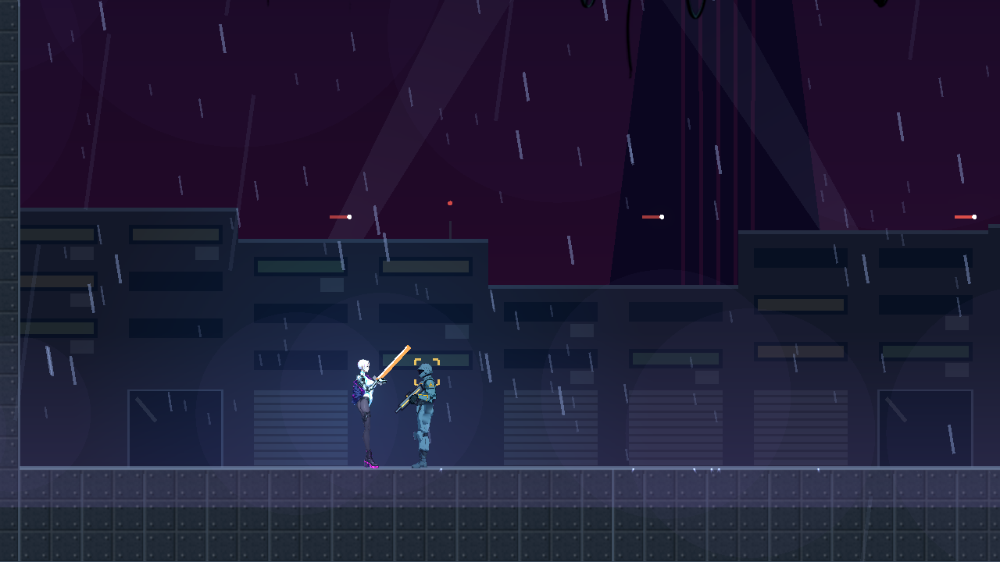
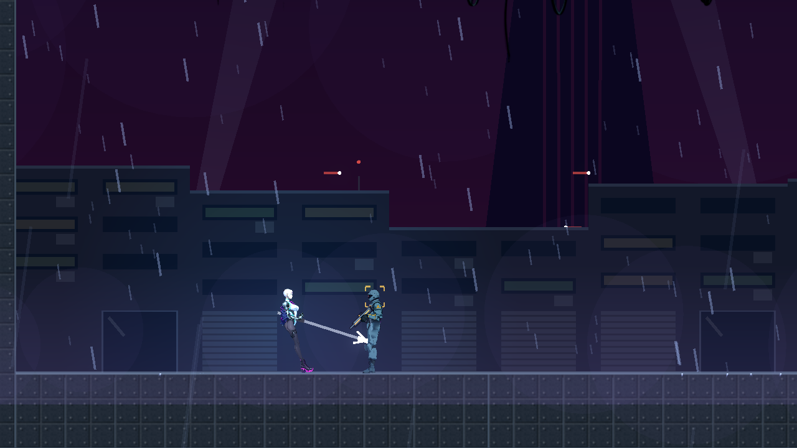

# [NE-260] 把近戰武器換成會發光的賽博龐克外觀

> 狀態：待辦

## 內文

### 需求
五把近戰武器拿在手上的樣子是程式畫的幾條線，沒有圖、不發光，使用者覺得很沒有賽博龐克的感覺，要換一批，而且近戰武器也要自帶光源。招式、手感與數值是戰鬥組調過的，這張票只換外觀與光，不改招式。

### 來源
2026-10-11，使用者看完場景與光影那批票之後提出（原話整理在 `pm/user_guide.md` 的「光影要從光源出發，近戰武器要換一批」）。設計與查到的資料見 [光源驅動的光影](../../design/08-lighting/LIGHT_SOURCES.md)。

### 驗收條件
- [ ] 五把近戰武器拿在手上、收在背包、掉在場景裡都用新的圖，三處看得出是同一把；畫風與槍和角色一致（賽璐璐、深色描邊）
- [ ] 每把武器有自己的發光部位與顏色：熱能長刀的刃口橘紅、單分子匕首的刃口青白、離子戰戟的戟頭電藍、液壓錘的錘頭琥珀、單分子鞭的線洋紅
- [ ] 刃光是真的光：拿在手上時照亮主角身邊一小圈，揮動時沿著軌跡照亮旁邊的牆與敵人；暗的區域裡揮一刀看得到被照亮的敵人
- [ ] 揮動的軌跡用該武器的顏色，每一段招式的軌跡看得出不同（斜砍、反斬、下劈…）
- [ ] 武器握在手上的位置對得上手，每一段招式的每一格都不穿過身體、不離手（站、蹲、空中、衝刺都看）
- [ ] 主角的白色頭髮不因刃光過曝（沿用既有的曝光量測）；設定的「減少閃光」打開時揮動的閃光降低
- [ ] 招式的傷害、距離、時間與連段行為和修前完全相同（既有的近戰測試全過，不改測試）
- [ ] 原生截圖：五把武器各一組待機與每一段招式的連續畫面，修前修後並排；暗的區域各一張

### 測試流程
1. 原生拍五把武器的待機與每一段招式
2. 在暗的區域揮動，看牆與敵人有沒有被照亮
3. 跑曝光量測
4. 跑既有的近戰測試與受影響的測試

### 參考
- [Cyberpunk 2077 的熱能刀（官方商品頁，橘色發光的刃）](https://eu.gear.cdprojektred.com/it/products/cyberpunk-2077-valentino-thermal-katana)
- [Metal Gear Rising 的高頻刃與切割線](https://en.wikipedia.org/wiki/Metal_Gear_Rising:_Revengeance)
- [反面例子：Ruiner 的武器看不出打中的力道](https://www.cgmagonline.com/review/ruiner-pc-review/)
- [櫻井政博談打擊停頓](https://sourcegaming.info/2015/11/11/thoughts-on-hitstop-sakurais-famitsu-column-vol-490-1/)

現況（手上的武器是程式畫的線）：

---

# 跟其他票的關係

- Blocks：NE-261
- Blocked by：無
- Related：NE-117、NE-236、NE-237、NE-258

---
