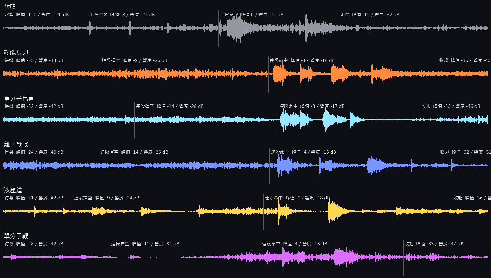

# [NE-261] 替每把近戰武器換上自己的聲音

> 狀態：審查中

## 內文

### 需求
五把近戰武器的揮動與命中共用幾個一般的刀劍聲，聽不出是發熱的刀、帶電的戟還是液壓的錘。使用者要近戰的音效也換掉。

### 來源
2026-10-11，使用者看完場景與光影那批票之後提出（原話整理在 `pm/user_guide.md` 的「光影要從光源出發，近戰武器要換一批」）。設計與查到的資料見 [光源驅動的光影](../../design/08-lighting/LIGHT_SOURCES.md)。

### 驗收條件
- [x] 每把武器有自己的揮動聲與命中聲，閉著眼睛分得出五把；重的招式比輕的招式低沉、長
- [x] 每把武器拿在手上時有很小聲的待機聲（熱刃的低嗡、戟的電弧、鞭的細鳴…），不蓋過腳步與環境音，收起武器就停
- [x] 連段的每一段聲音略有不同，最後一段最重；揮空不播命中聲
- [x] 命中不同材質（人、機械、盾）聽得出差別，沿用既有的命中材質分類
- [x] 所有新聲音來源都是 CC0，授權逐檔登記；素材檢查通過
- [x] 音量在設定的音效滑桿下和槍聲平衡：近戰聲不比同場的槍聲大
- [x] 附一段原生錄下來的五把武器各打一輪連段的聲音，或聲音實驗室的截圖與波形

### 測試流程
1. 在聲音實驗室逐把試聽揮動、命中、待機
2. 原生打一輪連段確認每一段的聲音
3. 跑音訊的授權與缺檔檢查
4. 跑受影響的測試

### 參考
- [Freesound 的授權說明（只用 CC0）](https://freesound.org/help/faq/)
- [Kenney 素材皆為 CC0](https://kenney.nl/support)
- [Sonniss GDC 合集不是 CC0，不能用](https://sonniss.com/gameaudiogdc/)

---

# 跟其他票的關係

- Blocks：無
- Blocked by：NE-260
- Related：NE-157、NE-236、NE-237

---

# Commit-1

## 內文

五把近戰武器的揮動與命中共用四個一般的刀劍聲，聽不出手上拿的是發熱的刀、帶電的戟還是液壓的錘；拿在手上也完全沒有聲音。

現在每把武器有自己的六個聲音：兩個輕的揮動聲、一個重的揮動聲、輕與重的命中聲、拿在手上的待機聲。熱能長刀是低沉的破風聲、命中帶一聲嘶、待機是低嗡；單分子匕首是又短又高的破風聲與細脆的切割聲；離子戰戟的揮動與命中都是電的聲音，待機是電流的嘶嘶聲；液壓錘是金屬的破風聲疊一聲洩氣、命中是悶重的敲擊；單分子鞭是很短的咻聲與一聲脆響。連段一段一個聲音，最後一段用最重的那個；只有一、兩段的武器（戟、錘、鞭）第一段有兩個聲音輪流，連按不會每一下都一樣。揮空只有揮動聲，打中只有命中聲，再疊上原本就有的材質聲（打裝甲、打血肉不同）。待機聲很小，出招時再壓低，換成槍就淡出停止。來源全部是 OpenGameArt 上標示 CC0 的素材包，逐檔登記在授權清單。

驗收（Arc B580，原生）：真的把五把武器各打一輪——拿在手上、整套連段揮空（含延伸招）、整套連段打在敵人身上、換回手槍——全程錄音，並記下每一段實際播了哪些聲音。每一段播出來的聲音都和設計一致（下表）。音量用同一段錄音裡的手槍當基準：連段揮空的響度比手槍空射小 2.8～9.4 dB，連段命中比手槍打同一個敵人小 4.4～6.4 dB；待機聲比腳步聲小 8 dB 以上、比環境音加配樂小 12 dB 以上，收起後完全沒有聲音。重的聲音都比同一把輕的長、頻譜重心也低（十組全部成立）。

**還沒驗收的一條**：「閉著眼睛分得出五把」需要人聽。這台機器只能量數字：同一把武器的兩個輕揮動聲頻譜只差 1～2 dB，不同武器之間最接近的一對（匕首與鞭）差 7 dB 以上，數字上分得很開，但這不能代替耳朵，所以這一條沒有打勾，票留在進行中、提交留在功能分支，等聽過附件的錄音或在聲音實驗室試聽（「武器」分組裡每把武器的揮空、命中、連段情境）之後再決定。

每一段實際播出的聲音（錄音時記下的順序；`mat_armor`、`hurt_humanoid` 是原本就有的材質聲與敵人受擊聲）：

| 武器 | 連段揮空 | 連段命中 |
|---|---|---|
| 熱能長刀 | 輕 A → 輕 B → 重 → 重（延伸招） | 命中 → 命中 → 重命中 → 重命中 |
| 單分子匕首 | 輕 A → 輕 B → 重 → 重（延伸招） | 命中 → 命中 → 重命中 → 重命中 |
| 離子戰戟 | 輕（A、B 輪流）→ 重 → 重（延伸招） | 命中 → 重命中 → 重命中 |
| 液壓錘 | 輕（A、B 輪流）→ 重 → 重（延伸招） | 命中 → 重命中（第三下把敵人打飛、揮空） |
| 單分子鞭 | 輕（A、B 輪流）→ 重（延伸招） | 命中 → 重命中 |

2026-10-12 補記：戰鬥組的分支併入 main 之後，把這個提交接到新的招式資料檢查上（檢查多認得待機聲這個欄位）。戰鬥組有一個測試是「先揮空一下、再打中一下，要聽到第一段的命中聲」——第二下其實是連段的第二段，以前每一段共用同一個命中聲所以沒差；現在每一段有自己的聲音，改成聽「實際打出去的那一段」的命中聲，斷言本身沒有刪。接上之後近戰、聲音、環境三個套件重跑 35,083 項全過。

動到其他組的檔案（只動聲音相關的欄位）：五份招式資料的 `sounds` 與新增的待機聲欄位、招式資料檢查多認得這個欄位、聲音事件表多三個事件、聲音實驗室的近戰動作多了「靶的距離」與「每一下的間隔」兩個參數。出招的時間、距離、傷害與音量的程式都沒有改。

### 測試結果

| 項目 | 結果 |
|---|---|
| 受影響的測試（`run_tests_changed.sh`） | 通過 43,594 項檢查，新失敗 0（含既有的近戰測試與聲音舞台測試） |
| 原生錄音（`tools/melee_sound_probe.tscn` ＋ `tools/audio/melee_sound_report.py`） | 5 把 × 4 段全部照設計播放；音量規則 0 項不合格 |
| 授權與缺檔檢查（音訊測試套件） | 通過；30 個新聲音逐檔登記，來源皆為 CC0 |
| 可讀性（第一章 14 點、舊兩關 16 點，低與高） | 全部達標（60 筆）：主角 0.62 以上、敵人 0.50 以上、地面邊緣 1.85 以上 |
| 原生 log | 無 ERROR |

2026-10-12 補記：使用者聽過附件的錄音，確認聲音可以，「閉著眼睛分得出五把」這一條據此打勾，推上 main。推送前接到最新的 main 重跑受影響的測試：46,391 項檢查；當時機器上同時有別的工作在跑測試，平行跑有 2 項受負載影響的失敗（匕首三連的舞台情境第三下沒接上、12 個爆炸同時發生的耗時），兩個套件單獨重跑全過。

在最新的 main 上直接提交（原本的工作分支已合併），提交見[遠端 main 上本票的提交](https://github.com/deadline314/Nest-Egg/commits/main/pm/Nest-Egg/%5BNE-261%5D%E6%9B%BF%E6%AF%8F%E6%8A%8A%E8%BF%91%E6%88%B0%E6%AD%A6%E5%99%A8%E6%8F%9B%E4%B8%8A%E8%87%AA%E5%B7%B1%E7%9A%84%E8%81%B2%E9%9F%B3.md)。

### 錄音與波形

- [實際混音（含環境音與配樂），46 秒](attachments/NE-261/melee-combos-master.ogg)
- [只有音效匯流排](attachments/NE-261/melee-combos-sfx-only.ogg)
- [每一段的起訖時間與播出的聲音](attachments/NE-261/melee-index.json)

錄音的順序：0～6 秒是對照（安靜、手槍空射三發、手槍打敵人三發、走路），之後依序是熱能長刀（6 秒起）、單分子匕首（14 秒起）、離子戰戟（20 秒起）、液壓錘（28 秒起）、單分子鞭（39 秒起），每把都是「待機 → 連段揮空 → 連段命中 → 收起」。

波形是實際混音，標示的峰值與響度量自音效匯流排：

# Commit-2

## 內文

main 的自動測試紅了一次：音效實驗室的「熱能長刀連段命中」情境沒有響出最後一段的重擊命中聲。原因在情境本身——連段是照固定秒數按近戰鍵，機器忙的時候遊戲時間跑得比計時慢，下一下不是按太早被吃掉，就是按太晚連段已經斷了。單獨跑會過，和其他測試一起跑才偶爾失敗；遊戲裡玩家實際操作的連段沒有問題，聲音資料也沒有動。

現在情境改成看主角的狀態再按：上一段真的可以接了才按下一下，按下去沒有出招就再按一次（最多三次），最後一段揮完才收尾。機器不忙的時候節奏和原本一樣。

驗收：同一台機器同時開 12～14 份同一個測試套件來製造負載。修正前 12 份裡有 10 份失敗（長刀、匕首、戰戟的連段情境都出現過）；修正後連跑兩輪各 14 份，28 份全過。單獨跑音效實驗室與近戰相關的套件也全過。

### 測試結果

| 項目 | 結果 |
|---|---|
| 高負載重現（同時 12 份 `StageCoverageWeaponsSuite`，修正前） | 10 份失敗 |
| 高負載重跑（同時 14 份 × 2 輪，修正後） | 28 份全過，每份 152 項檢查 |
| 單獨跑 `StageCoverageWeaponsSuite,SoundStageSuite,SoundLabSuite,MeleeWeaponsSuite,MeleeSuite` | 1522 項檢查，失敗 0 |
| 執行 log | 無 SCRIPT ERROR |

分支 `feature/lighting-assets`，提交見[遠端 main 上本票的提交](https://github.com/deadline314/Nest-Egg/commits/main/pm/Nest-Egg/%5BNE-261%5D%E6%9B%BF%E6%AF%8F%E6%8A%8A%E8%BF%91%E6%88%B0%E6%AD%A6%E5%99%A8%E6%8F%9B%E4%B8%8A%E8%87%AA%E5%B7%B1%E7%9A%84%E8%81%B2%E9%9F%B3.md)。

