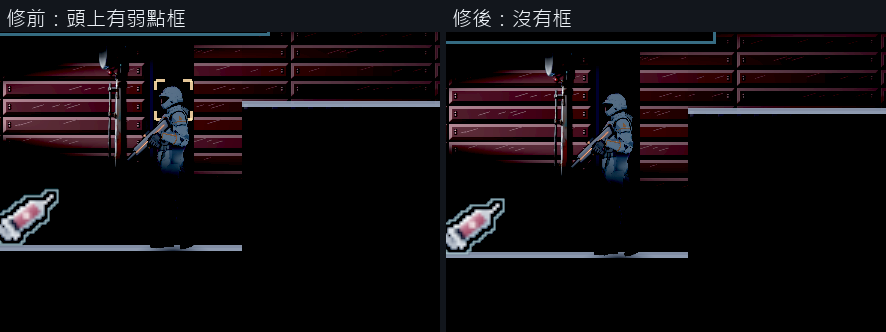

# [NE-262] 拿掉敵人頭上的弱點框

> 狀態：審查中

## 內文

### 需求
敵人的頭上一直有一個黃色的四角框，標示頭是弱點。使用者覺得它看起來很突兀，要拿掉。

### 來源
2026-10-11，使用者在看槍燈的畫面時提出：「敵人的頭那個框框拿掉，看起來很突兀」。

### 驗收條件
- [x] 平常遊玩時，敵人身上不再出現四角框（頭部與其他弱點都一樣）
- [x] 打頭仍然是弱點：傷害倍率、打中弱點的火花、命中聲與準星上的弱點標記都和原本一樣
- [x] 開發檢查用的受擊框顯示照常可用（黃色是弱點、青色是其他部位）
- [x] 原生畫面修前修後對照

### 測試流程
1. 原生進任一有敵人的區域，看敵人的頭
2. 打敵人的頭，確認傷害與回饋
3. 跑敵人相關的測試

---

# 跟其他票的關係

- Blocks：無
- Blocked by：無
- Related：NE-104、NE-248、NE-258

---

# Commit-1

## 內文

每個敵人的頭上都有一個淡淡呼吸的黃色四角框，用來提示頭是弱點；畫面調暗之後它在暗處特別顯眼，像一塊貼在敵人頭上的介面。

現在平常遊玩不再畫這個框。頭是弱點這件事不變，打中時的金色火花、較亮的命中聲與準星上的弱點標記都還在；開發檢查用的受擊框顯示也保留。

原生畫面對照：同一個位置的敵人，修前頭上有框、修後沒有。敵人相關的測試全過。

### 測試結果

| 項目 | 結果 |
|---|---|
| 受擊反應、新敵人、第一章敵人、曝光四組測試 | 550 項檢查；新失敗 0、已知失敗 0 |
| 原生畫面對照 | 修後敵人頭上沒有框 |

分支 `feature/light-sources`；提交見[遠端 main 上本票的提交](https://github.com/deadline314/Nest-Egg/commits/main/pm/Nest-Egg/%5BNE-262%5D%E6%8B%BF%E6%8E%89%E6%95%B5%E4%BA%BA%E9%A0%AD%E4%B8%8A%E7%9A%84%E5%BC%B1%E9%BB%9E%E6%A1%86.md)。

### 截圖

