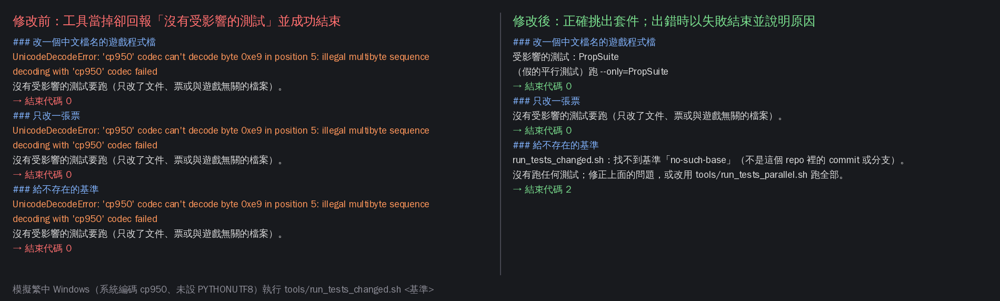

# [NE-263] 修正 Windows 上受影響測試被靜默略過

> 狀態：進行中

## 內文

### 需求
在這台繁體中文 Windows 上直接跑 `tools/run_tests_changed.sh`，挑選受影響測試的工具會當掉，但腳本把它當成「沒有受影響的測試」，印出「沒有受影響的測試要跑」並以成功結束。也就是改了遊戲程式卻一個測試都沒跑，畫面上看起來像通過。本機每個 Session 交付前都靠這支腳本，這個假的通過會讓壞掉的修改進到 main，只能等 CI 才發現。

發生的原因：挑選工具讀取 git 列出的檔名時用系統預設的編碼（這台是 cp950），repo 裡有中文檔名（`pm/` 的票、部分素材），解碼失敗後拿到空的結果就當掉；腳本沒有分辨「工具當掉」與「真的沒有受影響的測試」。

暫時的避開方法：執行前加 `PYTHONUTF8=1`（例如 `PYTHONUTF8=1 GODOT=... tools/run_tests_changed.sh <基準>`），挑選結果就正常（BG-36 用這個方式跑出 73 個套件）。

### 來源
2026-10-11，光影與場景素材 Session 做 BG-36 時發現：改了關卡與燈的程式，腳本卻回報沒有受影響的測試；看 log 才發現挑選工具丟出 `UnicodeDecodeError: 'cp950' codec can't decode byte`。

### 驗收條件
- [ ] 在這台 Windows、不設定任何額外環境變數的情況下，改一個遊戲程式檔後跑 `tools/run_tests_changed.sh`，挑出的套件與 `PYTHONUTF8=1` 時相同
- [x] 挑選工具自己出錯（當掉、git 指令失敗、輸出讀不到）時，腳本以失敗結束並印出原因，不再印「沒有受影響的測試要跑」
- [x] 真的只改文件或票時，仍然回報沒有受影響的測試並以成功結束
- [x] Linux 與 CI 的挑選結果和修改前相同（同一組更動挑出同一組套件）
- [x] 挑選工具自己的測試涵蓋「檔名含中文」與「工具出錯」兩種情況

### 測試流程
1. 在 Windows 的 Git Bash 不設 `PYTHONUTF8`，改一個遊戲程式檔，跑 `tools/run_tests_changed.sh <基準>`，確認有挑出套件
2. 故意讓挑選工具出錯（例如給不存在的基準），確認腳本以失敗結束
3. 只改一張票，確認回報沒有受影響的測試
4. 在 Linux 用同一組更動比對修改前後挑出的套件

---

# 跟其他票的關係

- Blocks：無
- Blocked by：無
- Related：BG-36

---

# Commit-1

## 內文

在繁中 Windows（系統編碼 cp950）跑受影響測試時，挑選工具讀到中文檔名就當掉，腳本卻把「當掉」當成「沒有受影響的測試」，印出沒有測試要跑並以成功結束；給錯基準時也一樣，會悄悄改用別的基準或回報成功。

現在挑選工具讀取檔名不再依賴系統編碼，也不受 git 是否替中文檔名加引號影響，不必再設 `PYTHONUTF8=1`。挑選工具自己出錯（當掉、git 指令失敗、找不到 git、基準不存在）時，腳本以失敗結束、印出原因並明講「沒有跑任何測試」；只改文件或票時仍照常回報沒有測試要跑並成功結束。

在 Linux 上把系統編碼模擬成 cp950 重跑使用者的情境：修改前重現了同一個 `UnicodeDecodeError` 與假的成功；修改後改中文檔名的程式會挑出對應套件、只改票回報沒有測試、給不存在的基準以失敗結束（見截圖）。用 main 最近 60 個提交、95 組更動比對修改前後的挑選結果，95 組完全相同（0～81 個套件不等）。挑選工具新增 11 項測試，涵蓋中文檔名、cp950、git 引號、只改票、基準不存在、不是 git repo、找不到 git、工具當掉；把工具換回修改前的版本，其中 8 項會失敗。

待本機原生驗收：第一條要在那台繁中 Windows 的 Git Bash、不設任何環境變數實跑一次，確認挑出的套件與設 `PYTHONUTF8=1` 時相同；雲端只能模擬系統編碼，所以這條先不打勾。

### 測試結果

| 項目 | 結果 |
|---|---|
| 受影響測試（改到測試流程本身，依規則跑全部 83 組） | 86094 項檢查；新失敗 0、已知失敗 0、腳本錯誤 0 |
| 挑選工具測試 | 11 / 11 通過 |
| Linux 新舊挑選結果比對 | 95 / 95 組相同 |

分支 `claude/youthful-archimedes-5xi3t0`；提交見[分支上本票的提交](https://github.com/deadline314/Nest-Egg/commits/claude/youthful-archimedes-5xi3t0/pm/Nest-Egg/%5BNE-263%5D%E4%BF%AE%E6%AD%A3Windows%E4%B8%8A%E5%8F%97%E5%BD%B1%E9%9F%BF%E6%B8%AC%E8%A9%A6%E8%A2%AB%E9%9D%9C%E9%BB%98%E7%95%A5%E9%81%8E.md)。

### 截圖

