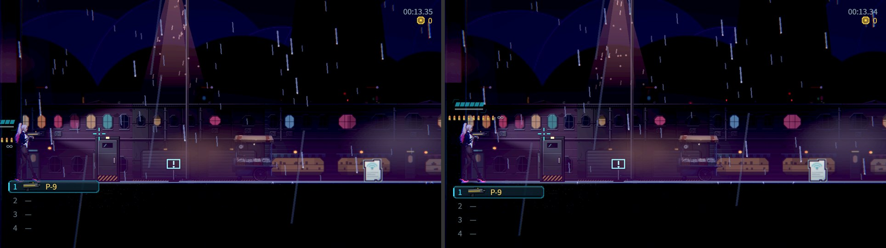
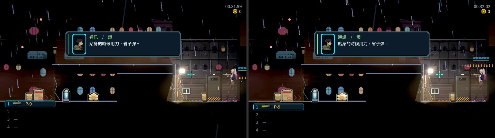
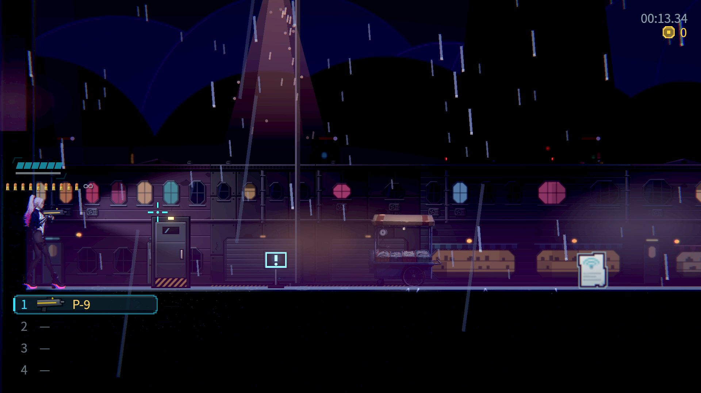
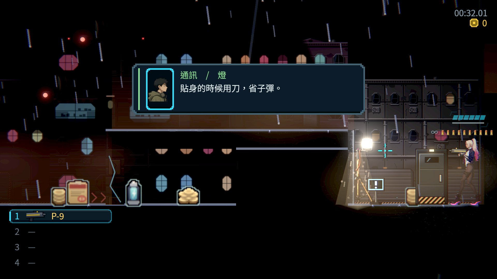
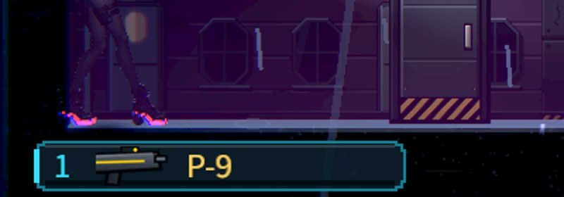
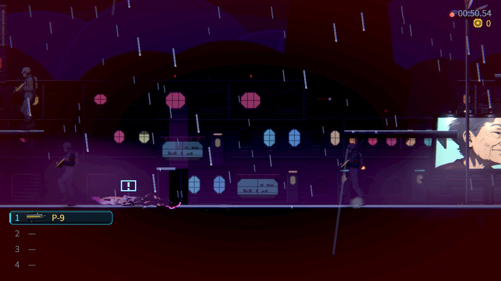
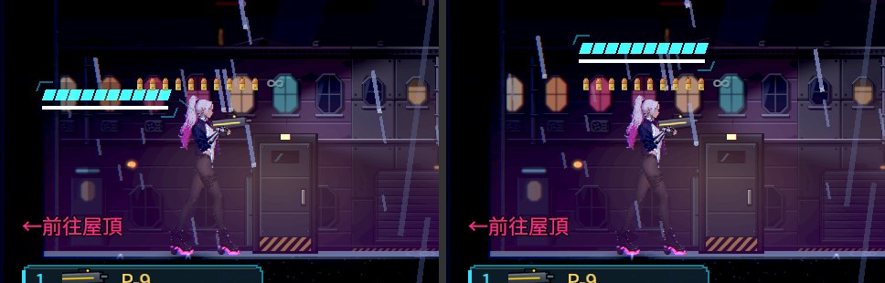

# [NE-264] 修正彈帶在拉近鏡頭後被畫面邊緣切掉

> 狀態：審查中

## 內文

### 需求
NE-256 把關卡鏡頭拉近、並把前方視野補回 300 世界像素以後，主角面向前方時站在畫面邊緣附近，背後只剩約 60 個畫面像素。主角身旁的彈帶（子彈列、備彈數）與護盾條固定擺在準星的反方向，也就是主角背後，現在有一半以上被畫面左緣（面向左時是右緣）切掉，玩家看不到剩幾發、護盾剩多少。
要讓這些跟著主角的介面在任何鏡頭位置都完整留在畫面裡，且不擋住瞄準方向與主角的臉。

### 來源
2026-10-11，演出與鏡頭組在 NE-256 拉近鏡頭後的實際畫面發現（第一章街道，1280×720，Forward+）。介面排版屬介面組。

### 驗收條件
- [x] 主角面向左、右，站在畫面邊緣附近時，彈帶、備彈數與護盾條完整顯示在畫面內（1280×720 與 1920×1080 各附一張面向左、右的截圖）
- [x] 改擺位置後仍不擋準星方向，也不蓋住主角的頭與臉
- [x] 轉身、跑、跳時彈帶換位置是平滑的，不會一格內跳到另一邊
- [x] 畫面左下的武器欄和站在地上的主角腳邊不重疊（目前只差約 15 個畫面像素，附截圖確認）

### 測試流程
1. 進第一章街道，面向右站著，看畫面左緣的彈帶與護盾條
2. 轉身面向左、再跑、跳、開槍、換彈，看彈帶位置的變化
3. 在 1920×1080 重複一次

---

# 跟其他票的關係

- Blocks：無
- Blocked by：無
- Related：NE-256、NE-228

---

# Commit-1

## 內文

鏡頭拉近之後，主角走到關卡邊緣、面向畫面內側時，背後只剩幾十個畫面像素，彈帶與生命護盾標籤固定擺在背後，一半以上被畫面邊緣切掉；轉身時整排彈帶也是一格內從一側跳到另一側。畫面左下的武器欄和站在地面的主角腳底剛好碰在一起。

現在彈帶與生命護盾標籤用同一條規則決定位置：背後放得下就照舊放在準星的反方向；靠近畫面邊緣、背後放不下時，兩者一起平滑移到頭頂上方（生命護盾在上、彈帶在下），不擋準星的方向，也不蓋住頭和臉，備彈數字改寫在靠畫面內側的那一端；不論在哪個位置，整排都留在畫面左右邊緣之內。轉身時整排先收攏到主角身旁再往另一側展開，跑、跳與移到頭頂的切換也都是連續移動。武器欄往下移，和站在地面的主角腳邊留出空隙；萬一真的重疊（例如站在左下角的低處），武器欄會讓位變淡。一般在街道中段跑動時主角在畫面左側約三分之一處，彈帶仍在背後，不受影響。共用的 HUD 擺位檢查裡，有一項直接指定彈帶方向的檢查，配合「畫面上的方向會平滑過渡」補設同一個值，斷言不變。

驗收在 Forward+（雲端軟體 Vulkan）第一章港區街道，1280×720 與 1920×1080 各拍面向左、右站在畫面邊緣的畫面，並與修前同一位置對照：修前彈帶在畫面上的範圍是 -49～20（左緣）與 620～689（右緣，畫面寬 640），修後是 4～73 與 567～636，全部在畫面內。自動檢查量了轉身、跳躍、從邊緣跑過切換點三種情況，離主角最遠的那顆子彈每一格的移動都在 24 個畫面像素以內；拿掉修正時有 4 項失敗。

### 測試結果

| 項目 | 結果 |
|---|---|
| 受影響範圍（基準 c743a8bd） | 14 組、3,299 檢查；0 新失敗、0 已知失敗，163 秒 |
| 新增檢查 | 邊緣時彈帶完整在畫面內、移到頭頂、標籤在上一列；武器欄只在重疊時讓位；轉身、跳躍、跑過切換點都平滑 |
| 修正前對照 | 換回舊的彈帶與標籤，新增檢查 4 項失敗 |
| 截圖工具量測（兩種解析度、四個站位） | 8／8 在畫面內 |

分支 `feature/ui-quest`，已併入 main：[a8ac7682](https://github.com/deadline314/Nest-Egg/commit/a8ac7682)。

### 截圖

# Commit-2

## 內文

整組交叉檢查時，在港區街道看到主角站在離左緣約一百個畫面像素的位置：彈帶已經移到頭頂，生命護盾標籤卻還在背後，兩者碰在一起。原因是兩個元件各自用自己的錨點與間距判斷「背後放不放得下」，在臨界附近的一小段距離裡判斷不同。

現在兩者只用主角中心在畫面上的位置與面向判斷，輸入相同、結果相同：一起留在背後，或一起移到頭頂上下兩列。

驗收：自動檢查讓主角從左緣每次往內走 3 個世界像素，每個站位都確認兩者一起決定；換回舊判斷時這項失敗。同一位置的 Forward+ 截圖修後兩者上下排好、沒有重疊。

### 測試結果

| 項目 | 結果 |
|---|---|
| 受影響範圍（基準 45efb74d） | 13 組、3,050 檢查；0 新失敗、0 已知失敗，163 秒 |
| 新增檢查 | 每個站位彈帶與標籤一起決定放背後或頭上（換回舊判斷時失敗） |

已併入 main：[2c7c4820](https://github.com/deadline314/Nest-Egg/commit/2c7c4820)。

### 截圖

