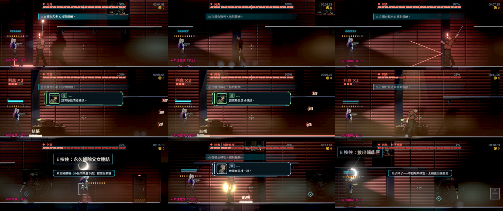
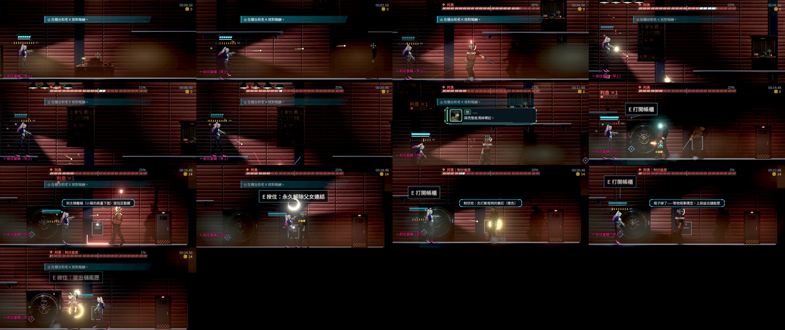
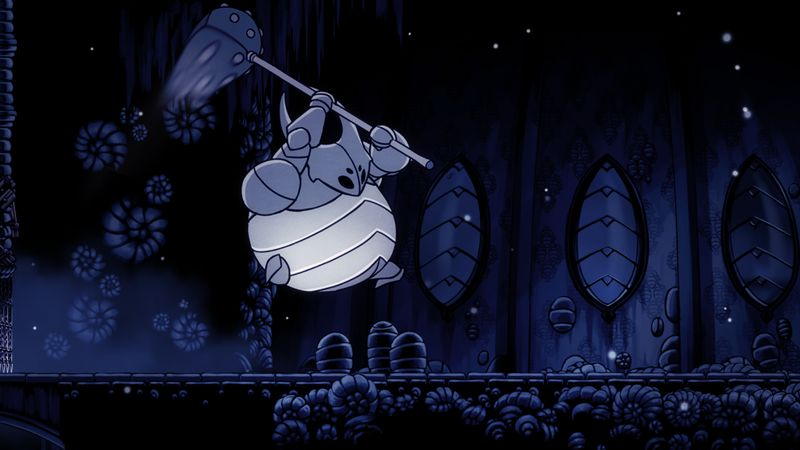
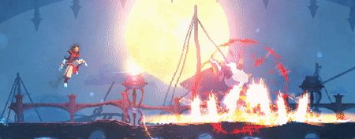
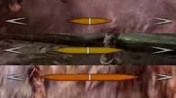
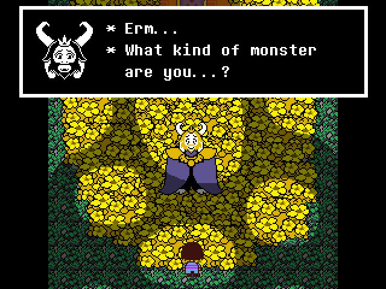
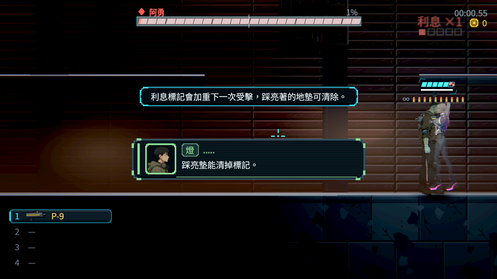

# [NE-265] 製作第二章阿勇頭目戰

> 狀態：進行中

## 內文

### 需求
第二章的頭目阿勇要有自己的打法，並且能接上劇本的「永久解除或保留父女連結」兩條路。阿勇是收帳人的頭，用鐵棍近身對決，戰中會疊「利息」標記；血量到門檻時退到終端前，遊戲安全暫停讓玩家選擇；斷連路要玩家親手操作主隔離箱再制伏，保留路會先真正死亡、復原一次，第二階段更慢、更重、匣蓋閉不上。兩路最後都是活著被制伏，不是被殺。

詳細打法、提示與每條路的結果見 `design/13-story-v2/SCRIPT_CH02.md` 的 S11～S13，故事端的接點見 `design/13-story-v2/CH02_IMPLEMENTATION.md`。

### 來源
2026-10-11 故事主線 Session 落地第二章（ST-19）時拆出；頭目戰設計原則見 NE-253（每個頭目有獨立機制）。敵人與頭目屬於戰鬥 Session。

### 驗收條件
- [x] 鐵棍蓄力重擊有約 0.8 秒的預兆，可閃可擋，撲空時有反擊空檔；慢速紙頁扇形可以跳過；同屏最多兩名小弟，第二階段不再增援
- [x] 「利息」標記每受擊疊一層、最多五層、每層讓下一擊多 10% 傷害；踩亮著的「結帳」地墊或 6 秒未受擊會清除，圖示與地墊白框看得出層數
- [x] 血量到 25% 時阿勇退到終端前，戰鬥安全暫停（敵人不會在暫停中出手），由故事端播出選擇說明；選擇沒有倒數，可以返回
- [x] 斷連路：玩家到主隔離箱操作約 1.5 秒（受擊會中斷、未完成不算），成功後阿勇的血量條改成「制伏進度」，打斷棍柄鎖扣後以互動拔出儲能匣完成制伏；全程沒有死亡與復原
- [x] 保留路：第一階段最後一擊讓阿勇真正倒下並復原一次（只一次），第二階段動作較慢、單擊較重、匣蓋閉不上；鷺關上維修暫停閂之後才改成「制伏進度」，同樣以拔匣完成制伏
- [x] 戰鬥的階段與結果寫進故事旗標（斷連選擇、連結解除、阿勇復原一次、制伏完成），重試從正確的階段開始：斷連成功後不會回到保留，保留路的復原不會因凜死亡重試而再發生一次
- [x] 小薇所在的高臺隔間不是攻擊目標，子彈與爆炸穿不過去
- [ ] 鍵鼠與手把都能打完；普通難度不靠刷錢可通過，附實際戰鬥的連續畫面（機器人 12 場與 Forward+ 連續畫面已附；待本機原生驗收：真人用滑鼠與實體手把各打完斷連、保留兩路的原生連續畫面）

### 測試流程
1. 從第二章帳房前室進入戰鬥，各走一次斷連路與保留路到制伏
2. 兩條路各在第二階段死亡一次再重試，確認階段、旗標與小薇的讀取次數都沒有重複

---

# 跟其他票的關係

- Blocks：ST-19、NE-231、NE-234
- Blocked by：無
- Related：NE-253、NE-266、ST-18

---

# Commit-1

## 內文

**問題**：第二章頭目阿勇還不存在；劇本要他用鐵棍近身對決、戰中疊「利息」、血量 25% 時安全暫停交給玩家選擇，並且接上「永久解除」與「保留」兩條路，兩路都是活著被制伏。

**改動**：阿勇的核心機制是「利息」：被他打中一次疊一層（最多五層），每層讓下一擊多 10%；踩亮著的「結帳」地墊或 6 秒沒受擊就全部清掉。主角頭上的小格與每塊地墊的白框分段都顯示目前層數；第一次疊層時提示一句並播燈的短通訊。他的習慣看得出個性：你欠越多他越貪（三層起改用兩棍連段），你帶著利息走向亮墊時他會衝過去先踩掉；近了舉棍、遠了丟紙頁。鐵棍重擊有約 0.8 秒的預兆（舉棍過頭、棍頭發紅、地上紅條往前填滿、最後 0.3 秒不再轉身），揮空時棍子卡在地上 1.2 秒是反擊空檔，舉盾擋下他收招變長，完美格擋打出 1.4 秒硬直。紙頁扇形五張、很慢、張與張之間有縫可以跳過或蹲過。第一階段押運手從兩側門補進來，同時最多兩名、整場兩名，之後不再增援。

生命 100。血量到 25% 時他停在那裡、不會被打死，退到終端前，戰鬥安全暫停（過場凍結整個世界，敵人不會出手），由故事端播選擇說明；選擇沒有倒數、可以返回。斷連路：他守在主隔離箱旁（小薇的高臺下面），玩家要在他有預兆的重擊之間按住互動 1.5 秒，受擊會中斷、未完成不寫；成功後寫入連結解除的旗標，血條改成「阿勇｜制伏進度」。保留路：繼續打到底，他真正倒下、播故事端的復原（只一次），回來時 60% 血量、動作 0.8 倍、每招傷害 +1、收招較長；再打到 35% 時鷺關上維修暫停閂（故事端的短演出），血條才改成制伏進度。兩路的制伏相同：先打中橙色的棍柄鎖扣三次，棍子掉了改用外骨骼短拳；制伏進度打完後，趁短拳撲空的空檔貼近他按住互動拔出儲能匣（開始按住就抓住他，空檔不會在按到一半時結束），他就被制伏（啟動 `ch2_yong_down`，關卡寫入制伏旗標，帳櫃與小薇的劇情讀它）。全程沒有被打死。死亡重試依旗標從正確的階段開始：選過不再選；斷連成功後直接是制伏；保留路的復原不會再發生一次。小薇的高臺隔間靠戰區那一側整面封住，子彈與爆炸進不去，她沒有受擊框。打法與參考資料（Hollow Knight、Dead Cells、Sekiro、Undertale、Blasphemous 的實際畫面，以及 FFXIV、Enter the Gungeon、Hades 的文字資料）寫在 `design/15-combat-feel/BOSS_FIGHTS.md` 第 7 節。

**暫代外觀（角色組交付前，換圖時只改資料）**：骨架用 NE-242 的阿勇；動作暫借監管者的舉過頭與下砸、收帳人打手的蓄力與揮擊；鐵棍用程式畫（從前手沿前臂 24 像素）；動作資料用阿勇自己的名稱（內容暫時複製，換動作只改資料）。需要的專屬姿勢：待機（棍扛在肩上）、走、舉棍過頭蓄力、下砸（棍頭到地面前 40 像素）、揮空卡地喘氣、舉起紙疊與甩出、衝刺踩墊、退到終端護住機器、真正倒下與復原起身（第二階段：一隻手顫、袖子沒穿好、匣蓋卡住閉不上，不裸體）、棄棍後的短拳與撲空、被拔匣後跪坐。鐵棍約 24 像素長、棍柄鎖扣在前手。

重擊與押運手的突進都只往前到貼近主角為止，不靠身體碰撞造成沒有預兆的傷害（實戰機器人第一輪發現受傷大多來自身體碰撞，修正後同一場從 65 降到個位數）。Forward+ 連續畫面也抓到一個問題：斷連路在箱子完成前繼續打，會把之後的制伏進度先打光；改成箱子完成前血量停在 25%，制伏進度從那裡開始。頭目框架順帶修兩處畫面：一直打開的部位（例如人形頭目的頭）不再畫常駐的圈（像光環）；利息格子畫在彈帶與護盾標籤上方，不重疊。

**驗收**：自動檢查（第二章敵人套件）：重擊預兆在三種難度都約 0.8 秒、打中扣 2、揮空收招 1.2 秒以上、完美格擋打出硬直；紙頁五張、慢、張與張之間有縫；利息每受擊一層、三層時下一擊 2→3、最多五層、踩亮墊或 6 秒沒受擊清除、他搶先踩到亮墊就暗掉、結束時還原；習慣（近重擊、遠紙頁、三層連段、帶利息走向亮墊時搶墊）；第一階段增援同時最多兩名、整場兩名；25% 前打不死、暫停後選擇走預設的斷連；隔離箱受擊中斷且不寫旗標、按滿 1.5 秒寫入連結解除；制伏時鎖扣打開、打三次繳械、進度打完不死、撲空後拔匣完成；保留路真正倒下並復原一次、復原後 60%、較慢較重、35% 時暫停閂寫入、保留連結資格；五種重試狀態都從正確的階段開始，制伏後重進不再出現；從戰區六個位置朝小薇開槍都被玻璃或高臺擋下，她沒有受擊框。正式帳房：從開打一路到 `ch2_yong_subdued` 寫入。機器人在正式帳房用真正的輸入打完 12 場（三難度 × 滑鼠／手把右搖桿 × 斷連／保留）全部制伏。Forward+（軟體 Vulkan）定格與兩秒一張的連續畫面看過：舉棍與地上紅條、扇形邊線、紙頁、結帳地墊與頭上的利息格、搶墊的紅線、退到終端、隔離箱的進度環、鎖扣的橙光、拔匣。真人用實體手把打完與本機原生連續畫面仍待驗，最後一條維持未勾。

### 測試結果

| 項目 | 結果 |
|---|---|
| 第二章敵人套件（含阿勇） | 138 項，0 失敗 |
| 受影響範圍（`tools/run_tests_changed.sh`，最新 main 為基準） | 93,804 項；唯一的新失敗是對負載敏感的蹲下計時檢查，單獨重跑全過 |
| 機器人實戰（斷連，滑鼠） | 簡單 31 秒／標準 26 秒／困難 24 秒，全部制伏 |
| 機器人實戰（斷連，手把右搖桿） | 簡單 30 秒／標準 30 秒／困難 28 秒，全部制伏 |
| 機器人實戰（保留，滑鼠） | 簡單 30 秒／標準 30 秒／困難 33 秒，全部制伏 |
| 機器人實戰（保留，手把右搖桿） | 簡單 30 秒／標準 29 秒／困難 29 秒，全部制伏 |
| 畫面 | Forward+ 軟體 Vulkan（llvmpipe）；本機原生畫面待驗 |

機器人知道每一招的時機、每槍瞄頭，所以比真人快很多；數字用來確認每一招都有可行的應對、三種難度與兩條路都打得完。

### 截圖

參考（截圖都看過，取捨寫在設計文件第 7 節）：

分支：`feature/sharp-knuth-9lsl88`，提交：https://github.com/deadline314/Nest-Egg/commit/9544f6a0

# Commit-2（冷續玩地墊保持原平台）

## 內文

在阿勇附近繼續遊戲時，平台地墊原本會錯落到低 80 像素的地面，並回報三次找不到地面。現在續玩立即醒來時也能按原地圖定位，指定在平台上的地墊回到平台；頭目、利息、地墊輪替與戰鬥時序保留。

### 測試結果

| 項目 | 結果 |
| --- | --- |
| 原主檔冷讀與原生負控制 | 各 7 項中 1 失敗、3 筆地面錯誤 |
| 修後原主檔冷讀與原生 | 各 7 項全過、0 錯誤 |
| 第二章敵人與地表邊界 | 144 項、0 新／已知失敗 |
| 最後原受影響回歸 | 69 組、92,422 項、0 新／已知失敗、578 秒 |

[原主檔、前後座標、原生原圖與全部原始失敗](attachments/NE-265-cold-pad-floor/README.md)。原主檔使用明示的戰鬥位置／狀態樣本，不代稱真人完整戰鬥或實體手把驗收。
