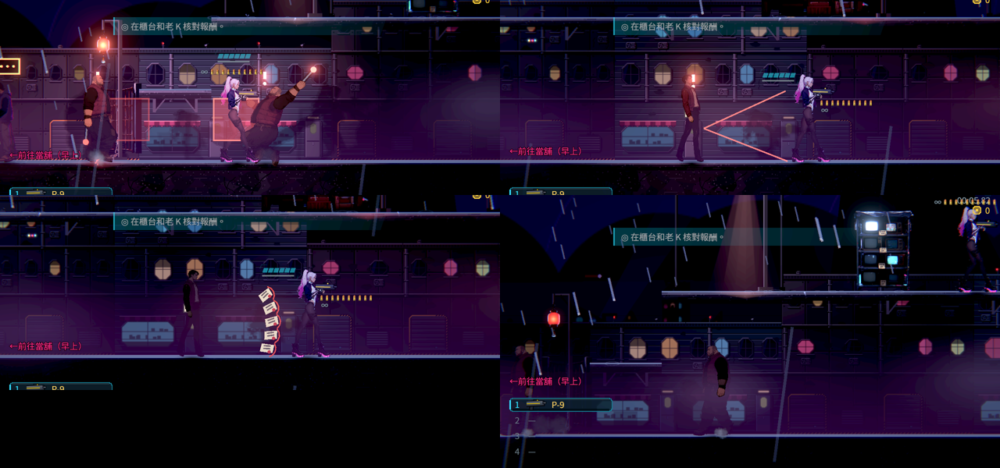
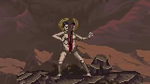

# [NE-266] 配置第二章市集遭遇與兩種新敵人

> 狀態：審查中

## 內文

### 需求
第二章的市集要有兩種本章才出現的收帳人身份：「押運手」（短棍突進）與「票據投手」（慢速紙頁扇形），不是把第一章的保全換色。遭遇放在故事端預留的戰鬥區：市集入口兩場可從公眾攤道繞過的短戰、雨棚背面下層貨道兩場小遭遇（可從上層電線橋繞過），以及阿勇戰的兩名小弟。每場同屏最多三名普通敵人，安全區（當舖、屋頂、阿梨住處、復原館、客人簿）不放敵人。

地圖與戰鬥區位置由 ST-19 的區域產生器提供，見 `design/13-story-v2/CH02_IMPLEMENTATION.md`。

### 2026-10-12 角色美術組：開始畫之前要確認的事
票上與劇本只寫了「短棍突進」「慢速紙頁扇形」「不是第一章保全換色」，還不夠畫。下列各項請戰鬥組或故事組在這裡回覆；沒有回覆的項目不動工。括號內是沒有意見時會採用的做法。

1. 兩種敵人在資料裡的名稱（外觀與敵人資料共用）。（`market_runner`、`market_clerk`）
2. 都是成年的人形收帳人、走人形骨架？體型與身高各是多少。（押運手：壯、高 60；票據投手：瘦、高 56）
3. 和第一章收帳人的關係：同一家公司的不同職務，還是市集攤位自己僱的人？這決定制服要不要沿用同一套配色。
4. 押運手的短棍：握在手上、由武器圖提供，還是畫在手臂零件上？長度多少。（握在手上，約 0.55 個身高，和阿勇的棍同一系列但較短）
5. 票據投手手上拿什麼（票夾、帳冊、腰掛票箱）？飛出去的紙頁是投射物素材，不算在角色零件裡？（腰掛票箱加手上一疊；紙頁歸投射物）
6. 人形八個動作之外需要哪些專屬姿勢：突進前的預兆、投擲前的預兆、被擋下的硬直？
7. 需不需要對話頭像。（不需要）

**戰鬥組回覆（2026-10-12）**

1. 名稱用敵人資料已經在用的 `ch2_escort`（押運手）、`ch2_bill_thrower`（票據投手），外觀做好後敵人資料的外觀欄位指到同名即可。
2. 都是成年人形收帳人，走人形骨架。受擊範圍是押運手 16×46、票據投手 14×44 世界像素，和第一章收帳人打手、槍手同一個尺度；押運手比打手壯一點，票據投手瘦長。
3. 同一個收帳人組織派駐市集的兩種職務：沿用收帳人的配色系統，但不是換色——押運手穿反光背心、護膝，票據投手揹帳夾、腰掛票箱，輪廓一眼分得出來。
4. 短棍握在手上、由武器圖提供（不畫在手臂零件上），長約 16～20 世界像素，和阿勇的鐵棍（約 24）同系列但短。
5. 同意：腰掛票箱加手上一疊單子；飛出去的紙頁是投射物，不算角色零件。
6. 專屬姿勢：押運手——壓低蓄力（重心前傾、棍舉到肩後）、突進揮棍、撲空喘氣、被擋下的硬直；票據投手——往後退一步、舉起單子蓄力（手在頭上方）、甩出（手臂橫掃）、收招。
7. 不需要對話頭像。

### 來源
2026-10-11 故事主線 Session 落地第二章（ST-19）時拆出；劇本 `design/13-story-v2/SCRIPT_CH02.md` 的 S05、S08、S12 與第 8 節素材表。敵人擺放屬於戰鬥 Session。

### 驗收條件
- [x] 兩種新敵人的動作與形狀看得出分工（突進與遠距紙頁），各有清楚的預兆
- [x] 市集入口與貨道的遭遇都放在預留的戰鬥區，玩家可以照劇本繞過，不鎖主線
- [x] 每場同屏最多三名普通敵人；安全區沒有敵人
- [x] 名單與數量符合每章敵人名單（NE-97 的規則），用資料整批調整
- [x] 外觀與零件由角色 Session 交付前，暫代外觀列在票上

### 測試流程
1. 從市集入口走到帳房，分別走戰鬥路線與繞道路線
2. 確認每場遭遇的敵人數量與種類

---

# 跟其他票的關係

- Blocks：ST-19、NE-231、NE-234
- Blocked by：無
- Related：NE-265、NE-97、NE-267

---

# Commit-1

## 內文

**問題**：第二章市集預留了四個戰鬥區，但沒有敵人；劇本要的「押運手」「票據投手」兩種本章才有的收帳人身份也還不存在。

**改動**：做了兩種新敵人，打法互補——押運手在約 6 格外壓低身子、棍頭發紅、地上畫出紅框，然後貼地突進揮短棍，跳起越過或衝刺穿過就閃得掉，撲空後要喘一下；票據投手站定保持距離（太近會往後退），舉起一疊單子、畫出扇形的兩條邊線，最後一刻鎖定方向，丟出五張很慢的紙頁，張與張之間有縫可以跳過或蹲過，收招時是靠近的時機。四個戰鬥區依劇本配置：市集入口「押運手×2」「押運手＋票據投手」，下層貨道「票據投手＋押運手」「押運手×2＋票據投手」，每場最多三名；地面的敵人看不到上層的公眾攤道與雨棚，照劇本可以整段繞過。名單與數量在產生器的一張表，整批調整只改那裡；第二章的章節名單加進共用的名單資料，兩種身份只屬於第二章。每種敵人都有自己的敗北圖鑑卡（一句講應對）、死亡特效、音效設定與動作資料（動作暫時複製收帳人打手的，名稱是押運手自己的，換動作只改資料）。突進只衝到貼近主角為止，不衝進主角身上（身體碰撞不算這一招的判定）。參考資料（Blasphemous 的站定投擲敵人、Hades 的衝撞前停頓、Enter the Gungeon 的扇形留縫）與取捨寫在 `design/15-combat-feel/BOSS_FIGHTS.md` 第 7、8 節。

**暫代外觀（角色組交付前，換圖時只改敵人資料的外觀欄位）**

| 敵人 | 目前暫用 | 需要的外觀 |
|---|---|---|
| 押運手 | 收帳人打手的骨架與動作；短棍用程式畫 | 收帳人的押車小弟，比打手瘦、穿反光背心；身高約 46 世界像素（和打手同一層級）、身寬約 16；前手握 16 像素長的短棍。姿勢：待機、走、壓低蓄力（重心前傾、棍舉到肩後）、突進揮棍（身體前伸一步）、撲空後喘氣、受擊、倒地 |
| 票據投手 | 收帳人槍手的骨架；紙疊用程式畫 | 開單員，瘦長、背著帳夾；身高約 44、身寬約 14；手上一疊收帳單。姿勢：待機、走、往後退一步、舉起單子蓄力（手在頭上方）、甩出（手臂橫掃）、收招、受擊、倒地 |

**驗收**：自動檢查：押運手在範圍內會蓄力並往前突進超過 40 像素；票據投手丟出五張慢速紙頁；站在高處平台上時地面的票據投手看不到；四場遭遇每場最多三名、只用本章的身份；當舖、屋頂、阿梨住處、復原館外、街道、市集與前室沒有敵人；兩種敵人在三種難度下都打得倒；第二章的區域只放第二章名單裡的敵人。

### 測試結果

| 項目 | 結果 |
|---|---|
| 第二章敵人（新套件） | 59 項，0 失敗 |
| 受影響範圍（`tools/run_tests_changed.sh`，最新 main 為基準） | 93,612 項；修正動作不共用、狀態特效與音效設定檔後，相關 6 組 34,954 項 0 失敗；另 5 個計時類檢查單獨重跑全過 |
| 畫面 | Forward+ 軟體 Vulkan（llvmpipe），正式市集入口 |

### 截圖

分支：`feature/sharp-knuth-9lsl88`，提交：https://github.com/deadline314/Nest-Egg/commit/e7aaf221
