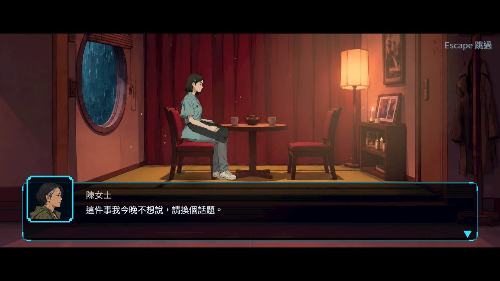

# [NE-267] 補畫第二章新登場的配角

> 狀態：進行中

## 內文

### 需求
第二章有幾位第一次出場、目前沒有外觀的配角。故事端先用頭像剪影與說話氣泡撐住，要換成和既有角色畫風一致的立繪、頭像與分件：

| 角色 | 出場 | 需要的動作 |
|---|---|---|
| 市集入口巡帳員（成年） | S05 | 站立、看證件、讓開 |
| 租攤視窗員（成年） | S08 | 坐在窗口、蓋章 |
| 小販（成年） | S08、S09 | 站立、遠聲吆喝 |
| 市場救護員（成年，非戰鬥） | S12、S13 | 護送、鎖暫停閂 |
| 灰衣搬運者兩名（成年，大黑傘與灰外套） | S13、S22 遠景 | 抬擔架、綁帶、點頭；遠景剪影 |
| 客人簿三位客人：鄭先生（58）、陳女士（44）、洪先生（35） | S18～S20 | 坐、站、翻雨帽、端湯、寫信 |
| 押運手、票據投手（敵人） | S05、S08、S12 | 見 NE-266 |

### 來源
2026-10-11 故事主線 Session 落地第二章（ST-19）時整理；劇本 `design/13-story-v2/SCRIPT_CH02.md` 第 8 節。角色立繪、分件與骨架屬於角色 Session，故事端不自己畫。

### 驗收條件
- [ ] 每位角色有立繪、頭像與分件，畫風與既有角色一致，沒有破圖、多一隻手或過度挺胸
- [ ] 客人與救護員都是成年人；客人簿場景不出現成人內容
- [ ] 表內每個動作在遊戲裡實際播出，附原生截圖

### 測試流程
1. 在第二章各場景與客人簿看每位角色的待機、說話與指定動作

---

# 跟其他票的關係

- Blocks：ST-19
- Blocked by：無
- Related：NE-242、NE-266

---

# Commit-1

## 內文

**問題**：鄭先生、陳女士與洪先生原本共用同一張居民男性頭像，難以辨識，也不符合陳女士的角色設定。

**改動**：三位成年客人各有符合年齡與畫風的獨立頭像；講者名字、對話、選擇與獎勵保持。

**驗收**：原尺寸裁切可重建，錯來源不覆寫圖片；三色背景與正式對話框都看過。這是頭像單位，沒有把保留的全身參照圖當成完成分件與指定動作。

[來源、原生範圍、測試與重跑](attachments/NE-267-guest-portraits/README.md)；[本票提交](https://github.com/deadline314/Nest-Egg/commits/main/pm/Nest-Egg/%5BNE-267%5D%E8%A3%9C%E7%95%AB%E7%AC%AC%E4%BA%8C%E7%AB%A0%E6%96%B0%E7%99%BB%E5%A0%B4%E7%9A%84%E9%85%8D%E8%A7%92.md)。
