# [NE-267] 補畫第二章新登場的配角

> 狀態：進行中

## 內文

### 需求
第二章有幾位第一次出場、目前沒有外觀的配角。故事端先用頭像剪影與說話氣泡撐住，要換成和既有角色畫風一致的立繪、頭像與分件：

| 角色 | 出場 | 需要的動作 |
|---|---|---|
| 市集入口巡帳員（成年） | S05 | 站立、看證件、讓開 |
| 租攤視窗員（成年） | S08 | 坐在窗口、蓋章 |
| 小販（成年） | S08、S09 | 站立、遠聲吆喝 |
| 市場救護員（成年，非戰鬥） | S12、S13 | 護送、鎖暫停閂 |
| 灰衣搬運者兩名（成年，大黑傘與灰外套） | S13、S22 遠景 | 抬擔架、綁帶、點頭；遠景剪影 |
| 客人簿三位客人：鄭先生（58）、陳女士（44）、洪先生（35） | S18～S20 | 坐、站、翻雨帽、端湯、寫信 |
| 押運手、票據投手（敵人） | S05、S08、S12 | 見 NE-266 |

### 來源
2026-10-11 故事主線 Session 落地第二章（ST-19）時整理；劇本 `design/13-story-v2/SCRIPT_CH02.md` 第 8 節。角色立繪、分件與骨架屬於角色 Session，故事端不自己畫。

### 驗收條件
- [ ] 每位角色有立繪、頭像與分件，畫風與既有角色一致，沒有破圖、多一隻手或過度挺胸
- [ ] 客人與救護員都是成年人；客人簿場景不出現成人內容
- [ ] 表內每個動作在遊戲裡實際播出，附原生截圖

### 測試流程
1. 在第二章各場景與客人簿看每位角色的待機、說話與指定動作

---

# 跟其他票的關係

- Blocks：ST-19
- Blocked by：NE-287、NE-290
- Related：NE-242、NE-266

---

# Commit-1

## 內文

**問題**：鄭先生、陳女士與洪先生原本共用同一張居民男性頭像，難以辨識，也不符合陳女士的角色設定。

**改動**：三位成年客人各有符合年齡與畫風的獨立頭像；講者名字、對話、選擇與獎勵保持。

**驗收**：原尺寸裁切可重建，錯來源不覆寫圖片；三色背景與正式對話框都看過。這是頭像單位，沒有把保留的全身參照圖當成完成分件與指定動作。

[來源、原生範圍、測試與重跑](attachments/NE-267-guest-portraits/README.md)；[本票提交](https://github.com/deadline314/Nest-Egg/commits/main/pm/Nest-Egg/%5BNE-267%5D%E8%A3%9C%E7%95%AB%E7%AC%AC%E4%BA%8C%E7%AB%A0%E6%96%B0%E7%99%BB%E5%A0%B4%E7%9A%84%E9%85%8D%E8%A7%92.md)。

---

# Commit-2

## 內文

**問題**：S18 客人簿重建舞台時只有阿梨，鄭先生尚無全身演員，拿出小票與放到桌面的動作也只有文字。

**改動**：加入符合 58 歲設定的鄭先生全身骨架、坐站及說聽演出；用既有紙張美術完成實際持紙、平放桌面與收手。三位批准頭像與原始全身圖保持原 bytes，身份、台詞、選項、任務與獎勵不變。

**分項驗證**：原生雙朝向、四倍率完整動作與坐站轉換共 228480 個接點樣本，真一像素孔負控仍被拒絕。三十張全彩動作頁與正式 S18 持紙／放桌／站起原圖已逐張檢視；實際轉換、手紙接點、座面、腳底與 diffuse／normal 掛載均另有量測。原 checker 的跨鄰關節外輪廓及歷史失敗資料保留，範圍與限制詳見附件。

原選擇器先前抓到 S18 離座後仍站在椅子範圍的 3 項新紅，已改成真正站穩再走，入／離椅動線另有回歸。整合時又發現舊存檔遷移把客人簿五段劇情認不出來：新加的走位「走完的姿勢」被當成劇情跳轉、伸手與持紙被當成結果。現在舞台上的走位、伸手與道具動作不參與舊結果比對（兩邊同樣排除，封存的對照表不動），五段劇情的舊結果恢復可辨識。

受影響範圍 77 組、97,396 項，修正後相關三組重跑 2,552 項 0 失敗；平行負載下兩項計時量測（爆炸每格耗時、鞭子命中聲）單獨重跑通過。本段仍為進行中紀錄：鄭先生的實際 6.216 倍率與走路驗收、陳女士、洪先生與其餘配角尚未完成。

[來源、分項結果、原始失敗與完整證據](attachments/NE-267-guest-rigs/README.md)。

---

# Commit-3（陳女士的全身零件、骨架與動作資料）

## 內文

**問題**：陳女士只有頭像，S19 客人簿場景沒有她的全身演員。

**改動**：用已保存的原生全身立繪（原圖位元組不變、沒有編造種子）做出陳女士的零件、骨架與動作資料：姿勢模型取關節後逐點核對（肩、肘、腕在近側手臂，膝、踝在近側腿）；本機 9070 XT 上的 SAM 取近側手臂與遠側腿（遠側腿只取膝蓋以下，避開兩條深色褲管相接處的雜點），Qwen 補出手臂後面的衣身與褲子；保留來源的半透明邊緣，不做模糊、邊緣重畫或盲目補洞。動作資料是她自己的一份（比鄭先生步幅略大、身體起伏略小）。

**分項驗證**：遊戲引擎內的 NPC 動畫器已能播站、坐、靠牆、蹲、說話、聆聽、揮手與工作循環（下圖）。NPC 八種動作在遊戲與過場（3.7 倍）兩種倍率、雙朝向的逐格接點稽核共 33,600 個取樣，823 個不合格，其中 519 個是真的縫（集中在遠側肩的站與揮手各 140、坐姿遠側膝 96～62、近側肩坐姿 73），其餘 304 個只是邊緣缺口。抽看遠側肩站姿：連帽外緣有 2 像素的小孔，且肩上留著移臂時的圓形袖窿片（近側手臂垂下時會蓋住）。這些都還沒修，陳女士尚未放進 S19，本段只是零件與骨架的進度。

### 測試結果

| 項目 | 結果 |
|---|---|
| 受影響範圍（`tools/run_tests_changed.sh`） | 52 組、64,125 項，0 失敗 |
| NPC 動作逐格接點（`rig_joint_audit --npc-performance`，1／3.7 倍、雙朝向） | 33,600 取樣：519 真縫、304 邊緣缺口，未通過 |

### 截圖

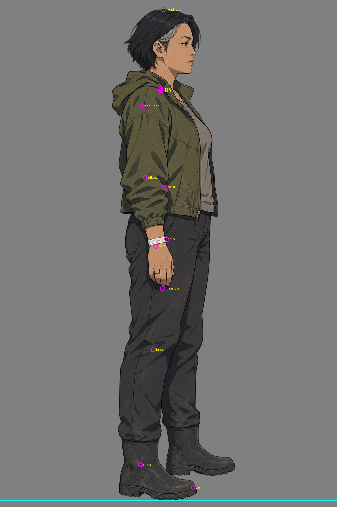

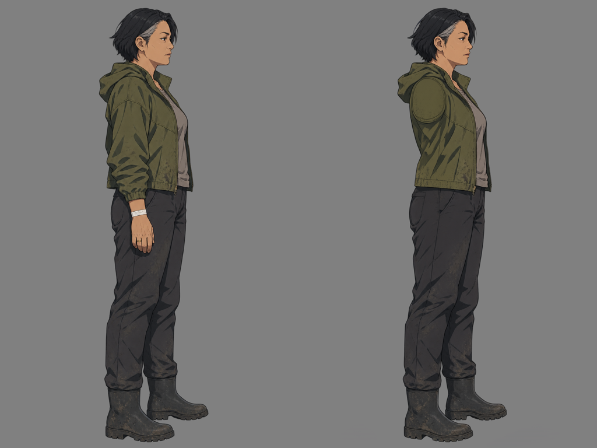

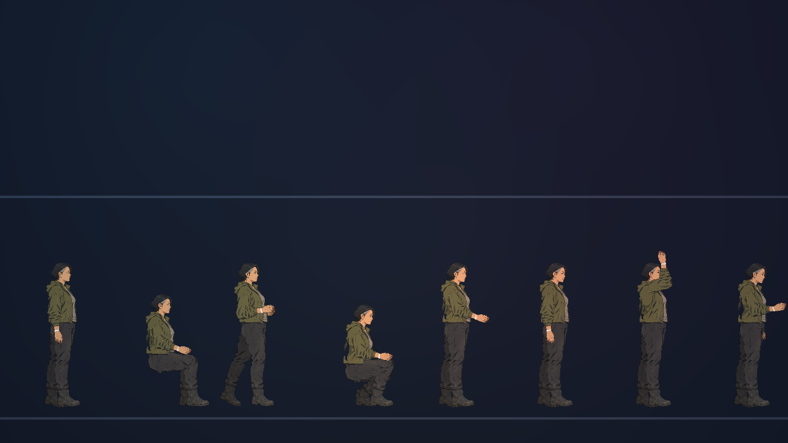

---

# Commit-4（陳女士坐進 S19）

## 內文

**問題**：S19 客人簿第二位客人只有阿梨在場，陳女士只用頭像說話。

**改動**：陳女士在 S19 第一段從右邊走到預約窗桌後的右椅坐下，整段對話坐著說話與聆聽，喝完湯那一段結束後起身走開；用和鄭先生同一張右椅的座面與地板支撐。身份、台詞、選項、旗標、交易與獎勵都不變（舊存檔的結果比對照常認得這幾段）。

**分項驗證**：正式 S19 舞台原生畫面（9070 XT、Forward+）：坐在椅面上、雙腳在地板、和阿梨同比例、受光一致；放大看坐姿臀部、膝、手腕與手部接合合理。逐格接點的 519 個真縫（Commit-3）仍待修，起立與走出的連續畫面也還沒逐格看，本段仍是進度紀錄；洪先生與其餘配角未完成。

### 測試結果

| 項目 | 結果 |
|---|---|
| 受影響範圍（`tools/run_tests_changed.sh`） | 10 組、6,619 項，0 失敗 |
| 劇情契約、客人演員 Python 測試 | 25 項，0 失敗 |

### 截圖

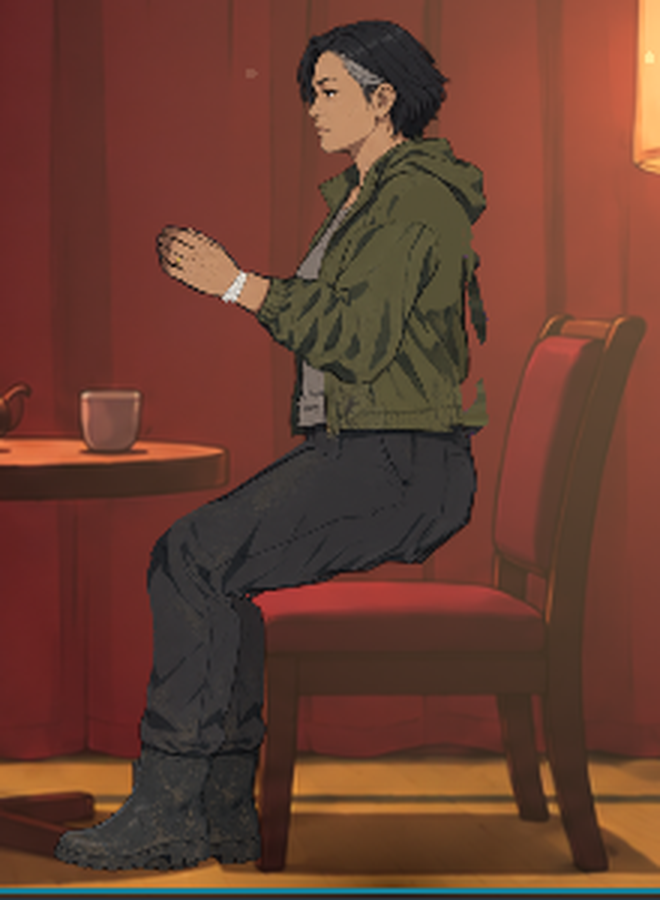

---

# Commit-5（洪先生的全身零件並坐進 S20）

## 內文

**問題**：S20 第三位客人洪先生只有頭像。

**改動**：用同一套保留來源流程（原圖位元組不變、無編造種子）做出洪先生的零件、骨架與他自己的動作資料，S20 第一段走到右椅坐下、整段坐著說話聆聽、最後一段起身離開；身份、台詞、選項與結果不變。S19／S20 的坐椅客人改成一張表，坐深依各自腿長在正式舞台量：洪先生比鄭先生、陳女士高，原坐深讓臀部浮在椅墊上方，改為 0.45 後臀底落在座面。

**分項驗證**：正式 S20 舞台原生畫面（9070 XT、Forward+）已逐張看過坐姿、手、膝與靴子；引擎內站、坐、靠牆、蹲、說話、聆聽、揮手、工作循環都能播。NPC 動作逐格接點 33,600 取樣：109 個真縫（坐姿遠側膝、揮手與聆聽時的頸部）、390 個邊緣缺口，未通過；建置時另警告骨盆前緣比大腿凸出 13 像素，遠側腿擺動時可能看得到。這些與陳女士的接縫一起待修，本段仍是進度紀錄。

### 測試結果

| 項目 | 結果 |
|---|---|
| 受影響範圍（`tools/run_tests_changed.sh`） | 64,167 項，0 失敗 |
| NPC 動作逐格接點（1／3.7 倍、雙朝向） | 33,600 取樣：109 真縫、390 邊緣缺口，未通過 |

### 截圖

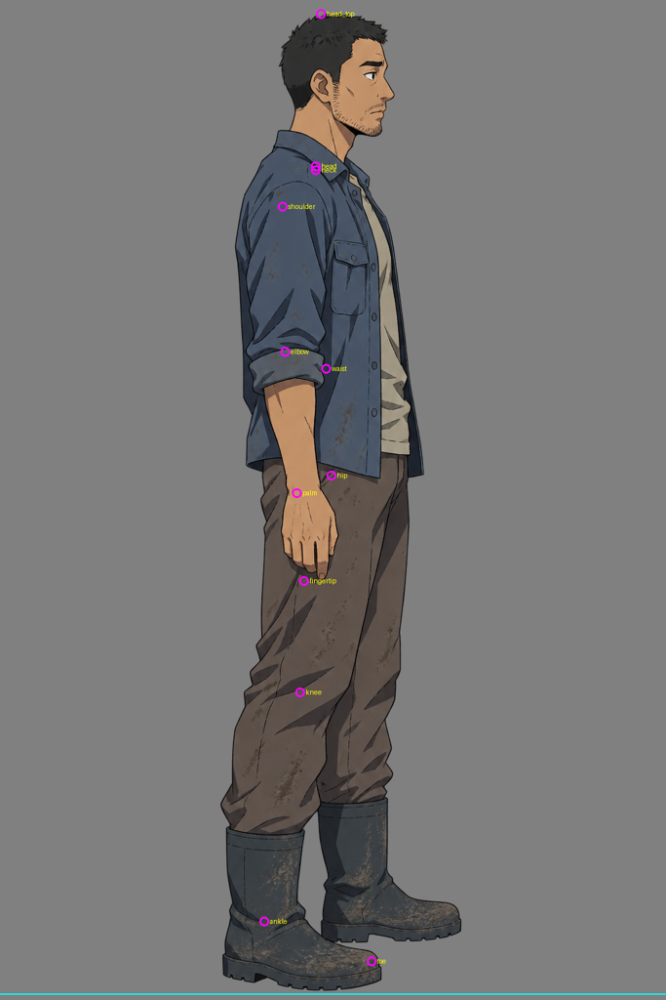

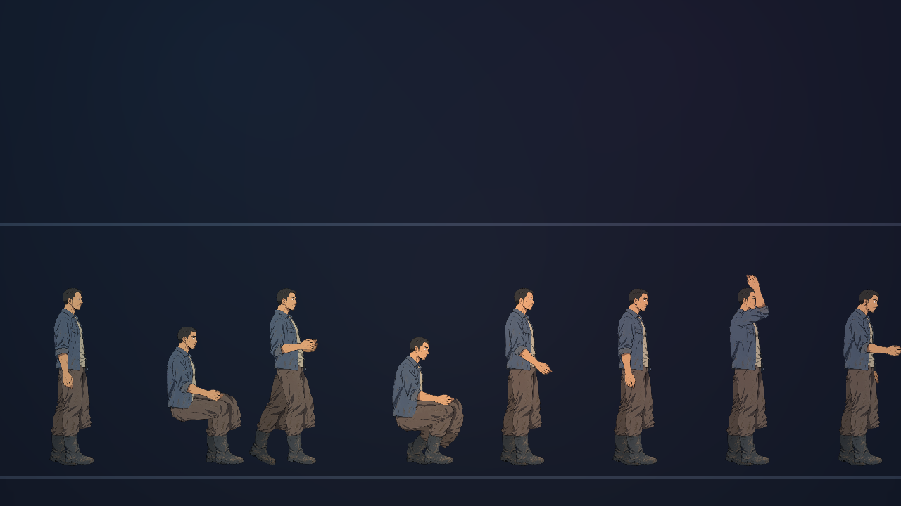

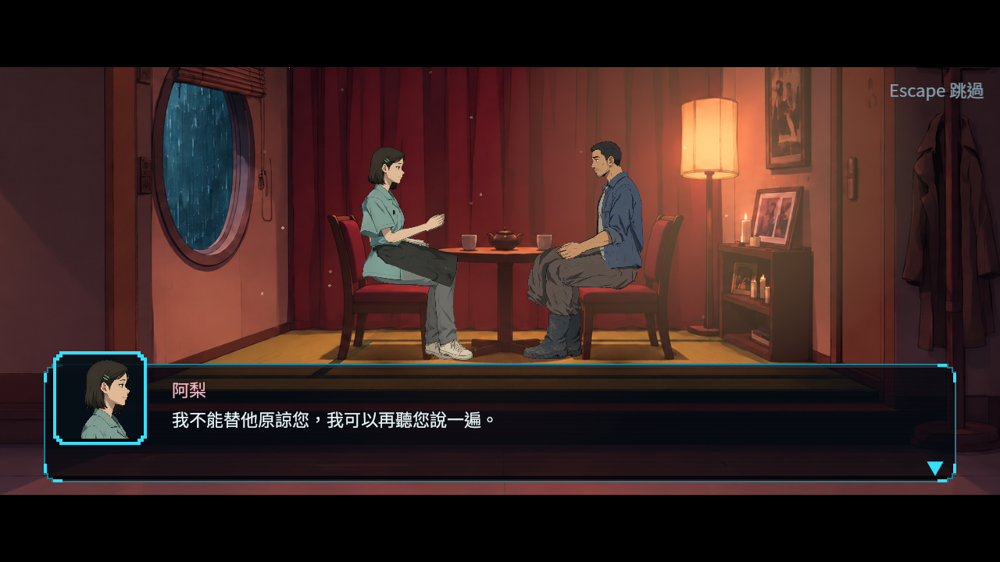

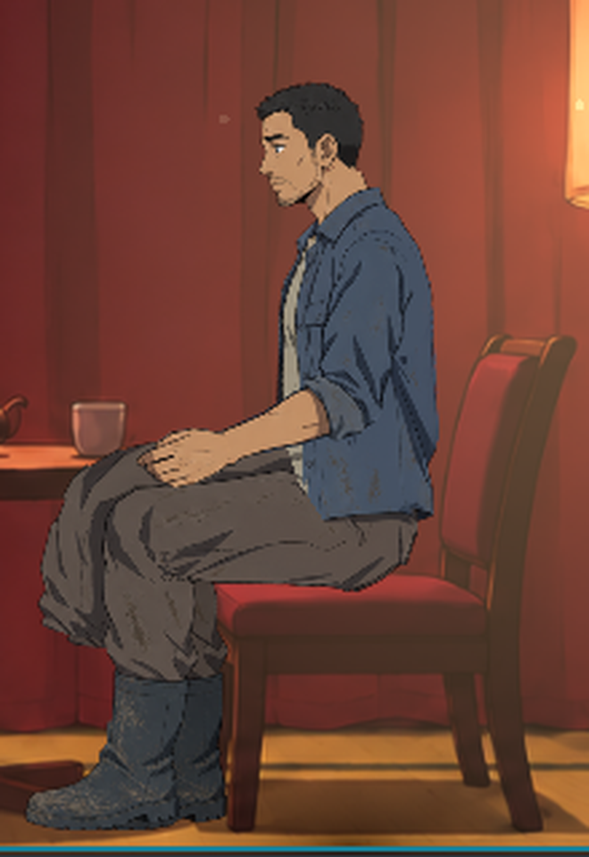

---

# Commit-6（市集入口巡帳員有自己的外觀與頭像）

## 內文

**問題**：S05 市集入口的巡帳員借用一般居民的外觀與頭像，和其他路人分不出來。

**改動**：用本機 9070 XT 的 Qwen Image 2.1 依共用畫風與中性站姿畫一張巡帳員（seed 24101，只生一張）：四十多歲的成年男性、深藍雨帽與及膝雨衣、近側上臂一條褪色橘臂章是唯一亮點、腰後掛夾板。同一套流程切成零件、骨架與他自己的動作資料（站得久、步子短而重），另裁一張對話頭像；關卡中的巡帳員與他的三句對話都改用他自己的外觀與頭像，台詞、旗標與任務不變。

**分項驗證**：原圖在灰底檢查透明背景、成年身份與空手站姿；引擎內站、看、說話、聆聽、揮手可播；市集入口原生畫面（暗場可讀性合格）。限制：雨衣比描述長（及膝），移臂底層在肩上留下深色圓片（手臂垂下時被蓋住，揮手時可見），腰後夾板在軀幹貼圖上是分離的一塊，坐與蹲時會翹出；他在遊戲裡只站崗與讓開，不坐不蹲。接點逐格稽核與小販、視窗員、救護員、灰衣搬運者尚未做。

### 測試結果

| 項目 | 結果 |
|---|---|
| 受影響範圍（`tools/run_tests_changed.sh`） | 100,103 項，0 失敗 |
| 市集入口暗場可讀性（Forward+） | 主角 2.23、地面邊緣 2.37、敵人 3.86，合格 |

### 截圖

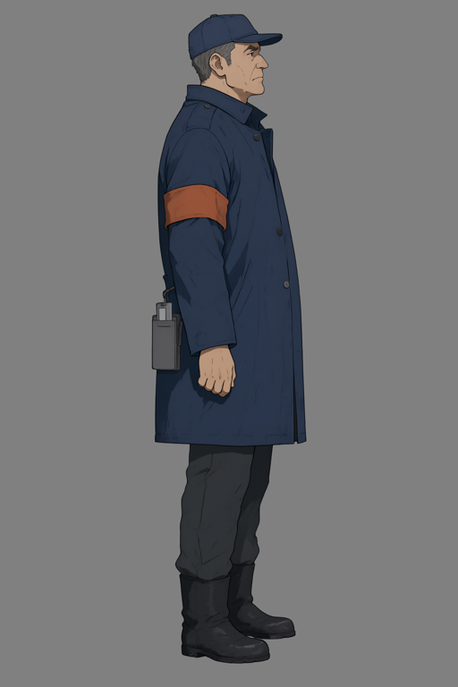

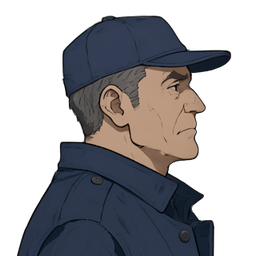

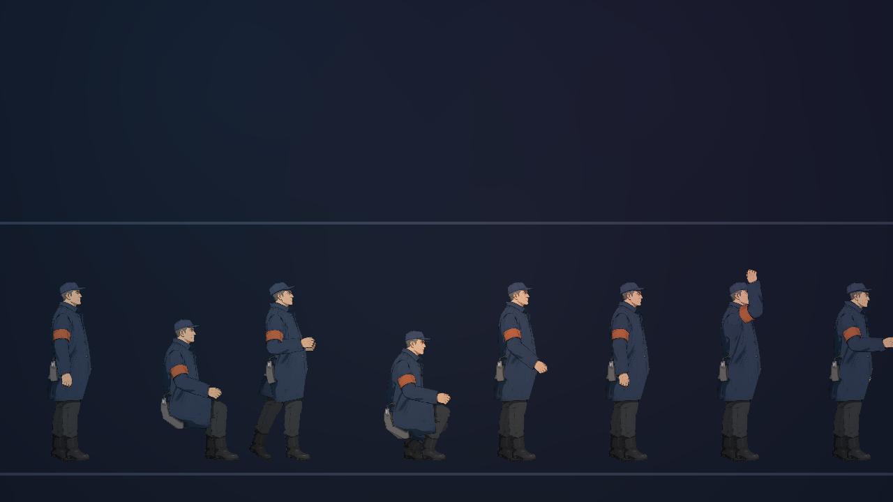

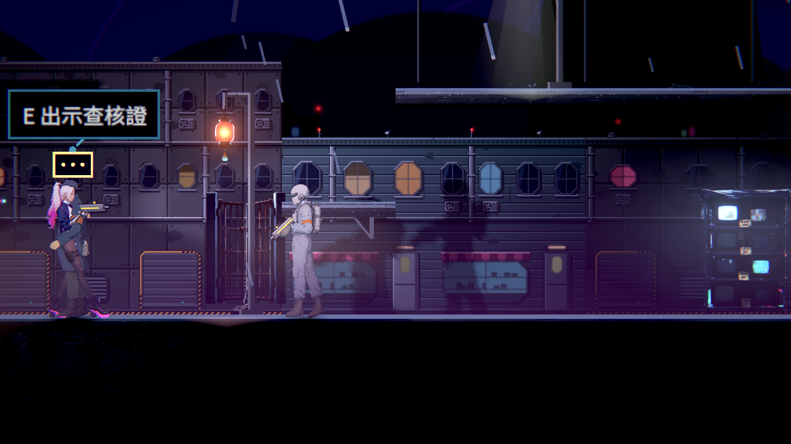

---

# Commit-7（市集小販有自己的外觀與頭像）

## 內文

**問題**：S08／S09 的小販借用一般居民的外觀與頭像。

**改動**：本機 9070 XT 的 Qwen 依共用畫風與中性站姿畫一張小販（seed 24201，只生一張）：五十多歲的成年女性、芥末黃防水圍裙是唯一亮色、藍綠工作衫、腰間錢袋、膠鞋。切成零件、骨架與她自己的動作資料（整天站著顧攤：步子短快），另裁對話頭像；攤道上的小販與她的台詞都改用她自己的外觀與頭像，台詞與傳聞紀錄不變。第一次分件時共用的 ComfyUI 伺服器中斷了 Qwen 工作，已重跑。

**分項驗證**：原圖灰底檢查透明背景、成年身份與空手站姿；引擎內站、整理貨（關卡裡她的循環動作）、說話、聆聽、揮手可播，頭像完整。限制：圍裙長到小腿，蹲下時圍裙會跟著大腿折起；軀幹貼圖有一塊 1,729 像素的分離碎片（腰間錢袋）。她在攤位前只站著，不坐不蹲。接點逐格稽核尚未做。

### 測試結果

| 項目 | 結果 |
|---|---|
| 受影響範圍（`tools/run_tests_changed.sh`） | 100,133 項，0 失敗 |

### 截圖

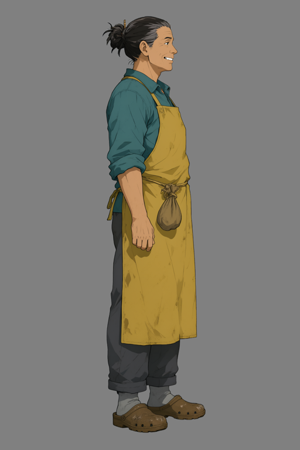

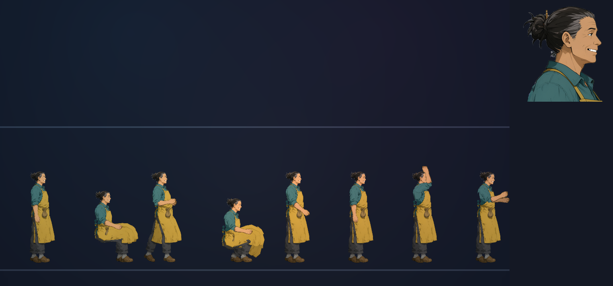

