# [NE-267] 補畫第二章新登場的配角

> 狀態：進行中

## 內文

### 需求
第二章有幾位第一次出場、目前沒有外觀的配角。故事端先用頭像剪影與說話氣泡撐住，要換成和既有角色畫風一致的立繪、頭像與分件：

| 角色 | 出場 | 需要的動作 |
|---|---|---|
| 市集入口巡帳員（成年） | S05 | 站立、看證件、讓開 |
| 租攤視窗員（成年） | S08 | 坐在窗口、蓋章 |
| 小販（成年） | S08、S09 | 站立、遠聲吆喝 |
| 市場救護員（成年，非戰鬥） | S12、S13 | 護送、鎖暫停閂 |
| 灰衣搬運者兩名（成年，大黑傘與灰外套） | S13、S22 遠景 | 抬擔架、綁帶、點頭；遠景剪影 |
| 客人簿三位客人：鄭先生（58）、陳女士（44）、洪先生（35） | S18～S20 | 坐、站、翻雨帽、端湯、寫信 |
| 押運手、票據投手（敵人） | S05、S08、S12 | 見 NE-266 |

### 來源
2026-10-11 故事主線 Session 落地第二章（ST-19）時整理；劇本 `design/13-story-v2/SCRIPT_CH02.md` 第 8 節。角色立繪、分件與骨架屬於角色 Session，故事端不自己畫。

### 驗收條件
- [ ] 每位角色有立繪、頭像與分件，畫風與既有角色一致，沒有破圖、多一隻手或過度挺胸
- [x] 客人與救護員都是成年人；客人簿場景不出現成人內容
- [x] 表內每個動作在遊戲裡實際播出，附原生截圖

### 測試流程
1. 在第二章各場景與客人簿看每位角色的待機、說話與指定動作

---

# 跟其他票的關係

- Blocks：ST-19
- Blocked by：NE-287、NE-290
- Related：NE-242、NE-266

---

# Commit-1

## 內文

**問題**：鄭先生、陳女士與洪先生原本共用同一張居民男性頭像，難以辨識，也不符合陳女士的角色設定。

**改動**：三位成年客人各有符合年齡與畫風的獨立頭像；講者名字、對話、選擇與獎勵保持。

**驗收**：原尺寸裁切可重建，錯來源不覆寫圖片；三色背景與正式對話框都看過。這是頭像單位，沒有把保留的全身參照圖當成完成分件與指定動作。

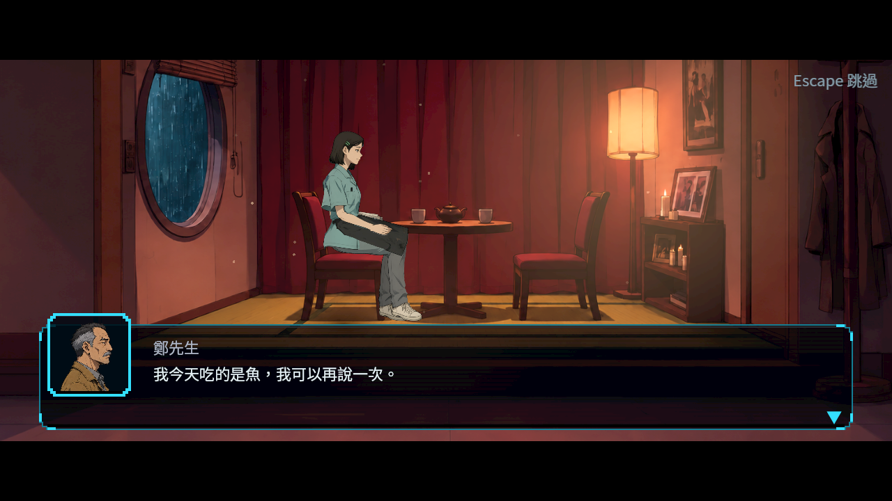

[來源、原生範圍、測試與重跑](attachments/NE-267-guest-portraits/README.md)；[本票提交](https://github.com/deadline314/Nest-Egg/commits/main/pm/Nest-Egg/%5BNE-267%5D%E8%A3%9C%E7%95%AB%E7%AC%AC%E4%BA%8C%E7%AB%A0%E6%96%B0%E7%99%BB%E5%A0%B4%E7%9A%84%E9%85%8D%E8%A7%92.md)。

---

# Commit-2

## 內文

**問題**：S18 客人簿重建舞台時只有阿梨，鄭先生尚無全身演員，拿出小票與放到桌面的動作也只有文字。

**改動**：加入符合 58 歲設定的鄭先生全身骨架、坐站及說聽演出；用既有紙張美術完成實際持紙、平放桌面與收手。三位批准頭像與原始全身圖保持原 bytes，身份、台詞、選項、任務與獎勵不變。

**分項驗證**：原生雙朝向、四倍率完整動作與坐站轉換共 228480 個接點樣本，真一像素孔負控仍被拒絕。三十張全彩動作頁與正式 S18 持紙／放桌／站起原圖已逐張檢視；實際轉換、手紙接點、座面、腳底與 diffuse／normal 掛載均另有量測。原 checker 的跨鄰關節外輪廓及歷史失敗資料保留，範圍與限制詳見附件。

原選擇器先前抓到 S18 離座後仍站在椅子範圍的 3 項新紅，已改成真正站穩再走，入／離椅動線另有回歸。整合時又發現舊存檔遷移把客人簿五段劇情認不出來：新加的走位「走完的姿勢」被當成劇情跳轉、伸手與持紙被當成結果。現在舞台上的走位、伸手與道具動作不參與舊結果比對（兩邊同樣排除，封存的對照表不動），五段劇情的舊結果恢復可辨識。

受影響範圍 77 組、97,396 項，修正後相關三組重跑 2,552 項 0 失敗；平行負載下兩項計時量測（爆炸每格耗時、鞭子命中聲）單獨重跑通過。本段仍為進行中紀錄：鄭先生的實際 6.216 倍率與走路驗收、陳女士、洪先生與其餘配角尚未完成。

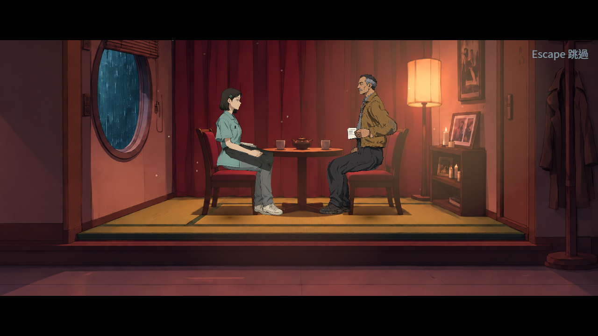

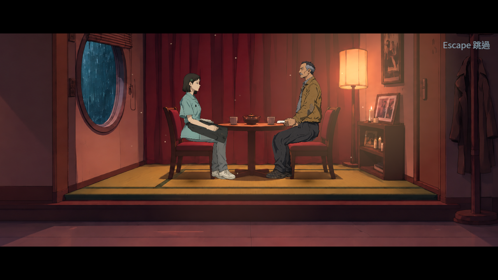

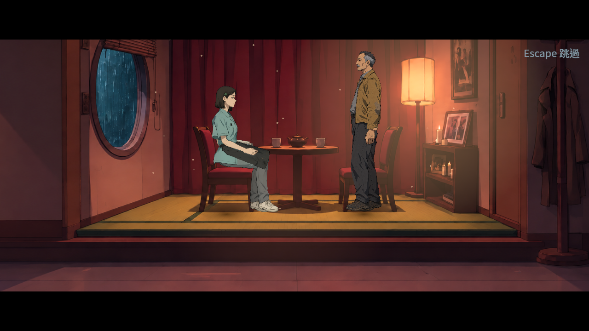

[來源、分項結果、原始失敗與完整證據](attachments/NE-267-guest-rigs/README.md)。

---

# Commit-3（陳女士的全身零件、骨架與動作資料）

## 內文

**問題**：陳女士只有頭像，S19 客人簿場景沒有她的全身演員。

**改動**：用已保存的原生全身立繪（原圖位元組不變、沒有編造種子）做出陳女士的零件、骨架與動作資料：姿勢模型取關節後逐點核對（肩、肘、腕在近側手臂，膝、踝在近側腿）；本機 9070 XT 上的 SAM 取近側手臂與遠側腿（遠側腿只取膝蓋以下，避開兩條深色褲管相接處的雜點），Qwen 補出手臂後面的衣身與褲子；保留來源的半透明邊緣，不做模糊、邊緣重畫或盲目補洞。動作資料是她自己的一份（比鄭先生步幅略大、身體起伏略小）。

**分項驗證**：遊戲引擎內的 NPC 動畫器已能播站、坐、靠牆、蹲、說話、聆聽、揮手與工作循環（下圖）。NPC 八種動作在遊戲與過場（3.7 倍）兩種倍率、雙朝向的逐格接點稽核共 33,600 個取樣，823 個不合格，其中 519 個是真的縫（集中在遠側肩的站與揮手各 140、坐姿遠側膝 96～62、近側肩坐姿 73），其餘 304 個只是邊緣缺口。抽看遠側肩站姿：連帽外緣有 2 像素的小孔，且肩上留著移臂時的圓形袖窿片（近側手臂垂下時會蓋住）。這些都還沒修，陳女士尚未放進 S19，本段只是零件與骨架的進度。

### 測試結果

| 項目 | 結果 |
|---|---|
| 受影響範圍（`tools/run_tests_changed.sh`） | 52 組、64,125 項，0 失敗 |
| NPC 動作逐格接點（`rig_joint_audit --npc-performance`，1／3.7 倍、雙朝向） | 33,600 取樣：519 真縫、304 邊緣缺口，未通過 |

### 截圖

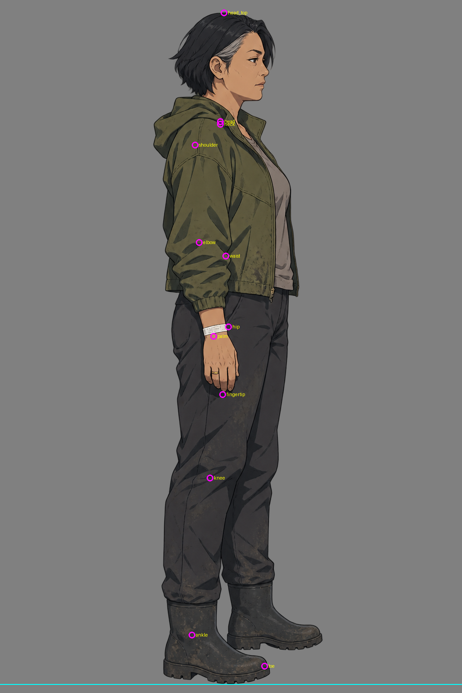

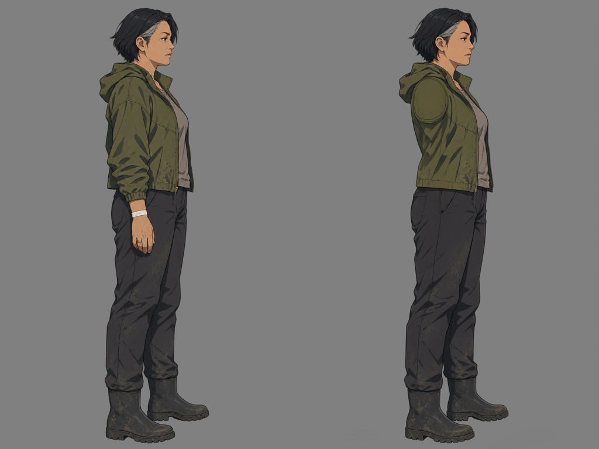

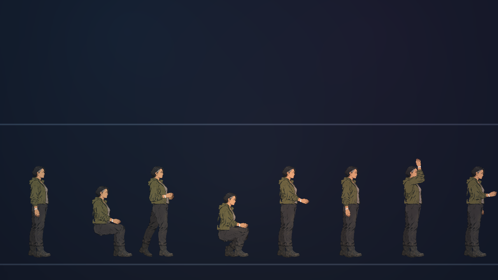

---

# Commit-4（陳女士坐進 S19）

## 內文

**問題**：S19 客人簿第二位客人只有阿梨在場，陳女士只用頭像說話。

**改動**：陳女士在 S19 第一段從右邊走到預約窗桌後的右椅坐下，整段對話坐著說話與聆聽，喝完湯那一段結束後起身走開；用和鄭先生同一張右椅的座面與地板支撐。身份、台詞、選項、旗標、交易與獎勵都不變（舊存檔的結果比對照常認得這幾段）。

**分項驗證**：正式 S19 舞台原生畫面（9070 XT、Forward+）：坐在椅面上、雙腳在地板、和阿梨同比例、受光一致；放大看坐姿臀部、膝、手腕與手部接合合理。逐格接點的 519 個真縫（Commit-3）仍待修，起立與走出的連續畫面也還沒逐格看，本段仍是進度紀錄；洪先生與其餘配角未完成。

### 測試結果

| 項目 | 結果 |
|---|---|
| 受影響範圍（`tools/run_tests_changed.sh`） | 10 組、6,619 項，0 失敗 |
| 劇情契約、客人演員 Python 測試 | 25 項，0 失敗 |

### 截圖

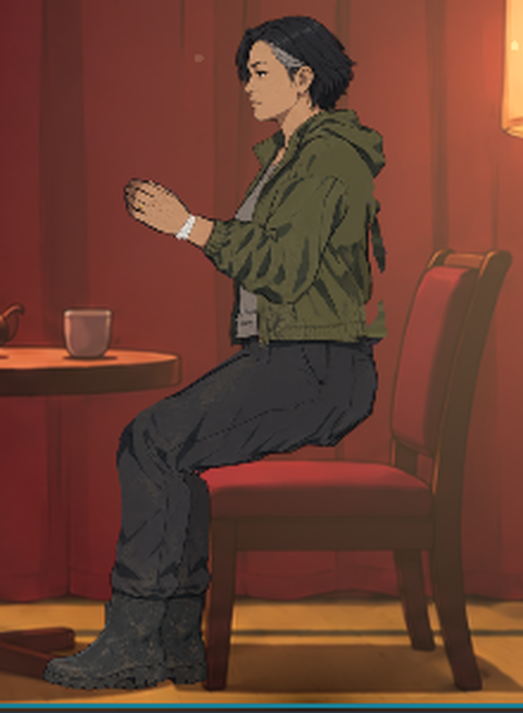

---

# Commit-5（洪先生的全身零件並坐進 S20）

## 內文

**問題**：S20 第三位客人洪先生只有頭像。

**改動**：用同一套保留來源流程（原圖位元組不變、無編造種子）做出洪先生的零件、骨架與他自己的動作資料，S20 第一段走到右椅坐下、整段坐著說話聆聽、最後一段起身離開；身份、台詞、選項與結果不變。S19／S20 的坐椅客人改成一張表，坐深依各自腿長在正式舞台量：洪先生比鄭先生、陳女士高，原坐深讓臀部浮在椅墊上方，改為 0.45 後臀底落在座面。

**分項驗證**：正式 S20 舞台原生畫面（9070 XT、Forward+）已逐張看過坐姿、手、膝與靴子；引擎內站、坐、靠牆、蹲、說話、聆聽、揮手、工作循環都能播。NPC 動作逐格接點 33,600 取樣：109 個真縫（坐姿遠側膝、揮手與聆聽時的頸部）、390 個邊緣缺口，未通過；建置時另警告骨盆前緣比大腿凸出 13 像素，遠側腿擺動時可能看得到。這些與陳女士的接縫一起待修，本段仍是進度紀錄。

### 測試結果

| 項目 | 結果 |
|---|---|
| 受影響範圍（`tools/run_tests_changed.sh`） | 64,167 項，0 失敗 |
| NPC 動作逐格接點（1／3.7 倍、雙朝向） | 33,600 取樣：109 真縫、390 邊緣缺口，未通過 |

### 截圖

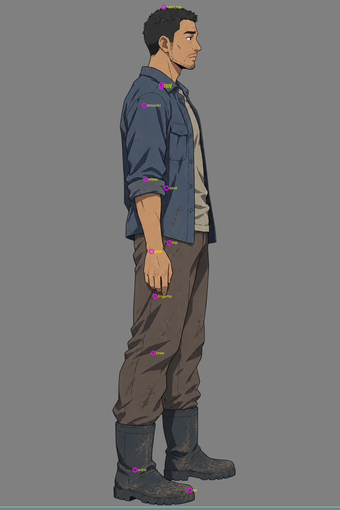

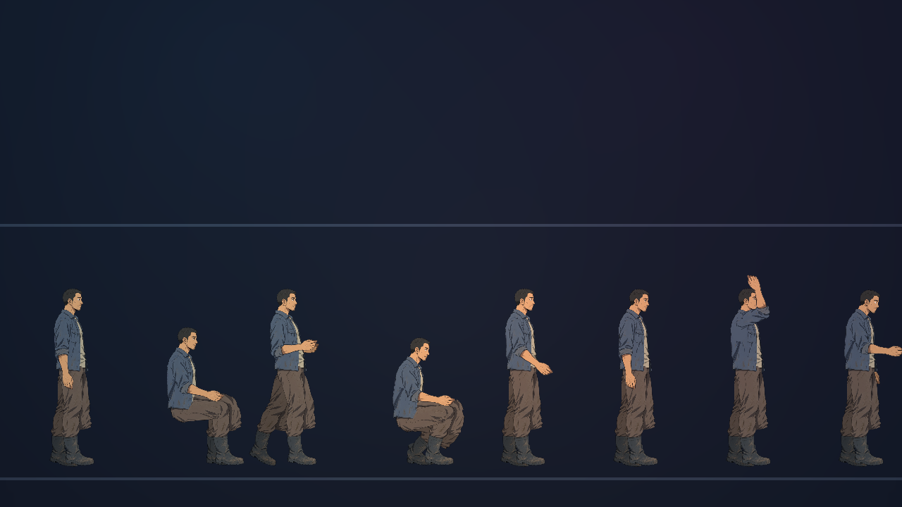

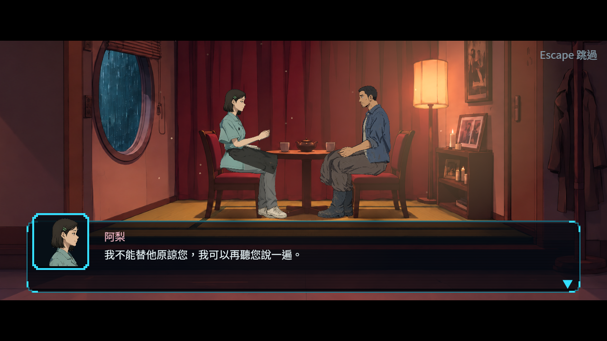

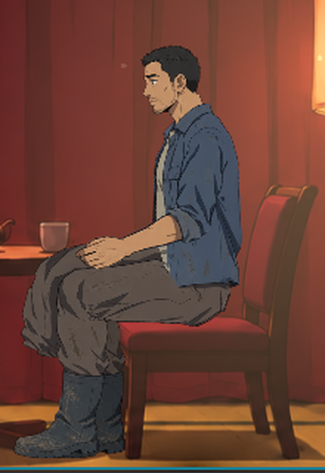

---

# Commit-6（市集入口巡帳員有自己的外觀與頭像）

## 內文

**問題**：S05 市集入口的巡帳員借用一般居民的外觀與頭像，和其他路人分不出來。

**改動**：用本機 9070 XT 的 Qwen Image 2.1 依共用畫風與中性站姿畫一張巡帳員（seed 24101，只生一張）：四十多歲的成年男性、深藍雨帽與及膝雨衣、近側上臂一條褪色橘臂章是唯一亮點、腰後掛夾板。同一套流程切成零件、骨架與他自己的動作資料（站得久、步子短而重），另裁一張對話頭像；關卡中的巡帳員與他的三句對話都改用他自己的外觀與頭像，台詞、旗標與任務不變。

**分項驗證**：原圖在灰底檢查透明背景、成年身份與空手站姿；引擎內站、看、說話、聆聽、揮手可播；市集入口原生畫面（暗場可讀性合格）。限制：雨衣比描述長（及膝），移臂底層在肩上留下深色圓片（手臂垂下時被蓋住，揮手時可見），腰後夾板在軀幹貼圖上是分離的一塊，坐與蹲時會翹出；他在遊戲裡只站崗與讓開，不坐不蹲。接點逐格稽核與小販、視窗員、救護員、灰衣搬運者尚未做。

### 測試結果

| 項目 | 結果 |
|---|---|
| 受影響範圍（`tools/run_tests_changed.sh`） | 100,103 項，0 失敗 |
| 市集入口暗場可讀性（Forward+） | 主角 2.23、地面邊緣 2.37、敵人 3.86，合格 |

### 截圖

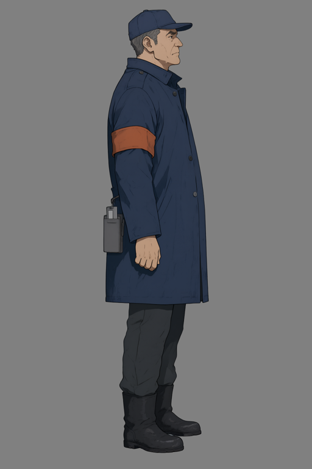

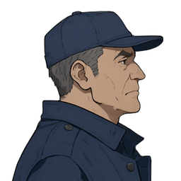

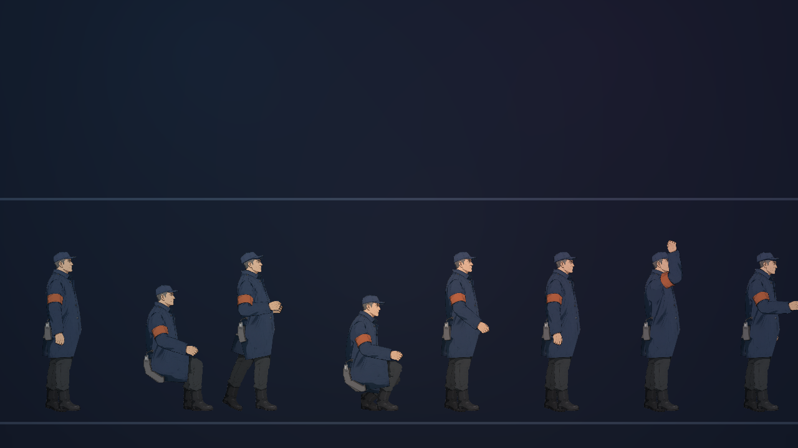

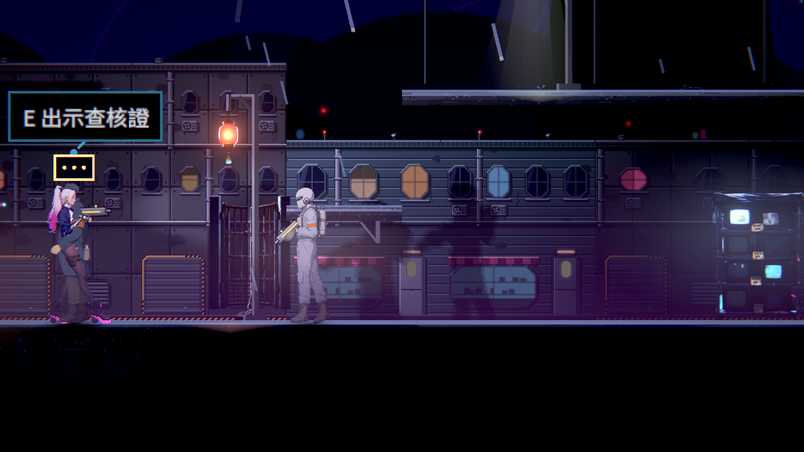

---

# Commit-7（市集小販有自己的外觀與頭像）

## 內文

**問題**：S08／S09 的小販借用一般居民的外觀與頭像。

**改動**：本機 9070 XT 的 Qwen 依共用畫風與中性站姿畫一張小販（seed 24201，只生一張）：五十多歲的成年女性、芥末黃防水圍裙是唯一亮色、藍綠工作衫、腰間錢袋、膠鞋。切成零件、骨架與她自己的動作資料（整天站著顧攤：步子短快），另裁對話頭像；攤道上的小販與她的台詞都改用她自己的外觀與頭像，台詞與傳聞紀錄不變。第一次分件時共用的 ComfyUI 伺服器中斷了 Qwen 工作，已重跑。

**分項驗證**：原圖灰底檢查透明背景、成年身份與空手站姿；引擎內站、整理貨（關卡裡她的循環動作）、說話、聆聽、揮手可播，頭像完整。限制：圍裙長到小腿，蹲下時圍裙會跟著大腿折起；軀幹貼圖有一塊 1,729 像素的分離碎片（腰間錢袋）。她在攤位前只站著，不坐不蹲。接點逐格稽核尚未做。

### 測試結果

| 項目 | 結果 |
|---|---|
| 受影響範圍（`tools/run_tests_changed.sh`） | 100,133 項，0 失敗 |

### 截圖

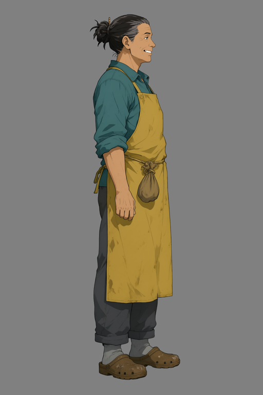

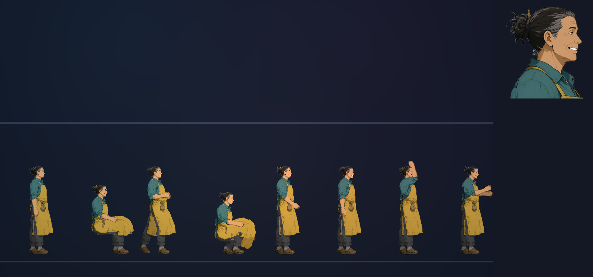

---

# Commit-8（市場救護員不再借用診所護理師）

## 內文

**問題**：S12／S13 的市場救護員借用夾層診所護理師的外觀與頭像，玩家會誤以為是同一個人。

**改動**：本機 Qwen 畫一張市場救護員（seed 24301，只生一張）：三十出頭的成年男性、非戰鬥，淡綠防水工作外套、近側袖上的白十字是唯一亮點、灰色連帽衫、帆布腰帶兩個小包。切成零件、骨架與他自己的動作資料（步子長而平穩），另裁頭像；S13 帳房舞台與他的台詞改用他自己的外觀與頭像，台詞與選擇不變。

**分項驗證**：原圖灰底檢查；引擎內站、坐、靠、蹲、說話、聆聽、揮手可播；S13 正式舞台原生畫面：站在地板上、和阿勇與小薇比例一致。限制：建置警告骨盆前緣比大腿凸出 23 像素（遠側腿擺動時可能出現鼓包），接點逐格稽核尚未做；「護送、鎖暫停閂」的手部動作還沒做。

### 測試結果

| 項目 | 結果 |
|---|---|
| 受影響範圍（`tools/run_tests_changed.sh`） | 100,185 項，0 失敗 |

### 截圖

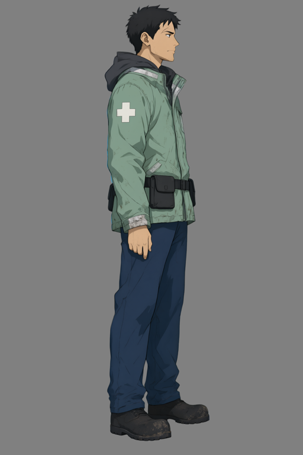

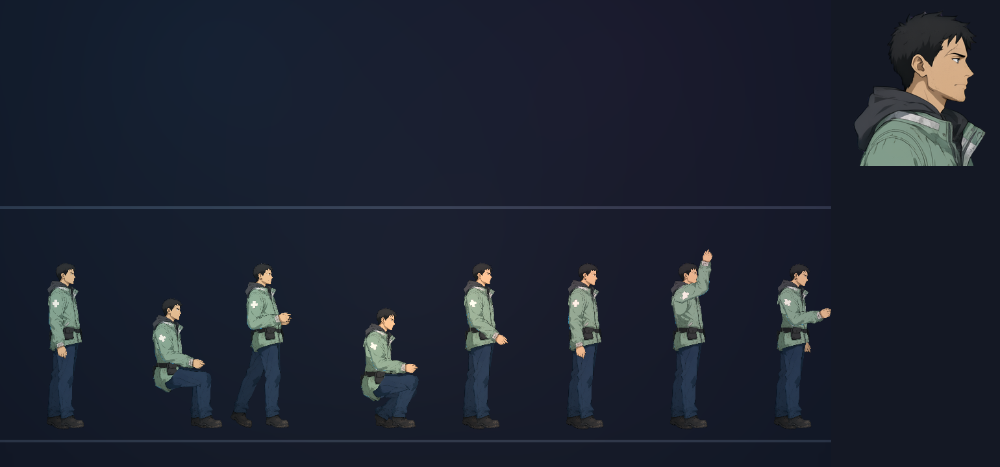

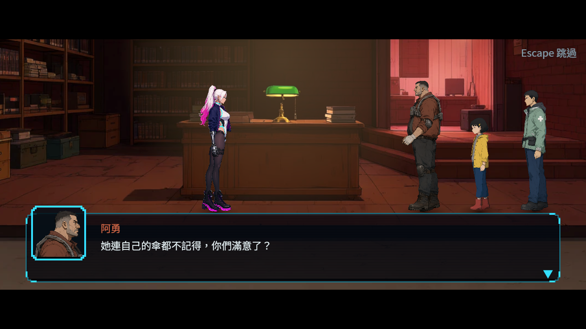

---

# Commit-9（租攤視窗員有自己的頭像與全身零件）

## 內文

**問題**：S08 租攤視窗的對話借用一般居民頭像。

**改動**：本機 Qwen 畫一張視窗員（seed 24401，只生一張）：三十多歲的成年女性、灰藍開襟衫與白襯衫、細框眼鏡、袖口一道紅墨水是唯一亮色。切成零件、骨架與她自己的動作資料（坐辦公桌：呼吸淺慢），另裁頭像；租攤視窗的三句對話改用她的頭像，台詞與證據不變。

**分項驗證**：原圖灰底檢查；引擎內坐、說話、聆聽、揮手與坐姿工作循環可播，頭像完整。限制：租攤視窗在關卡裡是可互動的窗口物件，她的全身還沒擺進窗口後面；「坐在窗口、蓋章」的實際演出待做。接點逐格稽核尚未做。

### 測試結果

| 項目 | 結果 |
|---|---|
| 受影響範圍（`tools/run_tests_changed.sh`） | 100,227 項，0 失敗 |

### 截圖

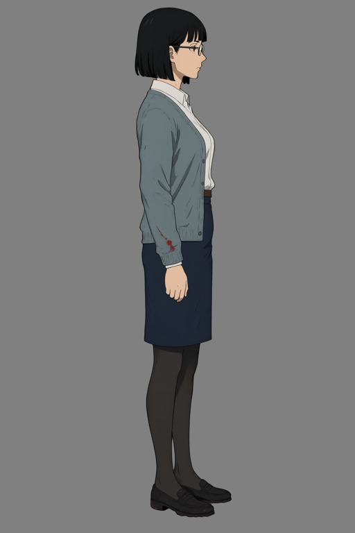

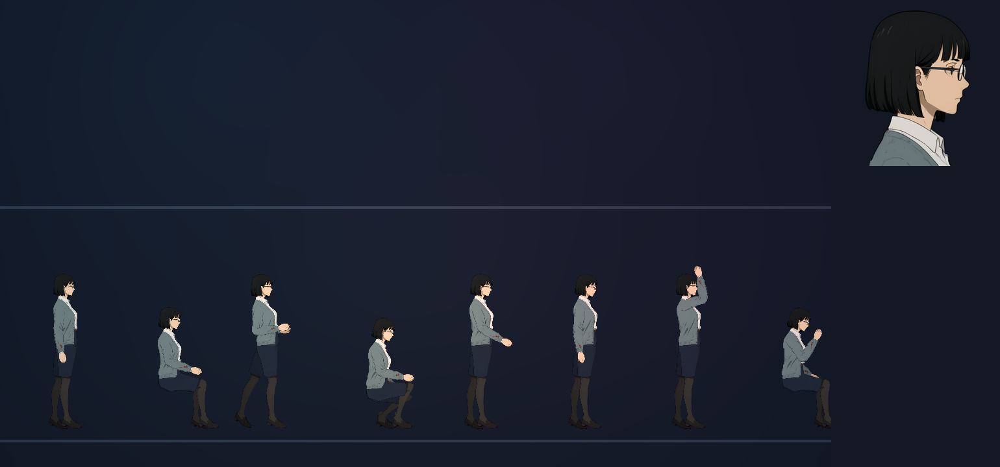

---

# Commit-10（灰衣人出現在章末對面樓頂）

## 內文

**問題**：S22 章末凜說「對面那個人一直看這邊」，畫面上卻沒有人；灰衣搬運者沒有外觀。

**改動**：本機 Qwen 畫一張灰衣搬運者（seed 24501，只生一張）：中年成年男性、非戰鬥不說話，及膝灰色連帽雨衣、灰手套、黑雨靴，全身沒有任何亮點。切成零件、骨架與他自己的動作資料（幾乎不晃、步子長而均勻）。S22「灰衣人」那一段把他放在對面樓頂：縮小並調暗成遠景人影，面向屋頂上的兩人，不說話、不解鎖任何身份。

為了讓遠景人物合理存在，過場演員多兩個欄位：`shade`（0.1～1，整個演員變暗的程度）與 `backdrop`（標明是遠處建物上的背景人物）。只有標了 `backdrop` 的演員略過「踩舞台地面、和前景同尺寸」的檢查，沒標的同一個人照樣會被報出來（新增回歸檢查）；兩個欄位的錯誤型別或範圍會被過場檢查擋下。

**分項驗證**：S22 正式屋頂舞台原生畫面：灰衣人站在對面樓頂邊緣、比前景小且暗，不搶前景兩人；引擎內站、走、說話、揮手可播。限制：S13 抬擔架、綁帶、點頭的實際演出與第二名搬運者尚未做，接點逐格稽核尚未做。

### 測試結果

| 項目 | 結果 |
|---|---|
| 受影響範圍（`tools/run_tests_changed.sh`） | 88 組、100,277 項，0 失敗 |
| 場景稽核（含新的遠景人物回歸） | 459 項，0 失敗 |

### 截圖

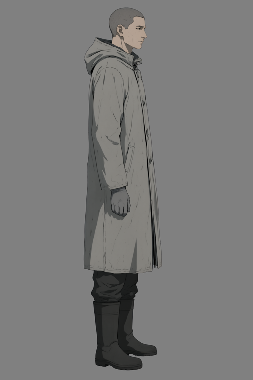

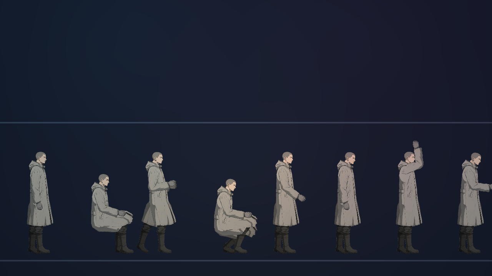

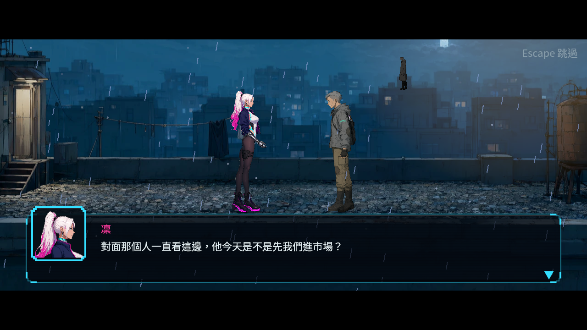

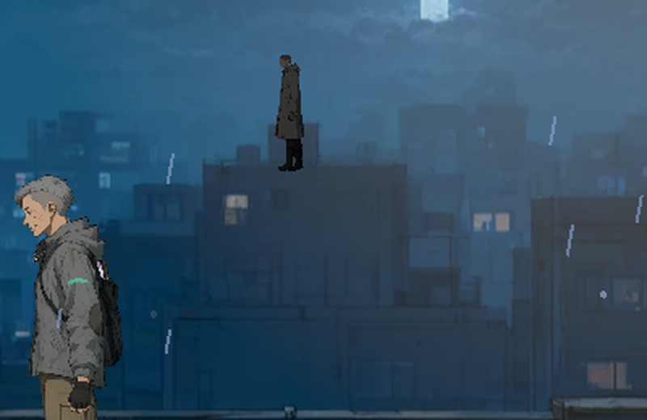

# Commit-11（陳女士軀幹接縫與窗口蓋章）

## 內文

陳女士軀幹漏切的原圖材質已補回；坐姿說聽、坐站、靠牆、蹲與工作動作的相同接點樣本，修復2,420例且沒有新增失敗。原有其他接點的問題保持逐項記錄。

租攤視窗員現在實際坐在窗口後取章、在租約上蓋下「暫未核准」、放回並收手。原三句對話、重訪、合約副本、領取條件與結果保持；讀取真正舊版存檔後可繼續且不重領。

### 測試結果

| 項目 | 結果 |
|---|---|
| 正式受影響回歸 | 88組、100,915項，0新／0已知失敗，退出0，577秒；來源保持 |
| 作者與原結果契約 | 31項通過；來源重建與損毀拒收自檢通過 |
| 陳女士逐格比較 | 28,800個相同樣本，修復2,420、新增0；保留280例，原檢查仍拒收 |
| 封裝接點證據獨立重跑 | 57,600筆修前／修後檢查，20份報告與原件完全一致 |
| 正式窗口演出 | 9張原生圖已檢視；111筆持章接觸，最大誤差0.000069舞台像素；無腳本或引擎錯誤 |
| 實際領取與舊檔冷讀 | 44項正式領取／拒寫／重試／冷讀及20項舊檔冷讀通過 |

### 截圖

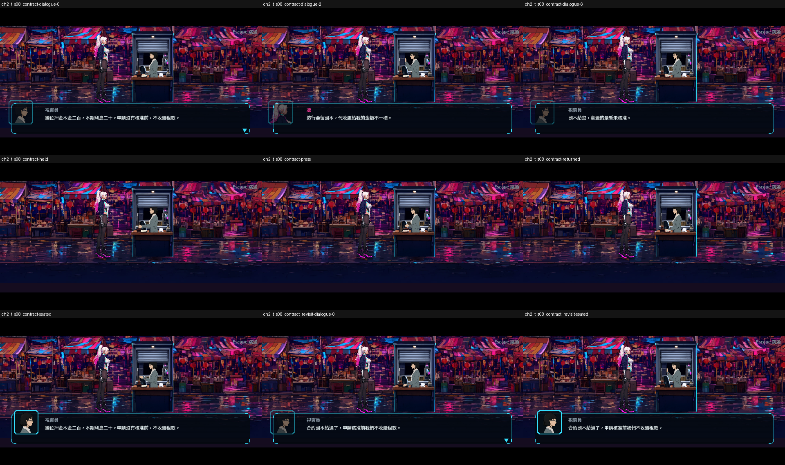
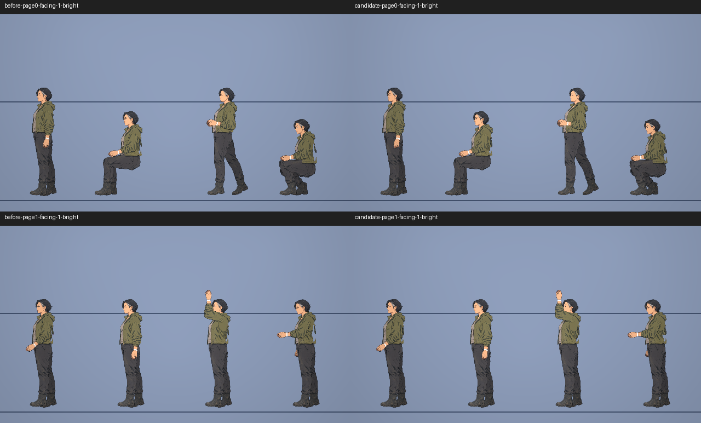
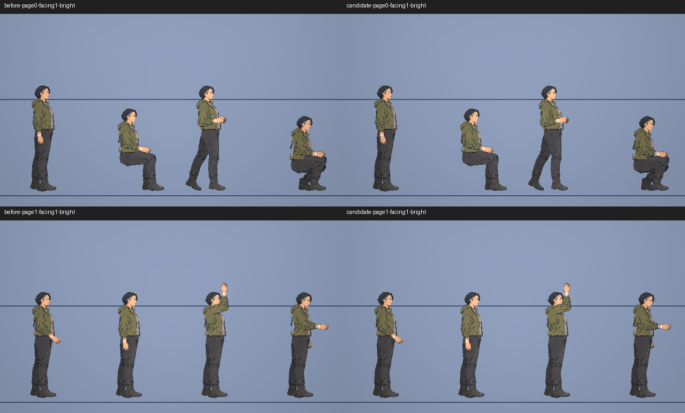

[來源、原生原圖、完整接點證據、保留失敗與整合範圍](attachments/NE-267-torso-window-2026-11-18/ROOT_REVIEW.md)。

# Commit-12（洪先生頸部與袖口接縫）

## 內文

洪先生點頭、坐著說聽、坐站、蹲與工作時，頸部及上下袖口的漏縫已補足。沿用原來的臉、衣物、身形與動作，左右朝向及明暗畫面都逐張核對。

### 測試結果

| 項目 | 結果 |
|---|---|
| 正式受影響回歸 | 88組、100,928項，0新／0已知失敗，退出0，565秒 |
| 原生逐格比較 | 73,920個相同樣本，修復779、新增0；保留32例，原檢查仍拒收 |
| 封裝證據獨立重跑 | 147,840筆修前／修後檢查、12份報告與原件完全一致 |
| 來源與重建 | 原圖及批准像素核對、損毀拒收、重跑保持與標準重建通過 |
| 原生畫面 | 32張修前修後圖、8頁已實看；3片黑灰白底比較通過 |
| 實際場景支撐對照 | 原版與修補版十個快照的座面／雙腳數值完全相同；原3項失敗保持拒收 |

### 截圖

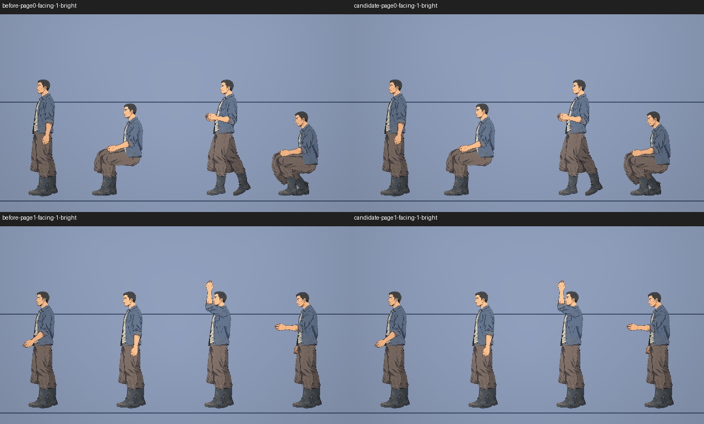
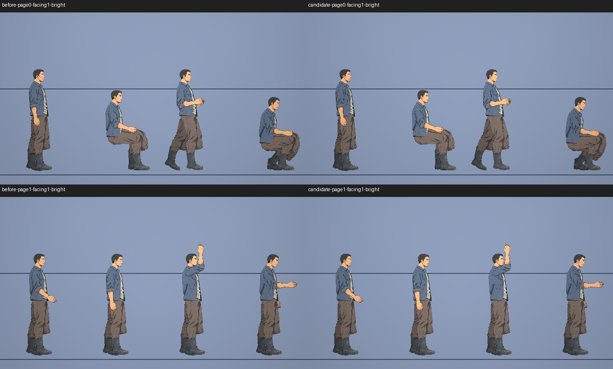
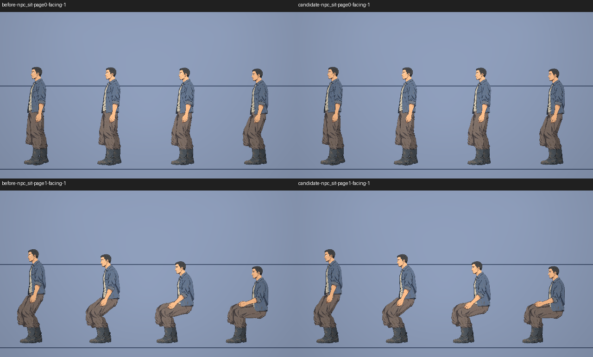
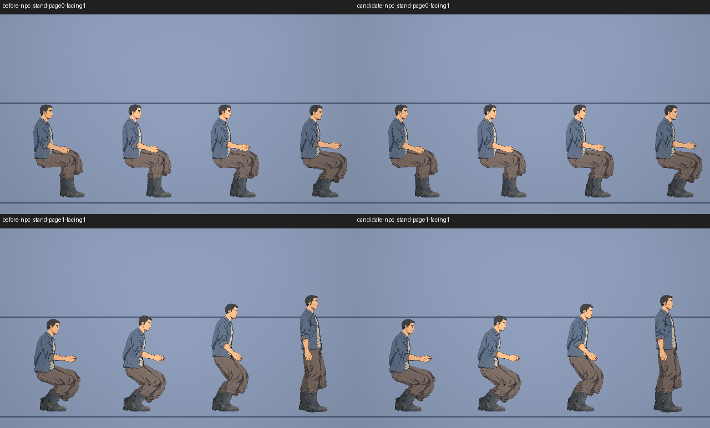

[來源、原生原圖、完整接點證據與獨立實景紀錄](attachments/NE-267-hong-seams-2026-11-18/ROOT_REVIEW.md)。

# Commit-13（醫護護送、掛鎖與擔架搬運）

## 內文

第二章帳房裡，醫護員現在會動手鎖暫停閂、收起鑰匙並打開安全出口。鷺倒下後，兩名成人托住她，放上擔架、固定束帶、取回破傘並推床出門。原有台詞、兩條分支、帳櫃獎勵及重訪結果保持。

### 測試結果

| 項目 | 結果 |
|---|---|
| 正式受影響回歸 | 72組、98,457項，0新／0已知失敗，退出0 |
| 三分支原生演出 | 26張原圖已檢視，2,486筆掌心接觸通過，最大誤差0.000183舞台像素 |
| 實際帳櫃與冷讀 | 正式兩分支與冷讀30項通過；另由原版實際寫檔後冷讀30項通過 |
| 來源重建 | 三段演出重建結果一致，其餘187場與原獎勵保持 |

### 截圖

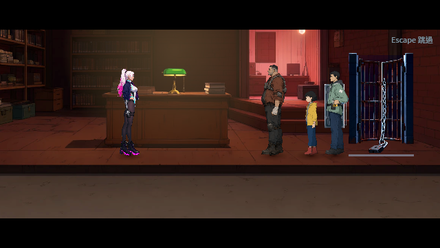
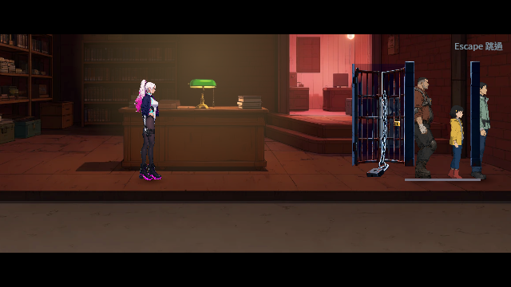
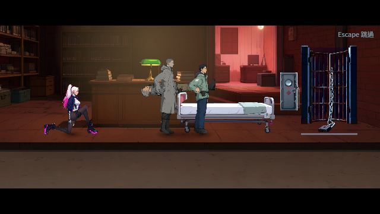
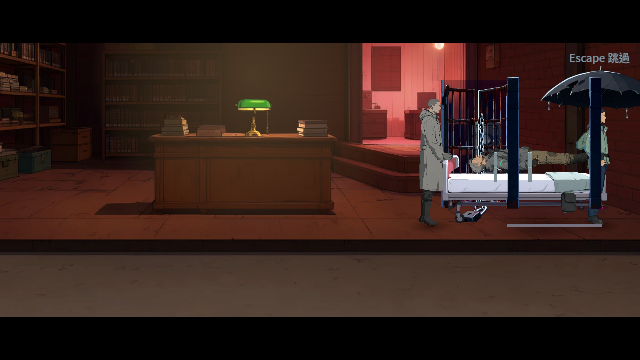

[原畫面、接觸量測、來源與存檔紀錄](attachments/NE-267-medic-transport-2026-11-19/ROOT_REVIEW.md)。

# Commit-14（市集巡帳員查核證件與讓路）

凜在市場入口拿出原有的查核證，巡帳員看過證件後移到路旁。原對話、放行和重訪條件保持。RX 9070 XT 取得五張原圖，336 筆手掌接觸通過。正式受影響回歸 33 組、51,852 項全過。實際 NPC、原版寫入與新版冷讀、拒寫和取消共 108 項通過。

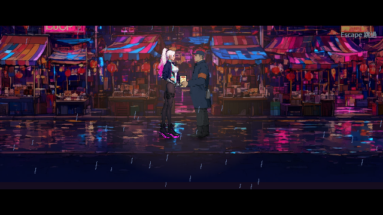

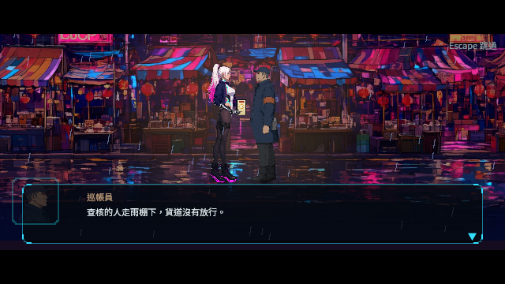

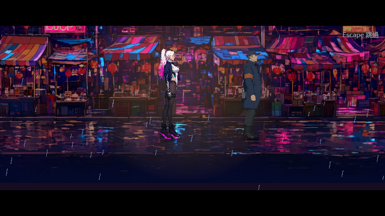

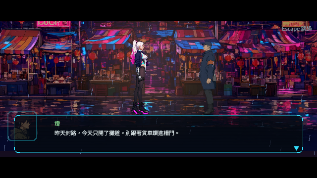

[完整原生畫面、存檔、來源及回歸](attachments/NE-267-market-pass-2026-11-19/ROOT_REVIEW.md)。

# Commit-15（屋頂灰衣人持傘走入梯間）

第二章末切到對面雨中的屋頂。灰衣人持黑傘走到梯間，收傘後從門內消失。保持原五句台詞、章末旗標及重訪。RX 9070 XT 錄得 10 張原圖及 475 筆實際手掌接觸，三條屋頂流程 39 項通過，正式受影響回歸 33 組、51,861 項全過。

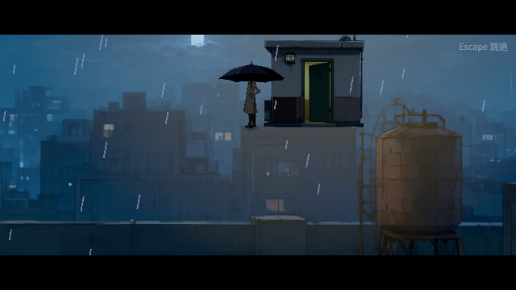

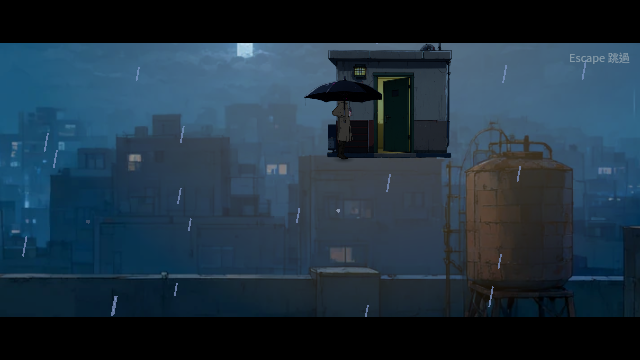

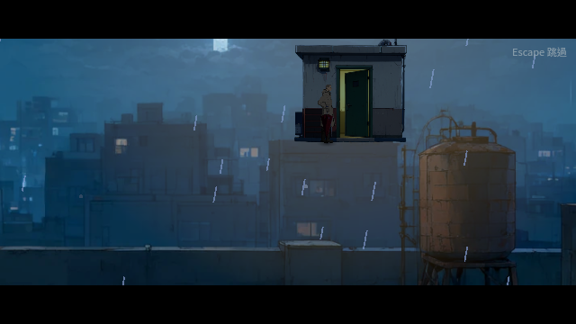

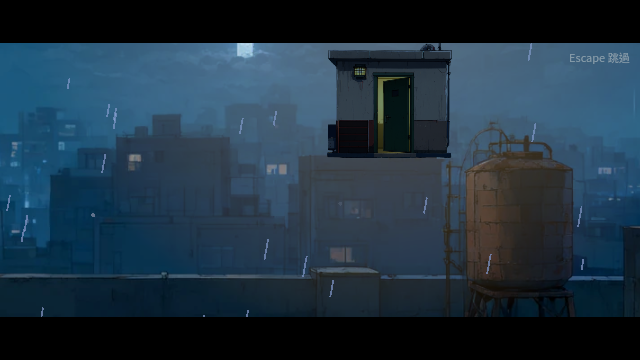

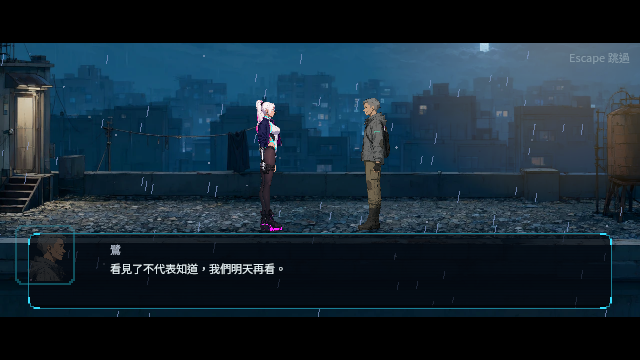

[原生畫面、流程、來源及回歸](attachments/NE-267-roof-watcher-2026-11-19/ROOT_REVIEW.md)。

# Commit-16（洪先生坐穩、寫信與帶走信封）

原選擇接受後，阿梨遞筆，洪先生低頭寫信，把筆平放桌上，收好並把信自己帶走。保留原台詞、錯路、取消與獎勵。實機 17 張原圖及 97 筆實際握筆接點，客人簿 43 項流程檢查，以及正式受影響回歸 53 組、70,103 項全部通過。

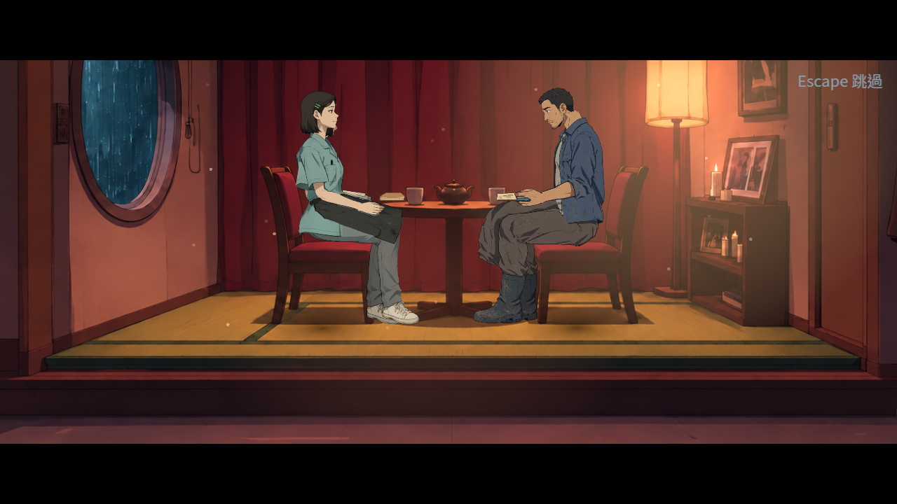

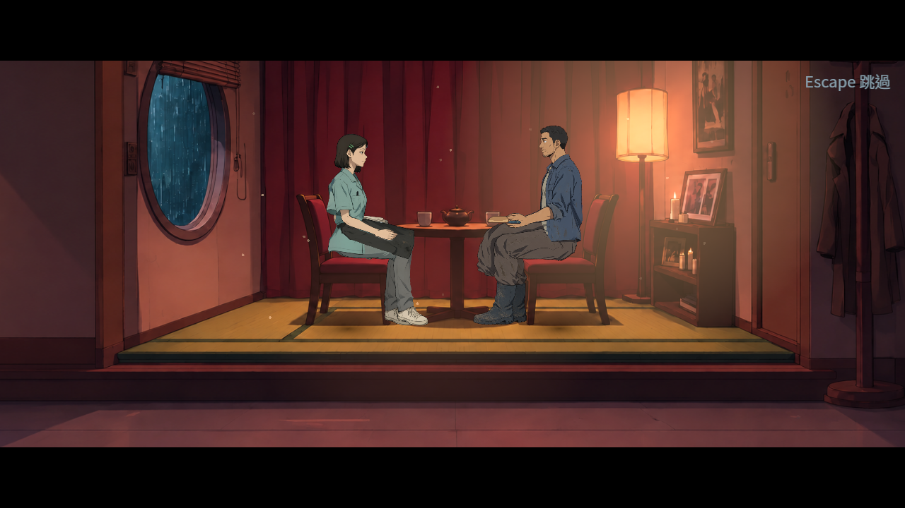

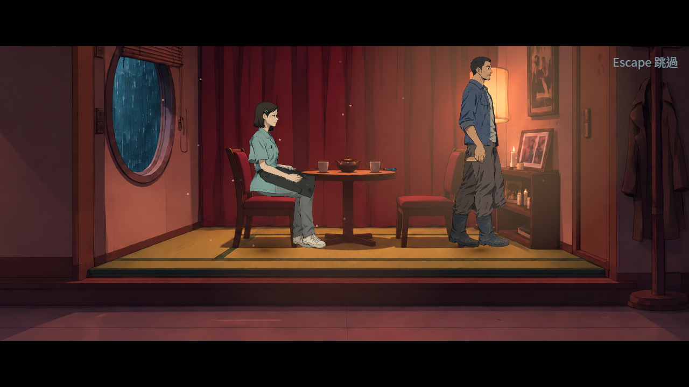

[原生畫面、接點、流程與回歸](attachments/NE-267-guest-letter-2026-11-19/ROOT_REVIEW.md)。

# Commit-17（陳女士坐穩，翻雨帽並端上梨湯）

玩家選對後，阿梨翻開雨帽，端起沒有蔥的梨湯並送到陳女士面前。原有選項、台詞與獎勵保持。附 14 張演出圖，41 筆端碗接點，現行客人簿 43 項及正式受影響回歸 53 組、70,113 項均通過。一併補齊窗口椅與屋頂傘的全尺寸匯入並重新實拍。

[原生畫面、接點、匯入政策與回歸](attachments/NE-267-guest-soup-2026-11-19/ROOT_REVIEW.md)。

# Commit-18（靠近貨門時聽到遠處小販的傳聞）

S09 的貨道支線在北棟貨門前呈現遠處小販的傳聞。三語各有 9 項實機檢查通過，玩家可邊讀邊走，門禁及原有繞路依舊生效。受影響回歸 53 組、58,785 項全過。另核對客人簿的正式分支、成年造型來源與現行畫面，勾選成年和內容項。其餘角色接點及整表仍有待驗。

[三語路線、來源、正式回歸與成年內容查核](attachments/NE-267-freight-vendor-2026-11-19/ROOT_REVIEW.md)。

# Commit-19（洪先生坐下與起身的髖部、膝部）

補齊同一件褲料的局部重疊，兩面向、雙尺度的 73,920 項接點檢查全過，原本 32 個失敗已排除。正式 S20 重播三場及 97 筆掌心接點，坐面、站姿、寫信與交接都通過。受影響回歸 4 組、7,366 項全過。其他人物仍在原票繼續驗收。

### 表內動作核對

| 演出 | 原生畫面與驗證 |
| --- | --- |
| S05 巡帳員站崗、看查核證並讓開 | [檢視與放行](attachments/NE-267-market-pass-2026-11-19/ROOT_REVIEW.md) |
| S08 視窗員坐著取章、觸紙、放回 | [窗口蓋章](images/NE-267-rent-window-stamp-20261118.png) |
| S08 小販在攤位站著整理貨物，S09 的遠處喊話 | 上方兩張市集實機原圖與[貨門三語字幕](attachments/NE-267-freight-vendor-2026-11-19/ROOT_REVIEW.md) |
| S13 醫護護送、鎖暫停閂、兩名搬運者抬擔架、固定束帶，前方搬運者點頭、後方帶傘 | [護送與搬運](attachments/NE-267-medic-transport-2026-11-19/ROOT_REVIEW.md)、[前方搬運者點頭](images/NE-267-s13-carrier-nod-20261119.png) |
| S22 灰衣人與大黑傘的屋頂剪影 | [遠景、折傘與進門](images/NE-267-s22-folded-20261119.png) |
| S18–20 成年客人坐下、起身，翻雨帽、端梨湯與寫信 | [鄭先生](images/NE-267-zheng-rig/ch2_t_s18_done-idle.png)、[陳女士](attachments/NE-267-guest-soup-2026-11-19/ROOT_REVIEW.md)、[洪先生](attachments/NE-267-guest-letter-2026-11-19/ROOT_REVIEW.md) |
| 押運手與票據投手的第二章戰鬥 | [正式市集配置](images/NE-266-market-enemies.png)、[投手出手預兆](images/NE-266-thrower-windup.png)、[押運手突進](images/NE-266-escort-dash.png) |

上表涵蓋角色指定動作。完整角色的美術檢查仍有待完成。

[素材重建、原生畫面與回歸](attachments/NE-267-hong-hip-knee-2026-11-19/ROOT_REVIEW.md)。

# Commit-20（陳女士靠身時的遠側肩部）

補齊遠側肩部後方的原衣料。28,800 項原生接點檢查中，114 個舊失敗已排除，新增 0。正式 S19 三場與 41 個掌心接點均通過，受影響回歸 4 組、7,366 項全過。此票的完整美術檢查仍有待驗，頸、前肩及肘的舊問題共 166 項。

[逐格結果、素材重建與正式回歸](attachments/NE-267-chen-shoulder-2026-11-19/ROOT_REVIEW.md)。

# Commit-21（陳女士敲擊時的頸部線條）

## 內文

陳女士做敲擊動作時，下巴與衣領之間會短暫露出背景。現在頸部沿用原立繪線條，轉頭、起身時能連續接合，正式客人簿過場的座位和端碗接點也通過檢查。

### 測試結果

| 項目 | 結果 |
|---|---|
| 原生逐格接點 | 28,800 項，原本 24 筆封閉孔洞全消除，新增 0 |
| 正式 S19 及預覽 | 3 段過場、41 個端碗接點，亮暗左右四組 |
| 素材檢查與受影響回歸 | 4 組、7,366 項全過 |

[來源、輪廓檢查與實機原件](attachments/NE-267-chen-neck-2026-11-19/README.md)

### 截圖

---

# Commit-22（後側搬運者的灰外套）

## 內文

搬送鷺時，後側搬運者原本穿著辨識度很高的綠色救護外套。現在在這場穿短灰外套，和前方的長灰外套形成不同輪廓。去掉袖章及法線圖上的凸紋。護送父女的救護員仍穿原本的綠外套。

### 測試結果

| 項目 | 結果 |
|---|---|
| 三段 S13 原生演出 | Forward+／RX 9070 XT。抬起、固定束帶、取回破傘及推床出門均出現。兩段救護員護送照原劇本演出 |
| 角色接點 | 2,483 筆掌心接點全部通過，最大誤差 0.000126 舞台像素。六張貼圖的透明輪廓與原件逐像素相同 |
| 受影響驗證 | 4 組、7,619 項全過，0 腳本錯誤，40 秒 |

[前後原圖、三段演出接點及回歸](attachments/NE-267-transport-coat-2026-11-19/evidence.zip)。

