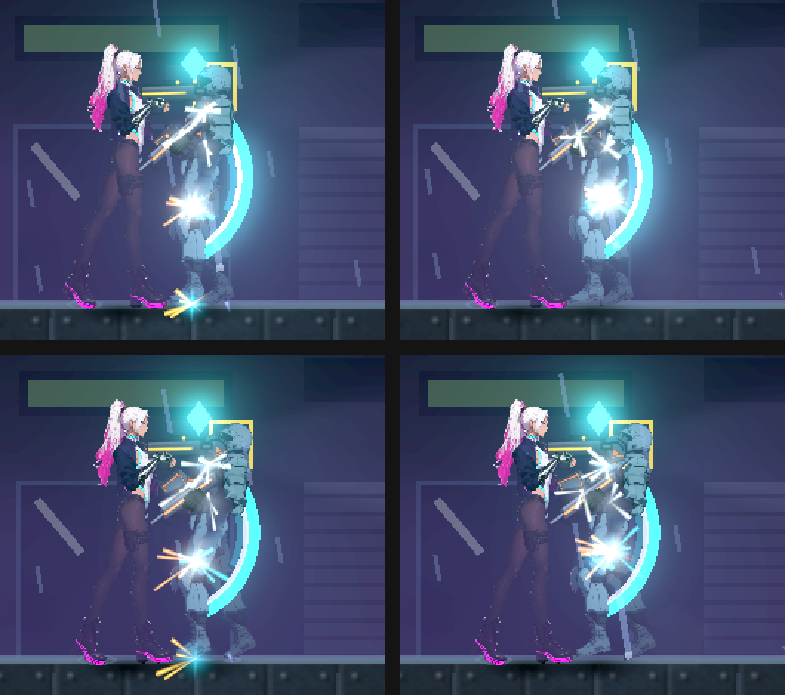

# [NE-268] 修正近戰命中回饋出現在敵人膝蓋

> 狀態：進行中

## 內文

### 需求
攻擊敵人的頭部，命中的火花、受擊閃光與傷害數字卻出現在膝蓋附近，看起來像打到別的地方。命中回饋要出現在武器實際碰到敵人的位置（打頭就在頭、打身體就在身體），讓玩家看得出自己打到哪裡；部位判定（頭部弱點等）與回饋位置要一致。

初步查到的成因：近戰命中時，火花、受擊閃光與傷害數字是用敵人的「站立原點」（腳底）定位，而不是武器與受擊範圍的接觸點；傷害數字只往上提一點，所以落在膝蓋高度。子彈的回饋用子彈本身的位置，但子彈沿彈道選中後方部位（NE-248）時，回饋仍停在身體邊緣，也要一起核對。

### 來源
使用者 2026-10-11：「為什麼敵人的受擊判定也有問題，我明明攻擊頭部，有受擊反饋的地方卻是在膝蓋？可以的話也幫我修正一下這件事情，然後幫我看一下業界都是怎麼做的」。

業界做法（實際讀到的內容）：
- Unreal Engine 的命中結果把「Location（掃掠形狀停下的位置）」與「ImpactPoint（形狀與被打物表面的接觸點）」分開，命中特效應放在 ImpactPoint；論壇上「ImpactPoint 永遠等於角色原點」的問題，原因是查詢打到了錯的對象——和本票「用原點定位回饋」是同一類錯誤。來源：[FHitResult 文件](https://docs.unrealengine.com/4.27/en-US/API/Runtime/Engine/Engine/FHitResult/)、[Epic 論壇：Get Sweep Result from OnComponentBeginOverlap](https://forums.unrealengine.com/t/get-sweep-result-from-oncomponentbeginoverlap/413483)。
- 近戰在 Epic 論壇的建議是沿刀身做掃掠或射線，取第一個碰到的點，而不是用整個角色的重疊；格鬥遊戲社群（MUGEN）討論火花位置時，建議把火花限制在出招肢體／攻擊框與對手的重疊範圍內，避免近距離時火花跑到對手身後。來源：[MUGEN Guild 討論](https://mugenguild.com/forum/prev_next.prev/topics/melee-attack-that-tracks-opponents-horizontal-position-199999.0.html)、[Dustloop：Hitboxes](https://dustloop.com/w/Hitboxes)。
- 採用：回饋放在攻擊範圍與被打部位受擊範圍的接觸點（重疊區域內、最靠近武器揮動路徑的一點）；部位命中時用該部位的範圍。不採用：逐像素或骨架網格的精確接觸（2D 骨架零件的受擊範圍已是矩形部位，成本不划算）。

### 驗收條件
- [x] 重現：近戰打頭時記錄火花、受擊閃光與傷害數字的位置，證實落在膝蓋附近（修前截圖與數值）
- [x] 近戰命中的火花、受擊閃光與傷害數字落在攻擊範圍與受擊範圍的重疊區內；打頭部部位時落在頭部範圍內，打身體時在身體範圍內
- [ ] 左右面向、高低差（從平台上往下砍、跳起來砍）都一樣；多個目標各自在自己的接觸點
- [x] 子彈沿彈道選中後方部位時，回饋位置在被選中的部位上，不停在身體邊緣
- [x] 弱點倍率、命中聲、擊退與停頓不變；只改回饋位置，不放大受擊範圍
- [ ] Forward+ 修前修後同一場景的對照截圖；本機原生畫面確認

### 測試流程
1. 在訓練場對一般敵人與有頭部部位的敵人近戰：平地、平台上往下、跳起來各砍一次，左右各一次
2. 用手槍斜向射一個部位在身體深處的敵人（例如監管者外露的核心）
3. 預期火花、閃光、傷害數字都出現在武器或子彈碰到的地方

---

# 跟其他票的關係

- Blocks：無
- Blocked by：無
- Related：NE-248、NE-252、NE-236、NE-241

---

# Commit-1

## 內文

**問題**：近戰命中時，火花、受擊閃光與傷害數字都放在敵人的站立原點（腳底），傷害數字只往上提一點，所以出現在膝蓋高度；不管砍的是頭還是身體都一樣。子彈沿彈道選中身體深處的核心時，回饋停在子彈剛碰到身體的邊緣。

**改動**：近戰的回饋改放在「武器揮到的那一點」最靠近的受擊範圍內：打部位就在部位裡、打身體就在身體裡，揮擊高度跟著角色與瞄準方向；子彈選中深處部位時，回饋放在子彈射進那個部位的點。被打的敵人自己的受擊特效也改用這個接觸點。傷害、弱點倍率、命中聲、擊退、停頓與受擊範圍都沒有改。

**驗收**：修前同一組檢查重現問題：近戰的受擊閃光正好在敵人腳底（例如腳底 (958.8, 319.9)，閃光也在 (958.8, 319.9)），射進監管者核心的閃光停在身體邊緣；修後近戰在身體範圍內、揮擊高度（左右兩個面向），核心命中的閃光在核心範圍內（左右兩側）。Forward+（軟體 Vulkan）放慢拍命中當下與下一格：修前腳邊有一團火花，修後火花都在身體上。另外核對：剛起跳就砍，回饋比站著砍的位置更高、仍在身體範圍內；一刀砍到兩個重疊的目標，兩個回饋各在自己的受擊範圍內。尚未做：從平台往下砍的核對與本機原生畫面，兩條維持未勾。

### 測試結果

| 項目 | 結果 |
|---|---|
| 重裝敵人套件（含新增的命中回饋位置、起跳砍、兩個目標） | 修前 4 項失敗；修後 283 項，0 失敗 |
| 畫面 | Forward+ 軟體 Vulkan 修前修後同一場景；本機原生畫面待驗 |

### 截圖

分支：`feature/combat`

