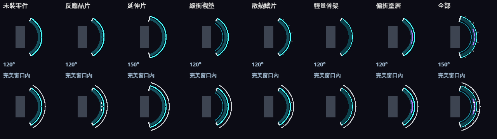
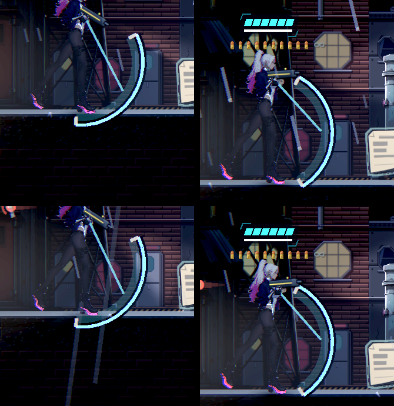

# [NE-269] 格擋改成機械臂展開的臂盾並有專屬姿勢與升級

> 狀態：進行中（臂盾零件的規則、資料、改裝頁與存檔已交付；臂盾零件圖與專屬姿勢等角色美術）

## 內文

### 需求
格擋時主角沒有專屬姿勢：手照常舉槍，只是上身前傾、兩腳換站法，看起來像歪著站；擋的東西是一道浮在身前的弧形光盾，不像是她拿出來的。放開格擋走路反而正常。

把格擋改成主角真的拿東西出來擋：機械左臂的前臂裝甲展開成一面臂盾，有舉盾、完美格擋、被打穿與舉盾移動的專屬動作；臂盾可以用零件升級，改變完美格擋的容錯、可擋的範圍、防禦量、回復、移動速度與能不能把子彈彈回去。

現況數字、查到的業界做法與採用方向見[格擋改成「主角拿東西出來擋」](../../design/15-combat-feel/GUARD_ARM.md)。

格擋的規則與「呈現」已經分開（2026-10-12，NE-239）：擋不擋得住、完美格擋的時間窗、防禦量與破盾都由主角判定，畫面只負責畫出來。臂盾做好之後換掉呈現那一層即可，不必動規則；每一格可以讀到的狀態、會收到的事件、臂盾要接在哪裡、以及需要的零件圖與姿勢（名稱、大小），見設計文件的「交接：格擋的語義與呈現介面」一節。新圖完成前畫面維持現在的光盾。

### 來源
2026-10-11，使用者：「為什麼格擋的時候角色會傾斜然後沒有專屬姿勢？好奇怪，但格擋後走路反而蠻正常的。可以把格擋改成不是這種浮在空中的護盾，而是改成主角拿什麼出來擋，符合賽博龐克世界觀的東西（也可以升級，升級能夠改變格擋容錯、範圍大小等等的），參考一下別人是怎麼做的，行業最佳實例是什麼」。並指示排在手上這張票（NE-222）做完之後開始。

### 驗收條件
- [ ] 按住格擋時，凜的機械左臂展開臂盾橫在身前，另一手持槍收在腰側；脊椎直立、沒有整個人往前歪。兩個面向、遊戲與過場兩種倍率各附原生截圖，並放大看過肩、肘、腕與盾的接合。
- [ ] 臂盾是實體零件：展開與收回各有短動作，盾面跟著瞄準方向上下轉；原本浮在空中的弧形光盾不再出現。
- [x] 畫面上盾遮住的範圍和實際可擋的角度一致：從盾遮不到的方向打過來的攻擊擋不住，附量測或測試。
- [ ] 完美格擋、被打穿各有專屬動作，和一般舉盾分得出來；舉著盾移動時下半身是正常步伐，不滑步、不原地踏。
- [ ] 持各種槍、近戰武器與空手時，舉盾都不會和武器或另一隻手穿插；放開格擋後回到原本的持武器姿勢，沒有跳一下。
- [x] 至少四種臂盾零件可以升級並各自改變一項：完美格擋時間窗、可擋角度、防禦量上限或硬直、回復速度、舉盾移動速度、把子彈彈回去。每一項在畫面上看得出差別。
- [x] 所有數值在資料檔，改數字不用改程式；資料遺失或數值不合理時記錄錯誤並退回預設值。
- [x] 選單與提示用一句話說明臂盾與每個零件做什麼。
- [x] 現有的格擋規則（防禦量、低於門檻舉不起來、連按縮短時間窗、完美格擋的回饋）沒有被破壞；相關測試全過。
- [ ] 通過角色製作 Skill 的固定檢查：輪廓檢查 0 項、逐格接點稽核的數字記在票上、動畫稽核通過。

### 測試流程
1. 站著按住格擋，兩個面向各看一次，上下瞄準看盾面跟著轉。
2. 舉著盾前後移動、跳、落地；放開後確認回到原本姿勢。
3. 讓敵人從正面、斜上、背後各打一次，確認擋得住與擋不住的方向和畫面一致。
4. 在時間窗內與時間窗外各擋一次，看完美格擋與一般格擋的差別；把防禦量擋到歸零看被打穿。
5. 逐一裝上每個零件，重做第 3、4 步，確認數值與外觀都變了。
6. 執行受影響範圍的測試。

---

# 跟其他票的關係

- Blocks：NE-231
- Blocked by：NE-222
- Related：NE-257、NE-264、NE-268、NE-239

---

---

# Commit-1（臂盾零件：規則、資料、改裝頁、存檔與呈現）

## 內文

**問題**：格擋沒有任何升級，數值寫死在主角的設定裡；設計文件定了六種臂盾零件，但遊戲裡買不到、也沒有規則。

**改動**
- 六個臂盾零件，每個是一份資料（效果、數值、價格、一句話說明），在背包「改裝」頁武器改裝的後面購買，買了立刻生效、跟著檢查點保存：
  - 反應晶片：完美格擋時間窗 0.16 → 0.21 秒（連按縮短的規則照舊）
  - 延伸片：擋得住的角度 120° → 150°，畫出的盾面同步加寬
  - 緩衝襯墊：防禦量上限 100 → 130，被打穿的硬直縮短 30%
  - 散熱鰭片：擋完後開始回復的等待減半、回復快 50%
  - 輕量骨架：舉盾移動速度 35% → 60%
  - 偏折塗層：一般格擋擋下的子彈也彈回去（完美格擋本來就會反彈，所以不改它）
- 改裝頁每個零件都顯示裝上前後的數值；說明與提示都是一句話；買了之後畫面上也說明零件做什麼。
- 目前的光盾依零件畫出差別：指示燈（完美窗口內亮）、較寬的盾面與加長端片、盾背內襯、外緣散熱鰭、較薄的盾框、紫色反光。臂盾零件圖做好後，呈現層換成實體臂盾，零件清單已經交給呈現層。
- 數值有上下限（時間窗 ≤ 0.3 秒、角度 ≤ 200°、移動 ≤ 90%、硬直 ≥ 0.15 秒）。零件資料不合理（超出範圍、缺說明）時記錄檔案與欄位，不列入商店，存檔也不認；存檔裡的零件欄位壞掉時視為沒有零件。
- 存檔只有買過零件才多一個欄位，沒買時和以前完全一樣；嚴格載入會拒絕不存在或重複的零件。
- 跨章帳本的防禦類加入六個零件（共 840，全部選購）；武器改裝的必要／選購合計沒有變。

**驗收**
- 同一個場景沒裝與全裝各打一次：前上方 68° 斜射的子彈，沒裝時打到人（120° 擋不到）、裝延伸片後擋住；畫出的盾面 120° → 150°；一般格擋的子彈只有裝偏折塗層時彈回；完美窗口 0.16 → 0.21 秒；舉盾移動 52 → 90 px/s；防禦上限 100 → 130。
- 每個零件只改自己那一項數值（其他數值逐項比對不變）；沒裝零件時每個數值都等於原本的設定。
- 原本的格擋規則（防禦量、低於門檻舉不起來、連按縮短時間窗、完美格擋反彈與暈眩、破防）與 NE-239 的盾面測試全部照舊通過。

**還沒做（等角色美術，NE-222 之後）**：機械臂展開的臂盾零件圖（收合、展開三段、裂開）、舉盾／完美格擋外撥／被打穿後仰／舉盾走路的專屬姿勢，以及這些姿勢的接點稽核。第 1、2、4、5、10 條因此未勾。

### 測試結果

| 項目 | 結果 |
|---|---|
| 受影響範圍（78 組） | 92,754 項，0 新失敗、0 已知失敗，無腳本錯誤，731 秒 |
| 盾牌套件（含新增三組臂盾檢查） | 416 項，0 失敗 |
| 經濟、成長、近戰武器套件（帳本加入零件後重跑） | 2,436 項，0 失敗 |

### 截圖

[同一場景沒裝與全裝的量測](attachments/NE-269-arm-shield-parts/rules.json)；工具 `tools/arm_shield_gallery.tscn`、`tools/screenshot.tscn --scenario=arm_shield`。

