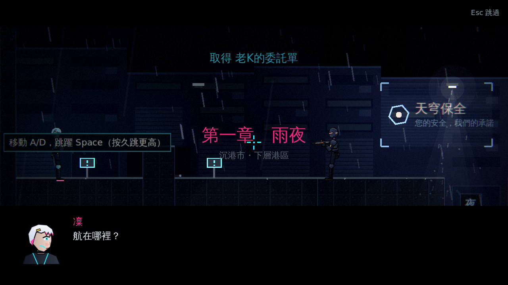
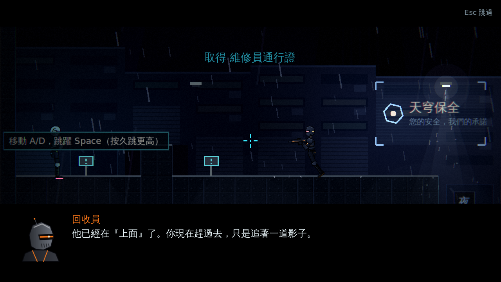
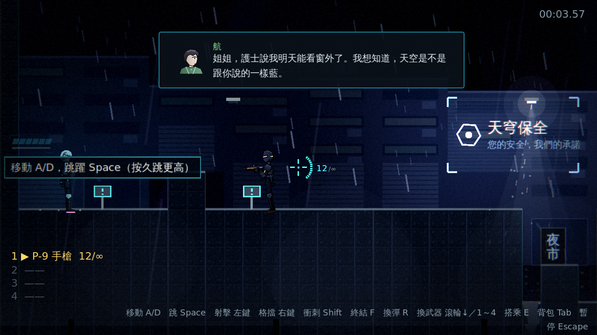
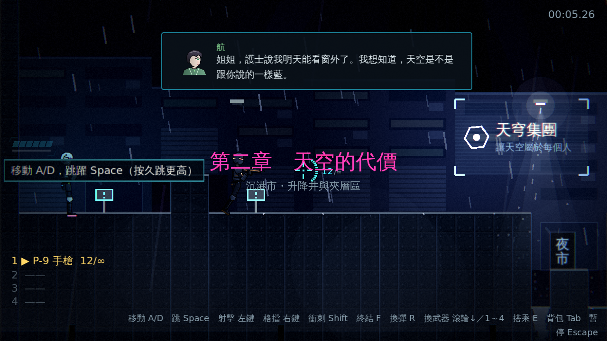

# [NE-26] 撰寫第二章劇本與世界觀

> 狀態：完成

## 內文

### 需求
第一章結尾預告「天空的代價」，需要完整的第二章劇本與設定，包含新角色與新場景的世界觀。延續主題：每一章都讓「上去」變得更近，也更貴。設計見 `design/09-content/DESIGN.md` 第一節與 `design/04-story/STORY.md`。

### 來源
2026-10-02，使用者於開發對話中提出：「讓遊戲內容更豐富」；確認四個方向都要做（第二章／新關卡、新敵人與新頭目、場景互動與探索、成長系統），順序為先光影再內容。

### 驗收條件
- [x] 劇情文件補上第二章大綱、新角色與新場景設定
- [x] 劇本資料檔含開場、關卡中途通訊、頭目登場與結尾過場，過場每段不超過 6 句、通訊每段 1～2 句
- [x] 劇本內所有講者都有名字、顏色與頭像，新角色補上頭像
- [x] 第二章取得的劇情道具以資料檔定義，並在背包的劇情道具分頁可查看
- [x] 有章節標題、結尾卡與下一章預告

### 測試流程
1. 閱讀劇情文件與劇本，確認與第一章結尾銜接
2. 在對話預覽中逐段播放，確認講者、頭像與文字正確
3. 執行完整測試套件，全部通過

---

# 跟其他票的關係

- Blocks：NE-27、NE-29
- Blocked by：NE-25
- Related：無

---

---

# Commit-1

## 內文

第二章「天空的代價」的劇本與世界觀完成。劇情文件新增第二章大綱、新角色（回收員、航的語音、老K的揭露）與新場景（升降井、夾層區、電力室、轉運站）；劇本資料檔 `chapter_02.json` 有開場、關卡中途 9 段通訊、頭目登場與結尾過場，以及章節標題、結尾卡與下一章預告「雲端之上」。新增講者「航」與「回收員」，各有程式繪製的暫代頭像；新增三個劇情道具（維修員通行證、NEST 名冊殘頁、航的醫療手環），在背包的劇情道具分頁查看。
劇情系統改為多章節：`Story` 讀取 `CHAPTER_PATHS` 的所有章節並合併講者與場景，章節資訊分章查詢，關卡以 `LevelData.chapter` 指定所屬章節；新增 `Story.validate()`，啟動時與測試都會檢查過場每段至多 6 句、通訊每段 1～2 句、講者已定義且有頭像、場景有台詞，違規會記錄具體場景 id。
驗收方式：冒煙測試驗證兩章同時載入、章節資訊完整且各自獨立、第二章過場／講者、劇本守則通過且真的能抓到違規（過場太長、通訊太長、講者未定義）、新增道具資料與圖示；對話預覽截圖。

### 測試結果

| 項目 | 結果 |
|---|---|
| 完整測試套件 | 通過 995 / 995 |
| 劇本守則 | 0 個問題 |
| 執行 log | 無非預期 ERROR |

### 截圖

